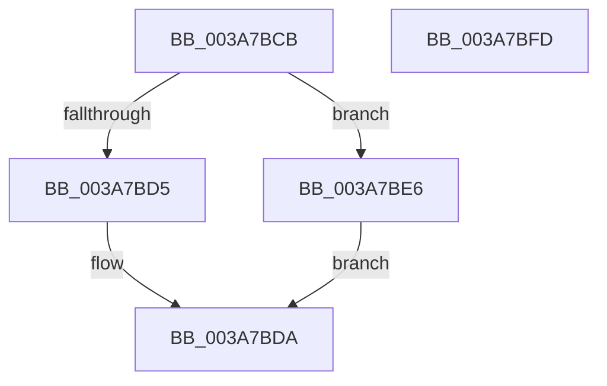

# sub_003A7BCB

- RVA: `0x003A7BCB`–`0x003A7C07` (길이 `60` bytes)
- VA: `0x00000001403A7BCB`
- 실행 섹션: `.text`
- PDB 이름 있음: `아니요`; PDB Function 태그: `아니요`
- unwind 정보 RVA: `0x00089C34`
- 디코드: `13`개 명령, `60/60` bytes 표시
- 미해석 바이트: `0` (있으면 어셈블리에 `.byte`로 보존)

> 이 문서는 커널 이미지의 기계어와 PDB 기호를 분석해 생성했습니다. 4번과 5번은 함수 원형과 자료형을 바이너리 사용 방식에서 추정한 C 해석이며 원본 소스 복구 결과는 아닙니다.

## 1. Dependencies

- 직접 호출 지점: **0**; 고유 호출 대상: **0**
- 직접 호출자로 확인된 함수: **0**
- RIP 상대 이미지 참조: **0**

### Outgoing calls
- 직접 디코드된 call 명령이 없습니다.

### Direct callers
- 이 함수 시작 RVA로 연결되는 직접 call은 확인되지 않았습니다. 간접 호출은 완전히 역산할 수 없습니다.

### Static image references
- 디코드된 RIP-relative 메모리 참조가 없습니다.

## 2. Other-region calls and transfers

- 다른 실행 섹션으로 향하는 call: **0**
- call이 아닌 외부 분기/꼬리 이동: **2**
  - `0x003A7BE1` → [sub_003A7809 + 0x15E](Unknown_function_003A7809.md) (`tail-transfer`)
  - `0x003A7C02` → [sub_003A7809 + 0x15E](Unknown_function_003A7809.md) (`tail-transfer`)

## 3. Assembly (complete function range)

```asm
003A7BCB  83 BC 24 B0 00 00 00 10         cmp dword ptr [rsp + 0xb0], 0x10
003A7BD3  73 11                           jae 0x1403a7be6
003A7BD5  B8 23 00 00 C0                  mov eax, 0xc0000023
003A7BDA  41 C7 07 10 00 00 00            mov dword ptr [r15], 0x10
003A7BE1  E9 81 FD FF FF                  jmp 0x1403a7967
003A7BE6  48 8B 84 24 A8 00 00 00         mov rax, qword ptr [rsp + 0xa8]
003A7BEE  0F 57 C0                        xorps xmm0, xmm0
003A7BF1  0F 11 00                        movups xmmword ptr [rax], xmm0
003A7BF4  66 C7 00 01 00                  mov word ptr [rax], 1
003A7BF9  8B C3                           mov eax, ebx
003A7BFB  EB DD                           jmp 0x1403a7bda
003A7BFD  B8 0D 00 00 C0                  mov eax, 0xc000000d
003A7C02  E9 60 FD FF FF                  jmp 0x1403a7967
```

## 4. C-style interpretation (structured pseudocode)

```c
__int64 __fastcall sub_003A7BCB(__int64 a1, __int64 a2, __int64 a3, __int64 a4, __int64 a5, __int64 a6, __int64 a7, __int64 a8, __int64 a9, __int64 a10, __int64 a11, __int64 a12, __int64 a13, __int64 a14, __int64 a15, __int64 a16, __int64 a17, __int64 a18, __int64 a19, __int64 a20, __int64 a21, unsigned int a22)
{
    if (a22 >= 16) goto loc_003A7BE6;
loc_003A7BDA:
    *(unsigned int *)(v_r15) = 16;
loc_003A7BE6:
    *(unsigned __int64 *)(a21) = v_xmm0;
    *(unsigned __int16 *)(a21) = 1;
    goto loc_003A7BDA;
}
```

## 5. (Beta) C Style

```c
int64_t sub_003A7BCB(int64_t Arg1, int64_t Arg2, int64_t Arg3, int64_t Arg4, uint64_t Arg5, uint64_t Arg6, uint64_t Arg7, uint64_t Arg8, uint64_t Arg9, uint64_t Arg10, uint64_t Arg11, uint64_t Arg12, uint64_t Arg13, uint64_t Arg14, uint64_t Arg15, uint64_t Arg16, uint64_t Arg17, uint64_t Arg18, uint64_t Arg19, uint64_t Arg20, void *Arg21, uint32_t Arg22)
{
    uint8_t *arg21 = (uint8_t *)Arg21;

    if (Arg22 >= 16) goto loc_003A7BE6;
loc_003A7BDA:
    *(uint32_t *)(local_r15) = 16;
loc_003A7BE6:
    *(uint64_t *)(arg21) = v_xmm0;
    *(uint16_t *)(arg21) = 1;
    goto loc_003A7BDA;
}
```

### 관측된 메모리 오프셋

구조체 형식이 확인되지 않은 접근은 인자 기준의 오프셋으로만 기록했습니다.

| 기준 인자 | 오프셋 표현 | 폭 (bit) | 접근 |
|---|---:|---:|---|
| `Arg21` | `+ 0x0` | `16` | `W` |
| `Arg21` | `+ 0x0` | `128` | `R` |

## 6. Execution-region graph

[열기: 2D/3D 그래프와 함수 탐색 컨트롤 패널](../../../control-panel.html?section=text&rva=0x003A7BCB&view=graph)

- 2D 그래프는 위에서 아래로 흐르고, 3D 그래프는 빈 공간을 드래그해 회전합니다. Shift+드래그는 이동, 휠은 확대·축소, 함수 노드 선택은 대상 보고서 이동입니다.

### Static fallback


