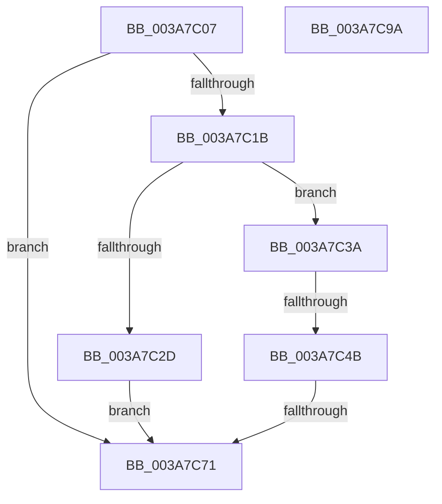

# sub_003A7C07

- RVA: `0x003A7C07`–`0x003A7C9B` (길이 `148` bytes)
- VA: `0x00000001403A7C07`
- 실행 섹션: `.text`
- PDB 이름 있음: `아니요`; PDB Function 태그: `아니요`
- unwind 정보 RVA: `0x00089C4C`
- 디코드: `42`개 명령, `148/148` bytes 표시
- 미해석 바이트: `0` (있으면 어셈블리에 `.byte`로 보존)

> 이 문서는 커널 이미지의 기계어와 PDB 기호를 분석해 생성했습니다. 4번과 5번은 함수 원형과 자료형을 바이너리 사용 방식에서 추정한 C 해석이며 원본 소스 복구 결과는 아닙니다.

## 1. Dependencies

- 직접 호출 지점: **7**; 고유 호출 대상: **6**
- 직접 호출자로 확인된 함수: **0**
- RIP 상대 이미지 참조: **0**

### Outgoing calls
- `0x003A7C0E` → [SepGetSingletonEntryFromIndexNumber](../2F/SepGetSingletonEntryFromIndexNumber_function_002F095C.md) (function, `0x002F095C`)
- `0x003A7C1E` → [ExAcquireSpinLockShared](../24/ExAcquireSpinLockShared_function_0024DCE0.md) (function, `0x0024DCE0`)
- `0x003A7C33` → [ExReleaseSpinLockShared](../2F/ExReleaseSpinLockShared_function_002F0EF0.md) (function, `0x002F0EF0`)
- `0x003A7C3A` → [AuthzBasepAllocateSecurityAttributesList](../30/AuthzBasepAllocateSecurityAttributesList_function_003013F4.md) (function, `0x003013F4`)
- `0x003A7C55` → [AuthzBasepDuplicateSecurityAttributes](../30/AuthzBasepDuplicateSecurityAttributes_function_003023C0.md) (function, `0x003023C0`)
- `0x003A7C63` → [ExReleaseSpinLockShared](../2F/ExReleaseSpinLockShared_function_002F0EF0.md) (function, `0x002F0EF0`)
- `0x003A7C88` → [SepInternalFillNoAttribs](SepInternalFillNoAttribs_function_003A8BBC.md) (function, `0x003A8BBC`)

### Direct callers
- 이 함수 시작 RVA로 연결되는 직접 call은 확인되지 않았습니다. 간접 호출은 완전히 역산할 수 없습니다.

### Static image references
- 디코드된 RIP-relative 메모리 참조가 없습니다.

## 2. Other-region calls and transfers

- 다른 실행 섹션으로 향하는 call: **0**
- call이 아닌 외부 분기/꼬리 이동: **2**
  - `0x003A7C45` → [sub_003A7D4D + 0x23](Unknown_function_003A7D4D.md) (`tail-transfer`)
  - `0x003A7C6F` → [sub_003A7CA5 + 0x15](Unknown_function_003A7CA5.md) (`tail-transfer`)

## 3. Assembly (complete function range)

```asm
003A7C07  8B 8C 24 88 00 00 00            mov ecx, dword ptr [rsp + 0x88]
003A7C0E  E8 49 8D F4 FF                  call 0x1402f095c
003A7C13  48 8B D8                        mov rbx, rax
003A7C16  48 85 C0                        test rax, rax
003A7C19  74 56                           je 0x1403a7c71
003A7C1B  48 8B C8                        mov rcx, rax
003A7C1E  E8 BD 60 EA FF                  call 0x14024dce0
003A7C23  48 83 7B 10 00                  cmp qword ptr [rbx + 0x10], 0
003A7C28  0F B6 F0                        movzx esi, al
003A7C2B  75 0D                           jne 0x1403a7c3a
003A7C2D  0F B6 D0                        movzx edx, al
003A7C30  48 8B CB                        mov rcx, rbx
003A7C33  E8 B8 92 F4 FF                  call 0x1402f0ef0
003A7C38  EB 37                           jmp 0x1403a7c71
003A7C3A  E8 B5 97 F5 FF                  call 0x1403013f4
003A7C3F  4C 8B F0                        mov r14, rax
003A7C42  48 85 C0                        test rax, rax
003A7C45  0F 84 25 01 00 00               je 0x1403a7d70
003A7C4B  48 8B 4B 10                     mov rcx, qword ptr [rbx + 0x10]
003A7C4F  45 33 C0                        xor r8d, r8d
003A7C52  48 8B D0                        mov rdx, rax
003A7C55  E8 66 A7 F5 FF                  call 0x1403023c0
003A7C5A  8B E8                           mov ebp, eax
003A7C5C  40 0F B6 D6                     movzx edx, sil
003A7C60  48 8B CB                        mov rcx, rbx
003A7C63  E8 88 92 F4 FF                  call 0x1402f0ef0
003A7C68  B8 25 02 00 C0                  mov eax, 0xc0000225
003A7C6D  3B E8                           cmp ebp, eax
003A7C6F  75 49                           jne 0x1403a7cba
003A7C71  4C 8B 84 24 B8 00 00 00         mov r8, qword ptr [rsp + 0xb8]
003A7C79  48 8B 8C 24 A8 00 00 00         mov rcx, qword ptr [rsp + 0xa8]
003A7C81  8B 94 24 B0 00 00 00            mov edx, dword ptr [rsp + 0xb0]
003A7C88  E8 2F 0F 00 00                  call 0x1403a8bbc
003A7C8D  48 83 C4 48                     add rsp, 0x48
003A7C91  41 5E                           pop r14
003A7C93  41 5C                           pop r12
003A7C95  5F                              pop rdi
003A7C96  5E                              pop rsi
003A7C97  5D                              pop rbp
003A7C98  5B                              pop rbx
003A7C99  C3                              ret
003A7C9A  CC                              int3
```

## 4. C-style interpretation (structured pseudocode)

```c
__int64 __fastcall sub_003A7C07(__int64 a1, __int64 a2, int a3, __int64 a4, __int64 a5, __int64 a6, __int64 a7, __int64 a8, __int64 a9, __int64 a10, __int64 a11, __int64 a12, __int64 a13, __int64 a14, __int64 a15, __int64 a16, unsigned int a17, __int64 a18, __int64 a19, __int64 a20, __int64 a21, unsigned int a22, __int64 a23)
{
    __int64 result;
    __int64 v_rsp;

    result = SepGetSingletonEntryFromIndexNumber((unsigned int)(a17), a2, a3, a4);
    if (result == 0) goto loc_003A7C71;
    result = ExAcquireSpinLockShared(result, a2, a3, a4);
    if ((*(unsigned __int64 *)(result + 16)) != 0) goto loc_003A7C3A;
    result = ExReleaseSpinLockShared(result, (unsigned __int8)(result), a3, a4);
    goto loc_003A7C71;
loc_003A7C3A:
    result = AuthzBasepAllocateSecurityAttributesList(result, (unsigned __int8)(result), a3, a4);
    a3 = 0;
    result = AuthzBasepDuplicateSecurityAttributes(*(unsigned __int64 *)(result + 16), result, a3, a4);
    result = ExReleaseSpinLockShared(result, (unsigned __int8)((unsigned __int8)(result)), a3, a4);
loc_003A7C71:
    result = SepInternalFillNoAttribs(a21, (unsigned int)(a22), a23, a4);
    v_rsp = (v_rsp) + (72);
    return result;
}
```

## 5. (Beta) C Style

```c
int64_t sub_003A7C07(int64_t Arg1, int64_t Arg2, int32_t Arg3, int64_t Arg4, uint64_t Arg5, uint64_t Arg6, uint64_t Arg7, uint64_t Arg8, uint64_t Arg9, uint64_t Arg10, uint64_t Arg11, uint64_t Arg12, uint64_t Arg13, uint64_t Arg14, uint64_t Arg15, uint64_t Arg16, uint32_t Arg17, uint64_t Arg18, uint64_t Arg19, uint64_t Arg20, int64_t Arg21, uint32_t Arg22, int64_t Arg23)
{
    int64_t result;
    int64_t local_rsp;

    result = SepGetSingletonEntryFromIndexNumber((uint32_t)(Arg17), Arg2, Arg3, Arg4);
    if (result == 0) goto loc_003A7C71;
    result = ExAcquireSpinLockShared(result, Arg2, Arg3, Arg4);
    if ((*(uint64_t *)(result + 0x10)) != 0) goto loc_003A7C3A;
    result = ExReleaseSpinLockShared(result, (uint8_t)(result), Arg3, Arg4);
    goto loc_003A7C71;
loc_003A7C3A:
    result = AuthzBasepAllocateSecurityAttributesList(result, (uint8_t)(result), Arg3, Arg4);
    Arg3 = 0;
    result = AuthzBasepDuplicateSecurityAttributes(*(uint64_t *)(result + 0x10), result, Arg3, Arg4);
    result = ExReleaseSpinLockShared(result, (uint8_t)((uint8_t)(result)), Arg3, Arg4);
loc_003A7C71:
    result = SepInternalFillNoAttribs(Arg21, (uint32_t)(Arg22), Arg23, Arg4);
    local_rsp = (local_rsp) + (72);
    return result;
}
```

## 6. Execution-region graph

[열기: 2D/3D 그래프와 함수 탐색 컨트롤 패널](../../../control-panel.html?section=text&rva=0x003A7C07&view=graph)

- 2D 그래프는 위에서 아래로 흐르고, 3D 그래프는 빈 공간을 드래그해 회전합니다. Shift+드래그는 이동, 휠은 확대·축소, 함수 노드 선택은 대상 보고서 이동입니다.

### Static fallback


