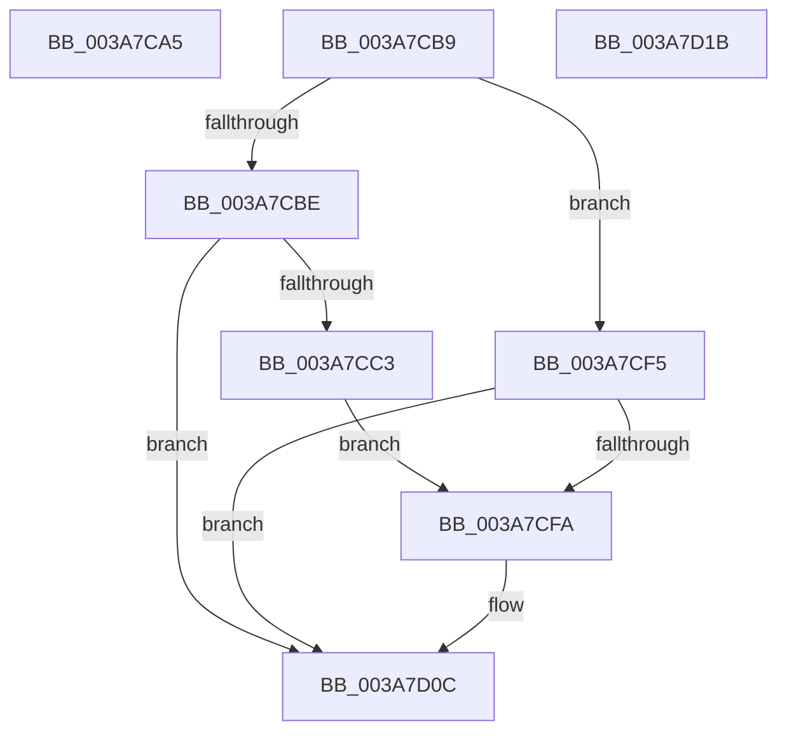

# sub_003A7CA5

- RVA: `0x003A7CA5`–`0x003A7D1C` (길이 `119` bytes)
- VA: `0x00000001403A7CA5`
- 실행 섹션: `.text`
- PDB 이름 있음: `아니요`; PDB Function 태그: `아니요`
- unwind 정보 RVA: `0x00089C78`
- 디코드: `43`개 명령, `119/119` bytes 표시
- 미해석 바이트: `0` (있으면 어셈블리에 `.byte`로 보존)

> 이 문서는 커널 이미지의 기계어와 PDB 기호를 분석해 생성했습니다. 4번과 5번은 함수 원형과 자료형을 바이너리 사용 방식에서 추정한 C 해석이며 원본 소스 복구 결과는 아닙니다.

## 1. Dependencies

- 직접 호출 지점: **3**; 고유 호출 대상: **3**
- 직접 호출자로 확인된 함수: **0**
- RIP 상대 이미지 참조: **0**

### Outgoing calls
- `0x003A7CEC` → [AuthzBasepQuerySecurityAttributesToken](AuthzBasepQuerySecurityAttributesToken_function_003A7D80.md) (function, `0x003A7D80`)
- `0x003A7CFD` → [AuthzBasepFreeSecurityAttributesList](../30/AuthzBasepFreeSecurityAttributesList_function_00301230.md) (function, `0x00301230`)
- `0x003A7D07` → [ExFreePoolWithTag](../../poolcode/B8/ExFreePoolWithTag_function_00B82870.md) (function, `0x00B82870`)

### Direct callers
- 이 함수 시작 RVA로 연결되는 직접 call은 확인되지 않았습니다. 간접 호출은 완전히 역산할 수 없습니다.

### Static image references
- 디코드된 RIP-relative 메모리 참조가 없습니다.

## 2. Other-region calls and transfers

- 다른 실행 섹션으로 향하는 call: **1**
  - `0x003A7D07` → [ExFreePoolWithTag](../../poolcode/B8/ExFreePoolWithTag_function_00B82870.md) (`.text` → `POOLCODE`)
- 별도 외부 분기/꼬리 이동을 확인하지 못했습니다.

## 3. Assembly (complete function range)

```asm
003A7CA5  BB 23 00 00 C0                  mov ebx, 0xc0000023
003A7CAA  8B C3                           mov eax, ebx
003A7CAC  48 83 C4 48                     add rsp, 0x48
003A7CB0  41 5E                           pop r14
003A7CB2  41 5C                           pop r12
003A7CB4  5F                              pop rdi
003A7CB5  5E                              pop rsi
003A7CB6  5D                              pop rbp
003A7CB7  5B                              pop rbx
003A7CB8  C3                              ret
003A7CB9  CC                              int3
003A7CBA  85 ED                           test ebp, ebp
003A7CBC  78 37                           js 0x1403a7cf5
003A7CBE  4D 85 F6                        test r14, r14
003A7CC1  74 49                           je 0x1403a7d0c
003A7CC3  48 8B 84 24 B8 00 00 00         mov rax, qword ptr [rsp + 0xb8]
003A7CCB  44 8B C7                        mov r8d, edi
003A7CCE  4C 8B 8C 24 A8 00 00 00         mov r9, qword ptr [rsp + 0xa8]
003A7CD6  49 8B D4                        mov rdx, r12
003A7CD9  48 89 44 24 28                  mov qword ptr [rsp + 0x28], rax
003A7CDE  49 8B CE                        mov rcx, r14
003A7CE1  8B 84 24 B0 00 00 00            mov eax, dword ptr [rsp + 0xb0]
003A7CE8  89 44 24 20                     mov dword ptr [rsp + 0x20], eax
003A7CEC  E8 8F 00 00 00                  call 0x1403a7d80
003A7CF1  8B E8                           mov ebp, eax
003A7CF3  EB 05                           jmp 0x1403a7cfa
003A7CF5  4D 85 F6                        test r14, r14
003A7CF8  74 12                           je 0x1403a7d0c
003A7CFA  49 8B CE                        mov rcx, r14
003A7CFD  E8 2E 95 F5 FF                  call 0x140301230
003A7D02  33 D2                           xor edx, edx
003A7D04  49 8B CE                        mov rcx, r14
003A7D07  E8 64 AB 7D 00                  call 0x140b82870
003A7D0C  8B C5                           mov eax, ebp
003A7D0E  48 83 C4 48                     add rsp, 0x48
003A7D12  41 5E                           pop r14
003A7D14  41 5C                           pop r12
003A7D16  5F                              pop rdi
003A7D17  5E                              pop rsi
003A7D18  5D                              pop rbp
003A7D19  5B                              pop rbx
003A7D1A  C3                              ret
003A7D1B  CC                              int3
```

## 4. C-style interpretation (structured pseudocode)

```c
__int64 __fastcall sub_003A7CA5(void)
{
    __int64 v_rsp;
    unsigned __int64 v_stack_p120;
    unsigned int v_stack_p128;
    unsigned __int64 v_stack_p130;
    unsigned int v_stack_p98;
    unsigned __int64 v_stack_pA0;

    v_rsp = (v_rsp) + (72);
    return (unsigned int)((unsigned int)((unsigned int)(0xC0000023ULL)));
}
```

## 5. (Beta) C Style

```c
void sub_003A7CA5(void)
{
    int64_t local_rsp;
    uint64_t v_stack_p120;
    uint32_t v_stack_p128;
    uint64_t v_stack_p130;
    uint32_t v_stack_p98;
    uint64_t v_stack_pA0;

    local_rsp = (local_rsp) + (72);
    return (uint32_t)((uint32_t)((uint32_t)(0xC0000023ULL)));
}
```

## 6. Execution-region graph

[열기: 2D/3D 그래프와 함수 탐색 컨트롤 패널](../../../control-panel.html?section=text&rva=0x003A7CA5&view=graph)

- 2D 그래프는 위에서 아래로 흐르고, 3D 그래프는 빈 공간을 드래그해 회전합니다. Shift+드래그는 이동, 휠은 확대·축소, 함수 노드 선택은 대상 보고서 이동입니다.

### Static fallback


