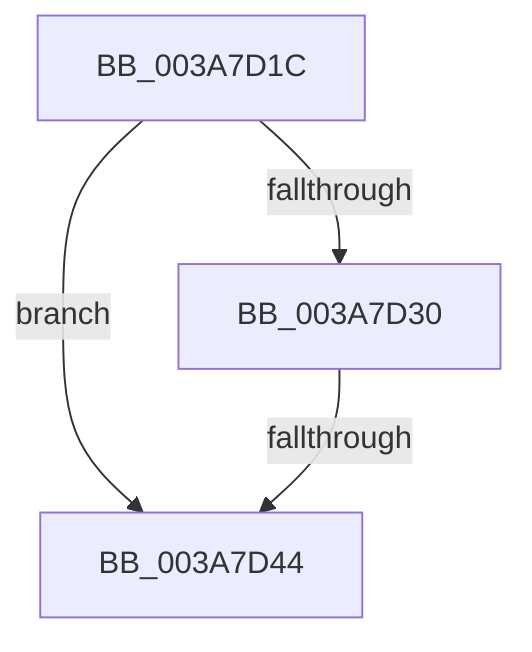

# sub_003A7D1C

- RVA: `0x003A7D1C`–`0x003A7D4D` (길이 `49` bytes)
- VA: `0x00000001403A7D1C`
- 실행 섹션: `.text`
- PDB 이름 있음: `아니요`; PDB Function 태그: `아니요`
- unwind 정보 RVA: `0x00089C90`
- 디코드: `12`개 명령, `49/49` bytes 표시
- 미해석 바이트: `0` (있으면 어셈블리에 `.byte`로 보존)

> 이 문서는 커널 이미지의 기계어와 PDB 기호를 분석해 생성했습니다. 4번과 5번은 함수 원형과 자료형을 바이너리 사용 방식에서 추정한 C 해석이며 원본 소스 복구 결과는 아닙니다.

## 1. Dependencies

- 직접 호출 지점: **1**; 고유 호출 대상: **1**
- 직접 호출자로 확인된 함수: **0**
- RIP 상대 이미지 참조: **0**

### Outgoing calls
- `0x003A7D37` → [AuthzBasepEqualUnicodeString](AuthzBasepEqualUnicodeString_function_003A8A80.md) (function, `0x003A8A80`)

### Direct callers
- 이 함수 시작 RVA로 연결되는 직접 call은 확인되지 않았습니다. 간접 호출은 완전히 역산할 수 없습니다.

### Static image references
- 디코드된 RIP-relative 메모리 참조가 없습니다.

## 2. Other-region calls and transfers

- 다른 실행 섹션으로 향하는 call: **0**
- call이 아닌 외부 분기/꼬리 이동: **2**
  - `0x003A7D3E` → [sub_003A7982 + 0xCF](Unknown_function_003A7982.md) (`tail-transfer`)
  - `0x003A7D48` → [sub_003A7809 + 0xAC](Unknown_function_003A7809.md) (`tail-transfer`)

## 3. Assembly (complete function range)

```asm
003A7D1C  41 8B 45 28                     mov eax, dword ptr [r13 + 0x28]
003A7D20  49 8D 4D F0                     lea rcx, [r13 - 0x10]
003A7D24  48 89 8C 24 80 00 00 00         mov qword ptr [rsp + 0x80], rcx
003A7D2C  A8 01                           test al, 1
003A7D2E  75 14                           jne 0x1403a7d44
003A7D30  48 83 C1 20                     add rcx, 0x20
003A7D34  49 8B D6                        mov rdx, r14
003A7D37  E8 44 0D 00 00                  call 0x1403a8a80
003A7D3C  84 C0                           test al, al
003A7D3E  0F 85 0D FD FF FF               jne 0x1403a7a51
003A7D44  4D 8B 6D 00                     mov r13, qword ptr [r13]
003A7D48  E9 68 FB FF FF                  jmp 0x1403a78b5
```

## 4. C-style interpretation (structured pseudocode)

```c
__int64 __fastcall sub_003A7D1C(void)
{
    __int64 result;
    unsigned __int64 v_stack_p80;

    v_stack_p80 = v_r13 - 16;
    if ((((unsigned __int8)((unsigned int)(*(unsigned int *)(v_r13 + 40)))) & (1)) != 0) goto loc_003A7D44;
    a1 = (v_r13 - 16) + (32);
    result = AuthzBasepEqualUnicodeString(a1, v_r14, a3, a4);
loc_003A7D44:
}
```

## 5. (Beta) C Style

```c
void sub_003A7D1C(void)
{
    int64_t result;
    uint64_t v_stack_p80;

    v_stack_p80 = local_r13 - 16;
    if ((((uint8_t)((uint32_t)(*(uint32_t *)(local_r13 + 0x28)))) & (1)) != 0) goto loc_003A7D44;
    a1 = (local_r13 - 16) + (32);
    result = AuthzBasepEqualUnicodeString(a1, local_r14, a3, a4);
loc_003A7D44:
}
```

## 6. Execution-region graph

[열기: 2D/3D 그래프와 함수 탐색 컨트롤 패널](../../../control-panel.html?section=text&rva=0x003A7D1C&view=graph)

- 2D 그래프는 위에서 아래로 흐르고, 3D 그래프는 빈 공간을 드래그해 회전합니다. Shift+드래그는 이동, 휠은 확대·축소, 함수 노드 선택은 대상 보고서 이동입니다.

### Static fallback


