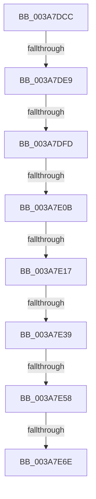

# sub_003A7DCC

- RVA: `0x003A7DCC`–`0x003A7E78` (길이 `172` bytes)
- VA: `0x00000001403A7DCC`
- 실행 섹션: `.text`
- PDB 이름 있음: `아니요`; PDB Function 태그: `아니요`
- unwind 정보 RVA: `0x00089CC8`
- 디코드: `40`개 명령, `172/172` bytes 표시
- 미해석 바이트: `0` (있으면 어셈블리에 `.byte`로 보존)

> 이 문서는 커널 이미지의 기계어와 PDB 기호를 분석해 생성했습니다. 4번과 5번은 함수 원형과 자료형을 바이너리 사용 방식에서 추정한 C 해석이며 원본 소스 복구 결과는 아닙니다.

## 1. Dependencies

- 직접 호출 지점: **0**; 고유 호출 대상: **0**
- 직접 호출자로 확인된 함수: **0**
- RIP 상대 이미지 참조: **0**

### Outgoing calls
- 직접 디코드된 call 명령이 없습니다.

### Direct callers
- 이 함수 시작 RVA로 연결되는 직접 call은 확인되지 않았습니다. 간접 호출은 완전히 역산할 수 없습니다.

### Static image references
- 디코드된 RIP-relative 메모리 참조가 없습니다.

## 2. Other-region calls and transfers

- 다른 실행 섹션으로 향하는 call: **0**
- call이 아닌 외부 분기/꼬리 이동: **8**
  - `0x003A7DE3` → [sub_003A7F1E](Unknown_function_003A7F1E.md) (`tail-transfer`)
  - `0x003A7DF7` → [sub_003A7F1E + 0x142](Unknown_function_003A7F1E.md) (`tail-transfer`)
  - `0x003A7E05` → [sub_003A7F1E + 0x142](Unknown_function_003A7F1E.md) (`tail-transfer`)
  - `0x003A7E11` → [sub_003A7F1E + 0x11A](Unknown_function_003A7F1E.md) (`tail-transfer`)
  - `0x003A7E37` → [sub_003A7EB8](Unknown_function_003A7EB8.md) (`tail-transfer`)
  - `0x003A7E52` → [sub_003A80B2 + 0x14](Unknown_function_003A80B2.md) (`tail-transfer`)
  - `0x003A7E68` → [sub_003A7F1E + 0xCF](Unknown_function_003A7F1E.md) (`tail-transfer`)
  - `0x003A7E73` → [sub_003A7EB8 + 0x49](Unknown_function_003A7EB8.md) (`tail-transfer`)

## 3. Assembly (complete function range)

```asm
003A7DCC  48 89 5C 24 58                  mov qword ptr [rsp + 0x58], rbx
003A7DD1  B9 28 00 00 00                  mov ecx, 0x28
003A7DD6  48 89 74 24 50                  mov qword ptr [rsp + 0x50], rsi
003A7DDB  4C 89 74 24 48                  mov qword ptr [rsp + 0x48], r14
003A7DE0  4D 85 ED                        test r13, r13
003A7DE3  0F 84 35 01 00 00               je 0x1403a7f1e
003A7DE9  48 8B C5                        mov rax, rbp
003A7DEC  48 89 7C 24 38                  mov qword ptr [rsp + 0x38], rdi
003A7DF1  48 F7 E1                        mul rcx
003A7DF4  48 85 D2                        test rdx, rdx
003A7DF7  0F 85 63 02 00 00               jne 0x1403a8060
003A7DFD  4C 8D 70 10                     lea r14, [rax + 0x10]
003A7E01  49 83 FE 10                     cmp r14, 0x10
003A7E05  0F 82 55 02 00 00               jb 0x1403a8060
003A7E0B  44 8B E7                        mov r12d, edi
003A7E0E  44 3B E5                        cmp r12d, ebp
003A7E11  0F 83 21 02 00 00               jae 0x1403a8038
003A7E17  48 8B B4 24 90 00 00 00         mov rsi, qword ptr [rsp + 0x90]
003A7E1F  45 8B FC                        mov r15d, r12d
003A7E22  49 C1 E7 04                     shl r15, 4
003A7E26  4D 03 FD                        add r15, r13
003A7E29  4C 8B EF                        mov r13, rdi
003A7E2C  48 8B 5E 08                     mov rbx, qword ptr [rsi + 8]
003A7E30  48 83 C6 08                     add rsi, 8
003A7E34  48 3B DE                        cmp rbx, rsi
003A7E37  75 7F                           jne 0x1403a7eb8
003A7E39  48 8B 9C 24 90 00 00 00         mov rbx, qword ptr [rsp + 0x90]
003A7E41  8B AC 24 A0 00 00 00            mov ebp, dword ptr [rsp + 0xa0]
003A7E48  48 83 C3 20                     add rbx, 0x20
003A7E4C  48 8B 33                        mov rsi, qword ptr [rbx]
003A7E4F  48 3B F3                        cmp rsi, rbx
003A7E52  0F 85 6E 02 00 00               jne 0x1403a80c6
003A7E58  40 0F B6 C7                     movzx eax, dil
003A7E5C  84 C0                           test al, al
003A7E5E  48 8B CF                        mov rcx, rdi
003A7E61  49 0F 45 CD                     cmovne rcx, r13
003A7E65  48 85 C9                        test rcx, rcx
003A7E68  0F 85 7F 01 00 00               jne 0x1403a7fed
003A7E6E  B8 25 02 00 C0                  mov eax, 0xc0000225
003A7E73  E9 89 00 00 00                  jmp 0x1403a7f01
```

## 4. C-style interpretation (structured pseudocode)

```c
__int64 __fastcall sub_003A7DCC(__int64 a1, __int64 a2, __int64 a3, __int64 a4, __int64 a5, __int64 a6, __int64 a7, __int64 a8, __int64 a9, __int64 a10, __int64 a11, __int64 a12, __int64 a13, __int64 a14, __int64 a15, __int64 a16, __int64 a17, __int64 a18, __int64 a19, unsigned int a20)
{
    __int64 v_r15;
    __int64 v_rbx;
    __int64 v_rsi;
    unsigned __int64 v_stack_p38;
    unsigned __int64 v_stack_p48;
    unsigned __int64 v_stack_p50;
    unsigned __int64 v_stack_p58;

    v_stack_p58 = v_rbx;
    v_stack_p50 = v_rsi;
    v_stack_p48 = v_r14;
    v_stack_p38 = v_rdi;
    v_r15 = ((unsigned int)((unsigned int)((unsigned int)((unsigned int)(v_rdi))))) << (4);
    v_r15 = (v_r15) + (v_r13);
    v_rsi = (a18) + (8);
    v_rbx = (a18) + (32);
    a1 = v_rdi;
    if ((unsigned __int8)((unsigned __int8)(v_rdi)) != 0) { a1 = v_rdi; }
}
```

## 5. (Beta) C Style

```c
int64_t sub_003A7DCC(int64_t Arg1, int64_t Arg2, int64_t Arg3, int64_t Arg4, uint64_t Arg5, uint64_t Arg6, uint64_t Arg7, uint64_t Arg8, uint64_t Arg9, uint64_t Arg10, uint64_t Arg11, uint64_t Arg12, uint64_t Arg13, uint64_t Arg14, uint64_t Arg15, uint64_t Arg16, uint64_t Arg17, void *Arg18, uint64_t Arg19, uint32_t Arg20)
{
    uint8_t *arg18 = (uint8_t *)Arg18;

    int64_t local_r15;
    int64_t local_rbx;
    int64_t local_rsi;
    uint64_t v_stack_p38;
    uint64_t v_stack_p48;
    uint64_t v_stack_p50;
    uint64_t v_stack_p58;

    v_stack_p58 = local_rbx;
    v_stack_p50 = local_rsi;
    v_stack_p48 = local_r14;
    v_stack_p38 = local_rdi;
    local_r15 = ((uint32_t)((uint32_t)((uint32_t)((uint32_t)(local_rdi))))) << (4);
    local_r15 = (local_r15) + (local_r13);
    local_rsi = (Arg18) + (8);
    local_rbx = (Arg18) + (32);
    Arg1 = local_rdi;
    if ((uint8_t)((uint8_t)(local_rdi)) != 0) { Arg1 = local_rdi; }
}
```

### 관측된 메모리 오프셋

구조체 형식이 확인되지 않은 접근은 인자 기준의 오프셋으로만 기록했습니다.

| 기준 인자 | 오프셋 표현 | 폭 (bit) | 접근 |
|---|---:|---:|---|
| `Arg18` | `+ 0x0` | `64` | `R` |
| `Arg18` | `+ 0x8` | `64` | `R` |

## 6. Execution-region graph

[열기: 2D/3D 그래프와 함수 탐색 컨트롤 패널](../../../control-panel.html?section=text&rva=0x003A7DCC&view=graph)

- 2D 그래프는 위에서 아래로 흐르고, 3D 그래프는 빈 공간을 드래그해 회전합니다. Shift+드래그는 이동, 휠은 확대·축소, 함수 노드 선택은 대상 보고서 이동입니다.

### Static fallback


