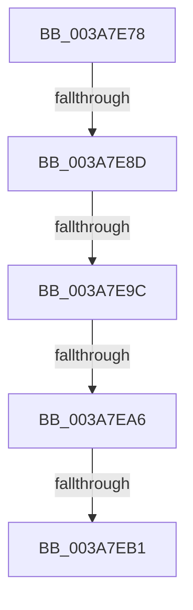

# sub_003A7E78

- RVA: `0x003A7E78`–`0x003A7EB8` (길이 `64` bytes)
- VA: `0x00000001403A7E78`
- 실행 섹션: `.text`
- PDB 이름 있음: `아니요`; PDB Function 태그: `아니요`
- unwind 정보 RVA: `0x00089CE4`
- 디코드: `14`개 명령, `64/64` bytes 표시
- 미해석 바이트: `0` (있으면 어셈블리에 `.byte`로 보존)

> 이 문서는 커널 이미지의 기계어와 PDB 기호를 분석해 생성했습니다. 4번과 5번은 함수 원형과 자료형을 바이너리 사용 방식에서 추정한 C 해석이며 원본 소스 복구 결과는 아닙니다.

## 1. Dependencies

- 직접 호출 지점: **0**; 고유 호출 대상: **0**
- 직접 호출자로 확인된 함수: **0**
- RIP 상대 이미지 참조: **0**

### Outgoing calls
- 직접 디코드된 call 명령이 없습니다.

### Direct callers
- 이 함수 시작 RVA로 연결되는 직접 call은 확인되지 않았습니다. 간접 호출은 완전히 역산할 수 없습니다.

### Static image references
- 디코드된 RIP-relative 메모리 참조가 없습니다.

## 2. Other-region calls and transfers

- 다른 실행 섹션으로 향하는 call: **0**
- call이 아닌 외부 분기/꼬리 이동: **5**
  - `0x003A7E87` → [sub_003A806A + 0x35](Unknown_function_003A806A.md) (`tail-transfer`)
  - `0x003A7E96` → [sub_003A806A + 0x35](Unknown_function_003A806A.md) (`tail-transfer`)
  - `0x003A7EA0` → [sub_003A806A + 0x35](Unknown_function_003A806A.md) (`tail-transfer`)
  - `0x003A7EAB` → [sub_003A806A + 0x35](Unknown_function_003A806A.md) (`tail-transfer`)
  - `0x003A7EB3` → [AuthzBasepQuerySecurityAttributesToken + 0x44](AuthzBasepQuerySecurityAttributesToken_function_003A7D80.md) (`tail-transfer`)

## 3. Assembly (complete function range)

```asm
003A7E78  8B C1                           mov eax, ecx
003A7E7A  48 03 C0                        add rax, rax
003A7E7D  45 0F B7 44 C5 00               movzx r8d, word ptr [r13 + rax*8]
003A7E83  66 45 85 C0                     test r8w, r8w
003A7E87  0F 84 12 02 00 00               je 0x1403a809f
003A7E8D  41 0F B7 54 C5 02               movzx edx, word ptr [r13 + rax*8 + 2]
003A7E93  66 85 D2                        test dx, dx
003A7E96  0F 84 03 02 00 00               je 0x1403a809f
003A7E9C  66 44 3B C2                     cmp r8w, dx
003A7EA0  0F 87 F9 01 00 00               ja 0x1403a809f
003A7EA6  49 39 7C C5 08                  cmp qword ptr [r13 + rax*8 + 8], rdi
003A7EAB  0F 84 EE 01 00 00               je 0x1403a809f
003A7EB1  FF C1                           inc ecx
003A7EB3  E9 0C FF FF FF                  jmp 0x1403a7dc4
```

## 4. C-style interpretation (structured pseudocode)

```c
__int64 __fastcall sub_003A7E78(int a1)
{
    __int64 result;

    result = ((unsigned int)(a1)) + ((unsigned int)(a1));
    a1 = (unsigned int)((a1) + 1);
}
```

## 5. (Beta) C Style

```c
int64_t sub_003A7E78(int32_t Arg1)
{
    int64_t result;

    result = ((uint32_t)(Arg1)) + ((uint32_t)(Arg1));
    Arg1 = (uint32_t)((Arg1) + 1);
}
```

## 6. Execution-region graph

[열기: 2D/3D 그래프와 함수 탐색 컨트롤 패널](../../../control-panel.html?section=text&rva=0x003A7E78&view=graph)

- 2D 그래프는 위에서 아래로 흐르고, 3D 그래프는 빈 공간을 드래그해 회전합니다. Shift+드래그는 이동, 휠은 확대·축소, 함수 노드 선택은 대상 보고서 이동입니다.

### Static fallback


