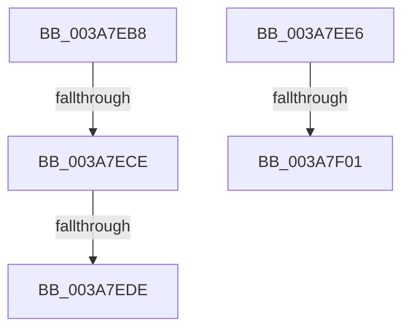

# sub_003A7EB8

- RVA: `0x003A7EB8`–`0x003A7F10` (길이 `88` bytes)
- VA: `0x00000001403A7EB8`
- 실행 섹션: `.text`
- PDB 이름 있음: `아니요`; PDB Function 태그: `아니요`
- unwind 정보 RVA: `0x00089CF4`
- 디코드: `20`개 명령, `88/88` bytes 표시
- 미해석 바이트: `0` (있으면 어셈블리에 `.byte`로 보존)

> 이 문서는 커널 이미지의 기계어와 PDB 기호를 분석해 생성했습니다. 4번과 5번은 함수 원형과 자료형을 바이너리 사용 방식에서 추정한 C 해석이며 원본 소스 복구 결과는 아닙니다.

## 1. Dependencies

- 직접 호출 지점: **1**; 고유 호출 대상: **1**
- 직접 호출자로 확인된 함수: **0**
- RIP 상대 이미지 참조: **0**

### Outgoing calls
- `0x003A7ED1` → [RtlEqualUnicodeString](../../page/93/RtlEqualUnicodeString_function_00932A20.md) (function, `0x00932A20`)

### Direct callers
- 이 함수 시작 RVA로 연결되는 직접 call은 확인되지 않았습니다. 간접 호출은 완전히 역산할 수 없습니다.

### Static image references
- 디코드된 RIP-relative 메모리 참조가 없습니다.

## 2. Other-region calls and transfers

- 다른 실행 섹션으로 향하는 call: **1**
  - `0x003A7ED1` → [RtlEqualUnicodeString](../../page/93/RtlEqualUnicodeString_function_00932A20.md) (`.text` → `PAGE`)
- call이 아닌 외부 분기/꼬리 이동: **4**
  - `0x003A7EC8` → [sub_003A80B2](Unknown_function_003A80B2.md) (`tail-transfer`)
  - `0x003A7ED8` → [sub_003A7F1E + 0xC8](Unknown_function_003A7F1E.md) (`tail-transfer`)
  - `0x003A7EE1` → [sub_003A7DCC + 0x68](Unknown_function_003A7DCC.md) (`tail-transfer`)
  - `0x003A7EFB` → [sub_003A7F1E + 0x7F](Unknown_function_003A7F1E.md) (`tail-transfer`)

## 3. Assembly (complete function range)

```asm
003A7EB8  4C 8B EB                        mov r13, rbx
003A7EBB  48 8D 4B 20                     lea rcx, [rbx + 0x20]
003A7EBF  44 0F 20 C0                     mov rax, cr8
003A7EC3  49 8B D7                        mov rdx, r15
003A7EC6  3C 02                           cmp al, 2
003A7EC8  0F 83 E4 01 00 00               jae 0x1403a80b2
003A7ECE  41 B0 01                        mov r8b, 1
003A7ED1  E8 4A AB 58 00                  call 0x140932a20
003A7ED6  84 C0                           test al, al
003A7ED8  0F 85 08 01 00 00               jne 0x1403a7fe6
003A7EDE  48 8B 1B                        mov rbx, qword ptr [rbx]
003A7EE1  E9 4E FF FF FF                  jmp 0x1403a7e34
003A7EE6  4C 8B BC 24 B8 00 00 00         mov r15, qword ptr [rsp + 0xb8]
003A7EEE  4C 8B A4 24 A8 00 00 00         mov r12, qword ptr [rsp + 0xa8]
003A7EF6  48 8B DF                        mov rbx, rdi
003A7EF9  85 C0                           test eax, eax
003A7EFB  0F 89 9C 00 00 00               jns 0x1403a7f9d
003A7F01  48 8B 74 24 50                  mov rsi, qword ptr [rsp + 0x50]
003A7F06  48 8B 5C 24 58                  mov rbx, qword ptr [rsp + 0x58]
003A7F0B  4C 8B 74 24 48                  mov r14, qword ptr [rsp + 0x48]
```

## 4. C-style interpretation (structured pseudocode)

```c
__int64 __fastcall sub_003A7EB8(void)
{
    __int64 result;
    unsigned __int64 v_stack_p48;
    unsigned __int64 v_stack_p50;
    unsigned __int64 v_stack_p58;
    unsigned __int64 v_stack_pA8;
    unsigned __int64 v_stack_pB8;

    result = RtlEqualUnicodeString(v_rbx + 32, v_r15, 1, a4);
}
```

## 5. (Beta) C Style

```c
void sub_003A7EB8(void)
{
    int64_t result;
    uint64_t v_stack_p48;
    uint64_t v_stack_p50;
    uint64_t v_stack_p58;
    uint64_t v_stack_pA8;
    uint64_t v_stack_pB8;

    result = RtlEqualUnicodeString(local_rbx + 32, local_r15, 1, a4);
}
```

## 6. Execution-region graph

[열기: 2D/3D 그래프와 함수 탐색 컨트롤 패널](../../../control-panel.html?section=text&rva=0x003A7EB8&view=graph)

- 2D 그래프는 위에서 아래로 흐르고, 3D 그래프는 빈 공간을 드래그해 회전합니다. Shift+드래그는 이동, 휠은 확대·축소, 함수 노드 선택은 대상 보고서 이동입니다.

### Static fallback


