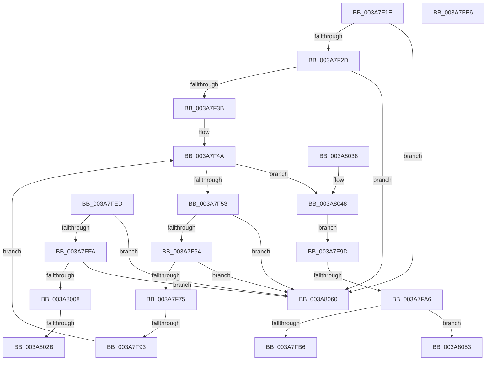

# sub_003A7F1E

- RVA: `0x003A7F1E`–`0x003A806A` (길이 `332` bytes)
- VA: `0x00000001403A7F1E`
- 실행 섹션: `.text`
- PDB 이름 있음: `아니요`; PDB Function 태그: `아니요`
- unwind 정보 RVA: `0x00089D24`
- 디코드: `77`개 명령, `332/332` bytes 표시
- 미해석 바이트: `0` (있으면 어셈블리에 `.byte`로 보존)

> 이 문서는 커널 이미지의 기계어와 PDB 기호를 분석해 생성했습니다. 4번과 5번은 함수 원형과 자료형을 바이너리 사용 방식에서 추정한 C 해석이며 원본 소스 복구 결과는 아닙니다.

## 1. Dependencies

- 직접 호출 지점: **4**; 고유 호출 대상: **3**
- 직접 호출자로 확인된 함수: **0**
- RIP 상대 이미지 참조: **0**

### Outgoing calls
- `0x003A7F86` → [AuthzBasepGetSecurityAttributeValueCopyoutBufferSize](AuthzBasepGetSecurityAttributeValueCopyoutBufferSize_function_003A8430.md) (function, `0x003A8430`)
- `0x003A7FBE` → [memset](../6C/memset_function_006C6C40.md) (function, `0x006C6C40`)
- `0x003A7FD9` → [AuthzBasepCopyoutSecurityAttributes](AuthzBasepCopyoutSecurityAttributes_function_003A8100.md) (function, `0x003A8100`)
- `0x003A8016` → [AuthzBasepGetSecurityAttributeValueCopyoutBufferSize](AuthzBasepGetSecurityAttributeValueCopyoutBufferSize_function_003A8430.md) (function, `0x003A8430`)

### Direct callers
- 이 함수 시작 RVA로 연결되는 직접 call은 확인되지 않았습니다. 간접 호출은 완전히 역산할 수 없습니다.

### Static image references
- 디코드된 RIP-relative 메모리 참조가 없습니다.

## 2. Other-region calls and transfers

- 다른 실행 섹션으로 향하는 call: **0**
- call이 아닌 외부 분기/꼬리 이동: **8**
  - `0x003A7F8D` → [sub_003A7EB8 + 0x3E](Unknown_function_003A7EB8.md) (`tail-transfer`)
  - `0x003A7FA0` → [sub_003A80B2 + 0xA](Unknown_function_003A80B2.md) (`tail-transfer`)
  - `0x003A7FE1` → [sub_003A7EB8 + 0x49](Unknown_function_003A7EB8.md) (`tail-transfer`)
  - `0x003A7FE8` → [sub_003A7DCC + 0x90](Unknown_function_003A7DCC.md) (`tail-transfer`)
  - `0x003A8025` → [sub_003A7EB8 + 0x2E](Unknown_function_003A7EB8.md) (`tail-transfer`)
  - `0x003A8033` → [sub_003A7DCC + 0x42](Unknown_function_003A7DCC.md) (`tail-transfer`)
  - `0x003A805B` → [sub_003A7EB8 + 0x49](Unknown_function_003A7EB8.md) (`tail-transfer`)
  - `0x003A8065` → [sub_003A7EB8 + 0x49](Unknown_function_003A7EB8.md) (`tail-transfer`)

## 3. Assembly (complete function range)

```asm
003A7F1E  49 8B C2                        mov rax, r10
003A7F21  48 F7 E1                        mul rcx
003A7F24  48 85 D2                        test rdx, rdx
003A7F27  0F 85 33 01 00 00               jne 0x1403a8060
003A7F2D  4C 8D 70 10                     lea r14, [rax + 0x10]
003A7F31  49 83 FE 10                     cmp r14, 0x10
003A7F35  0F 82 25 01 00 00               jb 0x1403a8060
003A7F3B  48 8B B4 24 90 00 00 00         mov rsi, qword ptr [rsp + 0x90]
003A7F43  48 83 C6 08                     add rsi, 8
003A7F47  48 8B 1E                        mov rbx, qword ptr [rsi]
003A7F4A  48 3B DE                        cmp rbx, rsi
003A7F4D  0F 84 F5 00 00 00               je 0x1403a8048
003A7F53  49 8D 4E 01                     lea rcx, [r14 + 1]
003A7F57  48 83 E1 FE                     and rcx, 0xfffffffffffffffe
003A7F5B  49 3B CE                        cmp rcx, r14
003A7F5E  0F 82 FC 00 00 00               jb 0x1403a8060
003A7F64  0F B7 53 20                     movzx edx, word ptr [rbx + 0x20]
003A7F68  48 8D 04 0A                     lea rax, [rdx + rcx]
003A7F6C  48 3B C1                        cmp rax, rcx
003A7F6F  0F 82 EB 00 00 00               jb 0x1403a8060
003A7F75  48 8D 04 0A                     lea rax, [rdx + rcx]
003A7F79  48 8B CB                        mov rcx, rbx
003A7F7C  48 8D 54 24 38                  lea rdx, [rsp + 0x38]
003A7F81  48 89 44 24 38                  mov qword ptr [rsp + 0x38], rax
003A7F86  E8 A5 04 00 00                  call 0x1403a8430
003A7F8B  85 C0                           test eax, eax
003A7F8D  0F 88 63 FF FF FF               js 0x1403a7ef6
003A7F93  48 8B 1B                        mov rbx, qword ptr [rbx]
003A7F96  4C 8B 74 24 38                  mov r14, qword ptr [rsp + 0x38]
003A7F9B  EB AD                           jmp 0x1403a7f4a
003A7F9D  48 85 FF                        test rdi, rdi
003A7FA0  0F 84 16 01 00 00               je 0x1403a80bc
003A7FA6  8B B4 24 B0 00 00 00            mov esi, dword ptr [rsp + 0xb0]
003A7FAD  48 3B F7                        cmp rsi, rdi
003A7FB0  0F 82 9D 00 00 00               jb 0x1403a8053
003A7FB6  44 8B C6                        mov r8d, esi
003A7FB9  33 D2                           xor edx, edx
003A7FBB  49 8B CC                        mov rcx, r12
003A7FBE  E8 7D EC 31 00                  call 0x1406c6c40
003A7FC3  48 8B 8C 24 90 00 00 00         mov rcx, qword ptr [rsp + 0x90]
003A7FCB  4D 8B CC                        mov r9, r12
003A7FCE  44 8B C5                        mov r8d, ebp
003A7FD1  48 89 74 24 20                  mov qword ptr [rsp + 0x20], rsi
003A7FD6  49 8B D5                        mov rdx, r13
003A7FD9  E8 22 01 00 00                  call 0x1403a8100
003A7FDE  41 89 1F                        mov dword ptr [r15], ebx
003A7FE1  E9 1B FF FF FF                  jmp 0x1403a7f01
003A7FE6  B0 01                           mov al, 1
003A7FE8  E9 6F FE FF FF                  jmp 0x1403a7e5c
003A7FED  49 8D 56 01                     lea rdx, [r14 + 1]
003A7FF1  48 83 E2 FE                     and rdx, 0xfffffffffffffffe
003A7FF5  49 3B D6                        cmp rdx, r14
003A7FF8  72 66                           jb 0x1403a8060
003A7FFA  44 0F B7 41 20                  movzx r8d, word ptr [rcx + 0x20]
003A7FFF  49 8D 04 10                     lea rax, [r8 + rdx]
003A8003  48 3B C2                        cmp rax, rdx
003A8006  72 58                           jb 0x1403a8060
003A8008  49 8D 04 10                     lea rax, [r8 + rdx]
003A800C  48 8D 54 24 38                  lea rdx, [rsp + 0x38]
003A8011  48 89 44 24 38                  mov qword ptr [rsp + 0x38], rax
003A8016  E8 15 04 00 00                  call 0x1403a8430
003A801B  4C 8B AC 24 98 00 00 00         mov r13, qword ptr [rsp + 0x98]
003A8023  85 C0                           test eax, eax
003A8025  0F 88 BB FE FF FF               js 0x1403a7ee6
003A802B  4C 8B 74 24 38                  mov r14, qword ptr [rsp + 0x38]
003A8030  41 FF C4                        inc r12d
003A8033  E9 D6 FD FF FF                  jmp 0x1403a7e0e
003A8038  4C 8B BC 24 B8 00 00 00         mov r15, qword ptr [rsp + 0xb8]
003A8040  4C 8B A4 24 A8 00 00 00         mov r12, qword ptr [rsp + 0xa8]
003A8048  49 8B FE                        mov rdi, r14
003A804B  49 8B DE                        mov rbx, r14
003A804E  E9 4A FF FF FF                  jmp 0x1403a7f9d
003A8053  41 89 1F                        mov dword ptr [r15], ebx
003A8056  B8 23 00 00 C0                  mov eax, 0xc0000023
003A805B  E9 A1 FE FF FF                  jmp 0x1403a7f01
003A8060  B8 95 00 00 C0                  mov eax, 0xc0000095
003A8065  E9 97 FE FF FF                  jmp 0x1403a7f01
```

## 4. C-style interpretation (structured pseudocode)

```c
__int64 __fastcall sub_003A7F1E(__int64 a1, __int64 a2, __int64 a3, __int64 a4, __int64 a5, __int64 a6, __int64 a7, __int64 a8, __int64 a9, __int64 a10, __int64 a11, __int64 a12, __int64 a13, __int64 a14, __int64 a15, __int64 a16, __int64 a17, __int64 a18, __int64 a19, __int64 a20, __int64 a21, unsigned int a22)
{
    __int64 result;
    __int64 v_rsi;
    unsigned __int64 v_stack_p20;
    unsigned __int64 v_stack_p38;
    unsigned __int64 v_stack_p98;
    unsigned __int64 v_stack_pA8;
    unsigned __int64 v_stack_pB8;

    if (a2 != 0) goto loc_003A8060;
    if ((v_r10 + 16) < 16) goto loc_003A8060;
    v_rsi = (a18) + (8);
loc_003A7F4A:
    if ((*(unsigned __int64 *)(v_rsi)) == v_rsi) goto loc_003A8048;
    a1 = (v_r10 + 16 + 1) & (-2);
    if (a1 < (v_r10 + 16)) goto loc_003A8060;
    if ((*(unsigned __int16 *)(*(unsigned __int64 *)(v_rsi) + 32) + a1 * 1) < a1) goto loc_003A8060;
    v_stack_p38 = *(unsigned __int16 *)(*(unsigned __int64 *)(v_rsi) + 32) + a1 * 1;
    result = AuthzBasepGetSecurityAttributeValueCopyoutBufferSize(*(unsigned __int64 *)(v_rsi), a7, a3, a4);
    goto loc_003A7F4A;
loc_003A7F9D:
    if (((unsigned int)(a22)) < v_rdi) goto loc_003A8053;
    a2 = 0;
    result = memset(v_r12, a2, (unsigned int)((unsigned int)((unsigned int)(a22))), a4);
    v_stack_p20 = (unsigned int)(a22);
    result = AuthzBasepCopyoutSecurityAttributes(a18, v_r13, (unsigned int)((unsigned int)(v_rbp)), v_r12);
    *(unsigned int *)(v_r15) = (unsigned int)(*(unsigned __int64 *)(*(unsigned __int64 *)(v_rsi)));
loc_003A8048:
    goto loc_003A7F9D;
loc_003A8053:
    *(unsigned int *)(v_r15) = (unsigned int)(a7);
loc_003A8060:
}
```

## 5. (Beta) C Style

```c
int64_t sub_003A7F1E(int64_t Arg1, int64_t Arg2, int64_t Arg3, int64_t Arg4, uint64_t Arg5, uint64_t Arg6, int64_t Arg7, uint64_t Arg8, uint64_t Arg9, uint64_t Arg10, uint64_t Arg11, uint64_t Arg12, uint64_t Arg13, uint64_t Arg14, uint64_t Arg15, uint64_t Arg16, uint64_t Arg17, void *Arg18, uint64_t Arg19, uint64_t Arg20, uint64_t Arg21, uint32_t Arg22)
{
    uint8_t *arg18 = (uint8_t *)Arg18;

    int64_t result;
    int64_t local_rsi;
    uint64_t v_stack_p20;
    uint64_t v_stack_p38;
    uint64_t v_stack_p98;
    uint64_t v_stack_pA8;
    uint64_t v_stack_pB8;

    if (Arg2 != 0) goto loc_003A8060;
    if ((local_r10 + 16) < 16) goto loc_003A8060;
    local_rsi = (Arg18) + (8);
loc_003A7F4A:
    if ((*(uint64_t *)(local_rsi)) == local_rsi) goto loc_003A8048;
    Arg1 = (local_r10 + 16 + 1) & (-2);
    if (Arg1 < (local_r10 + 16)) goto loc_003A8060;
    if ((*(uint16_t *)(*(uint64_t *)(local_rsi) + 0x20) + Arg1 * 1) < Arg1) goto loc_003A8060;
    v_stack_p38 = *(uint16_t *)(*(uint64_t *)(local_rsi) + 0x20) + Arg1 * 1;
    result = AuthzBasepGetSecurityAttributeValueCopyoutBufferSize(*(uint64_t *)(local_rsi), Arg7, Arg3, Arg4);
    goto loc_003A7F4A;
loc_003A7F9D:
    if (((uint32_t)(Arg22)) < local_rdi) goto loc_003A8053;
    Arg2 = 0;
    result = memset(local_r12, Arg2, (uint32_t)((uint32_t)((uint32_t)(Arg22))), Arg4);
    v_stack_p20 = (uint32_t)(Arg22);
    result = AuthzBasepCopyoutSecurityAttributes(Arg18, local_r13, (uint32_t)((uint32_t)(local_rbp)), local_r12);
    *(uint32_t *)(local_r15) = (uint32_t)(*(uint64_t *)(*(uint64_t *)(local_rsi)));
loc_003A8048:
    goto loc_003A7F9D;
loc_003A8053:
    *(uint32_t *)(local_r15) = (uint32_t)(Arg7);
loc_003A8060:
}
```

### 관측된 메모리 오프셋

구조체 형식이 확인되지 않은 접근은 인자 기준의 오프셋으로만 기록했습니다.

| 기준 인자 | 오프셋 표현 | 폭 (bit) | 접근 |
|---|---:|---:|---|
| `Arg18` | `+ 0x0` | `64` | `R` |

## 6. Execution-region graph

[열기: 2D/3D 그래프와 함수 탐색 컨트롤 패널](../../../control-panel.html?section=text&rva=0x003A7F1E&view=graph)

- 2D 그래프는 위에서 아래로 흐르고, 3D 그래프는 빈 공간을 드래그해 회전합니다. Shift+드래그는 이동, 휠은 확대·축소, 함수 노드 선택은 대상 보고서 이동입니다.

### Static fallback


