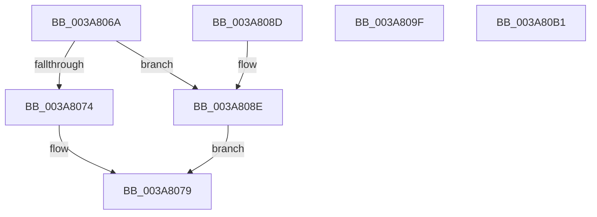

# sub_003A806A

- RVA: `0x003A806A`–`0x003A80B2` (길이 `72` bytes)
- VA: `0x00000001403A806A`
- 실행 섹션: `.text`
- PDB 이름 있음: `아니요`; PDB Function 태그: `아니요`
- unwind 정보 RVA: `0x00089D40`
- 디코드: `26`개 명령, `72/72` bytes 표시
- 미해석 바이트: `0` (있으면 어셈블리에 `.byte`로 보존)

> 이 문서는 커널 이미지의 기계어와 PDB 기호를 분석해 생성했습니다. 4번과 5번은 함수 원형과 자료형을 바이너리 사용 방식에서 추정한 C 해석이며 원본 소스 복구 결과는 아닙니다.

## 1. Dependencies

- 직접 호출 지점: **0**; 고유 호출 대상: **0**
- 직접 호출자로 확인된 함수: **0**
- RIP 상대 이미지 참조: **0**

### Outgoing calls
- 직접 디코드된 call 명령이 없습니다.

### Direct callers
- 이 함수 시작 RVA로 연결되는 직접 call은 확인되지 않았습니다. 간접 호출은 완전히 역산할 수 없습니다.

### Static image references
- 디코드된 RIP-relative 메모리 참조가 없습니다.

## 2. Other-region calls and transfers

- 다른 실행 섹션으로 향하는 call: **0**
- 별도 외부 분기/꼬리 이동을 확인하지 못했습니다.

## 3. Assembly (complete function range)

```asm
003A806A  83 BC 24 B0 00 00 00 10         cmp dword ptr [rsp + 0xb0], 0x10
003A8072  73 1A                           jae 0x1403a808e
003A8074  B8 23 00 00 C0                  mov eax, 0xc0000023
003A8079  41 C7 07 10 00 00 00            mov dword ptr [r15], 0x10
003A8080  48 83 C4 60                     add rsp, 0x60
003A8084  41 5F                           pop r15
003A8086  41 5D                           pop r13
003A8088  41 5C                           pop r12
003A808A  5F                              pop rdi
003A808B  5D                              pop rbp
003A808C  C3                              ret
003A808D  CC                              int3
003A808E  0F 57 C0                        xorps xmm0, xmm0
003A8091  8B C7                           mov eax, edi
003A8093  41 0F 11 01                     movups xmmword ptr [r9], xmm0
003A8097  66 41 C7 01 01 00               mov word ptr [r9], 1
003A809D  EB DA                           jmp 0x1403a8079
003A809F  B8 0D 00 00 C0                  mov eax, 0xc000000d
003A80A4  48 83 C4 60                     add rsp, 0x60
003A80A8  41 5F                           pop r15
003A80AA  41 5D                           pop r13
003A80AC  41 5C                           pop r12
003A80AE  5F                              pop rdi
003A80AF  5D                              pop rbp
003A80B0  C3                              ret
003A80B1  CC                              int3
```

## 4. C-style interpretation (structured pseudocode)

```c
__int64 __fastcall sub_003A806A(__int64 a1, __int64 a2, __int64 a3, __int64 a4, __int64 a5, __int64 a6, __int64 a7, __int64 a8, __int64 a9, __int64 a10, __int64 a11, __int64 a12, __int64 a13, __int64 a14, __int64 a15, __int64 a16, __int64 a17, __int64 a18, __int64 a19, __int64 a20, __int64 a21, unsigned int a22)
{
    __int64 v_rsp;

    if (a22 >= 16) goto loc_003A808E;
loc_003A8079:
    *(unsigned int *)(v_r15) = 16;
    v_rsp = (v_rsp) + (96);
    return (unsigned int)(0xC0000023ULL);
loc_003A808E:
    *(unsigned __int64 *)(a4) = v_xmm0;
    *(unsigned __int16 *)(a4) = 1;
    goto loc_003A8079;
}
```

## 5. (Beta) C Style

```c
int64_t sub_003A806A(int64_t Arg1, int64_t Arg2, int64_t Arg3, void *Arg4, uint64_t Arg5, uint64_t Arg6, uint64_t Arg7, uint64_t Arg8, uint64_t Arg9, uint64_t Arg10, uint64_t Arg11, uint64_t Arg12, uint64_t Arg13, uint64_t Arg14, uint64_t Arg15, uint64_t Arg16, uint64_t Arg17, uint64_t Arg18, uint64_t Arg19, uint64_t Arg20, uint64_t Arg21, uint32_t Arg22)
{
    uint8_t *arg4 = (uint8_t *)Arg4;

    int64_t local_rsp;

    if (Arg22 >= 16) goto loc_003A808E;
loc_003A8079:
    *(uint32_t *)(local_r15) = 16;
    local_rsp = (local_rsp) + (96);
    return (uint32_t)(0xC0000023ULL);
loc_003A808E:
    *(uint64_t *)(arg4) = v_xmm0;
    *(uint16_t *)(arg4) = 1;
    goto loc_003A8079;
}
```

### 관측된 메모리 오프셋

구조체 형식이 확인되지 않은 접근은 인자 기준의 오프셋으로만 기록했습니다.

| 기준 인자 | 오프셋 표현 | 폭 (bit) | 접근 |
|---|---:|---:|---|
| `Arg4` | `+ 0x0` | `16` | `W` |
| `Arg4` | `+ 0x0` | `128` | `R` |

## 6. Execution-region graph

[열기: 2D/3D 그래프와 함수 탐색 컨트롤 패널](../../../control-panel.html?section=text&rva=0x003A806A&view=graph)

- 2D 그래프는 위에서 아래로 흐르고, 3D 그래프는 빈 공간을 드래그해 회전합니다. Shift+드래그는 이동, 휠은 확대·축소, 함수 노드 선택은 대상 보고서 이동입니다.

### Static fallback


