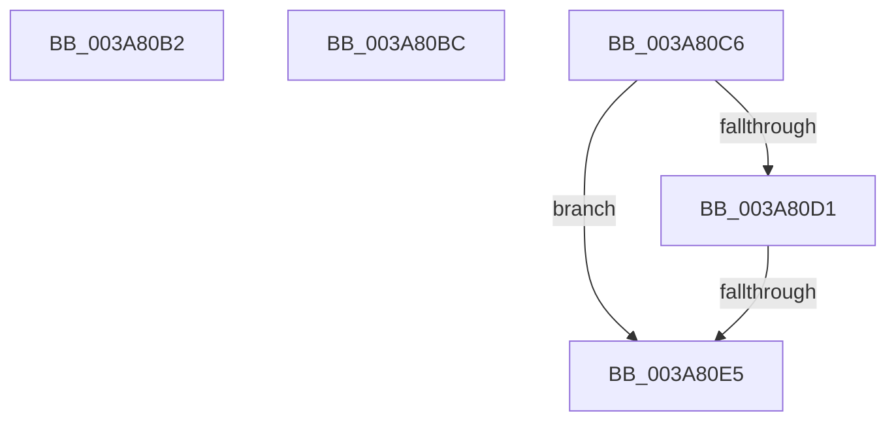

# sub_003A80B2

- RVA: `0x003A80B2`–`0x003A80ED` (길이 `59` bytes)
- VA: `0x00000001403A80B2`
- 실행 섹션: `.text`
- PDB 이름 있음: `아니요`; PDB Function 태그: `아니요`
- unwind 정보 RVA: `0x00089D58`
- 디코드: `15`개 명령, `59/59` bytes 표시
- 미해석 바이트: `0` (있으면 어셈블리에 `.byte`로 보존)

> 이 문서는 커널 이미지의 기계어와 PDB 기호를 분석해 생성했습니다. 4번과 5번은 함수 원형과 자료형을 바이너리 사용 방식에서 추정한 C 해석이며 원본 소스 복구 결과는 아닙니다.

## 1. Dependencies

- 직접 호출 지점: **2**; 고유 호출 대상: **2**
- 직접 호출자로 확인된 함수: **0**
- RIP 상대 이미지 참조: **0**

### Outgoing calls
- `0x003A80B2` → [AuthzBasepEqualUnicodeStringCaseSensitive](AuthzBasepEqualUnicodeStringCaseSensitive_function_003A8A44.md) (function, `0x003A8A44`)
- `0x003A80D8` → [AuthzBasepEqualUnicodeString](AuthzBasepEqualUnicodeString_function_003A8A80.md) (function, `0x003A8A80`)

### Direct callers
- 이 함수 시작 RVA로 연결되는 직접 call은 확인되지 않았습니다. 간접 호출은 완전히 역산할 수 없습니다.

### Static image references
- 디코드된 RIP-relative 메모리 참조가 없습니다.

## 2. Other-region calls and transfers

- 다른 실행 섹션으로 향하는 call: **0**
- call이 아닌 외부 분기/꼬리 이동: **4**
  - `0x003A80B7` → [sub_003A7EB8 + 0x1E](Unknown_function_003A7EB8.md) (`tail-transfer`)
  - `0x003A80C1` → [sub_003A7EB8 + 0x49](Unknown_function_003A7EB8.md) (`tail-transfer`)
  - `0x003A80DF` → [sub_003A7F1E + 0xC8](Unknown_function_003A7F1E.md) (`tail-transfer`)
  - `0x003A80E8` → [sub_003A7DCC + 0x83](Unknown_function_003A7DCC.md) (`tail-transfer`)

## 3. Assembly (complete function range)

```asm
003A80B2  E8 8D 09 00 00                  call 0x1403a8a44
003A80B7  E9 1A FE FF FF                  jmp 0x1403a7ed6
003A80BC  B8 0D 00 00 C0                  mov eax, 0xc000000d
003A80C1  E9 3B FE FF FF                  jmp 0x1403a7f01
003A80C6  8B 46 28                        mov eax, dword ptr [rsi + 0x28]
003A80C9  4C 8D 6E F0                     lea r13, [rsi - 0x10]
003A80CD  A8 01                           test al, 1
003A80CF  75 14                           jne 0x1403a80e5
003A80D1  49 8D 4D 20                     lea rcx, [r13 + 0x20]
003A80D5  49 8B D7                        mov rdx, r15
003A80D8  E8 A3 09 00 00                  call 0x1403a8a80
003A80DD  84 C0                           test al, al
003A80DF  0F 85 01 FF FF FF               jne 0x1403a7fe6
003A80E5  48 8B 36                        mov rsi, qword ptr [rsi]
003A80E8  E9 62 FD FF FF                  jmp 0x1403a7e4f
```

## 4. C-style interpretation (structured pseudocode)

```c
__int64 __fastcall sub_003A80B2(void)
{
    __int64 result;

    result = AuthzBasepEqualUnicodeStringCaseSensitive(a1, a2, a3, a4);
}
```

## 5. (Beta) C Style

```c
void sub_003A80B2(void)
{
    int64_t result;

    result = AuthzBasepEqualUnicodeStringCaseSensitive(a1, a2, a3, a4);
}
```

## 6. Execution-region graph

[열기: 2D/3D 그래프와 함수 탐색 컨트롤 패널](../../../control-panel.html?section=text&rva=0x003A80B2&view=graph)

- 2D 그래프는 위에서 아래로 흐르고, 3D 그래프는 빈 공간을 드래그해 회전합니다. Shift+드래그는 이동, 휠은 확대·축소, 함수 노드 선택은 대상 보고서 이동입니다.

### Static fallback


