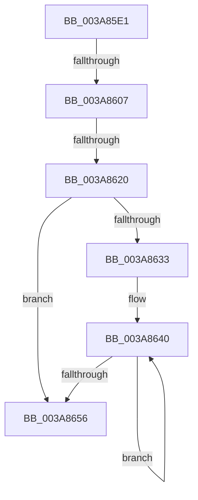

# sub_003A85E1

- RVA: `0x003A85E1`–`0x003A8675` (길이 `148` bytes)
- VA: `0x00000001403A85E1`
- 실행 섹션: `.text`
- PDB 이름 있음: `아니요`; PDB Function 태그: `아니요`
- unwind 정보 RVA: `0x00089D9C`
- 디코드: `37`개 명령, `148/148` bytes 표시
- 미해석 바이트: `0` (있으면 어셈블리에 `.byte`로 보존)

> 이 문서는 커널 이미지의 기계어와 PDB 기호를 분석해 생성했습니다. 4번과 5번은 함수 원형과 자료형을 바이너리 사용 방식에서 추정한 C 해석이며 원본 소스 복구 결과는 아닙니다.

## 1. Dependencies

- 직접 호출 지점: **0**; 고유 호출 대상: **0**
- 직접 호출자로 확인된 함수: **0**
- RIP 상대 이미지 참조: **0**

### Outgoing calls
- 직접 디코드된 call 명령이 없습니다.

### Direct callers
- 이 함수 시작 RVA로 연결되는 직접 call은 확인되지 않았습니다. 간접 호출은 완전히 역산할 수 없습니다.

### Static image references
- 디코드된 RIP-relative 메모리 참조가 없습니다.

## 2. Other-region calls and transfers

- 다른 실행 섹션으로 향하는 call: **0**
- call이 아닌 외부 분기/꼬리 이동: **2**
  - `0x003A8605` → [sub_003A8680](Unknown_function_003A8680.md) (`tail-transfer`)
  - `0x003A861A` → [sub_003A8680 + 0x183](Unknown_function_003A8680.md) (`tail-transfer`)

## 3. Assembly (complete function range)

```asm
003A85E1  48 89 6C 24 50                  mov qword ptr [rsp + 0x50], rbp
003A85E6  4C 89 64 24 58                  mov qword ptr [rsp + 0x58], r12
003A85EB  4C 89 6C 24 68                  mov qword ptr [rsp + 0x68], r13
003A85F0  4C 89 74 24 28                  mov qword ptr [rsp + 0x28], r14
003A85F5  4C 89 7C 24 20                  mov qword ptr [rsp + 0x20], r15
003A85FA  4C 8B 7C 24 70                  mov r15, qword ptr [rsp + 0x70]
003A85FF  49 89 3F                        mov qword ptr [r15], rdi
003A8602  83 F9 06                        cmp ecx, 6
003A8605  75 79                           jne 0x1403a8680
003A8607  41 8B 43 3C                     mov eax, dword ptr [r11 + 0x3c]
003A860B  4D 8D 48 07                     lea r9, [r8 + 7]
003A860F  49 83 E1 F8                     and r9, 0xfffffffffffffff8
003A8613  4D 8D 14 C1                     lea r10, [r9 + rax*8]
003A8617  4C 3B D6                        cmp r10, rsi
003A861A  0F 87 E3 01 00 00               ja 0x1403a8803
003A8620  49 83 C3 48                     add r11, 0x48
003A8624  4C 89 4A 20                     mov qword ptr [rdx + 0x20], r9
003A8628  44 8B C7                        mov r8d, edi
003A862B  49 8B 0B                        mov rcx, qword ptr [r11]
003A862E  49 3B CB                        cmp rcx, r11
003A8631  74 23                           je 0x1403a8656
003A8633  0F 1F 40 00                     nop dword ptr [rax]
003A8637  66 0F 1F 84 00 00 00 00 00      nop word ptr [rax + rax]
003A8640  48 8B 41 28                     mov rax, qword ptr [rcx + 0x28]
003A8644  41 8B D0                        mov edx, r8d
003A8647  41 FF C0                        inc r8d
003A864A  49 89 04 D1                     mov qword ptr [r9 + rdx*8], rax
003A864E  48 8B 09                        mov rcx, qword ptr [rcx]
003A8651  49 3B CB                        cmp rcx, r11
003A8654  75 EA                           jne 0x1403a8640
003A8656  4C 2B D3                        sub r10, rbx
003A8659  4D 89 17                        mov qword ptr [r15], r10
003A865C  4C 8B 74 24 28                  mov r14, qword ptr [rsp + 0x28]
003A8661  4C 8B 6C 24 68                  mov r13, qword ptr [rsp + 0x68]
003A8666  4C 8B 64 24 58                  mov r12, qword ptr [rsp + 0x58]
003A866B  48 8B 6C 24 50                  mov rbp, qword ptr [rsp + 0x50]
003A8670  4C 8B 7C 24 20                  mov r15, qword ptr [rsp + 0x20]
```

## 4. C-style interpretation (structured pseudocode)

```c
__int64 __fastcall sub_003A85E1(int a1, __int64 a2, __int64 a3, __int64 a4, __int64 a5, __int64 a6, __int64 a7, __int64 a8, __int64 a9, __int64 a10, __int64 a11, __int64 a12, __int64 a13, __int64 a14)
{
    __int64 v_r10;
    __int64 v_r11;
    unsigned __int64 v_stack_p20;
    unsigned __int64 v_stack_p28;
    unsigned __int64 v_stack_p50;
    unsigned __int64 v_stack_p58;
    unsigned __int64 v_stack_p68;

    v_stack_p50 = v_rbp;
    v_stack_p58 = v_r12;
    v_stack_p68 = v_r13;
    v_stack_p28 = v_r14;
    v_stack_p20 = v_r15;
    *(unsigned __int64 *)(a14) = v_rdi;
    a4 = (a3 + 7) & (-8);
    v_r11 = (v_r11) + (72);
    *(unsigned __int64 *)(a2 + 32) = a4;
    if ((*(unsigned __int64 *)(v_r11)) == v_r11) goto loc_003A8656;
loc_003A8640:
    a3 = (unsigned int)(((unsigned int)((unsigned int)(v_rdi))) + 1);
    *(unsigned __int64 *)(a4 + (unsigned int)((unsigned int)((unsigned int)((unsigned int)(v_rdi)))) * 8) = *(unsigned __int64 *)(*(unsigned __int64 *)(v_r11) + 40);
    if ((*(unsigned __int64 *)(*(unsigned __int64 *)(v_r11))) != v_r11) goto loc_003A8640;
loc_003A8656:
    v_r10 = (a4 + (unsigned int)(*(unsigned int *)(v_r11 + 60)) * 8) - (v_rbx);
    *(unsigned __int64 *)(a14) = v_r10;
    return *(unsigned __int64 *)(*(unsigned __int64 *)(v_r11) + 40);
}
```

## 5. (Beta) C Style

```c
int64_t sub_003A85E1(int32_t Arg1, void *Arg2, void *Arg3, int64_t Arg4, int64_t Arg5, uint64_t Arg6, uint64_t Arg7, uint64_t Arg8, uint64_t Arg9, int64_t Arg10, int64_t Arg11, uint64_t Arg12, int64_t Arg13, void *Arg14)
{
    uint8_t *arg2 = (uint8_t *)Arg2;
    uint8_t *arg3 = (uint8_t *)Arg3;
    uint8_t *arg14 = (uint8_t *)Arg14;

    int64_t local_r10;
    int64_t local_r11;
    uint64_t v_stack_p20;
    uint64_t v_stack_p28;
    uint64_t v_stack_p50;
    uint64_t v_stack_p58;
    uint64_t v_stack_p68;

    v_stack_p50 = local_rbp;
    v_stack_p58 = local_r12;
    v_stack_p68 = local_r13;
    v_stack_p28 = local_r14;
    v_stack_p20 = local_r15;
    *(uint64_t *)(arg14) = local_rdi;
    Arg4 = (Arg3 + 7) & (-8);
    local_r11 = (local_r11) + (72);
    *(uint64_t *)(arg2 + 0x20) = Arg4;
    if ((*(uint64_t *)(local_r11)) == local_r11) goto loc_003A8656;
loc_003A8640:
    Arg3 = (uint32_t)(((uint32_t)((uint32_t)(local_rdi))) + 1);
    *(uint64_t *)(Arg4 + (uint32_t)((uint32_t)((uint32_t)((uint32_t)(local_rdi)))) * 8) = *(uint64_t *)(*(uint64_t *)(local_r11) + 0x28);
    if ((*(uint64_t *)(*(uint64_t *)(local_r11))) != local_r11) goto loc_003A8640;
loc_003A8656:
    local_r10 = (Arg4 + (uint32_t)(*(uint32_t *)(local_r11 + 0x3C)) * 8) - (local_rbx);
    *(uint64_t *)(arg14) = local_r10;
    return *(uint64_t *)(*(uint64_t *)(local_r11) + 0x28);
}
```

### 관측된 메모리 오프셋

구조체 형식이 확인되지 않은 접근은 인자 기준의 오프셋으로만 기록했습니다.

| 기준 인자 | 오프셋 표현 | 폭 (bit) | 접근 |
|---|---:|---:|---|
| `Arg2` | `+ 0x20` | `64` | `W` |
| `Arg3` | `+ 0x0 + rax*8` | `64` | `R` |
| `Arg3` | `+ 0x0 + rdx*8` | `64` | `W` |
| `Arg3` | `+ 0x7` | `64` | `R` |
| `Arg14` | `+ 0x0` | `64` | `W` |

## 6. Execution-region graph

[열기: 2D/3D 그래프와 함수 탐색 컨트롤 패널](../../../control-panel.html?section=text&rva=0x003A85E1&view=graph)

- 2D 그래프는 위에서 아래로 흐르고, 3D 그래프는 빈 공간을 드래그해 회전합니다. Shift+드래그는 이동, 휠은 확대·축소, 함수 노드 선택은 대상 보고서 이동입니다.

### Static fallback


