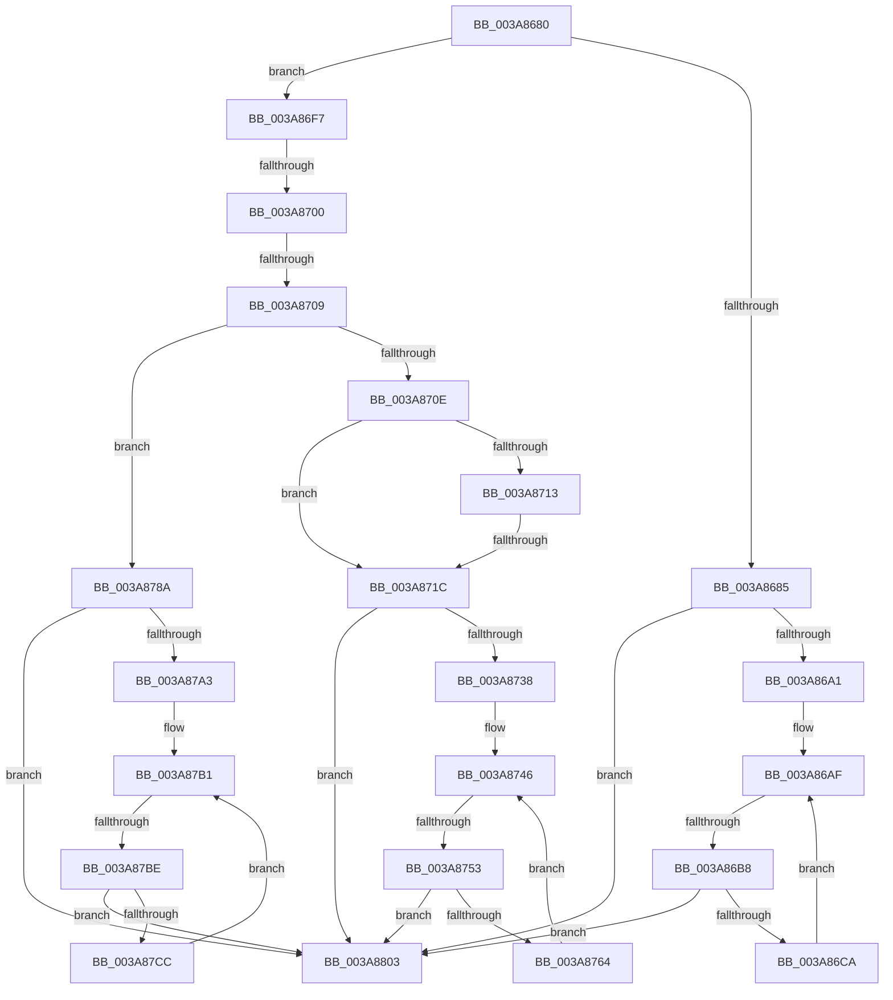

# sub_003A8680

- RVA: `0x003A8680`–`0x003A880D` (길이 `397` bytes)
- VA: `0x00000001403A8680`
- 실행 섹션: `.text`
- PDB 이름 있음: `아니요`; PDB Function 태그: `아니요`
- unwind 정보 RVA: `0x00089DD4`
- 디코드: `105`개 명령, `397/397` bytes 표시
- 미해석 바이트: `0` (있으면 어셈블리에 `.byte`로 보존)

> 이 문서는 커널 이미지의 기계어와 PDB 기호를 분석해 생성했습니다. 4번과 5번은 함수 원형과 자료형을 바이너리 사용 방식에서 추정한 C 해석이며 원본 소스 복구 결과는 아닙니다.

## 1. Dependencies

- 직접 호출 지점: **3**; 고유 호출 대상: **1**
- 직접 호출자로 확인된 함수: **0**
- RIP 상대 이미지 참조: **0**

### Outgoing calls
- `0x003A86E4` → [memcpy](../6C/memcpy_function_006C6840.md) (function, `0x006C6840`)
- `0x003A8777` → [memcpy](../6C/memcpy_function_006C6840.md) (function, `0x006C6840`)
- `0x003A87F0` → [memcpy](../6C/memcpy_function_006C6840.md) (function, `0x006C6840`)

### Direct callers
- 이 함수 시작 RVA로 연결되는 직접 call은 확인되지 않았습니다. 간접 호출은 완전히 역산할 수 없습니다.

### Static image references
- 디코드된 RIP-relative 메모리 참조가 없습니다.

## 2. Other-region calls and transfers

- 다른 실행 섹션으로 향하는 call: **0**
- call이 아닌 외부 분기/꼬리 이동: **7**
  - `0x003A86B6` → [sub_003A85E1 + 0x75](Unknown_function_003A85E1.md) (`tail-transfer`)
  - `0x003A86FA` → [sub_003A85E1 + 0x26](Unknown_function_003A85E1.md) (`tail-transfer`)
  - `0x003A8703` → [sub_003A85E1 + 0x26](Unknown_function_003A85E1.md) (`tail-transfer`)
  - `0x003A8716` → [sub_003A8817](Unknown_function_003A8817.md) (`tail-transfer`)
  - `0x003A874D` → [sub_003A85E1 + 0x75](Unknown_function_003A85E1.md) (`tail-transfer`)
  - `0x003A87B8` → [sub_003A85E1 + 0x75](Unknown_function_003A85E1.md) (`tail-transfer`)
  - `0x003A8808` → [sub_003A85E1 + 0x7B](Unknown_function_003A85E1.md) (`tail-transfer`)

## 3. Assembly (complete function range)

```asm
003A8680  83 F9 03                        cmp ecx, 3
003A8683  75 72                           jne 0x1403a86f7
003A8685  45 8B 53 3C                     mov r10d, dword ptr [r11 + 0x3c]
003A8689  4D 8D 60 07                     lea r12, [r8 + 7]
003A868D  49 83 E4 F8                     and r12, 0xfffffffffffffff8
003A8691  49 C1 E2 04                     shl r10, 4
003A8695  4D 03 D4                        add r10, r12
003A8698  4C 3B D6                        cmp r10, rsi
003A869B  0F 87 62 01 00 00               ja 0x1403a8803
003A86A1  4D 8D 6B 48                     lea r13, [r11 + 0x48]
003A86A5  4C 89 62 20                     mov qword ptr [rdx + 0x20], r12
003A86A9  4D 8B 75 00                     mov r14, qword ptr [r13]
003A86AD  8B C7                           mov eax, edi
003A86AF  89 44 24 60                     mov dword ptr [rsp + 0x60], eax
003A86B3  4D 3B F5                        cmp r14, r13
003A86B6  74 9E                           je 0x1403a8656
003A86B8  45 0F B7 46 28                  movzx r8d, word ptr [r14 + 0x28]
003A86BD  4B 8D 2C 02                     lea rbp, [r10 + r8]
003A86C1  48 3B EE                        cmp rbp, rsi
003A86C4  0F 87 39 01 00 00               ja 0x1403a8803
003A86CA  48 03 C0                        add rax, rax
003A86CD  49 8B CA                        mov rcx, r10
003A86D0  66 45 89 04 C4                  mov word ptr [r12 + rax*8], r8w
003A86D5  66 45 89 44 C4 02               mov word ptr [r12 + rax*8 + 2], r8w
003A86DB  4D 89 54 C4 08                  mov qword ptr [r12 + rax*8 + 8], r10
003A86E0  49 8B 56 30                     mov rdx, qword ptr [r14 + 0x30]
003A86E4  E8 57 E1 31 00                  call 0x1406c6840
003A86E9  8B 44 24 60                     mov eax, dword ptr [rsp + 0x60]
003A86ED  4C 8B D5                        mov r10, rbp
003A86F0  4D 8B 36                        mov r14, qword ptr [r14]
003A86F3  FF C0                           inc eax
003A86F5  EB B8                           jmp 0x1403a86af
003A86F7  83 E9 01                        sub ecx, 1
003A86FA  0F 84 07 FF FF FF               je 0x1403a8607
003A8700  83 E9 01                        sub ecx, 1
003A8703  0F 84 FE FE FF FF               je 0x1403a8607
003A8709  83 E9 02                        sub ecx, 2
003A870C  74 7C                           je 0x1403a878a
003A870E  83 E9 01                        sub ecx, 1
003A8711  74 09                           je 0x1403a871c
003A8713  83 F9 0B                        cmp ecx, 0xb
003A8716  0F 85 FB 00 00 00               jne 0x1403a8817
003A871C  45 8B 53 3C                     mov r10d, dword ptr [r11 + 0x3c]
003A8720  4D 8D 60 07                     lea r12, [r8 + 7]
003A8724  49 83 E4 F8                     and r12, 0xfffffffffffffff8
003A8728  49 C1 E2 04                     shl r10, 4
003A872C  4D 03 D4                        add r10, r12
003A872F  4C 3B D6                        cmp r10, rsi
003A8732  0F 87 CB 00 00 00               ja 0x1403a8803
003A8738  49 8D 6B 48                     lea rbp, [r11 + 0x48]
003A873C  4C 89 62 20                     mov qword ptr [rdx + 0x20], r12
003A8740  4C 8B 75 00                     mov r14, qword ptr [rbp]
003A8744  8B C7                           mov eax, edi
003A8746  89 44 24 60                     mov dword ptr [rsp + 0x60], eax
003A874A  4C 3B F5                        cmp r14, rbp
003A874D  0F 84 03 FF FF FF               je 0x1403a8656
003A8753  45 8B 46 30                     mov r8d, dword ptr [r14 + 0x30]
003A8757  4F 8D 2C 02                     lea r13, [r10 + r8]
003A875B  4C 3B EE                        cmp r13, rsi
003A875E  0F 87 9F 00 00 00               ja 0x1403a8803
003A8764  48 03 C0                        add rax, rax
003A8767  49 8B CA                        mov rcx, r10
003A876A  4D 89 14 C4                     mov qword ptr [r12 + rax*8], r10
003A876E  45 89 44 C4 08                  mov dword ptr [r12 + rax*8 + 8], r8d
003A8773  49 8B 56 28                     mov rdx, qword ptr [r14 + 0x28]
003A8777  E8 C4 E0 31 00                  call 0x1406c6840
003A877C  8B 44 24 60                     mov eax, dword ptr [rsp + 0x60]
003A8780  4D 8B D5                        mov r10, r13
003A8783  4D 8B 36                        mov r14, qword ptr [r14]
003A8786  FF C0                           inc eax
003A8788  EB BC                           jmp 0x1403a8746
003A878A  41 8B 43 3C                     mov eax, dword ptr [r11 + 0x3c]
003A878E  4D 8D 60 07                     lea r12, [r8 + 7]
003A8792  49 83 E4 F8                     and r12, 0xfffffffffffffff8
003A8796  48 8D 0C 40                     lea rcx, [rax + rax*2]
003A879A  4D 8D 14 CC                     lea r10, [r12 + rcx*8]
003A879E  4C 3B D6                        cmp r10, rsi
003A87A1  77 60                           ja 0x1403a8803
003A87A3  49 8D 6B 48                     lea rbp, [r11 + 0x48]
003A87A7  4C 89 62 20                     mov qword ptr [rdx + 0x20], r12
003A87AB  4C 8B 75 00                     mov r14, qword ptr [rbp]
003A87AF  8B C7                           mov eax, edi
003A87B1  89 44 24 60                     mov dword ptr [rsp + 0x60], eax
003A87B5  4C 3B F5                        cmp r14, rbp
003A87B8  0F 84 98 FE FF FF               je 0x1403a8656
003A87BE  45 0F B7 46 30                  movzx r8d, word ptr [r14 + 0x30]
003A87C3  4F 8D 2C 02                     lea r13, [r10 + r8]
003A87C7  4C 3B EE                        cmp r13, rsi
003A87CA  77 37                           ja 0x1403a8803
003A87CC  48 8D 0C 40                     lea rcx, [rax + rax*2]
003A87D0  49 8B 46 28                     mov rax, qword ptr [r14 + 0x28]
003A87D4  49 89 04 CC                     mov qword ptr [r12 + rcx*8], rax
003A87D8  66 45 89 44 CC 08               mov word ptr [r12 + rcx*8 + 8], r8w
003A87DE  66 45 89 44 CC 0A               mov word ptr [r12 + rcx*8 + 0xa], r8w
003A87E4  4D 89 54 CC 10                  mov qword ptr [r12 + rcx*8 + 0x10], r10
003A87E9  49 8B CA                        mov rcx, r10
003A87EC  49 8B 56 38                     mov rdx, qword ptr [r14 + 0x38]
003A87F0  E8 4B E0 31 00                  call 0x1406c6840
003A87F5  8B 44 24 60                     mov eax, dword ptr [rsp + 0x60]
003A87F9  4D 8B D5                        mov r10, r13
003A87FC  4D 8B 36                        mov r14, qword ptr [r14]
003A87FF  FF C0                           inc eax
003A8801  EB AE                           jmp 0x1403a87b1
003A8803  BF 05 00 00 80                  mov edi, 0x80000005
003A8808  E9 4F FE FF FF                  jmp 0x1403a865c
```

## 4. C-style interpretation (structured pseudocode)

```c
__int64 __fastcall sub_003A8680(int a1, __int64 a2, __int64 a3, __int64 a4, __int64 a5, __int64 a6, __int64 a7, __int64 a8, __int64 a9, __int64 a10, __int64 a11, unsigned int a12)
{
    __int64 result;
    __int64 v_r10;
    __int64 v_r12;
    unsigned int v_stack_p60;

    if (a1 != 3) goto loc_003A86F7;
    v_r12 = (a3 + 7) & (-8);
    v_r10 = ((unsigned int)(*(unsigned int *)(v_r11 + 60))) << (4);
    v_r10 = (v_r10) + (v_r12);
    if (v_r10 > v_rsi) goto loc_003A8803;
    *(unsigned __int64 *)(a2 + 32) = v_r12;
loc_003A86AF:
    v_stack_p60 = (unsigned int)((unsigned int)((unsigned int)(v_rdi)));
    if ((v_r10 + *(unsigned __int16 *)(*(unsigned __int64 *)(v_r11 + 72) + 40) * 1) > v_rsi) goto loc_003A8803;
    result = ((unsigned int)((unsigned int)(v_rdi))) + ((unsigned int)((unsigned int)(v_rdi)));
    *(unsigned __int16 *)(v_r12 + result * 8) = (unsigned __int16)(*(unsigned __int16 *)(*(unsigned __int64 *)(v_r11 + 72) + 40));
    *(unsigned __int16 *)(v_r12 + result * 8 + 2) = (unsigned __int16)(*(unsigned __int16 *)(*(unsigned __int64 *)(v_r11 + 72) + 40));
    *(unsigned __int64 *)(v_r12 + result * 8 + 8) = v_r10;
    result = memcpy(v_r10, *(unsigned __int64 *)(*(unsigned __int64 *)(v_r11 + 72) + 48), *(unsigned __int16 *)(*(unsigned __int64 *)(v_r11 + 72) + 40), a4);
    result = (unsigned int)(((unsigned int)(a12)) + 1);
    goto loc_003A86AF;
loc_003A86F7:
    a1 = (unsigned int)((v_r10) - (1));
    a1 = (unsigned int)((a1) - (1));
    a1 = (unsigned int)((a1) - (2));
    if (condition_is_equal) goto loc_003A878A;
    a1 = (unsigned int)((a1) - (1));
    if (condition_is_equal) goto loc_003A871C;
loc_003A871C:
    v_r12 = (*(unsigned __int16 *)(*(unsigned __int64 *)(v_r11 + 72) + 40) + 7) & (-8);
    v_r10 = ((unsigned int)(*(unsigned int *)(v_r11 + 60))) << (4);
    v_r10 = (v_r10) + (v_r12);
    if (v_r10 > v_rsi) goto loc_003A8803;
    *(unsigned __int64 *)(*(unsigned __int64 *)(*(unsigned __int64 *)(v_r11 + 72) + 48) + 32) = v_r12;
loc_003A8746:
    v_stack_p60 = (unsigned int)((unsigned int)((unsigned int)(v_rdi)));
    if ((v_r10 + (unsigned int)(*(unsigned int *)(*(unsigned __int64 *)(v_r11 + 72) + 48)) * 1) > v_rsi) goto loc_003A8803;
    result = ((unsigned int)((unsigned int)(v_rdi))) + ((unsigned int)((unsigned int)(v_rdi)));
    *(unsigned __int64 *)(v_r12 + result * 8) = v_r10;
    *(unsigned int *)(v_r12 + result * 8 + 8) = (unsigned int)((unsigned int)(*(unsigned int *)(*(unsigned __int64 *)(v_r11 + 72) + 48)));
    result = memcpy(v_r10, *(unsigned __int64 *)(*(unsigned __int64 *)(v_r11 + 72) + 40), (unsigned int)(*(unsigned int *)(*(unsigned __int64 *)(v_r11 + 72) + 48)), a4);
    result = (unsigned int)(((unsigned int)(a12)) + 1);
    goto loc_003A8746;
loc_003A878A:
    v_r12 = ((unsigned int)(*(unsigned int *)(*(unsigned __int64 *)(v_r11 + 72) + 48)) + 7) & (-8);
    if ((v_r12 + (unsigned int)(*(unsigned int *)(v_r11 + 60)) + (unsigned int)(*(unsigned int *)(v_r11 + 60)) * 2 * 8) > v_rsi) goto loc_003A8803;
    *(unsigned __int64 *)(*(unsigned __int64 *)(*(unsigned __int64 *)(v_r11 + 72) + 40) + 32) = v_r12;
loc_003A87B1:
    v_stack_p60 = (unsigned int)((unsigned int)((unsigned int)(v_rdi)));
    if ((v_r12 + (unsigned int)(*(unsigned int *)(v_r11 + 60)) + (unsigned int)(*(unsigned int *)(v_r11 + 60)) * 2 * 8 + *(unsigned __int16 *)(*(unsigned __int64 *)(v_r11 + 72) + 48) * 1) > v_rsi) goto loc_003A8803;
    *(unsigned __int64 *)(v_r12 + (unsigned int)((unsigned int)(v_rdi)) + (unsigned int)((unsigned int)(v_rdi)) * 2 * 8) = *(unsigned __int64 *)(*(unsigned __int64 *)(v_r11 + 72) + 40);
    *(unsigned __int16 *)(v_r12 + (unsigned int)((unsigned int)(v_rdi)) + (unsigned int)((unsigned int)(v_rdi)) * 2 * 8 + 8) = (unsigned __int16)(*(unsigned __int16 *)(*(unsigned __int64 *)(v_r11 + 72) + 48));
    *(unsigned __int16 *)(v_r12 + (unsigned int)((unsigned int)(v_rdi)) + (unsigned int)((unsigned int)(v_rdi)) * 2 * 8 + 10) = (unsigned __int16)(*(unsigned __int16 *)(*(unsigned __int64 *)(v_r11 + 72) + 48));
    *(unsigned __int64 *)(v_r12 + (unsigned int)((unsigned int)(v_rdi)) + (unsigned int)((unsigned int)(v_rdi)) * 2 * 8 + 16) = v_r12 + (unsigned int)(*(unsigned int *)(v_r11 + 60)) + (unsigned int)(*(unsigned int *)(v_r11 + 60)) * 2 * 8;
    result = memcpy(v_r12 + (unsigned int)(*(unsigned int *)(v_r11 + 60)) + (unsigned int)(*(unsigned int *)(v_r11 + 60)) * 2 * 8, *(unsigned __int64 *)(*(unsigned __int64 *)(v_r11 + 72) + 56), *(unsigned __int16 *)(*(unsigned __int64 *)(v_r11 + 72) + 48), a4);
    result = (unsigned int)(((unsigned int)(a12)) + 1);
    goto loc_003A87B1;
loc_003A8803:
}
```

## 5. (Beta) C Style

```c
int64_t sub_003A8680(int32_t Arg1, void *Arg2, void *Arg3, int64_t Arg4, uint64_t Arg5, uint64_t Arg6, uint64_t Arg7, uint64_t Arg8, uint64_t Arg9, uint64_t Arg10, uint64_t Arg11, uint32_t Arg12)
{
    uint8_t *arg2 = (uint8_t *)Arg2;
    uint8_t *arg3 = (uint8_t *)Arg3;

    int64_t result;
    int64_t local_r10;
    int64_t local_r12;
    uint32_t v_stack_p60;

    if (Arg1 != 3) goto loc_003A86F7;
    local_r12 = (Arg3 + 7) & (-8);
    local_r10 = ((uint32_t)(*(uint32_t *)(local_r11 + 0x3C))) << (4);
    local_r10 = (local_r10) + (local_r12);
    if (local_r10 > local_rsi) goto loc_003A8803;
    *(uint64_t *)(arg2 + 0x20) = local_r12;
loc_003A86AF:
    v_stack_p60 = (uint32_t)((uint32_t)((uint32_t)(local_rdi)));
    if ((local_r10 + *(uint16_t *)(*(uint64_t *)(local_r11 + 0x48) + 0x28) * 1) > local_rsi) goto loc_003A8803;
    result = ((uint32_t)((uint32_t)(local_rdi))) + ((uint32_t)((uint32_t)(local_rdi)));
    *(uint16_t *)(local_r12 + result * 8) = (uint16_t)(*(uint16_t *)(*(uint64_t *)(local_r11 + 0x48) + 0x28));
    *(uint16_t *)(local_r12 + result * 8 + 0x2) = (uint16_t)(*(uint16_t *)(*(uint64_t *)(local_r11 + 0x48) + 0x28));
    *(uint64_t *)(local_r12 + result * 8 + 0x8) = local_r10;
    result = memcpy(local_r10, *(uint64_t *)(*(uint64_t *)(local_r11 + 0x48) + 0x30), *(uint16_t *)(*(uint64_t *)(local_r11 + 0x48) + 0x28), Arg4);
    result = (uint32_t)(((uint32_t)(Arg12)) + 1);
    goto loc_003A86AF;
loc_003A86F7:
    Arg1 = (uint32_t)((local_r10) - (1));
    Arg1 = (uint32_t)((Arg1) - (1));
    Arg1 = (uint32_t)((Arg1) - (2));
    if (condition_is_equal) goto loc_003A878A;
    Arg1 = (uint32_t)((Arg1) - (1));
    if (condition_is_equal) goto loc_003A871C;
loc_003A871C:
    local_r12 = (*(uint16_t *)(*(uint64_t *)(local_r11 + 0x48) + 0x28) + 7) & (-8);
    local_r10 = ((uint32_t)(*(uint32_t *)(local_r11 + 0x3C))) << (4);
    local_r10 = (local_r10) + (local_r12);
    if (local_r10 > local_rsi) goto loc_003A8803;
    *(uint64_t *)(*(uint64_t *)(*(uint64_t *)(local_r11 + 0x48) + 0x30) + 0x20) = local_r12;
loc_003A8746:
    v_stack_p60 = (uint32_t)((uint32_t)((uint32_t)(local_rdi)));
    if ((local_r10 + (uint32_t)(*(uint32_t *)(*(uint64_t *)(local_r11 + 0x48) + 0x30)) * 1) > local_rsi) goto loc_003A8803;
    result = ((uint32_t)((uint32_t)(local_rdi))) + ((uint32_t)((uint32_t)(local_rdi)));
    *(uint64_t *)(local_r12 + result * 8) = local_r10;
    *(uint32_t *)(local_r12 + result * 8 + 0x8) = (uint32_t)((uint32_t)(*(uint32_t *)(*(uint64_t *)(local_r11 + 0x48) + 0x30)));
    result = memcpy(local_r10, *(uint64_t *)(*(uint64_t *)(local_r11 + 0x48) + 0x28), (uint32_t)(*(uint32_t *)(*(uint64_t *)(local_r11 + 0x48) + 0x30)), Arg4);
    result = (uint32_t)(((uint32_t)(Arg12)) + 1);
    goto loc_003A8746;
loc_003A878A:
    local_r12 = ((uint32_t)(*(uint32_t *)(*(uint64_t *)(local_r11 + 0x48) + 0x30)) + 7) & (-8);
    if ((local_r12 + (uint32_t)(*(uint32_t *)(local_r11 + 0x3C)) + (uint32_t)(*(uint32_t *)(local_r11 + 0x3C)) * 2 * 8) > local_rsi) goto loc_003A8803;
    *(uint64_t *)(*(uint64_t *)(*(uint64_t *)(local_r11 + 0x48) + 0x28) + 0x20) = local_r12;
loc_003A87B1:
    v_stack_p60 = (uint32_t)((uint32_t)((uint32_t)(local_rdi)));
    if ((local_r12 + (uint32_t)(*(uint32_t *)(local_r11 + 0x3C)) + (uint32_t)(*(uint32_t *)(local_r11 + 0x3C)) * 2 * 8 + *(uint16_t *)(*(uint64_t *)(local_r11 + 0x48) + 0x30) * 1) > local_rsi) goto loc_003A8803;
    *(uint64_t *)(local_r12 + (uint32_t)((uint32_t)(local_rdi)) + (uint32_t)((uint32_t)(local_rdi)) * 2 * 8) = *(uint64_t *)(*(uint64_t *)(local_r11 + 0x48) + 0x28);
    *(uint16_t *)(local_r12 + (uint32_t)((uint32_t)(local_rdi)) + (uint32_t)((uint32_t)(local_rdi)) * 2 * 8 + 0x8) = (uint16_t)(*(uint16_t *)(*(uint64_t *)(local_r11 + 0x48) + 0x30));
    *(uint16_t *)(local_r12 + (uint32_t)((uint32_t)(local_rdi)) + (uint32_t)((uint32_t)(local_rdi)) * 2 * 8 + 0xA) = (uint16_t)(*(uint16_t *)(*(uint64_t *)(local_r11 + 0x48) + 0x30));
    *(uint64_t *)(local_r12 + (uint32_t)((uint32_t)(local_rdi)) + (uint32_t)((uint32_t)(local_rdi)) * 2 * 8 + 0x10) = local_r12 + (uint32_t)(*(uint32_t *)(local_r11 + 0x3C)) + (uint32_t)(*(uint32_t *)(local_r11 + 0x3C)) * 2 * 8;
    result = memcpy(local_r12 + (uint32_t)(*(uint32_t *)(local_r11 + 0x3C)) + (uint32_t)(*(uint32_t *)(local_r11 + 0x3C)) * 2 * 8, *(uint64_t *)(*(uint64_t *)(local_r11 + 0x48) + 0x38), *(uint16_t *)(*(uint64_t *)(local_r11 + 0x48) + 0x30), Arg4);
    result = (uint32_t)(((uint32_t)(Arg12)) + 1);
    goto loc_003A87B1;
loc_003A8803:
}
```

### 관측된 메모리 오프셋

구조체 형식이 확인되지 않은 접근은 인자 기준의 오프셋으로만 기록했습니다.

| 기준 인자 | 오프셋 표현 | 폭 (bit) | 접근 |
|---|---:|---:|---|
| `Arg2` | `+ 0x20` | `64` | `W` |
| `Arg3` | `+ 0x0 + rax*8` | `16` | `W` |
| `Arg3` | `+ 0x0 + rax*8` | `64` | `W` |
| `Arg3` | `+ 0x0 + rcx*8` | `64` | `R` |
| `Arg3` | `+ 0x0 + rcx*8` | `64` | `W` |
| `Arg3` | `+ 0x2 + rax*8` | `16` | `W` |
| `Arg3` | `+ 0x7` | `64` | `R` |
| `Arg3` | `+ 0x8 + rax*8` | `32` | `W` |
| `Arg3` | `+ 0x8 + rax*8` | `64` | `W` |
| `Arg3` | `+ 0x8 + rcx*8` | `16` | `W` |
| `Arg3` | `+ 0xA + rcx*8` | `16` | `W` |
| `Arg3` | `+ 0x10 + rcx*8` | `64` | `W` |

## 6. Execution-region graph

[열기: 2D/3D 그래프와 함수 탐색 컨트롤 패널](../../../control-panel.html?section=text&rva=0x003A8680&view=graph)

- 2D 그래프는 위에서 아래로 흐르고, 3D 그래프는 빈 공간을 드래그해 회전합니다. Shift+드래그는 이동, 휠은 확대·축소, 함수 노드 선택은 대상 보고서 이동입니다.

### Static fallback


