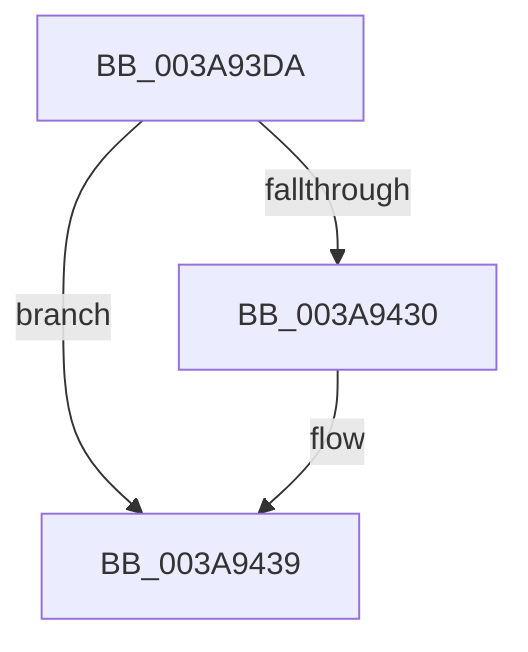

# sub_003A93DA

- RVA: `0x003A93DA`–`0x003A9457` (길이 `125` bytes)
- VA: `0x00000001403A93DA`
- 실행 섹션: `.text`
- PDB 이름 있음: `아니요`; PDB Function 태그: `아니요`
- unwind 정보 RVA: `0x00089F2C`
- 디코드: `35`개 명령, `125/125` bytes 표시
- 미해석 바이트: `0` (있으면 어셈블리에 `.byte`로 보존)

> 이 문서는 커널 이미지의 기계어와 PDB 기호를 분석해 생성했습니다. 4번과 5번은 함수 원형과 자료형을 바이너리 사용 방식에서 추정한 C 해석이며 원본 소스 복구 결과는 아닙니다.

## 1. Dependencies

- 직접 호출 지점: **2**; 고유 호출 대상: **2**
- 직접 호출자로 확인된 함수: **0**
- RIP 상대 이미지 참조: **0**

### Outgoing calls
- `0x003A93E6` → [memset](../6C/memset_function_006C6C40.md) (function, `0x006C6C40`)
- `0x003A941A` → [memcpy](../6C/memcpy_function_006C6840.md) (function, `0x006C6840`)

### Direct callers
- 이 함수 시작 RVA로 연결되는 직접 call은 확인되지 않았습니다. 간접 호출은 완전히 역산할 수 없습니다.

### Static image references
- 디코드된 RIP-relative 메모리 참조가 없습니다.

## 2. Other-region calls and transfers

- 다른 실행 섹션으로 향하는 call: **0**
- 별도 외부 분기/꼬리 이동을 확인하지 못했습니다.

## 3. Assembly (complete function range)

```asm
003A93DA  48 89 74 24 30                  mov qword ptr [rsp + 0x30], rsi
003A93DF  48 8B C8                        mov rcx, rax
003A93E2  44 8D 42 70                     lea r8d, [rdx + 0x70]
003A93E6  E8 55 D8 31 00                  call 0x1406c6c40
003A93EB  0F B7 0F                        movzx ecx, word ptr [rdi]
003A93EE  66 89 4B 22                     mov word ptr [rbx + 0x22], cx
003A93F2  48 8D 4B 70                     lea rcx, [rbx + 0x70]
003A93F6  48 89 4B 28                     mov qword ptr [rbx + 0x28], rcx
003A93FA  48 8B F1                        mov rsi, rcx
003A93FD  0F B7 0F                        movzx ecx, word ptr [rdi]
003A9400  0F B7 43 22                     movzx eax, word ptr [rbx + 0x22]
003A9404  48 8B 57 08                     mov rdx, qword ptr [rdi + 8]
003A9408  66 3B C8                        cmp cx, ax
003A940B  0F 46 C1                        cmovbe eax, ecx
003A940E  48 8B CE                        mov rcx, rsi
003A9411  8B F8                           mov edi, eax
003A9413  44 8B C0                        mov r8d, eax
003A9416  66 89 7B 20                     mov word ptr [rbx + 0x20], di
003A941A  E8 21 D4 31 00                  call 0x1406c6840
003A941F  0F B7 4B 20                     movzx ecx, word ptr [rbx + 0x20]
003A9423  0F B7 43 22                     movzx eax, word ptr [rbx + 0x22]
003A9427  48 83 C1 02                     add rcx, 2
003A942B  48 3B C8                        cmp rcx, rax
003A942E  77 09                           ja 0x1403a9439
003A9430  48 D1 EF                        shr rdi, 1
003A9433  33 C0                           xor eax, eax
003A9435  66 89 04 7E                     mov word ptr [rsi + rdi*2], ax
003A9439  48 8B 74 24 30                  mov rsi, qword ptr [rsp + 0x30]
003A943E  48 8D 43 48                     lea rax, [rbx + 0x48]
003A9442  48 89 40 08                     mov qword ptr [rax + 8], rax
003A9446  48 89 00                        mov qword ptr [rax], rax
003A9449  48 8D 43 60                     lea rax, [rbx + 0x60]
003A944D  48 89 40 08                     mov qword ptr [rax + 8], rax
003A9451  48 89 00                        mov qword ptr [rax], rax
003A9454  48 8B C3                        mov rax, rbx
```

## 4. C-style interpretation (structured pseudocode)

```c
__int64 __fastcall sub_003A93DA(__int64 a1, __int64 a2, __int64 a3, __int64 a4, __int64 a5, __int64 a6)
{
    __int64 result;
    __int64 v_rdi;
    unsigned __int64 v_stack_p30;

    v_stack_p30 = v_rsi;
    result = memset(result, a2, a2 + 112, a4);
    *(unsigned __int16 *)(v_rbx + 34) = (unsigned __int16)(*(unsigned __int16 *)(v_rdi));
    *(unsigned __int64 *)(v_rbx + 40) = v_rbx + 112;
    result = *(unsigned __int16 *)(v_rbx + 34);
    if (((unsigned __int16)(*(unsigned __int16 *)(v_rdi))) <= ((unsigned __int16)(*(unsigned __int16 *)(v_rbx + 34)))) { result = (unsigned int)(*(unsigned __int16 *)(v_rdi)); }
    *(unsigned __int16 *)(v_rbx + 32) = (unsigned __int16)((unsigned int)((unsigned int)(result)));
    result = memcpy(v_rbx + 112, *(unsigned __int64 *)(v_rdi + 8), (unsigned int)((unsigned int)(result)), a4);
    a1 = (*(unsigned __int16 *)(v_rbx + 32)) + (2);
    result = *(unsigned __int16 *)(v_rbx + 34);
    v_rdi = (unsigned int)((unsigned int)(result));
    if (a1 <= (*(unsigned __int16 *)(v_rbx + 34))) {
        v_rdi = ((unsigned int)((unsigned int)(result))) >> (1);
        result = 0;
        *(unsigned __int16 *)(v_rbx + 112 + v_rdi * 2) = 0;
    }
    *(unsigned __int64 *)(v_rbx + 72 + 8) = v_rbx + 72;
    *(unsigned __int64 *)(v_rbx + 72) = v_rbx + 72;
    *(unsigned __int64 *)(v_rbx + 96 + 8) = v_rbx + 96;
    *(unsigned __int64 *)(v_rbx + 96) = v_rbx + 96;
    return v_rbx;
}
```

## 5. (Beta) C Style

```c
int64_t sub_003A93DA(int64_t Arg1, void *Arg2, int64_t Arg3, int64_t Arg4, uint64_t Arg5, int64_t Arg6)
{
    uint8_t *arg2 = (uint8_t *)Arg2;

    int64_t result;
    int64_t local_rdi;
    uint64_t v_stack_p30;

    v_stack_p30 = local_rsi;
    result = memset(result, Arg2, Arg2 + 112, Arg4);
    *(uint16_t *)(local_rbx + 0x22) = (uint16_t)(*(uint16_t *)(local_rdi));
    *(uint64_t *)(local_rbx + 0x28) = local_rbx + 112;
    result = *(uint16_t *)(local_rbx + 0x22);
    if (((uint16_t)(*(uint16_t *)(local_rdi))) <= ((uint16_t)(*(uint16_t *)(local_rbx + 0x22)))) { result = (uint32_t)(*(uint16_t *)(local_rdi)); }
    *(uint16_t *)(local_rbx + 0x20) = (uint16_t)((uint32_t)((uint32_t)(result)));
    result = memcpy(local_rbx + 112, *(uint64_t *)(local_rdi + 0x8), (uint32_t)((uint32_t)(result)), Arg4);
    Arg1 = (*(uint16_t *)(local_rbx + 0x20)) + (2);
    result = *(uint16_t *)(local_rbx + 0x22);
    local_rdi = (uint32_t)((uint32_t)(result));
    if (Arg1 <= (*(uint16_t *)(local_rbx + 0x22))) {
        local_rdi = ((uint32_t)((uint32_t)(result))) >> (1);
        result = 0;
        *(uint16_t *)(local_rbx + 0x70 + local_rdi * 2) = 0;
    }
    *(uint64_t *)(local_rbx + 0x48 + 0x8) = local_rbx + 72;
    *(uint64_t *)(local_rbx + 0x48) = local_rbx + 72;
    *(uint64_t *)(local_rbx + 0x60 + 0x8) = local_rbx + 96;
    *(uint64_t *)(local_rbx + 0x60) = local_rbx + 96;
    return local_rbx;
}
```

### 관측된 메모리 오프셋

구조체 형식이 확인되지 않은 접근은 인자 기준의 오프셋으로만 기록했습니다.

| 기준 인자 | 오프셋 표현 | 폭 (bit) | 접근 |
|---|---:|---:|---|
| `Arg2` | `+ 0x70` | `32` | `R` |

## 6. Execution-region graph

[열기: 2D/3D 그래프와 함수 탐색 컨트롤 패널](../../../control-panel.html?section=text&rva=0x003A93DA&view=graph)

- 2D 그래프는 위에서 아래로 흐르고, 3D 그래프는 빈 공간을 드래그해 회전합니다. Shift+드래그는 이동, 휠은 확대·축소, 함수 노드 선택은 대상 보고서 이동입니다.

### Static fallback


