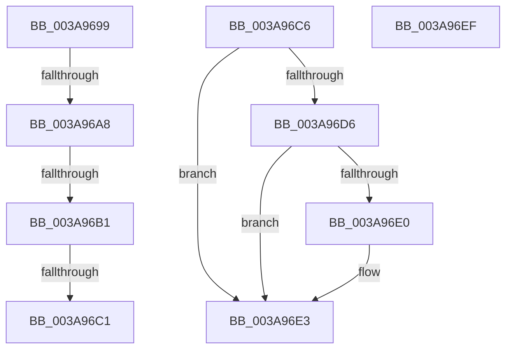

# sub_003A9699

- RVA: `0x003A9699`–`0x003A96F0` (길이 `87` bytes)
- VA: `0x00000001403A9699`
- 실행 섹션: `.text`
- PDB 이름 있음: `아니요`; PDB Function 태그: `아니요`
- unwind 정보 RVA: `0x00089F9C`
- 디코드: `29`개 명령, `87/87` bytes 표시
- 미해석 바이트: `0` (있으면 어셈블리에 `.byte`로 보존)

> 이 문서는 커널 이미지의 기계어와 PDB 기호를 분석해 생성했습니다. 4번과 5번은 함수 원형과 자료형을 바이너리 사용 방식에서 추정한 C 해석이며 원본 소스 복구 결과는 아닙니다.

## 1. Dependencies

- 직접 호출 지점: **1**; 고유 호출 대상: **1**
- 직접 호출자로 확인된 함수: **0**
- RIP 상대 이미지 참조: **0**

### Outgoing calls
- `0x003A96E5` → [ExFreePoolWithTag](../../poolcode/B8/ExFreePoolWithTag_function_00B82870.md) (function, `0x00B82870`)

### Direct callers
- 이 함수 시작 RVA로 연결되는 직접 call은 확인되지 않았습니다. 간접 호출은 완전히 역산할 수 없습니다.

### Static image references
- 디코드된 RIP-relative 메모리 참조가 없습니다.

## 2. Other-region calls and transfers

- 다른 실행 섹션으로 향하는 call: **1**
  - `0x003A96E5` → [ExFreePoolWithTag](../../poolcode/B8/ExFreePoolWithTag_function_00B82870.md) (`.text` → `POOLCODE`)
- call이 아닌 외부 분기/꼬리 이동: **5**
  - `0x003A96A6` → [AuthzBasepFreeSecurityAttributeValues + 0x41](AuthzBasepFreeSecurityAttributeValues_function_003A9630.md) (`tail-transfer`)
  - `0x003A96AF` → [AuthzBasepFreeSecurityAttributeValues + 0x41](AuthzBasepFreeSecurityAttributeValues_function_003A9630.md) (`tail-transfer`)
  - `0x003A96BF` → [AuthzBasepFreeSecurityAttributeValues + 0x24](AuthzBasepFreeSecurityAttributeValues_function_003A9630.md) (`tail-transfer`)
  - `0x003A96C4` → [AuthzBasepFreeSecurityAttributeValues + 0x24](AuthzBasepFreeSecurityAttributeValues_function_003A9630.md) (`tail-transfer`)
  - `0x003A96EA` → [AuthzBasepFreeSecurityAttributeValues + 0x15](AuthzBasepFreeSecurityAttributeValues_function_003A9630.md) (`tail-transfer`)

## 3. Assembly (complete function range)

```asm
003A9699  CC                              int3
003A969A  4C 8B 41 10                     mov r8, qword ptr [rcx + 0x10]
003A969E  48 8D 41 10                     lea rax, [rcx + 0x10]
003A96A2  49 39 40 08                     cmp qword ptr [r8 + 8], rax
003A96A6  75 C9                           jne 0x1403a9671
003A96A8  48 8B 50 08                     mov rdx, qword ptr [rax + 8]
003A96AC  48 39 02                        cmp qword ptr [rdx], rax
003A96AF  75 C0                           jne 0x1403a9671
003A96B1  4C 89 02                        mov qword ptr [rdx], r8
003A96B4  49 89 50 08                     mov qword ptr [r8 + 8], rdx
003A96B8  83 61 20 FD                     and dword ptr [rcx + 0x20], 0xfffffffd
003A96BC  48 85 DB                        test rbx, rbx
003A96BF  74 93                           je 0x1403a9654
003A96C1  FF 4B 58                        dec dword ptr [rbx + 0x58]
003A96C4  EB 8E                           jmp 0x1403a9654
003A96C6  48 89 10                        mov qword ptr [rax], rdx
003A96C9  48 89 42 08                     mov qword ptr [rdx + 8], rax
003A96CD  83 61 20 FE                     and dword ptr [rcx + 0x20], 0xfffffffe
003A96D1  48 85 DB                        test rbx, rbx
003A96D4  74 0D                           je 0x1403a96e3
003A96D6  FF 4B 3C                        dec dword ptr [rbx + 0x3c]
003A96D9  8B 41 20                        mov eax, dword ptr [rcx + 0x20]
003A96DC  A8 04                           test al, 4
003A96DE  74 03                           je 0x1403a96e3
003A96E0  FF 4B 40                        dec dword ptr [rbx + 0x40]
003A96E3  33 D2                           xor edx, edx
003A96E5  E8 86 91 7D 00                  call 0x140b82870
003A96EA  E9 56 FF FF FF                  jmp 0x1403a9645
003A96EF  90                              nop
```

## 4. C-style interpretation (structured pseudocode)

```c
__int64 __fastcall sub_003A9699(__int64 a1)
{
    *(unsigned __int64 *)(*(unsigned __int64 *)(a1 + 16 + 8)) = *(unsigned __int64 *)(a1 + 16);
    *(unsigned __int64 *)(*(unsigned __int64 *)(a1 + 16) + 8) = *(unsigned __int64 *)(a1 + 16 + 8);
}
```

## 5. (Beta) C Style

```c
int64_t sub_003A9699(void *Arg1)
{
    uint8_t *arg1 = (uint8_t *)Arg1;

    *(uint64_t *)(*(uint64_t *)(arg1 + 0x10 + 0x8)) = *(uint64_t *)(arg1 + 0x10);
    *(uint64_t *)(*(uint64_t *)(arg1 + 0x10) + 0x8) = *(uint64_t *)(arg1 + 0x10 + 0x8);
}
```

### 관측된 메모리 오프셋

구조체 형식이 확인되지 않은 접근은 인자 기준의 오프셋으로만 기록했습니다.

| 기준 인자 | 오프셋 표현 | 폭 (bit) | 접근 |
|---|---:|---:|---|
| `Arg1` | `+ 0x8` | `64` | `R` |
| `Arg1` | `+ 0x10` | `64` | `R` |
| `Arg1` | `+ 0x20` | `32` | `R/W` |

## 6. Execution-region graph

[열기: 2D/3D 그래프와 함수 탐색 컨트롤 패널](../../../control-panel.html?section=text&rva=0x003A9699&view=graph)

- 2D 그래프는 위에서 아래로 흐르고, 3D 그래프는 빈 공간을 드래그해 회전합니다. Shift+드래그는 이동, 휠은 확대·축소, 함수 노드 선택은 대상 보고서 이동입니다.

### Static fallback


