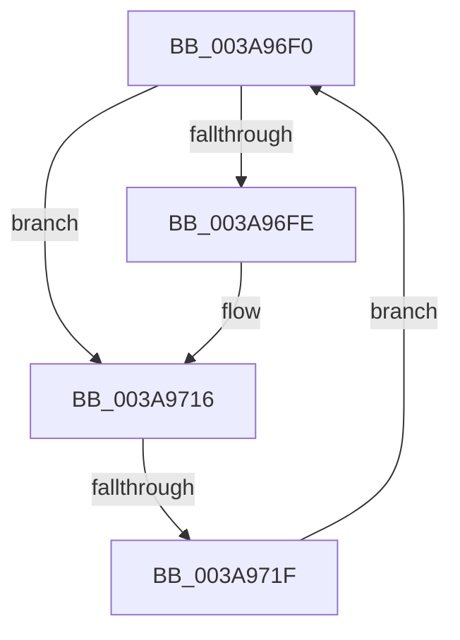

# sub_003A96F0

- RVA: `0x003A96F0`–`0x003A9721` (길이 `49` bytes)
- VA: `0x00000001403A96F0`
- 실행 섹션: `.text`
- PDB 이름 있음: `아니요`; PDB Function 태그: `아니요`
- unwind 정보 RVA: `0x00089FAC`
- 디코드: `15`개 명령, `49/49` bytes 표시
- 미해석 바이트: `0` (있으면 어셈블리에 `.byte`로 보존)

> 이 문서는 커널 이미지의 기계어와 PDB 기호를 분석해 생성했습니다. 4번과 5번은 함수 원형과 자료형을 바이너리 사용 방식에서 추정한 C 해석이며 원본 소스 복구 결과는 아닙니다.

## 1. Dependencies

- 직접 호출 지점: **2**; 고유 호출 대상: **2**
- 직접 호출자로 확인된 함수: **0**
- RIP 상대 이미지 참조: **0**

### Outgoing calls
- `0x003A9707` → [AuthzBasepRemoveSecurityAttributeValueFromLists](../30/AuthzBasepRemoveSecurityAttributeValueFromLists_function_00302E00.md) (function, `0x00302E00`)
- `0x003A9711` → [ExFreePoolWithTag](../../poolcode/B8/ExFreePoolWithTag_function_00B82870.md) (function, `0x00B82870`)

### Direct callers
- 이 함수 시작 RVA로 연결되는 직접 call은 확인되지 않았습니다. 간접 호출은 완전히 역산할 수 없습니다.

### Static image references
- 디코드된 RIP-relative 메모리 참조가 없습니다.

## 2. Other-region calls and transfers

- 다른 실행 섹션으로 향하는 call: **1**
  - `0x003A9711` → [ExFreePoolWithTag](../../poolcode/B8/ExFreePoolWithTag_function_00B82870.md) (`.text` → `POOLCODE`)
- call이 아닌 외부 분기/꼬리 이동: **1**
  - `0x003A9719` → [sub_003A967C + 0xD](Unknown_function_003A967C.md) (`tail-transfer`)

## 3. Assembly (complete function range)

```asm
003A96F0  8B 46 10                        mov eax, dword ptr [rsi + 0x10]
003A96F3  4C 8D 5E F0                     lea r11, [rsi - 0x10]
003A96F7  48 8B 36                        mov rsi, qword ptr [rsi]
003A96FA  A8 01                           test al, 1
003A96FC  75 18                           jne 0x1403a9716
003A96FE  45 33 C0                        xor r8d, r8d
003A9701  49 8B D3                        mov rdx, r11
003A9704  48 8B CB                        mov rcx, rbx
003A9707  E8 F4 96 F5 FF                  call 0x140302e00
003A970C  49 8B CB                        mov rcx, r11
003A970F  33 D2                           xor edx, edx
003A9711  E8 5A 91 7D 00                  call 0x140b82870
003A9716  48 3B F7                        cmp rsi, rdi
003A9719  0F 84 6A FF FF FF               je 0x1403a9689
003A971F  EB CF                           jmp 0x1403a96f0
```

## 4. C-style interpretation (structured pseudocode)

```c
__int64 __fastcall sub_003A96F0(__int64 a1, __int64 a2, int a3)
{
    __int64 result;

    result = (unsigned int)(*(unsigned int *)(v_rsi + 16));
    if ((((unsigned __int8)((unsigned int)(*(unsigned int *)(v_rsi + 16)))) & (1)) == 0) {
        a3 = 0;
        a2 = v_rsi - 16;
        a1 = v_rbx;
        result = AuthzBasepRemoveSecurityAttributeValueFromLists(a1, a2, a3, a4);
        a1 = v_rsi - 16;
        a2 = 0;
        result = ExFreePoolWithTag(a1, a2, a3, a4);
    }
    goto loc_003A96F0;
}
```

## 5. (Beta) C Style

```c
int64_t sub_003A96F0(int64_t Arg1, int64_t Arg2, int32_t Arg3)
{
    int64_t result;

    result = (uint32_t)(*(uint32_t *)(local_rsi + 0x10));
    if ((((uint8_t)((uint32_t)(*(uint32_t *)(local_rsi + 0x10)))) & (1)) == 0) {
        Arg3 = 0;
        Arg2 = local_rsi - 16;
        Arg1 = local_rbx;
        result = AuthzBasepRemoveSecurityAttributeValueFromLists(Arg1, Arg2, Arg3, a4);
        Arg1 = local_rsi - 16;
        Arg2 = 0;
        result = ExFreePoolWithTag(Arg1, Arg2, Arg3, a4);
    }
    goto loc_003A96F0;
}
```

## 6. Execution-region graph

[열기: 2D/3D 그래프와 함수 탐색 컨트롤 패널](../../../control-panel.html?section=text&rva=0x003A96F0&view=graph)

- 2D 그래프는 위에서 아래로 흐르고, 3D 그래프는 빈 공간을 드래그해 회전합니다. Shift+드래그는 이동, 휠은 확대·축소, 함수 노드 선택은 대상 보고서 이동입니다.

### Static fallback


