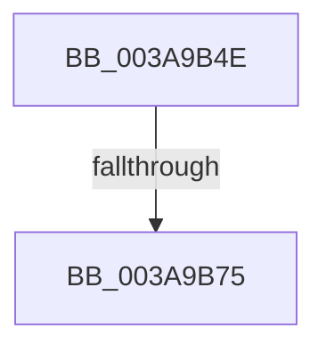

# sub_003A9B4E

- RVA: `0x003A9B4E`–`0x003A9B7A` (길이 `44` bytes)
- VA: `0x00000001403A9B4E`
- 실행 섹션: `.text`
- PDB 이름 있음: `아니요`; PDB Function 태그: `아니요`
- unwind 정보 RVA: `0x0008B6DC`
- 디코드: `12`개 명령, `44/44` bytes 표시
- 미해석 바이트: `0` (있으면 어셈블리에 `.byte`로 보존)

> 이 문서는 커널 이미지의 기계어와 PDB 기호를 분석해 생성했습니다. 4번과 5번은 함수 원형과 자료형을 바이너리 사용 방식에서 추정한 C 해석이며 원본 소스 복구 결과는 아닙니다.

## 1. Dependencies

- 직접 호출 지점: **0**; 고유 호출 대상: **0**
- 직접 호출자로 확인된 함수: **0**
- RIP 상대 이미지 참조: **0**

### Outgoing calls
- 직접 디코드된 call 명령이 없습니다.

### Direct callers
- 이 함수 시작 RVA로 연결되는 직접 call은 확인되지 않았습니다. 간접 호출은 완전히 역산할 수 없습니다.

### Static image references
- 디코드된 RIP-relative 메모리 참조가 없습니다.

## 2. Other-region calls and transfers

- 다른 실행 섹션으로 향하는 call: **0**
- call이 아닌 외부 분기/꼬리 이동: **1**
  - `0x003A9B73` → [sub_003A9B88](Unknown_function_003A9B88.md) (`tail-transfer`)

## 3. Assembly (complete function range)

```asm
003A9B4E  48 89 5C 24 20                  mov qword ptr [rsp + 0x20], rbx
003A9B53  8D 58 FF                        lea ebx, [rax - 1]
003A9B56  48 C1 E3 04                     shl rbx, 4
003A9B5A  48 03 1A                        add rbx, qword ptr [rdx]
003A9B5D  48 8B 43 08                     mov rax, qword ptr [rbx + 8]
003A9B61  48 8B 0B                        mov rcx, qword ptr [rbx]
003A9B64  48 83 C0 FC                     add rax, -4
003A9B68  48 83 C1 10                     add rcx, 0x10
003A9B6C  48 89 43 08                     mov qword ptr [rbx + 8], rax
003A9B70  48 3B C1                        cmp rax, rcx
003A9B73  72 13                           jb 0x1403a9b88
003A9B75  48 8B 5C 24 20                  mov rbx, qword ptr [rsp + 0x20]
```

## 4. C-style interpretation (structured pseudocode)

```c
__int64 __fastcall sub_003A9B4E(__int64 a1, __int64 a2)
{
    __int64 result;
    __int64 v_rbx;
    unsigned __int64 v_stack_p20;

    v_stack_p20 = v_rbx;
    v_rbx = (result - 1) << (4);
    v_rbx = (v_rbx) + (*(unsigned __int64 *)(a2));
    result = (*(unsigned __int64 *)(v_rbx + 8)) + (-4);
    a1 = (*(unsigned __int64 *)(v_rbx)) + (16);
    *(unsigned __int64 *)(v_rbx + 8) = result;
    return result;
}
```

## 5. (Beta) C Style

```c
int64_t sub_003A9B4E(int64_t Arg1, void *Arg2)
{
    uint8_t *arg2 = (uint8_t *)Arg2;

    int64_t result;
    int64_t local_rbx;
    uint64_t v_stack_p20;

    v_stack_p20 = local_rbx;
    local_rbx = (result - 1) << (4);
    local_rbx = (local_rbx) + (*(uint64_t *)(arg2));
    result = (*(uint64_t *)(local_rbx + 0x8)) + (-4);
    Arg1 = (*(uint64_t *)(local_rbx)) + (16);
    *(uint64_t *)(local_rbx + 0x8) = result;
    return result;
}
```

### 관측된 메모리 오프셋

구조체 형식이 확인되지 않은 접근은 인자 기준의 오프셋으로만 기록했습니다.

| 기준 인자 | 오프셋 표현 | 폭 (bit) | 접근 |
|---|---:|---:|---|
| `Arg2` | `+ 0x0` | `64` | `R` |

## 6. Execution-region graph

[열기: 2D/3D 그래프와 함수 탐색 컨트롤 패널](../../../control-panel.html?section=text&rva=0x003A9B4E&view=graph)

- 2D 그래프는 위에서 아래로 흐르고, 3D 그래프는 빈 공간을 드래그해 회전합니다. Shift+드래그는 이동, 휠은 확대·축소, 함수 노드 선택은 대상 보고서 이동입니다.

### Static fallback


