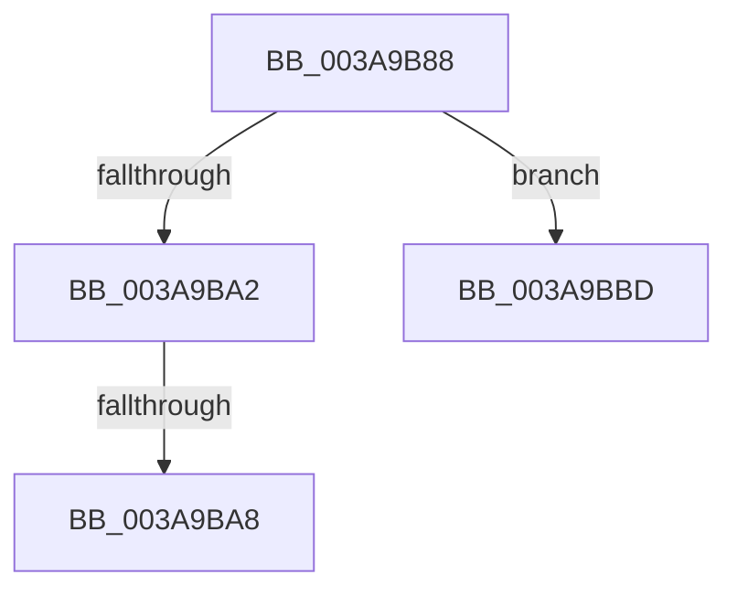

# sub_003A9B88

- RVA: `0x003A9B88`–`0x003A9BC7` (길이 `63` bytes)
- VA: `0x00000001403A9B88`
- 실행 섹션: `.text`
- PDB 이름 있음: `아니요`; PDB Function 태그: `아니요`
- unwind 정보 RVA: `0x0008B708`
- 디코드: `19`개 명령, `63/63` bytes 표시
- 미해석 바이트: `0` (있으면 어셈블리에 `.byte`로 보존)

> 이 문서는 커널 이미지의 기계어와 PDB 기호를 분석해 생성했습니다. 4번과 5번은 함수 원형과 자료형을 바이너리 사용 방식에서 추정한 C 해석이며 원본 소스 복구 결과는 아닙니다.

## 1. Dependencies

- 직접 호출 지점: **1**; 고유 호출 대상: **1**
- 직접 호출자로 확인된 함수: **0**
- RIP 상대 이미지 참조: **0**

### Outgoing calls
- `0x003A9B95` → [B_TREE<unsigned long,ST_STORE<SM_TRAITS>::_ST_REGION_ENTRY,4096,NP_CONTEXT,ST_STORE<SM_TRAITS>::ST_REGION_ENTRY_COMPARATOR>::BTreeFindLeafSiblingEx](B_TREE_unsigned_long_ST_STORE_SM_TRAITS__ST_REGION_ENTRY_4096_NP_CONTEXT_ST_STORE_SM_TRAITS_ST_REGIO_function_003A9BD8.md) (function, `0x003A9BD8`)

### Direct callers
- 이 함수 시작 RVA로 연결되는 직접 call은 확인되지 않았습니다. 간접 호출은 완전히 역산할 수 없습니다.

### Static image references
- 디코드된 RIP-relative 메모리 참조가 없습니다.

## 2. Other-region calls and transfers

- 다른 실행 섹션으로 향하는 call: **0**
- call이 아닌 외부 분기/꼬리 이동: **2**
  - `0x003A9BA6` → [sub_003A9BC8](Unknown_function_003A9BC8.md) (`tail-transfer`)
  - `0x003A9BBB` → [sub_003A9B4E + 0x27](Unknown_function_003A9B4E.md) (`tail-transfer`)

## 3. Assembly (complete function range)

```asm
003A9B88  48 89 4B 08                     mov qword ptr [rbx + 8], rcx
003A9B8C  41 B8 02 00 00 00               mov r8d, 2
003A9B92  49 8B C9                        mov rcx, r9
003A9B95  E8 3E 00 00 00                  call 0x1403a9bd8
003A9B9A  48 8B D0                        mov rdx, rax
003A9B9D  48 85 C0                        test rax, rax
003A9BA0  74 1B                           je 0x1403a9bbd
003A9BA2  48 83 F8 FF                     cmp rax, -1
003A9BA6  74 20                           je 0x1403a9bc8
003A9BA8  8B 00                           mov eax, dword ptr [rax]
003A9BAA  0F B7 C0                        movzx eax, ax
003A9BAD  FF C8                           dec eax
003A9BAF  48 83 C0 04                     add rax, 4
003A9BB3  48 8D 04 82                     lea rax, [rdx + rax*4]
003A9BB7  48 89 43 08                     mov qword ptr [rbx + 8], rax
003A9BBB  EB B8                           jmp 0x1403a9b75
003A9BBD  48 8B 5C 24 20                  mov rbx, qword ptr [rsp + 0x20]
003A9BC2  48 83 C4 28                     add rsp, 0x28
003A9BC6  C3                              ret
```

## 4. C-style interpretation (structured pseudocode)

```c
__int64 __fastcall sub_003A9B88(__int64 a1, __int64 a2, __int64 a3, __int64 a4)
{
    __int64 result;
    __int64 v_rsp;
    unsigned __int64 v_stack_p20;

    *(unsigned __int64 *)(v_rbx + 8) = a1;
    result = B_TREE_unsigned_long_ST_STORE_SM_TRAITS____ST_REGION_ENTRY_4096_NP_CONTEXT_ST_STORE_SM_TRAITS___ST_R(a4, a2, 2, a4);
    if (result == 0) goto loc_003A9BBD;
    result = (unsigned int)(((unsigned __int16)((unsigned int)(*(unsigned int *)(result)))) - 1);
    result = (result) + (4);
    *(unsigned __int64 *)(v_rbx + 8) = result + result * 4;
loc_003A9BBD:
    v_rsp = (v_rsp) + (40);
    return result + result * 4;
}
```

## 5. (Beta) C Style

```c
int64_t sub_003A9B88(int64_t Arg1, int64_t Arg2, int64_t Arg3, int64_t Arg4)
{
    int64_t result;
    int64_t local_rsp;
    uint64_t v_stack_p20;

    *(uint64_t *)(local_rbx + 0x8) = Arg1;
    result = B_TREE_unsigned_long_ST_STORE_SM_TRAITS____ST_REGION_ENTRY_4096_NP_CONTEXT_ST_STORE_SM_TRAITS___ST_R(Arg4, Arg2, 2, Arg4);
    if (result == 0) goto loc_003A9BBD;
    result = (uint32_t)(((uint16_t)((uint32_t)(*(uint32_t *)(result)))) - 1);
    result = (result) + (4);
    *(uint64_t *)(local_rbx + 0x8) = result + result * 4;
loc_003A9BBD:
    local_rsp = (local_rsp) + (40);
    return result + result * 4;
}
```

## 6. Execution-region graph

[열기: 2D/3D 그래프와 함수 탐색 컨트롤 패널](../../../control-panel.html?section=text&rva=0x003A9B88&view=graph)

- 2D 그래프는 위에서 아래로 흐르고, 3D 그래프는 빈 공간을 드래그해 회전합니다. Shift+드래그는 이동, 휠은 확대·축소, 함수 노드 선택은 대상 보고서 이동입니다.

### Static fallback


