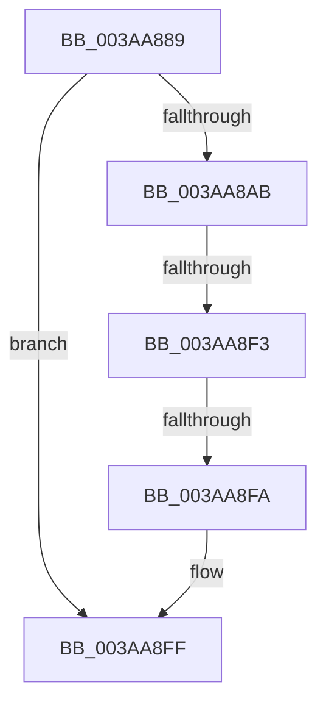

# sub_003AA889

- RVA: `0x003AA889`–`0x003AA913` (길이 `138` bytes)
- VA: `0x00000001403AA889`
- 실행 섹션: `.text`
- PDB 이름 있음: `아니요`; PDB Function 태그: `아니요`
- unwind 정보 RVA: `0x0008B7F0`
- 디코드: `30`개 명령, `138/138` bytes 표시
- 미해석 바이트: `0` (있으면 어셈블리에 `.byte`로 보존)

> 이 문서는 커널 이미지의 기계어와 PDB 기호를 분석해 생성했습니다. 4번과 5번은 함수 원형과 자료형을 바이너리 사용 방식에서 추정한 C 해석이며 원본 소스 복구 결과는 아닙니다.

## 1. Dependencies

- 직접 호출 지점: **4**; 고유 호출 대상: **4**
- 직접 호출자로 확인된 함수: **0**
- RIP 상대 이미지 참조: **1**

### Outgoing calls
- `0x003AA891` → [KeStackAttachProcess](../21/KeStackAttachProcess_function_00216800.md) (function, `0x00216800`)
- `0x003AA89E` → [ST_STORE<SM_TRAITS>::StAcquireReadContext](ST_STORE_SM_TRAITS_StAcquireReadContext_function_003AA980.md) (function, `0x003AA980`)
- `0x003AA8EA` → [KeExpandKernelStackAndCalloutEx](../2F/KeExpandKernelStackAndCalloutEx_function_002F85B0.md) (function, `0x002F85B0`)
- `0x003AA906` → [KiUnstackDetachProcess](../21/KiUnstackDetachProcess_function_00217D30.md) (function, `0x00217D30`)

### Direct callers
- 이 함수 시작 RVA로 연결되는 직접 call은 확인되지 않았습니다. 간접 호출은 완전히 역산할 수 없습니다.

### Static image references
- `0x003AA8D5` → RVA `0x002FA3E0` (`SMKM_STORE<SM_TRAITS>::SmStDirectReadCallout`; read)

## 2. Other-region calls and transfers

- 다른 실행 섹션으로 향하는 call: **0**
- call이 아닌 외부 분기/꼬리 이동: **2**
  - `0x003AA8F1` → [sub_003AA952](Unknown_function_003AA952.md) (`tail-transfer`)
  - `0x003AA8F8` → [sub_003AA952 + 0x12](Unknown_function_003AA952.md) (`tail-transfer`)

## 3. Assembly (complete function range)

```asm
003AA889  48 89 B4 24 E0 00 00 00         mov qword ptr [rsp + 0xe0], rsi
003AA891  E8 6A BF E6 FF                  call 0x140216800
003AA896  48 8B CF                        mov rcx, rdi
003AA899  BB 02 00 00 00                  mov ebx, 2
003AA89E  E8 DD 00 00 00                  call 0x1403aa980
003AA8A3  48 8B F0                        mov rsi, rax
003AA8A6  48 85 C0                        test rax, rax
003AA8A9  74 54                           je 0x1403aa8ff
003AA8AB  0F 10 45 00                     movups xmm0, xmmword ptr [rbp]
003AA8AF  45 33 C9                        xor r9d, r9d
003AA8B2  48 89 7C 24 30                  mov qword ptr [rsp + 0x30], rdi
003AA8B7  41 B8 00 20 00 00               mov r8d, 0x2000
003AA8BD  48 89 6C 24 38                  mov qword ptr [rsp + 0x38], rbp
003AA8C2  0F 11 44 24 50                  movups xmmword ptr [rsp + 0x50], xmm0
003AA8C7  48 8D 54 24 30                  lea rdx, [rsp + 0x30]
003AA8CC  48 89 44 24 40                  mov qword ptr [rsp + 0x40], rax
003AA8D1  0F 10 45 10                     movups xmm0, xmmword ptr [rbp + 0x10]
003AA8D5  48 8D 0D 04 FB F4 FF            lea rcx, [rip - 0xb04fc]
003AA8DC  48 C7 44 24 20 00 00 00 00      mov qword ptr [rsp + 0x20], 0
003AA8E5  0F 11 44 24 60                  movups xmmword ptr [rsp + 0x60], xmm0
003AA8EA  E8 C1 DC F4 FF                  call 0x1402f85b0
003AA8EF  85 C0                           test eax, eax
003AA8F1  78 5F                           js 0x1403aa952
003AA8F3  83 7C 24 48 00                  cmp dword ptr [rsp + 0x48], 0
003AA8F8  74 6A                           je 0x1403aa964
003AA8FA  BB 06 00 00 00                  mov ebx, 6
003AA8FF  33 D2                           xor edx, edx
003AA901  48 8D 4C 24 70                  lea rcx, [rsp + 0x70]
003AA906  E8 25 D4 E6 FF                  call 0x140217d30
003AA90B  48 8B B4 24 E0 00 00 00         mov rsi, qword ptr [rsp + 0xe0]
```

## 4. C-style interpretation (structured pseudocode)

```c
__int64 __fastcall sub_003AA889(__int64 a1, __int64 a2, __int64 a3, int a4, __int64 a5, __int64 a6, __int64 a7, __int64 a8, unsigned int a9, __int64 a10, __int64 a11, __int64 a12, __int64 a13, __int64 a14, __int64 a15, __int64 a16, __int64 a17, __int64 a18, __int64 a19, __int64 a20, __int64 a21, __int64 a22, __int64 a23, __int64 a24, __int64 a25, __int64 a26, __int64 a27, __int64 a28)
{
    __int64 result;
    unsigned __int64 v_stack_p20;
    unsigned __int64 v_stack_p30;
    unsigned __int64 v_stack_p38;
    unsigned __int64 v_stack_p40;
    unsigned __int64 v_stack_pE0;

    v_stack_pE0 = v_rsi;
    result = KeStackAttachProcess(a1, a2, a3, a4);
    result = ST_STORE_SM_TRAITS___StAcquireReadContext(v_rdi, a2, a3, a4);
    if (result == 0) goto loc_003AA8FF;
    a4 = 0;
    v_stack_p30 = v_rdi;
    v_stack_p38 = v_rbp;
    a10 = v_xmm0;
    v_stack_p40 = result;
    v_stack_p20 = 0;
    a12 = v_xmm0;
    result = KeExpandKernelStackAndCalloutEx(v_rip - 722172, a6, (unsigned int)(0x2000ULL), a4);
loc_003AA8FF:
    a2 = 0;
    result = KiUnstackDetachProcess(a14, a2, (unsigned int)(0x2000ULL), a4);
    return result;
}
```

## 5. (Beta) C Style

```c
int64_t sub_003AA889(int64_t Arg1, int64_t Arg2, int64_t Arg3, int32_t Arg4, uint64_t Arg5, int64_t Arg6, uint64_t Arg7, uint64_t Arg8, uint32_t Arg9, int64_t Arg10, uint64_t Arg11, int64_t Arg12, uint64_t Arg13, int64_t Arg14, uint64_t Arg15, uint64_t Arg16, uint64_t Arg17, uint64_t Arg18, uint64_t Arg19, uint64_t Arg20, uint64_t Arg21, uint64_t Arg22, uint64_t Arg23, uint64_t Arg24, uint64_t Arg25, uint64_t Arg26, uint64_t Arg27, int64_t Arg28)
{
    int64_t result;
    uint64_t v_stack_p20;
    uint64_t v_stack_p30;
    uint64_t v_stack_p38;
    uint64_t v_stack_p40;
    uint64_t v_stack_pE0;

    v_stack_pE0 = local_rsi;
    result = KeStackAttachProcess(Arg1, Arg2, Arg3, Arg4);
    result = ST_STORE_SM_TRAITS___StAcquireReadContext(local_rdi, Arg2, Arg3, Arg4);
    if (result == 0) goto loc_003AA8FF;
    Arg4 = 0;
    v_stack_p30 = local_rdi;
    v_stack_p38 = local_rbp;
    Arg10 = v_xmm0;
    v_stack_p40 = result;
    v_stack_p20 = 0;
    Arg12 = v_xmm0;
    result = KeExpandKernelStackAndCalloutEx(v_rip - 722172, Arg6, (uint32_t)(0x2000ULL), Arg4);
loc_003AA8FF:
    Arg2 = 0;
    result = KiUnstackDetachProcess(Arg14, Arg2, (uint32_t)(0x2000ULL), Arg4);
    return result;
}
```

## 6. Execution-region graph

[열기: 2D/3D 그래프와 함수 탐색 컨트롤 패널](../../../control-panel.html?section=text&rva=0x003AA889&view=graph)

- 2D 그래프는 위에서 아래로 흐르고, 3D 그래프는 빈 공간을 드래그해 회전합니다. Shift+드래그는 이동, 휠은 확대·축소, 함수 노드 선택은 대상 보고서 이동입니다.

### Static fallback


