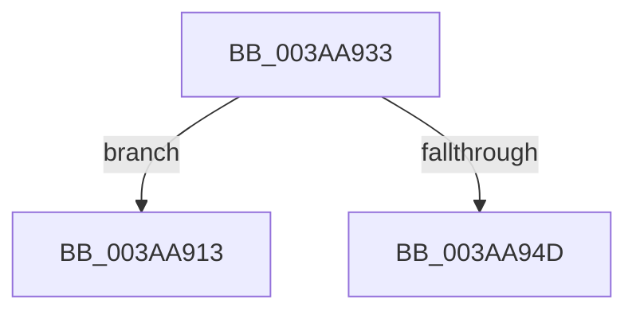

# sub_003AA913

- RVA: `0x003AA913`–`0x003AA952` (길이 `63` bytes)
- VA: `0x00000001403AA913`
- 실행 섹션: `.text`
- PDB 이름 있음: `아니요`; PDB Function 태그: `아니요`
- unwind 정보 RVA: `0x0008B804`
- 디코드: `16`개 명령, `63/63` bytes 표시
- 미해석 바이트: `0` (있으면 어셈블리에 `.byte`로 보존)

> 이 문서는 커널 이미지의 기계어와 PDB 기호를 분석해 생성했습니다. 4번과 5번은 함수 원형과 자료형을 바이너리 사용 방식에서 추정한 C 해석이며 원본 소스 복구 결과는 아닙니다.

## 1. Dependencies

- 직접 호출 지점: **1**; 고유 호출 대상: **1**
- 직접 호출자로 확인된 함수: **0**
- RIP 상대 이미지 참조: **0**

### Outgoing calls
- `0x003AA923` → [_security_check_cookie](../6A/_security_check_cookie_function_006AC640.md) (function, `0x006AC640`)

### Direct callers
- 이 함수 시작 RVA로 연결되는 직접 call은 확인되지 않았습니다. 간접 호출은 완전히 역산할 수 없습니다.

### Static image references
- 디코드된 RIP-relative 메모리 참조가 없습니다.

## 2. Other-region calls and transfers

- 다른 실행 섹션으로 향하는 call: **0**
- call이 아닌 외부 분기/꼬리 이동: **1**
  - `0x003AA94D` → [SMKM_STORE<SM_TRAITS>::SmStDirectRead + 0x5D](SMKM_STORE_SM_TRAITS_SmStDirectRead_function_003AA820.md) (`tail-transfer`)

## 3. Assembly (complete function range)

```asm
003AA913  C1 EB 02                        shr ebx, 2
003AA916  8B C3                           mov eax, ebx
003AA918  48 8B 8C 24 A0 00 00 00         mov rcx, qword ptr [rsp + 0xa0]
003AA920  48 33 CC                        xor rcx, rsp
003AA923  E8 18 1D 30 00                  call 0x1406ac640
003AA928  48 81 C4 B0 00 00 00            add rsp, 0xb0
003AA92F  5F                              pop rdi
003AA930  5D                              pop rbp
003AA931  5B                              pop rbx
003AA932  C3                              ret
003AA933  CC                              int3
003AA934  65 48 8B 14 25 88 01 00 00      mov rdx, qword ptr gs:[0x188]
003AA93D  48 8B 81 00 1D 00 00            mov rax, qword ptr [rcx + 0x1d00]
003AA944  48 39 82 B8 00 00 00            cmp qword ptr [rdx + 0xb8], rax
003AA94B  75 C6                           jne 0x1403aa913
003AA94D  E9 2B FF FF FF                  jmp 0x1403aa87d
```

## 4. C-style interpretation (structured pseudocode)

```c
__int64 __fastcall sub_003AA913(__int64 a1, __int64 a2, __int64 a3, __int64 a4, __int64 a5, __int64 a6, __int64 a7, __int64 a8, __int64 a9, __int64 a10, __int64 a11, __int64 a12, __int64 a13, __int64 a14, __int64 a15, __int64 a16, __int64 a17, __int64 a18, __int64 a19, __int64 a20)
{
    __int64 result;
    __int64 v_rbx;
    __int64 v_rsp;

    v_rbx = (unsigned int)((v_rbx) >> (2));
    a1 = (a20) ^ (v_rsp);
    result = _security_check_cookie(a1, a2, a3, a4);
    v_rsp = (v_rsp) + (176);
    return result;
}
```

## 5. (Beta) C Style

```c
int64_t sub_003AA913(int64_t Arg1, int64_t Arg2, int64_t Arg3, int64_t Arg4, uint64_t Arg5, uint64_t Arg6, uint64_t Arg7, uint64_t Arg8, uint64_t Arg9, uint64_t Arg10, uint64_t Arg11, uint64_t Arg12, uint64_t Arg13, uint64_t Arg14, uint64_t Arg15, uint64_t Arg16, uint64_t Arg17, uint64_t Arg18, uint64_t Arg19, int64_t Arg20)
{
    int64_t result;
    int64_t local_rbx;
    int64_t local_rsp;

    local_rbx = (uint32_t)((local_rbx) >> (2));
    Arg1 = (Arg20) ^ (local_rsp);
    result = _security_check_cookie(Arg1, Arg2, Arg3, Arg4);
    local_rsp = (local_rsp) + (176);
    return result;
}
```

## 6. Execution-region graph

[열기: 2D/3D 그래프와 함수 탐색 컨트롤 패널](../../../control-panel.html?section=text&rva=0x003AA913&view=graph)

- 2D 그래프는 위에서 아래로 흐르고, 3D 그래프는 빈 공간을 드래그해 회전합니다. Shift+드래그는 이동, 휠은 확대·축소, 함수 노드 선택은 대상 보고서 이동입니다.

### Static fallback


