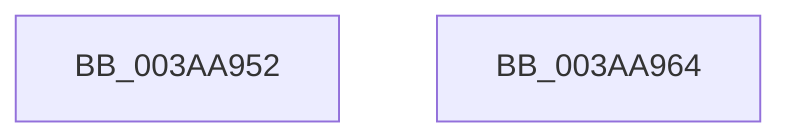

# sub_003AA952

- RVA: `0x003AA952`–`0x003AA978` (길이 `38` bytes)
- VA: `0x00000001403AA952`
- 실행 섹션: `.text`
- PDB 이름 있음: `아니요`; PDB Function 태그: `아니요`
- unwind 정보 RVA: `0x0008B818`
- 디코드: `10`개 명령, `38/38` bytes 표시
- 미해석 바이트: `0` (있으면 어셈블리에 `.byte`로 보존)

> 이 문서는 커널 이미지의 기계어와 PDB 기호를 분석해 생성했습니다. 4번과 5번은 함수 원형과 자료형을 바이너리 사용 방식에서 추정한 C 해석이며 원본 소스 복구 결과는 아닙니다.

## 1. Dependencies

- 직접 호출 지점: **1**; 고유 호출 대상: **1**
- 직접 호출자로 확인된 함수: **0**
- RIP 상대 이미지 참조: **0**

### Outgoing calls
- `0x003AA958` → [ST_STORE<SM_TRAITS>::StReleaseReadContext](ST_STORE_SM_TRAITS_StReleaseReadContext_function_003ABF84.md) (function, `0x003ABF84`)

### Direct callers
- 이 함수 시작 RVA로 연결되는 직접 call은 확인되지 않았습니다. 간접 호출은 완전히 역산할 수 없습니다.

### Static image references
- 디코드된 RIP-relative 메모리 참조가 없습니다.

## 2. Other-region calls and transfers

- 다른 실행 섹션으로 향하는 call: **0**
- call이 아닌 외부 분기/꼬리 이동: **2**
  - `0x003AA962` → [sub_003AA889 + 0x76](Unknown_function_003AA889.md) (`tail-transfer`)
  - `0x003AA976` → [sub_003AA889 + 0x76](Unknown_function_003AA889.md) (`tail-transfer`)

## 3. Assembly (complete function range)

```asm
003AA952  48 8B D6                        mov rdx, rsi
003AA955  48 8B CF                        mov rcx, rdi
003AA958  E8 27 16 00 00                  call 0x1403abf84
003AA95D  BB 03 00 00 00                  mov ebx, 3
003AA962  EB 9B                           jmp 0x1403aa8ff
003AA964  0F 10 44 24 50                  movups xmm0, xmmword ptr [rsp + 0x50]
003AA969  0F 10 4C 24 60                  movups xmm1, xmmword ptr [rsp + 0x60]
003AA96E  0F 11 45 00                     movups xmmword ptr [rbp], xmm0
003AA972  0F 11 4D 10                     movups xmmword ptr [rbp + 0x10], xmm1
003AA976  EB 87                           jmp 0x1403aa8ff
```

## 4. C-style interpretation (structured pseudocode)

```c
__int64 __fastcall sub_003AA952(void)
{
    __int64 result;
    unsigned __int64 v_stack_p50;
    unsigned __int64 v_stack_p60;

    result = ST_STORE_SM_TRAITS___StReleaseReadContext(v_rdi, v_rsi, a3, a4);
}
```

## 5. (Beta) C Style

```c
void sub_003AA952(void)
{
    int64_t result;
    uint64_t v_stack_p50;
    uint64_t v_stack_p60;

    result = ST_STORE_SM_TRAITS___StReleaseReadContext(local_rdi, local_rsi, a3, a4);
}
```

## 6. Execution-region graph

[열기: 2D/3D 그래프와 함수 탐색 컨트롤 패널](../../../control-panel.html?section=text&rva=0x003AA952&view=graph)

- 2D 그래프는 위에서 아래로 흐르고, 3D 그래프는 빈 공간을 드래그해 회전합니다. Shift+드래그는 이동, 휠은 확대·축소, 함수 노드 선택은 대상 보고서 이동입니다.

### Static fallback


