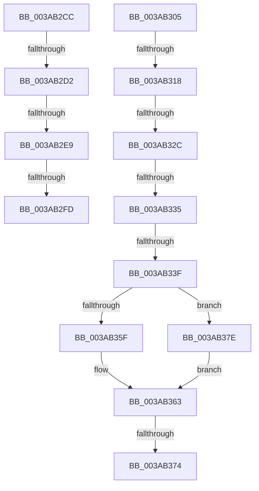

# sub_003AB2CC

- RVA: `0x003AB2CC`–`0x003AB384` (길이 `184` bytes)
- VA: `0x00000001403AB2CC`
- 실행 섹션: `.text`
- PDB 이름 있음: `아니요`; PDB Function 태그: `아니요`
- unwind 정보 RVA: `0x0008B8C4`
- 디코드: `51`개 명령, `184/184` bytes 표시
- 미해석 바이트: `0` (있으면 어셈블리에 `.byte`로 보존)

> 이 문서는 커널 이미지의 기계어와 PDB 기호를 분석해 생성했습니다. 4번과 5번은 함수 원형과 자료형을 바이너리 사용 방식에서 추정한 C 해석이며 원본 소스 복구 결과는 아닙니다.

## 1. Dependencies

- 직접 호출 지점: **2**; 고유 호출 대상: **2**
- 직접 호출자로 확인된 함수: **0**
- RIP 상대 이미지 참조: **0**

### Outgoing calls
- `0x003AB30B` → [B_TREE<_SM_PAGE_KEY,ST_STORE<SM_TRAITS>::_ST_PAGE_ENTRY,4096,NP_CONTEXT,B_TREE_KEY_COMPARATOR<_SM_PAGE_KEY> >::BTreeRedistribute](B_TREE__SM_PAGE_KEY_ST_STORE_SM_TRAITS__ST_PAGE_ENTRY_4096_NP_CONTEXT_B_TREE_KEY_COMPARATOR__SM_PAGE_function_003AB4B8.md) (function, `0x003AB4B8`)
- `0x003AB374` → [NP_CONTEXT::NpLeafDerefInternal](NP_CONTEXT_NpLeafDerefInternal_function_003A9A70.md) (function, `0x003A9A70`)

### Direct callers
- 이 함수 시작 RVA로 연결되는 직접 call은 확인되지 않았습니다. 간접 호출은 완전히 역산할 수 없습니다.

### Static image references
- 디코드된 RIP-relative 메모리 참조가 없습니다.

## 2. Other-region calls and transfers

- 다른 실행 섹션으로 향하는 call: **0**
- call이 아닌 외부 분기/꼬리 이동: **10**
  - `0x003AB2D0` → [sub_003AB294 + 0x19](Unknown_function_003AB294.md) (`tail-transfer`)
  - `0x003AB2E7` → [sub_003AB294 + 0x19](Unknown_function_003AB294.md) (`tail-transfer`)
  - `0x003AB2F7` → [sub_003AB3AF + 0x4A](Unknown_function_003AB3AF.md) (`tail-transfer`)
  - `0x003AB303` → [sub_003AB294 + 0x19](Unknown_function_003AB294.md) (`tail-transfer`)
  - `0x003AB316` → [sub_003AB393](Unknown_function_003AB393.md) (`tail-transfer`)
  - `0x003AB326` → [sub_003AB3AF](Unknown_function_003AB3AF.md) (`tail-transfer`)
  - `0x003AB32F` → [sub_003AB3AF + 0x53](Unknown_function_003AB3AF.md) (`tail-transfer`)
  - `0x003AB339` → [sub_003AB294 + 0x9](Unknown_function_003AB294.md) (`tail-transfer`)
  - `0x003AB36E` → [sub_003AB294 + 0x9](Unknown_function_003AB294.md) (`tail-transfer`)
  - `0x003AB379` → [sub_003AB294 + 0x9](Unknown_function_003AB294.md) (`tail-transfer`)

## 3. Assembly (complete function range)

```asm
003AB2CC  80 79 03 00                     cmp byte ptr [rcx + 3], 0
003AB2D0  74 DB                           je 0x1403ab2ad
003AB2D2  41 8B 4F 18                     mov ecx, dword ptr [r15 + 0x18]
003AB2D6  4D 8B 07                        mov r8, qword ptr [r15]
003AB2D9  48 83 E9 02                     sub rcx, 2
003AB2DD  48 C1 E1 04                     shl rcx, 4
003AB2E1  49 03 C8                        add rcx, r8
003AB2E4  49 3B C8                        cmp rcx, r8
003AB2E7  72 C4                           jb 0x1403ab2ad
003AB2E9  48 8B 01                        mov rax, qword ptr [rcx]
003AB2EC  4C 8B 49 08                     mov r9, qword ptr [rcx + 8]
003AB2F0  48 83 C0 10                     add rax, 0x10
003AB2F4  4C 3B C8                        cmp r9, rax
003AB2F7  0F 86 FC 00 00 00               jbe 0x1403ab3f9
003AB2FD  8B 02                           mov eax, dword ptr [rdx]
003AB2FF  41 89 41 F0                     mov dword ptr [r9 - 0x10], eax
003AB303  EB A8                           jmp 0x1403ab2ad
003AB305  49 8B D7                        mov rdx, r15
003AB308  49 8B CE                        mov rcx, r14
003AB30B  E8 A8 01 00 00                  call 0x1403ab4b8
003AB310  4C 8B E8                        mov r13, rax
003AB313  48 85 C0                        test rax, rax
003AB316  74 7B                           je 0x1403ab393
003AB318  8B 03                           mov eax, dword ptr [rbx]
003AB31A  41 23 C4                        and eax, r12d
003AB31D  4D 8B E5                        mov r12, r13
003AB320  41 83 E4 01                     and r12d, 1
003AB324  3B C5                           cmp eax, ebp
003AB326  0F 82 83 00 00 00               jb 0x1403ab3af
003AB32C  4D 85 E4                        test r12, r12
003AB32F  0F 85 CD 00 00 00               jne 0x1403ab402
003AB335  80 7B 03 00                     cmp byte ptr [rbx + 3], 0
003AB339  0F 84 5E FF FF FF               je 0x1403ab29d
003AB33F  48 8B 56 F0                     mov rdx, qword ptr [rsi - 0x10]
003AB343  49 83 F4 01                     xor r12, 1
003AB347  48 8B 4E F8                     mov rcx, qword ptr [rsi - 8]
003AB34B  49 C1 E4 05                     shl r12, 5
003AB34F  48 83 C1 F0                     add rcx, -0x10
003AB353  49 03 CC                        add rcx, r12
003AB356  48 8D 42 10                     lea rax, [rdx + 0x10]
003AB35A  48 3B C8                        cmp rcx, rax
003AB35D  76 1F                           jbe 0x1403ab37e
003AB35F  48 8D 51 F8                     lea rdx, [rcx - 8]
003AB363  49 8B 46 10                     mov rax, qword ptr [r14 + 0x10]
003AB367  49 8D 4E 10                     lea rcx, [r14 + 0x10]
003AB36B  83 38 FF                        cmp dword ptr [rax], -1
003AB36E  0F 84 29 FF FF FF               je 0x1403ab29d
003AB374  E8 F7 E6 FF FF                  call 0x1403a9a70
003AB379  E9 1F FF FF FF                  jmp 0x1403ab29d
003AB37E  48 83 C2 08                     add rdx, 8
003AB382  EB DF                           jmp 0x1403ab363
```

## 4. C-style interpretation (structured pseudocode)

```c
__int64 __fastcall sub_003AB2CC(__int64 a1, __int64 a2)
{
    __int64 result;

    a1 = ((unsigned int)(*(unsigned int *)(v_r15 + 24))) - (2);
    a1 = (a1) << (4);
    a1 = (a1) + (*(unsigned __int64 *)(v_r15));
    result = (*(unsigned __int64 *)(a1)) + (16);
    *(unsigned int *)(*(unsigned __int64 *)(a1 + 8) - 16) = (unsigned int)((unsigned int)(*(unsigned int *)(a2)));
}
```

## 5. (Beta) C Style

```c
int64_t sub_003AB2CC(void *Arg1, void *Arg2)
{
    uint8_t *arg1 = (uint8_t *)Arg1;
    uint8_t *arg2 = (uint8_t *)Arg2;

    int64_t result;

    Arg1 = ((uint32_t)(*(uint32_t *)(local_r15 + 0x18))) - (2);
    Arg1 = (Arg1) << (4);
    Arg1 = (Arg1) + (*(uint64_t *)(local_r15));
    result = (*(uint64_t *)(arg1)) + (16);
    *(uint32_t *)(*(uint64_t *)(arg1 + 0x8) - 0x10) = (uint32_t)((uint32_t)(*(uint32_t *)(arg2)));
}
```

### 관측된 메모리 오프셋

구조체 형식이 확인되지 않은 접근은 인자 기준의 오프셋으로만 기록했습니다.

| 기준 인자 | 오프셋 표현 | 폭 (bit) | 접근 |
|---|---:|---:|---|
| `Arg1` | `+ 0x3` | `8` | `R` |
| `Arg2` | `+ 0x0` | `32` | `R` |

## 6. Execution-region graph

[열기: 2D/3D 그래프와 함수 탐색 컨트롤 패널](../../../control-panel.html?section=text&rva=0x003AB2CC&view=graph)

- 2D 그래프는 위에서 아래로 흐르고, 3D 그래프는 빈 공간을 드래그해 회전합니다. Shift+드래그는 이동, 휠은 확대·축소, 함수 노드 선택은 대상 보고서 이동입니다.

### Static fallback


