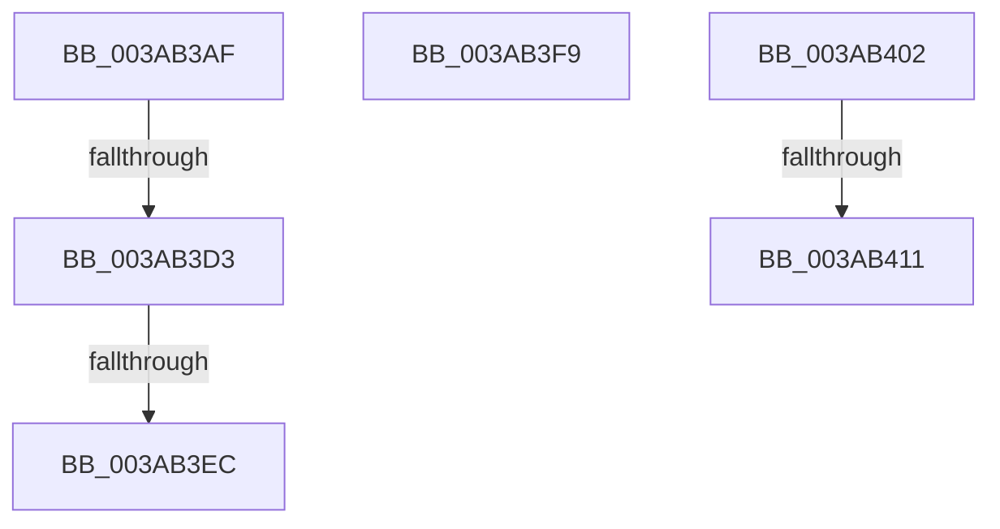

# sub_003AB3AF

- RVA: `0x003AB3AF`–`0x003AB41E` (길이 `111` bytes)
- VA: `0x00000001403AB3AF`
- 실행 섹션: `.text`
- PDB 이름 있음: `아니요`; PDB Function 태그: `아니요`
- unwind 정보 RVA: `0x0008B90C`
- 디코드: `28`개 명령, `111/111` bytes 표시
- 미해석 바이트: `0` (있으면 어셈블리에 `.byte`로 보존)

> 이 문서는 커널 이미지의 기계어와 PDB 기호를 분석해 생성했습니다. 4번과 5번은 함수 원형과 자료형을 바이너리 사용 방식에서 추정한 C 해석이며 원본 소스 복구 결과는 아닙니다.

## 1. Dependencies

- 직접 호출 지점: **1**; 고유 호출 대상: **1**
- 직접 호출자로 확인된 함수: **0**
- RIP 상대 이미지 참조: **0**

### Outgoing calls
- `0x003AB3B8` → [B_TREE<_SM_PAGE_KEY,ST_STORE<SM_TRAITS>::_ST_PAGE_ENTRY,4096,NP_CONTEXT,B_TREE_KEY_COMPARATOR<_SM_PAGE_KEY> >::BTreeMergeNodes](B_TREE__SM_PAGE_KEY_ST_STORE_SM_TRAITS__ST_PAGE_ENTRY_4096_NP_CONTEXT_B_TREE_KEY_COMPARATOR__SM_PAGE_function_003AADC4.md) (function, `0x003AADC4`)

### Direct callers
- 이 함수 시작 RVA로 연결되는 직접 call은 확인되지 않았습니다. 간접 호출은 완전히 역산할 수 없습니다.

### Static image references
- 디코드된 RIP-relative 메모리 참조가 없습니다.

## 2. Other-region calls and transfers

- 다른 실행 섹션으로 향하는 call: **0**
- call이 아닌 외부 분기/꼬리 이동: **6**
  - `0x003AB3CD` → [sub_003AB294 + 0x9](Unknown_function_003AB294.md) (`tail-transfer`)
  - `0x003AB3E6` → [sub_006E6D09](../6E/Unknown_function_006E6D09.md) (`tail-transfer`)
  - `0x003AB3F4` → [sub_006E6D09 + 0x7](../6E/Unknown_function_006E6D09.md) (`tail-transfer`)
  - `0x003AB3FD` → [sub_003AB2CC + 0x18](Unknown_function_003AB2CC.md) (`tail-transfer`)
  - `0x003AB40F` → [sub_003AB463](Unknown_function_003AB463.md) (`tail-transfer`)
  - `0x003AB419` → [sub_003AB2CC + 0x69](Unknown_function_003AB2CC.md) (`tail-transfer`)

## 3. Assembly (complete function range)

```asm
003AB3AF  4D 8B C5                        mov r8, r13
003AB3B2  49 8B D7                        mov rdx, r15
003AB3B5  49 8B CE                        mov rcx, r14
003AB3B8  E8 07 FA FF FF                  call 0x1403aadc4
003AB3BD  41 8B 77 18                     mov esi, dword ptr [r15 + 0x18]
003AB3C1  FF CE                           dec esi
003AB3C3  48 C1 E6 04                     shl rsi, 4
003AB3C7  49 03 37                        add rsi, qword ptr [r15]
003AB3CA  4D 85 E4                        test r12, r12
003AB3CD  0F 84 CA FE FF FF               je 0x1403ab29d
003AB3D3  49 83 E5 FE                     and r13, 0xfffffffffffffffe
003AB3D7  4C 89 2E                        mov qword ptr [rsi], r13
003AB3DA  41 80 7D 03 00                  cmp byte ptr [r13 + 3], 0
003AB3DF  41 8B 45 00                     mov eax, dword ptr [r13]
003AB3E3  0F B7 C0                        movzx eax, ax
003AB3E6  0F 84 1D B9 33 00               je 0x1406e6d09
003AB3EC  48 8D 04 C5 10 00 00 00         lea rax, [rax*8 + 0x10]
003AB3F4  E9 17 B9 33 00                  jmp 0x1406e6d10
003AB3F9  48 83 E9 10                     sub rcx, 0x10
003AB3FD  E9 E2 FE FF FF                  jmp 0x1403ab2e4
003AB402  2B C5                           sub eax, ebp
003AB404  80 7B 03 00                     cmp byte ptr [rbx + 3], 0
003AB408  8D 48 01                        lea ecx, [rax + 1]
003AB40B  48 8B 46 08                     mov rax, qword ptr [rsi + 8]
003AB40F  74 52                           je 0x1403ab463
003AB411  48 8D 04 C8                     lea rax, [rax + rcx*8]
003AB415  48 89 46 08                     mov qword ptr [rsi + 8], rax
003AB419  E9 17 FF FF FF                  jmp 0x1403ab335
```

## 4. C-style interpretation (structured pseudocode)

```c
__int64 __fastcall sub_003AB3AF(void)
{
    __int64 result;
    __int64 v_r13;
    __int64 v_rsi;

    result = B_TREE__SM_PAGE_KEY_ST_STORE_SM_TRAITS____ST_PAGE_ENTRY_4096_NP_CONTEXT_B_TREE_KEY_COMPARATOR__SM_PA(v_r14, v_r15, v_r13, a4);
    v_rsi = (unsigned int)(((unsigned int)(*(unsigned int *)(v_r15 + 24))) - 1);
    v_rsi = (v_rsi) << (4);
    v_rsi = (v_rsi) + (*(unsigned __int64 *)(v_r15));
    v_r13 = (v_r13) & (-2);
    *(unsigned __int64 *)(v_rsi) = v_r13;
}
```

## 5. (Beta) C Style

```c
void sub_003AB3AF(void)
{
    int64_t result;
    int64_t local_r13;
    int64_t local_rsi;

    result = B_TREE__SM_PAGE_KEY_ST_STORE_SM_TRAITS____ST_PAGE_ENTRY_4096_NP_CONTEXT_B_TREE_KEY_COMPARATOR__SM_PA(local_r14, local_r15, local_r13, a4);
    local_rsi = (uint32_t)(((uint32_t)(*(uint32_t *)(local_r15 + 0x18))) - 1);
    local_rsi = (local_rsi) << (4);
    local_rsi = (local_rsi) + (*(uint64_t *)(local_r15));
    local_r13 = (local_r13) & (-2);
    *(uint64_t *)(local_rsi) = local_r13;
}
```

## 6. Execution-region graph

[열기: 2D/3D 그래프와 함수 탐색 컨트롤 패널](../../../control-panel.html?section=text&rva=0x003AB3AF&view=graph)

- 2D 그래프는 위에서 아래로 흐르고, 3D 그래프는 빈 공간을 드래그해 회전합니다. Shift+드래그는 이동, 휠은 확대·축소, 함수 노드 선택은 대상 보고서 이동입니다.

### Static fallback


