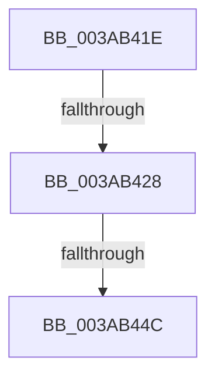

# sub_003AB41E

- RVA: `0x003AB41E`–`0x003AB463` (길이 `69` bytes)
- VA: `0x00000001403AB41E`
- 실행 섹션: `.text`
- PDB 이름 있음: `아니요`; PDB Function 태그: `아니요`
- unwind 정보 RVA: `0x0008B920`
- 디코드: `18`개 명령, `69/69` bytes 표시
- 미해석 바이트: `0` (있으면 어셈블리에 `.byte`로 보존)

> 이 문서는 커널 이미지의 기계어와 PDB 기호를 분석해 생성했습니다. 4번과 5번은 함수 원형과 자료형을 바이너리 사용 방식에서 추정한 C 해석이며 원본 소스 복구 결과는 아닙니다.

## 1. Dependencies

- 직접 호출 지점: **2**; 고유 호출 대상: **2**
- 직접 호출자로 확인된 함수: **0**
- RIP 상대 이미지 참조: **0**

### Outgoing calls
- `0x003AB43A` → [memcpy](../6C/memcpy_function_006C6840.md) (function, `0x006C6840`)
- `0x003AB459` → [B_TREE<_SM_PAGE_KEY,ST_STORE<SM_TRAITS>::_ST_PAGE_ENTRY,4096,NP_CONTEXT,B_TREE_KEY_COMPARATOR<_SM_PAGE_KEY> >::BTreeDeleteNode](B_TREE__SM_PAGE_KEY_ST_STORE_SM_TRAITS__ST_PAGE_ENTRY_4096_NP_CONTEXT_B_TREE_KEY_COMPARATOR__SM_PAGE_function_003AA598.md) (function, `0x003AA598`)

### Direct callers
- 이 함수 시작 RVA로 연결되는 직접 call은 확인되지 않았습니다. 간접 호출은 완전히 역산할 수 없습니다.

### Static image references
- 디코드된 RIP-relative 메모리 참조가 없습니다.

## 2. Other-region calls and transfers

- 다른 실행 섹션으로 향하는 call: **0**
- call이 아닌 외부 분기/꼬리 이동: **3**
  - `0x003AB422` → [sub_003AB384 + 0x8](Unknown_function_003AB384.md) (`tail-transfer`)
  - `0x003AB44A` → [sub_003AB473](Unknown_function_003AB473.md) (`tail-transfer`)
  - `0x003AB45E` → [sub_003AB384 + 0x8](Unknown_function_003AB384.md) (`tail-transfer`)

## 3. Assembly (complete function range)

```asm
003AB41E  80 7B 03 00                     cmp byte ptr [rbx + 3], 0
003AB422  0F 85 64 FF FF FF               jne 0x1403ab38c
003AB428  45 8B 47 1C                     mov r8d, dword ptr [r15 + 0x1c]
003AB42C  48 8D 56 10                     lea rdx, [rsi + 0x10]
003AB430  41 FF C8                        dec r8d
003AB433  48 8B CE                        mov rcx, rsi
003AB436  49 C1 E0 04                     shl r8, 4
003AB43A  E8 01 B4 31 00                  call 0x1406c6840
003AB43F  41 FF 4F 18                     dec dword ptr [r15 + 0x18]
003AB443  49 8B 46 10                     mov rax, qword ptr [r14 + 0x10]
003AB447  83 38 FF                        cmp dword ptr [rax], -1
003AB44A  75 27                           jne 0x1403ab473
003AB44C  48 8B 43 08                     mov rax, qword ptr [rbx + 8]
003AB450  49 89 06                        mov qword ptr [r14], rax
003AB453  48 8B D3                        mov rdx, rbx
003AB456  49 8B CE                        mov rcx, r14
003AB459  E8 3A F1 FF FF                  call 0x1403aa598
003AB45E  E9 29 FF FF FF                  jmp 0x1403ab38c
```

## 4. C-style interpretation (structured pseudocode)

```c
__int64 __fastcall sub_003AB41E(void)
{
    __int64 result;

    a3 = (unsigned int)(((unsigned int)(*(unsigned int *)(v_r15 + 28))) - 1);
    a3 = (a3) << (4);
    result = memcpy(v_rsi, v_rsi + 16, a3, a4);
    *(unsigned __int64 *)(v_r14) = *(unsigned __int64 *)(v_rbx + 8);
    result = B_TREE__SM_PAGE_KEY_ST_STORE_SM_TRAITS____ST_PAGE_ENTRY_4096_NP_CONTEXT_B_TREE_KEY_COMPARATOR__SM_PA(v_r14, v_rbx, a3, a4);
}
```

## 5. (Beta) C Style

```c
void sub_003AB41E(void)
{
    int64_t result;

    a3 = (uint32_t)(((uint32_t)(*(uint32_t *)(local_r15 + 0x1C))) - 1);
    a3 = (a3) << (4);
    result = memcpy(local_rsi, local_rsi + 16, a3, a4);
    *(uint64_t *)(local_r14) = *(uint64_t *)(local_rbx + 0x8);
    result = B_TREE__SM_PAGE_KEY_ST_STORE_SM_TRAITS____ST_PAGE_ENTRY_4096_NP_CONTEXT_B_TREE_KEY_COMPARATOR__SM_PA(local_r14, local_rbx, a3, a4);
}
```

## 6. Execution-region graph

[열기: 2D/3D 그래프와 함수 탐색 컨트롤 패널](../../../control-panel.html?section=text&rva=0x003AB41E&view=graph)

- 2D 그래프는 위에서 아래로 흐르고, 3D 그래프는 빈 공간을 드래그해 회전합니다. Shift+드래그는 이동, 휠은 확대·축소, 함수 노드 선택은 대상 보고서 이동입니다.

### Static fallback


