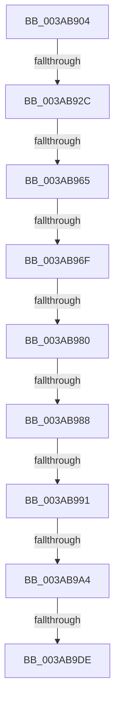

# sub_003AB904

- RVA: `0x003AB904`–`0x003AB9E8` (길이 `228` bytes)
- VA: `0x00000001403AB904`
- 실행 섹션: `.text`
- PDB 이름 있음: `아니요`; PDB Function 태그: `아니요`
- unwind 정보 RVA: `0x0008BA14`
- 디코드: `61`개 명령, `228/228` bytes 표시
- 미해석 바이트: `0` (있으면 어셈블리에 `.byte`로 보존)

> 이 문서는 커널 이미지의 기계어와 PDB 기호를 분석해 생성했습니다. 4번과 5번은 함수 원형과 자료형을 바이너리 사용 방식에서 추정한 C 해석이며 원본 소스 복구 결과는 아닙니다.

## 1. Dependencies

- 직접 호출 지점: **2**; 고유 호출 대상: **2**
- 직접 호출자로 확인된 함수: **0**
- RIP 상대 이미지 참조: **0**

### Outgoing calls
- `0x003AB932` → [B_TREE<_SM_PAGE_KEY,ST_STORE<SM_TRAITS>::_ST_PAGE_ENTRY,4096,NP_CONTEXT,B_TREE_KEY_COMPARATOR<_SM_PAGE_KEY> >::BTreeRedistribute](B_TREE__SM_PAGE_KEY_ST_STORE_SM_TRAITS__ST_PAGE_ENTRY_4096_NP_CONTEXT_B_TREE_KEY_COMPARATOR__SM_PAGE_function_003AB4B8.md) (function, `0x003AB4B8`)
- `0x003AB9DE` → [NP_CONTEXT::NpLeafDerefInternal](NP_CONTEXT_NpLeafDerefInternal_function_003A9A70.md) (function, `0x003A9A70`)

### Direct callers
- 이 함수 시작 RVA로 연결되는 직접 call은 확인되지 않았습니다. 간접 호출은 완전히 역산할 수 없습니다.

### Static image references
- 디코드된 RIP-relative 메모리 참조가 없습니다.

## 2. Other-region calls and transfers

- 다른 실행 섹션으로 향하는 call: **0**
- call이 아닌 외부 분기/꼬리 이동: **9**
  - `0x003AB926` → [sub_003ABA1D + 0xCB](Unknown_function_003ABA1D.md) (`tail-transfer`)
  - `0x003AB95F` → [sub_003ABA1D](Unknown_function_003ABA1D.md) (`tail-transfer`)
  - `0x003AB969` → [sub_003ABA1D + 0xBB](Unknown_function_003ABA1D.md) (`tail-transfer`)
  - `0x003AB97A` → [sub_003ABA1D + 0x124](Unknown_function_003ABA1D.md) (`tail-transfer`)
  - `0x003AB982` → [sub_003ABA1D + 0x110](Unknown_function_003ABA1D.md) (`tail-transfer`)
  - `0x003AB98B` → [sub_003ABA1D + 0x11B](Unknown_function_003ABA1D.md) (`tail-transfer`)
  - `0x003AB99E` → [sub_003ABA1D + 0xD9](Unknown_function_003ABA1D.md) (`tail-transfer`)
  - `0x003AB9D8` → [sub_003AB867 + 0x1F](Unknown_function_003AB867.md) (`tail-transfer`)
  - `0x003AB9E3` → [sub_003AB867 + 0x1F](Unknown_function_003AB867.md) (`tail-transfer`)

## 3. Assembly (complete function range)

```asm
003AB904  4C 8B 67 08                     mov r12, qword ptr [rdi + 8]
003AB908  4C 2B E3                        sub r12, rbx
003AB90B  C1 E9 18                        shr ecx, 0x18
003AB90E  49 83 EC 10                     sub r12, 0x10
003AB912  49 8B C4                        mov rax, r12
003AB915  49 C1 FC 03                     sar r12, 3
003AB919  48 C1 F8 04                     sar rax, 4
003AB91D  84 C9                           test cl, cl
003AB91F  44 0F 44 E0                     cmove r12d, eax
003AB923  49 3B 1E                        cmp rbx, qword ptr [r14]
003AB926  0F 84 BC 01 00 00               je 0x1403abae8
003AB92C  48 8B D6                        mov rdx, rsi
003AB92F  49 8B CE                        mov rcx, r14
003AB932  E8 81 FB FF FF                  call 0x1403ab4b8
003AB937  4C 8B 4F F8                     mov r9, qword ptr [rdi - 8]
003AB93B  4C 8B D0                        mov r10, rax
003AB93E  49 F7 D2                        not r10
003AB941  4C 8B C0                        mov r8, rax
003AB944  41 83 E2 01                     and r10d, 1
003AB948  49 C1 E2 05                     shl r10, 5
003AB94C  49 83 C2 F0                     add r10, -0x10
003AB950  4D 03 D1                        add r10, r9
003AB953  8B 03                           mov eax, dword ptr [rbx]
003AB955  8B C8                           mov ecx, eax
003AB957  C1 E9 18                        shr ecx, 0x18
003AB95A  0F B7 D0                        movzx edx, ax
003AB95D  3B D5                           cmp edx, ebp
003AB95F  0F 83 B8 00 00 00               jae 0x1403aba1d
003AB965  41 F6 C0 01                     test r8b, 1
003AB969  0F 84 69 01 00 00               je 0x1403abad8
003AB96F  2B D5                           sub edx, ebp
003AB971  49 83 E0 FE                     and r8, 0xfffffffffffffffe
003AB975  41 03 D4                        add edx, r12d
003AB978  84 C9                           test cl, cl
003AB97A  0F 84 C1 01 00 00               je 0x1403abb41
003AB980  85 D2                           test edx, edx
003AB982  0F 8E A5 01 00 00               jle 0x1403abb2d
003AB988  49 3B D8                        cmp rbx, r8
003AB98B  0F 84 A7 01 00 00               je 0x1403abb38
003AB991  4D 8B CA                        mov r9, r10
003AB994  48 89 1F                        mov qword ptr [rdi], rbx
003AB997  48 63 C2                        movsxd rax, edx
003AB99A  44 38 6B 03                     cmp byte ptr [rbx + 3], r13b
003AB99E  0F 84 52 01 00 00               je 0x1403abaf6
003AB9A4  48 83 C0 02                     add rax, 2
003AB9A8  49 8D 51 F8                     lea rdx, [r9 - 8]
003AB9AC  48 8D 04 C3                     lea rax, [rbx + rax*8]
003AB9B0  48 89 47 08                     mov qword ptr [rdi + 8], rax
003AB9B4  48 8B 47 F0                     mov rax, qword ptr [rdi - 0x10]
003AB9B8  48 8D 48 10                     lea rcx, [rax + 0x10]
003AB9BC  48 83 C0 08                     add rax, 8
003AB9C0  4C 3B C9                        cmp r9, rcx
003AB9C3  49 8D 4E 10                     lea rcx, [r14 + 0x10]
003AB9C7  48 0F 46 D0                     cmovbe rdx, rax
003AB9CB  4D 85 F6                        test r14, r14
003AB9CE  49 0F 44 CD                     cmove rcx, r13
003AB9D2  48 8B 01                        mov rax, qword ptr [rcx]
003AB9D5  83 38 FF                        cmp dword ptr [rax], -1
003AB9D8  0F 84 A8 FE FF FF               je 0x1403ab886
003AB9DE  E8 8D E0 FF FF                  call 0x1403a9a70
003AB9E3  E9 9E FE FF FF                  jmp 0x1403ab886
```

## 4. C-style interpretation (structured pseudocode)

```c
__int64 __fastcall sub_003AB904(int a1)
{
    __int64 result;
    __int64 v_r10;
    __int64 v_r12;

    v_r12 = (*(unsigned __int64 *)(v_rdi + 8)) - (v_rbx);
    a1 = (unsigned int)((a1) >> (24));
    v_r12 = (v_r12) - (16);
    v_r12 = (v_r12) >> (3);
    result = (v_r12) >> (4);
    if ((unsigned __int8)(a1) == 0) { v_r12 = (unsigned int)(result); }
    result = B_TREE__SM_PAGE_KEY_ST_STORE_SM_TRAITS____ST_PAGE_ENTRY_4096_NP_CONTEXT_B_TREE_KEY_COMPARATOR__SM_PA(v_r14, v_rsi, a3, a4);
    v_r10 = ~(result);
    v_r10 = (unsigned int)((v_r10) & (1));
    v_r10 = (v_r10) << (5);
    v_r10 = (v_r10) + (-16);
    v_r10 = (v_r10) + (*(unsigned __int64 *)(v_rdi - 8));
    a1 = (unsigned int)(((unsigned int)((unsigned int)((unsigned int)(*(unsigned int *)(v_rbx))))) >> (24));
    a2 = (unsigned int)(((unsigned __int16)((unsigned int)(*(unsigned int *)(v_rbx)))) - ((unsigned int)(v_rbp)));
    a3 = (result) & (-2);
    a2 = (unsigned int)((a2) + ((unsigned int)(v_r12)));
    *(unsigned __int64 *)(v_rdi) = v_rbx;
    result = ((int)((unsigned int)(a2))) + (2);
    *(unsigned __int64 *)(v_rdi + 8) = v_rbx + result * 8;
    result = (*(unsigned __int64 *)(v_rdi - 16)) + (8);
    a2 = v_r10 - 8;
    if (v_r10 <= (*(unsigned __int64 *)(v_rdi - 16) + 16)) { a2 = result; }
    a1 = v_r14 + 16;
    if (v_r14 == 0) { a1 = v_r13; }
    result = NP_CONTEXT__NpLeafDerefInternal(a1, a2, a3, v_r10);
}
```

## 5. (Beta) C Style

```c
int64_t sub_003AB904(int32_t Arg1)
{
    int64_t result;
    int64_t local_r10;
    int64_t local_r12;

    local_r12 = (*(uint64_t *)(local_rdi + 0x8)) - (local_rbx);
    Arg1 = (uint32_t)((Arg1) >> (24));
    local_r12 = (local_r12) - (16);
    local_r12 = (local_r12) >> (3);
    result = (local_r12) >> (4);
    if ((uint8_t)(Arg1) == 0) { local_r12 = (uint32_t)(result); }
    result = B_TREE__SM_PAGE_KEY_ST_STORE_SM_TRAITS____ST_PAGE_ENTRY_4096_NP_CONTEXT_B_TREE_KEY_COMPARATOR__SM_PA(local_r14, local_rsi, a3, a4);
    local_r10 = ~(result);
    local_r10 = (uint32_t)((local_r10) & (1));
    local_r10 = (local_r10) << (5);
    local_r10 = (local_r10) + (-16);
    local_r10 = (local_r10) + (*(uint64_t *)(local_rdi - 0x8));
    Arg1 = (uint32_t)(((uint32_t)((uint32_t)((uint32_t)(*(uint32_t *)(local_rbx))))) >> (24));
    a2 = (uint32_t)(((uint16_t)((uint32_t)(*(uint32_t *)(local_rbx)))) - ((uint32_t)(local_rbp)));
    a3 = (result) & (-2);
    a2 = (uint32_t)((a2) + ((uint32_t)(local_r12)));
    *(uint64_t *)(local_rdi) = local_rbx;
    result = ((int32_t)((uint32_t)(a2))) + (2);
    *(uint64_t *)(local_rdi + 0x8) = local_rbx + result * 8;
    result = (*(uint64_t *)(local_rdi - 0x10)) + (8);
    a2 = local_r10 - 8;
    if (local_r10 <= (*(uint64_t *)(local_rdi - 0x10) + 16)) { a2 = result; }
    Arg1 = local_r14 + 16;
    if (local_r14 == 0) { Arg1 = local_r13; }
    result = NP_CONTEXT__NpLeafDerefInternal(Arg1, a2, a3, local_r10);
}
```

## 6. Execution-region graph

[열기: 2D/3D 그래프와 함수 탐색 컨트롤 패널](../../../control-panel.html?section=text&rva=0x003AB904&view=graph)

- 2D 그래프는 위에서 아래로 흐르고, 3D 그래프는 빈 공간을 드래그해 회전합니다. Shift+드래그는 이동, 휠은 확대·축소, 함수 노드 선택은 대상 보고서 이동입니다.

### Static fallback


