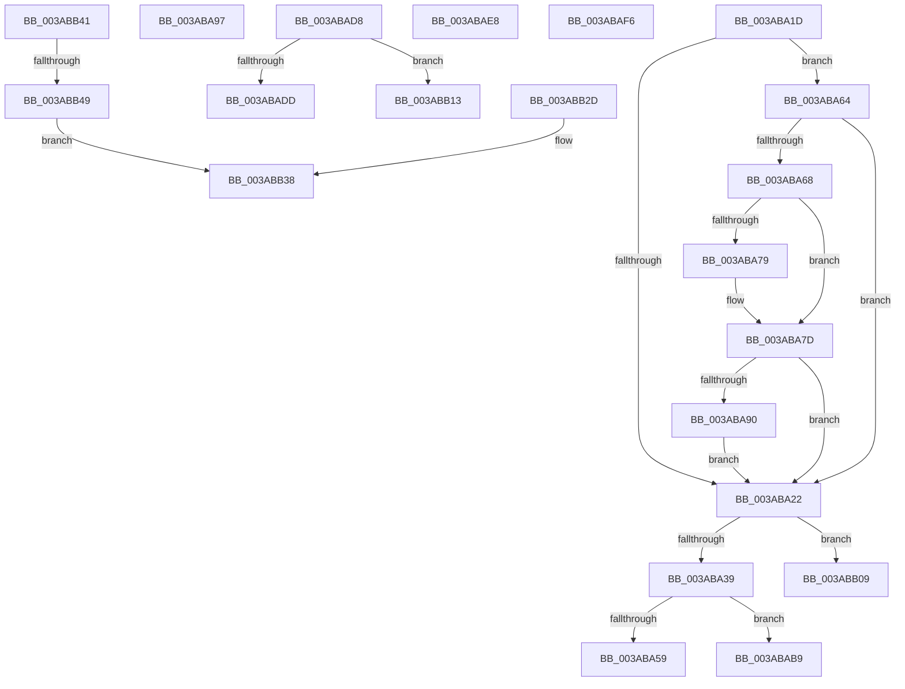

# sub_003ABA1D

- RVA: `0x003ABA1D`–`0x003ABB58` (길이 `315` bytes)
- VA: `0x00000001403ABA1D`
- 실행 섹션: `.text`
- PDB 이름 있음: `아니요`; PDB Function 태그: `아니요`
- unwind 정보 RVA: `0x0008BA44`
- 디코드: `91`개 명령, `315/315` bytes 표시
- 미해석 바이트: `0` (있으면 어셈블리에 `.byte`로 보존)

> 이 문서는 커널 이미지의 기계어와 PDB 기호를 분석해 생성했습니다. 4번과 5번은 함수 원형과 자료형을 바이너리 사용 방식에서 추정한 C 해석이며 원본 소스 복구 결과는 아닙니다.

## 1. Dependencies

- 직접 호출 지점: **3**; 고유 호출 대상: **3**
- 직접 호출자로 확인된 함수: **0**
- RIP 상대 이미지 참조: **0**

### Outgoing calls
- `0x003ABA28` → [B_TREE<_SM_PAGE_KEY,ST_STORE<SM_TRAITS>::_ST_PAGE_ENTRY,4096,NP_CONTEXT,B_TREE_KEY_COMPARATOR<_SM_PAGE_KEY> >::BTreeSplitChild](B_TREE__SM_PAGE_KEY_ST_STORE_SM_TRAITS__ST_PAGE_ENTRY_4096_NP_CONTEXT_B_TREE_KEY_COMPARATOR__SM_PAGE_function_003AAF50.md) (function, `0x003AAF50`)
- `0x003ABA90` → [NP_CONTEXT::NpLeafDerefInternal](NP_CONTEXT_NpLeafDerefInternal_function_003A9A70.md) (function, `0x003A9A70`)
- `0x003ABAA8` → [memcpy](../6C/memcpy_function_006C6840.md) (function, `0x006C6840`)

### Direct callers
- 이 함수 시작 RVA로 연결되는 직접 call은 확인되지 않았습니다. 간접 호출은 완전히 역산할 수 없습니다.

### Static image references
- 디코드된 RIP-relative 메모리 참조가 없습니다.

## 2. Other-region calls and transfers

- 다른 실행 섹션으로 향하는 call: **0**
- call이 아닌 외부 분기/꼬리 이동: **10**
  - `0x003ABA5F` → [sub_003AB904 + 0x90](Unknown_function_003AB904.md) (`tail-transfer`)
  - `0x003ABAB4` → [sub_003AB867 + 0x57](Unknown_function_003AB867.md) (`tail-transfer`)
  - `0x003ABAD3` → [sub_003AB904 + 0x90](Unknown_function_003AB904.md) (`tail-transfer`)
  - `0x003ABAE3` → [sub_003AB904 + 0x90](Unknown_function_003AB904.md) (`tail-transfer`)
  - `0x003ABAF1` → [sub_003AB904 + 0x4F](Unknown_function_003AB904.md) (`tail-transfer`)
  - `0x003ABB04` → [sub_003AB867 + 0x1F](Unknown_function_003AB867.md) (`tail-transfer`)
  - `0x003ABB0E` → [sub_003AB867 + 0x5D](Unknown_function_003AB867.md) (`tail-transfer`)
  - `0x003ABB28` → [sub_003AB904 + 0x90](Unknown_function_003AB904.md) (`tail-transfer`)
  - `0x003ABB3C` → [sub_003AB904 + 0x90](Unknown_function_003AB904.md) (`tail-transfer`)
  - `0x003ABB43` → [sub_003AB904 + 0x84](Unknown_function_003AB904.md) (`tail-transfer`)

## 3. Assembly (complete function range)

```asm
003ABA1D  4D 85 C0                        test r8, r8
003ABA20  75 42                           jne 0x1403aba64
003ABA22  48 8B D6                        mov rdx, rsi
003ABA25  49 8B CE                        mov rcx, r14
003ABA28  E8 23 F5 FF FF                  call 0x1403aaf50
003ABA2D  48 8B C8                        mov rcx, rax
003ABA30  48 85 C0                        test rax, rax
003ABA33  0F 84 D0 00 00 00               je 0x1403abb09
003ABA39  8B 7E 18                        mov edi, dword ptr [rsi + 0x18]
003ABA3C  44 8B 03                        mov r8d, dword ptr [rbx]
003ABA3F  FF CF                           dec edi
003ABA41  48 C1 E7 04                     shl rdi, 4
003ABA45  48 03 3E                        add rdi, qword ptr [rsi]
003ABA48  41 0F B7 D0                     movzx edx, r8w
003ABA4C  4C 8B 4F F8                     mov r9, qword ptr [rdi - 8]
003ABA50  49 8D 41 10                     lea rax, [r9 + 0x10]
003ABA54  44 3B E2                        cmp r12d, edx
003ABA57  7F 60                           jg 0x1403abab9
003ABA59  4C 8B C8                        mov r9, rax
003ABA5C  41 8B D4                        mov edx, r12d
003ABA5F  E9 30 FF FF FF                  jmp 0x1403ab994
003ABA64  84 C9                           test cl, cl
003ABA66  74 BA                           je 0x1403aba22
003ABA68  48 8B 4F F0                     mov rcx, qword ptr [rdi - 0x10]
003ABA6C  49 8D 52 F8                     lea rdx, [r10 - 8]
003ABA70  48 8D 41 10                     lea rax, [rcx + 0x10]
003ABA74  4C 3B D0                        cmp r10, rax
003ABA77  77 04                           ja 0x1403aba7d
003ABA79  48 8D 51 08                     lea rdx, [rcx + 8]
003ABA7D  4D 85 F6                        test r14, r14
003ABA80  49 8D 4E 10                     lea rcx, [r14 + 0x10]
003ABA84  49 0F 44 CD                     cmove rcx, r13
003ABA88  48 8B 01                        mov rax, qword ptr [rcx]
003ABA8B  83 38 FF                        cmp dword ptr [rax], -1
003ABA8E  74 92                           je 0x1403aba22
003ABA90  E8 DB DF FF FF                  call 0x1403a9a70
003ABA95  EB 8B                           jmp 0x1403aba22
003ABA97  49 FF C0                        inc r8
003ABA9A  48 8D 4F 10                     lea rcx, [rdi + 0x10]
003ABA9E  49 C1 E0 04                     shl r8, 4
003ABAA2  4C 2B C7                        sub r8, rdi
003ABAA5  4C 03 C3                        add r8, rbx
003ABAA8  E8 93 AD 31 00                  call 0x1406c6840
003ABAAD  41 0F 10 07                     movups xmm0, xmmword ptr [r15]
003ABAB1  0F 11 07                        movups xmmword ptr [rdi], xmm0
003ABAB4  E9 05 FE FF FF                  jmp 0x1403ab8be
003ABAB9  44 2B E2                        sub r12d, edx
003ABABC  41 C1 E8 18                     shr r8d, 0x18
003ABAC0  45 84 C0                        test r8b, r8b
003ABAC3  48 89 47 F8                     mov qword ptr [rdi - 8], rax
003ABAC7  48 8B D9                        mov rbx, rcx
003ABACA  41 8D 54 24 FF                  lea edx, [r12 - 1]
003ABACF  41 0F 45 D4                     cmovne edx, r12d
003ABAD3  E9 BC FE FF FF                  jmp 0x1403ab994
003ABAD8  44 3B E2                        cmp r12d, edx
003ABADB  7F 36                           jg 0x1403abb13
003ABADD  4D 8B CA                        mov r9, r10
003ABAE0  41 8B D4                        mov edx, r12d
003ABAE3  E9 AC FE FF FF                  jmp 0x1403ab994
003ABAE8  4D 8B D5                        mov r10, r13
003ABAEB  4D 8B C5                        mov r8, r13
003ABAEE  4D 8B CD                        mov r9, r13
003ABAF1  E9 5D FE FF FF                  jmp 0x1403ab953
003ABAF6  48 FF C0                        inc rax
003ABAF9  48 C1 E0 04                     shl rax, 4
003ABAFD  48 03 C3                        add rax, rbx
003ABB00  48 89 47 08                     mov qword ptr [rdi + 8], rax
003ABB04  E9 7D FD FF FF                  jmp 0x1403ab886
003ABB09  B8 9A 00 00 C0                  mov eax, 0xc000009a
003ABB0E  E9 B1 FD FF FF                  jmp 0x1403ab8c4
003ABB13  44 2B E2                        sub r12d, edx
003ABB16  4C 89 57 F8                     mov qword ptr [rdi - 8], r10
003ABB1A  84 C9                           test cl, cl
003ABB1C  49 8B D8                        mov rbx, r8
003ABB1F  41 8D 54 24 FF                  lea edx, [r12 - 1]
003ABB24  41 0F 45 D4                     cmovne edx, r12d
003ABB28  E9 67 FE FF FF                  jmp 0x1403ab994
003ABB2D  41 8B 00                        mov eax, dword ptr [r8]
003ABB30  49 8B D8                        mov rbx, r8
003ABB33  0F B7 C8                        movzx ecx, ax
003ABB36  03 D1                           add edx, ecx
003ABB38  4C 89 57 F8                     mov qword ptr [rdi - 8], r10
003ABB3C  E9 53 FE FF FF                  jmp 0x1403ab994
003ABB41  85 D2                           test edx, edx
003ABB43  0F 89 3F FE FF FF               jns 0x1403ab988
003ABB49  41 8B 00                        mov eax, dword ptr [r8]
003ABB4C  FF C2                           inc edx
003ABB4E  0F B7 C8                        movzx ecx, ax
003ABB51  49 8B D8                        mov rbx, r8
003ABB54  03 D1                           add edx, ecx
003ABB56  EB E0                           jmp 0x1403abb38
```

## 4. C-style interpretation (structured pseudocode)

```c
__int64 __fastcall sub_003ABA1D(__int64 a1, __int64 a2, __int64 a3)
{
    __int64 result;
    __int64 v_r12;
    __int64 v_rdi;

    if (a3 != 0) goto loc_003ABA64;
loc_003ABA22:
    result = B_TREE__SM_PAGE_KEY_ST_STORE_SM_TRAITS____ST_PAGE_ENTRY_4096_NP_CONTEXT_B_TREE_KEY_COMPARATOR__SM_PA(v_r14, v_rsi, a3, a4);
    if (result == 0) goto loc_003ABB09;
    v_rdi = (unsigned int)(((unsigned int)(*(unsigned int *)(v_rsi + 24))) - 1);
    v_rdi = (v_rdi) << (4);
    v_rdi = (v_rdi) + (*(unsigned __int64 *)(v_rsi));
    if (((unsigned int)(v_r12)) > ((unsigned int)((unsigned __int16)((unsigned int)(*(unsigned int *)(v_rbx)))))) goto loc_003ABAB9;
loc_003ABA64:
    if ((unsigned __int8)(result) == 0) goto loc_003ABA22;
    if (v_r10 <= (*(unsigned __int64 *)(v_rdi - 16) + 16)) {
        a2 = *(unsigned __int64 *)(v_rdi - 16) + 8;
    }
    a1 = v_r14 + 16;
    if (v_r14 == 0) { a1 = v_r13; }
    if ((*(unsigned int *)(*(unsigned __int64 *)(a1))) == -1) goto loc_003ABA22;
    result = NP_CONTEXT__NpLeafDerefInternal(a1, a2, (unsigned int)(*(unsigned int *)(v_rbx)), *(unsigned __int64 *)(v_rdi - 8) + 16);
    goto loc_003ABA22;
loc_003ABAB9:
    v_r12 = (unsigned int)((v_r12) - ((unsigned int)(a2)));
    a3 = (unsigned int)(((unsigned int)(*(unsigned int *)(v_rbx))) >> (24));
    *(unsigned __int64 *)(v_rdi - 8) = result;
    a2 = v_r12 - 1;
    if ((unsigned __int8)(a3) != 0) { a2 = (unsigned int)(v_r12); }
loc_003ABB09:
}
```

## 5. (Beta) C Style

```c
int64_t sub_003ABA1D(int64_t Arg1, int64_t Arg2, int64_t Arg3)
{
    int64_t result;
    int64_t local_r12;
    int64_t local_rdi;

    if (Arg3 != 0) goto loc_003ABA64;
loc_003ABA22:
    result = B_TREE__SM_PAGE_KEY_ST_STORE_SM_TRAITS____ST_PAGE_ENTRY_4096_NP_CONTEXT_B_TREE_KEY_COMPARATOR__SM_PA(local_r14, local_rsi, Arg3, a4);
    if (result == 0) goto loc_003ABB09;
    local_rdi = (uint32_t)(((uint32_t)(*(uint32_t *)(local_rsi + 0x18))) - 1);
    local_rdi = (local_rdi) << (4);
    local_rdi = (local_rdi) + (*(uint64_t *)(local_rsi));
    if (((uint32_t)(local_r12)) > ((uint32_t)((uint16_t)((uint32_t)(*(uint32_t *)(local_rbx)))))) goto loc_003ABAB9;
loc_003ABA64:
    if ((uint8_t)(result) == 0) goto loc_003ABA22;
    if (local_r10 <= (*(uint64_t *)(local_rdi - 0x10) + 16)) {
        Arg2 = *(uint64_t *)(local_rdi - 0x10) + 8;
    }
    Arg1 = local_r14 + 16;
    if (local_r14 == 0) { Arg1 = local_r13; }
    if ((*(uint32_t *)(*(uint64_t *)(Arg1))) == -1) goto loc_003ABA22;
    result = NP_CONTEXT__NpLeafDerefInternal(Arg1, Arg2, (uint32_t)(*(uint32_t *)(local_rbx)), *(uint64_t *)(local_rdi - 0x8) + 16);
    goto loc_003ABA22;
loc_003ABAB9:
    local_r12 = (uint32_t)((local_r12) - ((uint32_t)(Arg2)));
    Arg3 = (uint32_t)(((uint32_t)(*(uint32_t *)(local_rbx))) >> (24));
    *(uint64_t *)(local_rdi - 0x8) = result;
    Arg2 = local_r12 - 1;
    if ((uint8_t)(Arg3) != 0) { Arg2 = (uint32_t)(local_r12); }
loc_003ABB09:
}
```

## 6. Execution-region graph

[열기: 2D/3D 그래프와 함수 탐색 컨트롤 패널](../../../control-panel.html?section=text&rva=0x003ABA1D&view=graph)

- 2D 그래프는 위에서 아래로 흐르고, 3D 그래프는 빈 공간을 드래그해 회전합니다. Shift+드래그는 이동, 휠은 확대·축소, 함수 노드 선택은 대상 보고서 이동입니다.

### Static fallback


