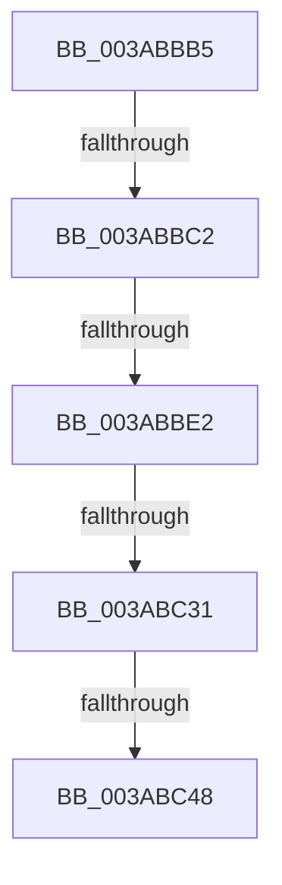

# sub_003ABBB5

- RVA: `0x003ABBB5`–`0x003ABC74` (길이 `191` bytes)
- VA: `0x00000001403ABBB5`
- 실행 섹션: `.text`
- PDB 이름 있음: `아니요`; PDB Function 태그: `아니요`
- unwind 정보 RVA: `0x0008BA8C`
- 디코드: `51`개 명령, `191/191` bytes 표시
- 미해석 바이트: `0` (있으면 어셈블리에 `.byte`로 보존)

> 이 문서는 커널 이미지의 기계어와 PDB 기호를 분석해 생성했습니다. 4번과 5번은 함수 원형과 자료형을 바이너리 사용 방식에서 추정한 C 해석이며 원본 소스 복구 결과는 아닙니다.

## 1. Dependencies

- 직접 호출 지점: **3**; 고유 호출 대상: **3**
- 직접 호출자로 확인된 함수: **0**
- RIP 상대 이미지 참조: **0**

### Outgoing calls
- `0x003ABBD1` → [NP_CONTEXT::NpNodeAllocate](NP_CONTEXT_NpNodeAllocate_function_003ABEEC.md) (function, `0x003ABEEC`)
- `0x003ABBED` → [memset](../6C/memset_function_006C6C40.md) (function, `0x006C6C40`)
- `0x003ABC5A` → [memcpy](../6C/memcpy_function_006C6840.md) (function, `0x006C6840`)

### Direct callers
- 이 함수 시작 RVA로 연결되는 직접 call은 확인되지 않았습니다. 간접 호출은 완전히 역산할 수 없습니다.

### Static image references
- 디코드된 RIP-relative 메모리 참조가 없습니다.

## 2. Other-region calls and transfers

- 다른 실행 섹션으로 향하는 call: **0**
- call이 아닌 외부 분기/꼬리 이동: **4**
  - `0x003ABBBC` → [sub_003ABC8C](Unknown_function_003ABC8C.md) (`tail-transfer`)
  - `0x003ABBDC` → [sub_003ABC8C + 0x154](Unknown_function_003ABC8C.md) (`tail-transfer`)
  - `0x003ABC2F` → [sub_003ABC8C + 0x10](Unknown_function_003ABC8C.md) (`tail-transfer`)
  - `0x003ABC42` → [sub_003ABC8C + 0x75](Unknown_function_003ABC8C.md) (`tail-transfer`)

## 3. Assembly (complete function range)

```asm
003ABBB5  4C 89 74 24 50                  mov qword ptr [rsp + 0x50], r14
003ABBBA  85 ED                           test ebp, ebp
003ABBBC  0F 85 CA 00 00 00               jne 0x1403abc8c
003ABBC2  48 85 FF                        test rdi, rdi
003ABBC5  48 8D 4F 10                     lea rcx, [rdi + 0x10]
003ABBC9  44 8D 45 01                     lea r8d, [rbp + 1]
003ABBCD  49 0F 44 CD                     cmove rcx, r13
003ABBD1  E8 16 03 00 00                  call 0x1403abeec
003ABBD6  48 8B E8                        mov rbp, rax
003ABBD9  48 85 C0                        test rax, rax
003ABBDC  0F 84 FE 01 00 00               je 0x1403abde0
003ABBE2  33 D2                           xor edx, edx
003ABBE4  41 B8 00 10 00 00               mov r8d, 0x1000
003ABBEA  48 8B C8                        mov rcx, rax
003ABBED  E8 4E B0 31 00                  call 0x1406c6c40
003ABBF2  66 C7 45 02 01 01               mov word ptr [rbp + 2], 0x101
003ABBF8  48 89 2F                        mov qword ptr [rdi], rbp
003ABBFB  4C 8B 33                        mov r14, qword ptr [rbx]
003ABBFE  49 89 2E                        mov qword ptr [r14], rbp
003ABC01  48 8B 07                        mov rax, qword ptr [rdi]
003ABC04  48 83 C0 10                     add rax, 0x10
003ABC08  49 89 46 08                     mov qword ptr [r14 + 8], rax
003ABC0C  8B 43 18                        mov eax, dword ptr [rbx + 0x18]
003ABC0F  FF C0                           inc eax
003ABC11  41 89 07                        mov dword ptr [r15], eax
003ABC14  49 8B 36                        mov rsi, qword ptr [r14]
003ABC17  B8 FF 00 00 00                  mov eax, 0xff
003ABC1C  BD FC 03 00 00                  mov ebp, 0x3fc
003ABC21  44 38 6E 03                     cmp byte ptr [rsi + 3], r13b
003ABC25  8B 0E                           mov ecx, dword ptr [rsi]
003ABC27  0F 44 E8                        cmove ebp, eax
003ABC2A  0F B7 C1                        movzx eax, cx
003ABC2D  3B C5                           cmp eax, ebp
003ABC2F  73 6B                           jae 0x1403abc9c
003ABC31  49 8B 5E 08                     mov rbx, qword ptr [r14 + 8]
003ABC35  48 8B D3                        mov rdx, rbx
003ABC38  8B 06                           mov eax, dword ptr [rsi]
003ABC3A  44 0F B7 C0                     movzx r8d, ax
003ABC3E  44 38 6E 03                     cmp byte ptr [rsi + 3], r13b
003ABC42  0F 84 B9 00 00 00               je 0x1403abd01
003ABC48  4E 8D 04 85 10 00 00 00         lea r8, [r8*4 + 0x10]
003ABC50  4C 2B C3                        sub r8, rbx
003ABC53  48 8D 4B 04                     lea rcx, [rbx + 4]
003ABC57  4C 03 C6                        add r8, rsi
003ABC5A  E8 E1 AB 31 00                  call 0x1406c6840
003ABC5F  41 8B 04 24                     mov eax, dword ptr [r12]
003ABC63  89 03                           mov dword ptr [rbx], eax
003ABC65  48 FF 47 08                     inc qword ptr [rdi + 8]
003ABC69  66 FF 06                        inc word ptr [rsi]
003ABC6C  41 8B C5                        mov eax, r13d
003ABC6F  4C 8B 74 24 50                  mov r14, qword ptr [rsp + 0x50]
```

## 4. C-style interpretation (structured pseudocode)

```c
__int64 __fastcall sub_003ABBB5(__int64 a1, int a2, __int64 a3, __int64 a4, __int64 a5, __int64 a6, __int64 a7, __int64 a8, __int64 a9, __int64 a10)
{
    __int64 result;
    __int64 v_rbp;
    unsigned __int64 v_stack_p50;

    v_stack_p50 = v_r14;
    a1 = v_rdi + 16;
    if (v_rdi == 0) { a1 = v_r13; }
    result = NP_CONTEXT__NpNodeAllocate(a1, a2, v_rbp + 1, a4);
    a2 = 0;
    result = memset(result, a2, (unsigned int)(0x1000ULL), a4);
    *(unsigned __int16 *)(result + 2) = 257;
    *(unsigned __int64 *)(v_rdi) = result;
    *(unsigned __int64 *)(*(unsigned __int64 *)(v_rbx)) = result;
    result = (*(unsigned __int64 *)(v_rdi)) + (16);
    *(unsigned __int64 *)(*(unsigned __int64 *)(v_rbx) + 8) = result;
    result = (unsigned int)(((unsigned int)(*(unsigned int *)(v_rbx + 24))) + 1);
    *(unsigned int *)(v_r15) = (unsigned int)(result);
    v_rbp = (unsigned int)(0x3FCULL);
    if ((*(unsigned __int8 *)(*(unsigned __int64 *)(*(unsigned __int64 *)(v_rbx)) + 3)) == ((unsigned __int8)(v_r13))) { v_rbp = 255; }
    a3 = ((unsigned __int16)((unsigned int)(*(unsigned int *)(*(unsigned __int64 *)(*(unsigned __int64 *)(v_rbx))))) * 4 + 16) - (*(unsigned __int64 *)(*(unsigned __int64 *)(v_rbx) + 8));
    a3 = (a3) + (*(unsigned __int64 *)(*(unsigned __int64 *)(v_rbx)));
    result = memcpy(*(unsigned __int64 *)(*(unsigned __int64 *)(v_rbx) + 8) + 4, *(unsigned __int64 *)(*(unsigned __int64 *)(v_rbx) + 8), a3, a4);
    *(unsigned int *)(*(unsigned __int64 *)(*(unsigned __int64 *)(v_rbx) + 8)) = (unsigned int)((unsigned int)(*(unsigned int *)(v_r12)));
    return (unsigned int)((unsigned int)(v_r13));
}
```

## 5. (Beta) C Style

```c
int64_t sub_003ABBB5(int64_t Arg1, int32_t Arg2, int64_t Arg3, int64_t Arg4, uint64_t Arg5, uint64_t Arg6, uint64_t Arg7, uint64_t Arg8, uint64_t Arg9, int64_t Arg10)
{
    int64_t result;
    int64_t local_rbp;
    uint64_t v_stack_p50;

    v_stack_p50 = local_r14;
    Arg1 = local_rdi + 16;
    if (local_rdi == 0) { Arg1 = local_r13; }
    result = NP_CONTEXT__NpNodeAllocate(Arg1, Arg2, local_rbp + 1, Arg4);
    Arg2 = 0;
    result = memset(result, Arg2, (uint32_t)(0x1000ULL), Arg4);
    *(uint16_t *)(result + 0x2) = 257;
    *(uint64_t *)(local_rdi) = result;
    *(uint64_t *)(*(uint64_t *)(local_rbx)) = result;
    result = (*(uint64_t *)(local_rdi)) + (16);
    *(uint64_t *)(*(uint64_t *)(local_rbx) + 0x8) = result;
    result = (uint32_t)(((uint32_t)(*(uint32_t *)(local_rbx + 0x18))) + 1);
    *(uint32_t *)(local_r15) = (uint32_t)(result);
    local_rbp = (uint32_t)(0x3FCULL);
    if ((*(uint8_t *)(*(uint64_t *)(*(uint64_t *)(local_rbx)) + 0x3)) == ((uint8_t)(local_r13))) { local_rbp = 255; }
    Arg3 = ((uint16_t)((uint32_t)(*(uint32_t *)(*(uint64_t *)(*(uint64_t *)(local_rbx))))) * 4 + 16) - (*(uint64_t *)(*(uint64_t *)(local_rbx) + 0x8));
    Arg3 = (Arg3) + (*(uint64_t *)(*(uint64_t *)(local_rbx)));
    result = memcpy(*(uint64_t *)(*(uint64_t *)(local_rbx) + 0x8) + 4, *(uint64_t *)(*(uint64_t *)(local_rbx) + 0x8), Arg3, Arg4);
    *(uint32_t *)(*(uint64_t *)(*(uint64_t *)(local_rbx) + 0x8)) = (uint32_t)((uint32_t)(*(uint32_t *)(local_r12)));
    return (uint32_t)((uint32_t)(local_r13));
}
```

## 6. Execution-region graph

[열기: 2D/3D 그래프와 함수 탐색 컨트롤 패널](../../../control-panel.html?section=text&rva=0x003ABBB5&view=graph)

- 2D 그래프는 위에서 아래로 흐르고, 3D 그래프는 빈 공간을 드래그해 회전합니다. Shift+드래그는 이동, 휠은 확대·축소, 함수 노드 선택은 대상 보고서 이동입니다.

### Static fallback


