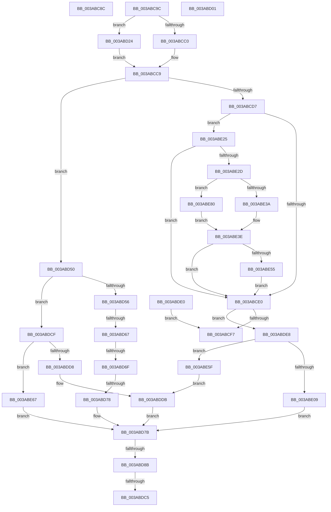

# sub_003ABC8C

- RVA: `0x003ABC8C`–`0x003ABE86` (길이 `506` bytes)
- VA: `0x00000001403ABC8C`
- 실행 섹션: `.text`
- PDB 이름 있음: `아니요`; PDB Function 태그: `아니요`
- unwind 정보 RVA: `0x0008BAB4`
- 디코드: `139`개 명령, `506/506` bytes 표시
- 미해석 바이트: `0` (있으면 어셈블리에 `.byte`로 보존)

> 이 문서는 커널 이미지의 기계어와 PDB 기호를 분석해 생성했습니다. 4번과 5번은 함수 원형과 자료형을 바이너리 사용 방식에서 추정한 C 해석이며 원본 소스 복구 결과는 아닙니다.

## 1. Dependencies

- 직접 호출 지점: **5**; 고유 호출 대상: **4**
- 직접 호출자로 확인된 함수: **0**
- RIP 상대 이미지 참조: **0**

### Outgoing calls
- `0x003ABCE6` → [B_TREE<unsigned long,ST_STORE<SM_TRAITS>::_ST_REGION_ENTRY,4096,NP_CONTEXT,ST_STORE<SM_TRAITS>::ST_REGION_ENTRY_COMPARATOR>::BTreeSplitChild](B_TREE_unsigned_long_ST_STORE_SM_TRAITS__ST_REGION_ENTRY_4096_NP_CONTEXT_ST_STORE_SM_TRAITS_ST_REGIO_function_003AAAA4.md) (function, `0x003AAAA4`)
- `0x003ABD12` → [memcpy](../6C/memcpy_function_006C6840.md) (function, `0x006C6840`)
- `0x003ABD2A` → [B_TREE<unsigned long,ST_STORE<SM_TRAITS>::_ST_REGION_ENTRY,4096,NP_CONTEXT,ST_STORE<SM_TRAITS>::ST_REGION_ENTRY_COMPARATOR>::BTreeRedistribute](B_TREE_unsigned_long_ST_STORE_SM_TRAITS__ST_REGION_ENTRY_4096_NP_CONTEXT_ST_STORE_SM_TRAITS_ST_REGIO_function_003AEA1C.md) (function, `0x003AEA1C`)
- `0x003ABDC5` → [NP_CONTEXT::NpLeafDerefInternal](NP_CONTEXT_NpLeafDerefInternal_function_003A9A70.md) (function, `0x003A9A70`)
- `0x003ABE55` → [NP_CONTEXT::NpLeafDerefInternal](NP_CONTEXT_NpLeafDerefInternal_function_003A9A70.md) (function, `0x003A9A70`)

### Direct callers
- 이 함수 시작 RVA로 연결되는 직접 call은 확인되지 않았습니다. 간접 호출은 완전히 역산할 수 없습니다.

### Static image references
- 디코드된 RIP-relative 메모리 참조가 없습니다.

## 2. Other-region calls and transfers

- 다른 실행 섹션으로 향하는 call: **0**
- call이 아닌 외부 분기/꼬리 이동: **9**
  - `0x003ABC97` → [sub_003ABBB5 + 0x5F](Unknown_function_003ABBB5.md) (`tail-transfer`)
  - `0x003ABCFC` → [sub_003ABBB5 + 0xBA](Unknown_function_003ABBB5.md) (`tail-transfer`)
  - `0x003ABD1F` → [sub_003ABBB5 + 0xB4](Unknown_function_003ABBB5.md) (`tail-transfer`)
  - `0x003ABD61` → [sub_003ABEA5 + 0x14](Unknown_function_003ABEA5.md) (`tail-transfer`)
  - `0x003ABD69` → [sub_003ABEA5](Unknown_function_003ABEA5.md) (`tail-transfer`)
  - `0x003ABD72` → [sub_003ABEA5 + 0xB](Unknown_function_003ABEA5.md) (`tail-transfer`)
  - `0x003ABD85` → [sub_003ABEA5 + 0x2B](Unknown_function_003ABEA5.md) (`tail-transfer`)
  - `0x003ABDBF` → [sub_003ABBB5 + 0x7C](Unknown_function_003ABBB5.md) (`tail-transfer`)
  - `0x003ABDCA` → [sub_003ABBB5 + 0x7C](Unknown_function_003ABBB5.md) (`tail-transfer`)

## 3. Assembly (complete function range)

```asm
003ABC8C  44 8D 75 FF                     lea r14d, [rbp - 1]
003ABC90  49 C1 E6 04                     shl r14, 4
003ABC94  4C 03 33                        add r14, qword ptr [rbx]
003ABC97  E9 78 FF FF FF                  jmp 0x1403abc14
003ABC9C  4D 8B 7E 08                     mov r15, qword ptr [r14 + 8]
003ABCA0  4C 2B FE                        sub r15, rsi
003ABCA3  C1 E9 18                        shr ecx, 0x18
003ABCA6  49 83 EF 10                     sub r15, 0x10
003ABCAA  49 8B C7                        mov rax, r15
003ABCAD  49 C1 FF 02                     sar r15, 2
003ABCB1  48 C1 F8 04                     sar rax, 4
003ABCB5  84 C9                           test cl, cl
003ABCB7  44 0F 44 F8                     cmove r15d, eax
003ABCBB  48 3B 37                        cmp rsi, qword ptr [rdi]
003ABCBE  75 64                           jne 0x1403abd24
003ABCC0  4D 8B D5                        mov r10, r13
003ABCC3  4D 8B C5                        mov r8, r13
003ABCC6  4D 8B CD                        mov r9, r13
003ABCC9  8B 06                           mov eax, dword ptr [rsi]
003ABCCB  8B C8                           mov ecx, eax
003ABCCD  C1 E9 18                        shr ecx, 0x18
003ABCD0  0F B7 D0                        movzx edx, ax
003ABCD3  3B D5                           cmp edx, ebp
003ABCD5  72 79                           jb 0x1403abd50
003ABCD7  4D 85 C0                        test r8, r8
003ABCDA  0F 85 45 01 00 00               jne 0x1403abe25
003ABCE0  48 8B D3                        mov rdx, rbx
003ABCE3  48 8B CF                        mov rcx, rdi
003ABCE6  E8 B9 ED FF FF                  call 0x1403aaaa4
003ABCEB  48 8B C8                        mov rcx, rax
003ABCEE  48 85 C0                        test rax, rax
003ABCF1  0F 85 F1 00 00 00               jne 0x1403abde8
003ABCF7  B8 9A 00 00 C0                  mov eax, 0xc000009a
003ABCFC  E9 6E FF FF FF                  jmp 0x1403abc6f
003ABD01  49 FF C0                        inc r8
003ABD04  48 8D 4B 10                     lea rcx, [rbx + 0x10]
003ABD08  49 C1 E0 04                     shl r8, 4
003ABD0C  4C 2B C3                        sub r8, rbx
003ABD0F  4C 03 C6                        add r8, rsi
003ABD12  E8 29 AB 31 00                  call 0x1406c6840
003ABD17  41 0F 10 04 24                  movups xmm0, xmmword ptr [r12]
003ABD1C  0F 11 03                        movups xmmword ptr [rbx], xmm0
003ABD1F  E9 45 FF FF FF                  jmp 0x1403abc69
003ABD24  48 8B D3                        mov rdx, rbx
003ABD27  48 8B CF                        mov rcx, rdi
003ABD2A  E8 ED 2C 00 00                  call 0x1403aea1c
003ABD2F  4D 8B 4E F8                     mov r9, qword ptr [r14 - 8]
003ABD33  4C 8B D0                        mov r10, rax
003ABD36  49 F7 D2                        not r10
003ABD39  4C 8B C0                        mov r8, rax
003ABD3C  41 83 E2 01                     and r10d, 1
003ABD40  49 C1 E2 05                     shl r10, 5
003ABD44  49 83 C2 F0                     add r10, -0x10
003ABD48  4D 03 D1                        add r10, r9
003ABD4B  E9 79 FF FF FF                  jmp 0x1403abcc9
003ABD50  41 F6 C0 01                     test r8b, 1
003ABD54  74 79                           je 0x1403abdcf
003ABD56  2B D5                           sub edx, ebp
003ABD58  49 83 E0 FE                     and r8, 0xfffffffffffffffe
003ABD5C  41 03 D7                        add edx, r15d
003ABD5F  84 C9                           test cl, cl
003ABD61  0F 84 52 01 00 00               je 0x1403abeb9
003ABD67  85 D2                           test edx, edx
003ABD69  0F 8E 36 01 00 00               jle 0x1403abea5
003ABD6F  49 3B F0                        cmp rsi, r8
003ABD72  0F 84 38 01 00 00               je 0x1403abeb0
003ABD78  4D 8B CA                        mov r9, r10
003ABD7B  49 89 36                        mov qword ptr [r14], rsi
003ABD7E  48 63 C2                        movsxd rax, edx
003ABD81  44 38 6E 03                     cmp byte ptr [rsi + 3], r13b
003ABD85  0F 84 45 01 00 00               je 0x1403abed0
003ABD8B  48 83 C0 04                     add rax, 4
003ABD8F  49 8D 51 F8                     lea rdx, [r9 - 8]
003ABD93  48 8D 04 86                     lea rax, [rsi + rax*4]
003ABD97  49 89 46 08                     mov qword ptr [r14 + 8], rax
003ABD9B  49 8B 46 F0                     mov rax, qword ptr [r14 - 0x10]
003ABD9F  48 8D 48 10                     lea rcx, [rax + 0x10]
003ABDA3  48 83 C0 08                     add rax, 8
003ABDA7  4C 3B C9                        cmp r9, rcx
003ABDAA  48 8D 4F 10                     lea rcx, [rdi + 0x10]
003ABDAE  48 0F 46 D0                     cmovbe rdx, rax
003ABDB2  48 85 FF                        test rdi, rdi
003ABDB5  49 0F 44 CD                     cmove rcx, r13
003ABDB9  48 8B 01                        mov rax, qword ptr [rcx]
003ABDBC  83 38 FF                        cmp dword ptr [rax], -1
003ABDBF  0F 84 6C FE FF FF               je 0x1403abc31
003ABDC5  E8 A6 DC FF FF                  call 0x1403a9a70
003ABDCA  E9 62 FE FF FF                  jmp 0x1403abc31
003ABDCF  44 3B FA                        cmp r15d, edx
003ABDD2  0F 8F 8F 00 00 00               jg 0x1403abe67
003ABDD8  4D 8B CA                        mov r9, r10
003ABDDB  41 8B D7                        mov edx, r15d
003ABDDE  EB 9B                           jmp 0x1403abd7b
003ABDE0  48 89 2F                        mov qword ptr [rdi], rbp
003ABDE3  E9 0F FF FF FF                  jmp 0x1403abcf7
003ABDE8  44 8B 73 18                     mov r14d, dword ptr [rbx + 0x18]
003ABDEC  8B 06                           mov eax, dword ptr [rsi]
003ABDEE  41 FF CE                        dec r14d
003ABDF1  49 C1 E6 04                     shl r14, 4
003ABDF5  4C 03 33                        add r14, qword ptr [rbx]
003ABDF8  44 0F B7 C0                     movzx r8d, ax
003ABDFC  4D 8B 4E F8                     mov r9, qword ptr [r14 - 8]
003ABE00  49 8D 51 10                     lea rdx, [r9 + 0x10]
003ABE04  45 3B F8                        cmp r15d, r8d
003ABE07  7E 56                           jle 0x1403abe5f
003ABE09  45 2B F8                        sub r15d, r8d
003ABE0C  49 89 56 F8                     mov qword ptr [r14 - 8], rdx
003ABE10  C1 E8 18                        shr eax, 0x18
003ABE13  48 8B F1                        mov rsi, rcx
003ABE16  84 C0                           test al, al
003ABE18  41 8D 57 FF                     lea edx, [r15 - 1]
003ABE1C  41 0F 45 D7                     cmovne edx, r15d
003ABE20  E9 56 FF FF FF                  jmp 0x1403abd7b
003ABE25  84 C9                           test cl, cl
003ABE27  0F 84 B3 FE FF FF               je 0x1403abce0
003ABE2D  49 8B 56 F0                     mov rdx, qword ptr [r14 - 0x10]
003ABE31  48 8D 42 10                     lea rax, [rdx + 0x10]
003ABE35  4C 3B D0                        cmp r10, rax
003ABE38  76 46                           jbe 0x1403abe80
003ABE3A  49 8D 52 F8                     lea rdx, [r10 - 8]
003ABE3E  48 85 FF                        test rdi, rdi
003ABE41  48 8D 4F 10                     lea rcx, [rdi + 0x10]
003ABE45  49 0F 44 CD                     cmove rcx, r13
003ABE49  48 8B 01                        mov rax, qword ptr [rcx]
003ABE4C  83 38 FF                        cmp dword ptr [rax], -1
003ABE4F  0F 84 8B FE FF FF               je 0x1403abce0
003ABE55  E8 16 DC FF FF                  call 0x1403a9a70
003ABE5A  E9 81 FE FF FF                  jmp 0x1403abce0
003ABE5F  4C 8B CA                        mov r9, rdx
003ABE62  E9 74 FF FF FF                  jmp 0x1403abddb
003ABE67  44 2B FA                        sub r15d, edx
003ABE6A  4D 89 56 F8                     mov qword ptr [r14 - 8], r10
003ABE6E  84 C9                           test cl, cl
003ABE70  49 8B F0                        mov rsi, r8
003ABE73  41 8D 57 FF                     lea edx, [r15 - 1]
003ABE77  41 0F 45 D7                     cmovne edx, r15d
003ABE7B  E9 FB FE FF FF                  jmp 0x1403abd7b
003ABE80  48 83 C2 08                     add rdx, 8
003ABE84  EB B8                           jmp 0x1403abe3e
```

## 4. C-style interpretation (structured pseudocode)

```c
__int64 __fastcall sub_003ABC8C(int a1)
{
    __int64 v_r14;

    v_r14 = (v_rbp - 1) << (4);
    v_r14 = (v_r14) + (*(unsigned __int64 *)(v_rbx));
}
```

## 5. (Beta) C Style

```c
int64_t sub_003ABC8C(int32_t Arg1)
{
    int64_t local_r14;

    local_r14 = (local_rbp - 1) << (4);
    local_r14 = (local_r14) + (*(uint64_t *)(local_rbx));
}
```

## 6. Execution-region graph

[열기: 2D/3D 그래프와 함수 탐색 컨트롤 패널](../../../control-panel.html?section=text&rva=0x003ABC8C&view=graph)

- 2D 그래프는 위에서 아래로 흐르고, 3D 그래프는 빈 공간을 드래그해 회전합니다. Shift+드래그는 이동, 휠은 확대·축소, 함수 노드 선택은 대상 보고서 이동입니다.

### Static fallback


