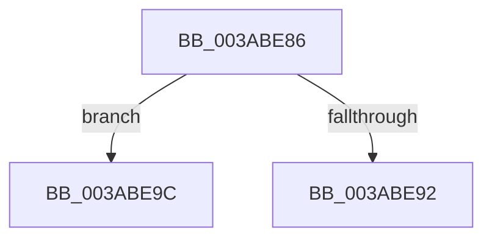

# sub_003ABE86

- RVA: `0x003ABE86`–`0x003ABEA5` (길이 `31` bytes)
- VA: `0x00000001403ABE86`
- 실행 섹션: `.text`
- PDB 이름 있음: `아니요`; PDB Function 태그: `아니요`
- unwind 정보 RVA: `0x0008BAC8`
- 디코드: `8`개 명령, `31/31` bytes 표시
- 미해석 바이트: `0` (있으면 어셈블리에 `.byte`로 보존)

> 이 문서는 커널 이미지의 기계어와 PDB 기호를 분석해 생성했습니다. 4번과 5번은 함수 원형과 자료형을 바이너리 사용 방식에서 추정한 C 해석이며 원본 소스 복구 결과는 아닙니다.

## 1. Dependencies

- 직접 호출 지점: **1**; 고유 호출 대상: **1**
- 직접 호출자로 확인된 함수: **0**
- RIP 상대 이미지 참조: **0**

### Outgoing calls
- `0x003ABE89` → [SmArrayGrow](SmArrayGrow_function_003AC6C8.md) (function, `0x003AC6C8`)

### Direct callers
- 이 함수 시작 RVA로 연결되는 직접 call은 확인되지 않았습니다. 간접 호출은 완전히 역산할 수 없습니다.

### Static image references
- 디코드된 RIP-relative 메모리 참조가 없습니다.

## 2. Other-region calls and transfers

- 다른 실행 섹션으로 향하는 call: **0**
- call이 아닌 외부 분기/꼬리 이동: **2**
  - `0x003ABE97` → [sub_003ABC74](Unknown_function_003ABC74.md) (`tail-transfer`)
  - `0x003ABEA0` → [sub_003ABBB5](Unknown_function_003ABBB5.md) (`tail-transfer`)

## 3. Assembly (complete function range)

```asm
003ABE86  4C 8B CB                        mov r9, rbx
003ABE89  E8 3A 08 00 00                  call 0x1403ac6c8
003ABE8E  85 C0                           test eax, eax
003ABE90  75 0A                           jne 0x1403abe9c
003ABE92  B8 9A 00 00 C0                  mov eax, 0xc000009a
003ABE97  E9 D8 FD FF FF                  jmp 0x1403abc74
003ABE9C  4C 8D 7B 18                     lea r15, [rbx + 0x18]
003ABEA0  E9 10 FD FF FF                  jmp 0x1403abbb5
```

## 4. C-style interpretation (structured pseudocode)

```c
__int64 __fastcall sub_003ABE86(void)
{
    __int64 result;

    result = SmArrayGrow(a1, a2, a3, v_rbx);
    if ((unsigned int)(result) != 0) goto loc_003ABE9C;
loc_003ABE9C:
}
```

## 5. (Beta) C Style

```c
void sub_003ABE86(void)
{
    int64_t result;

    result = SmArrayGrow(a1, a2, a3, local_rbx);
    if ((uint32_t)(result) != 0) goto loc_003ABE9C;
loc_003ABE9C:
}
```

## 6. Execution-region graph

[열기: 2D/3D 그래프와 함수 탐색 컨트롤 패널](../../../control-panel.html?section=text&rva=0x003ABE86&view=graph)

- 2D 그래프는 위에서 아래로 흐르고, 3D 그래프는 빈 공간을 드래그해 회전합니다. Shift+드래그는 이동, 휠은 확대·축소, 함수 노드 선택은 대상 보고서 이동입니다.

### Static fallback


