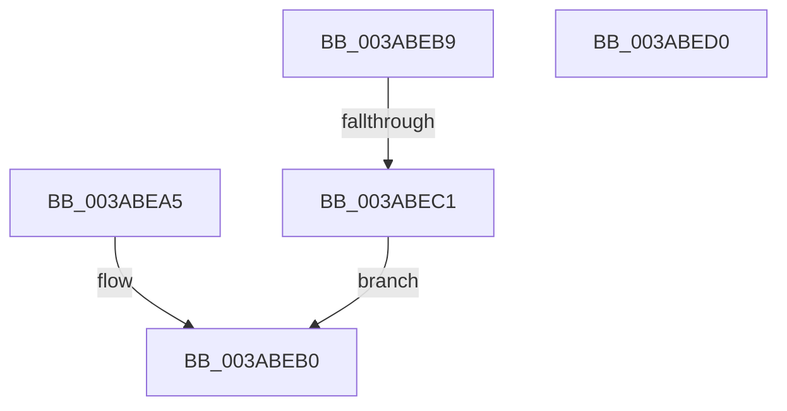

# sub_003ABEA5

- RVA: `0x003ABEA5`–`0x003ABEE3` (길이 `62` bytes)
- VA: `0x00000001403ABEA5`
- 실행 섹션: `.text`
- PDB 이름 있음: `아니요`; PDB Function 태그: `아니요`
- unwind 정보 RVA: `0x0008BAD8`
- 디코드: `19`개 명령, `62/62` bytes 표시
- 미해석 바이트: `0` (있으면 어셈블리에 `.byte`로 보존)

> 이 문서는 커널 이미지의 기계어와 PDB 기호를 분석해 생성했습니다. 4번과 5번은 함수 원형과 자료형을 바이너리 사용 방식에서 추정한 C 해석이며 원본 소스 복구 결과는 아닙니다.

## 1. Dependencies

- 직접 호출 지점: **0**; 고유 호출 대상: **0**
- 직접 호출자로 확인된 함수: **0**
- RIP 상대 이미지 참조: **0**

### Outgoing calls
- 직접 디코드된 call 명령이 없습니다.

### Direct callers
- 이 함수 시작 RVA로 연결되는 직접 call은 확인되지 않았습니다. 간접 호출은 완전히 역산할 수 없습니다.

### Static image references
- 디코드된 RIP-relative 메모리 참조가 없습니다.

## 2. Other-region calls and transfers

- 다른 실행 섹션으로 향하는 call: **0**
- call이 아닌 외부 분기/꼬리 이동: **3**
  - `0x003ABEB4` → [sub_003ABC8C + 0xEF](Unknown_function_003ABC8C.md) (`tail-transfer`)
  - `0x003ABEBB` → [sub_003ABC8C + 0xE3](Unknown_function_003ABC8C.md) (`tail-transfer`)
  - `0x003ABEDE` → [sub_003ABBB5 + 0x7C](Unknown_function_003ABBB5.md) (`tail-transfer`)

## 3. Assembly (complete function range)

```asm
003ABEA5  41 8B 00                        mov eax, dword ptr [r8]
003ABEA8  49 8B F0                        mov rsi, r8
003ABEAB  0F B7 C8                        movzx ecx, ax
003ABEAE  03 D1                           add edx, ecx
003ABEB0  4D 89 56 F8                     mov qword ptr [r14 - 8], r10
003ABEB4  E9 C2 FE FF FF                  jmp 0x1403abd7b
003ABEB9  85 D2                           test edx, edx
003ABEBB  0F 89 AE FE FF FF               jns 0x1403abd6f
003ABEC1  41 8B 00                        mov eax, dword ptr [r8]
003ABEC4  FF C2                           inc edx
003ABEC6  0F B7 C8                        movzx ecx, ax
003ABEC9  49 8B F0                        mov rsi, r8
003ABECC  03 D1                           add edx, ecx
003ABECE  EB E0                           jmp 0x1403abeb0
003ABED0  48 FF C0                        inc rax
003ABED3  48 C1 E0 04                     shl rax, 4
003ABED7  48 03 C6                        add rax, rsi
003ABEDA  49 89 46 08                     mov qword ptr [r14 + 8], rax
003ABEDE  E9 4E FD FF FF                  jmp 0x1403abc31
```

## 4. C-style interpretation (structured pseudocode)

```c
__int64 __fastcall sub_003ABEA5(__int64 a1, int a2, __int64 a3)
{
    a2 = (unsigned int)((a2) + ((unsigned int)((unsigned __int16)((unsigned int)(*(unsigned int *)(a3))))));
loc_003ABEB0:
    *(unsigned __int64 *)(v_r14 - 8) = v_r10;
}
```

## 5. (Beta) C Style

```c
int64_t sub_003ABEA5(int64_t Arg1, int32_t Arg2, void *Arg3)
{
    uint8_t *arg3 = (uint8_t *)Arg3;

    Arg2 = (uint32_t)((Arg2) + ((uint32_t)((uint16_t)((uint32_t)(*(uint32_t *)(arg3))))));
loc_003ABEB0:
    *(uint64_t *)(local_r14 - 0x8) = local_r10;
}
```

### 관측된 메모리 오프셋

구조체 형식이 확인되지 않은 접근은 인자 기준의 오프셋으로만 기록했습니다.

| 기준 인자 | 오프셋 표현 | 폭 (bit) | 접근 |
|---|---:|---:|---|
| `Arg3` | `+ 0x0` | `32` | `R` |

## 6. Execution-region graph

[열기: 2D/3D 그래프와 함수 탐색 컨트롤 패널](../../../control-panel.html?section=text&rva=0x003ABEA5&view=graph)

- 2D 그래프는 위에서 아래로 흐르고, 3D 그래프는 빈 공간을 드래그해 회전합니다. Shift+드래그는 이동, 휠은 확대·축소, 함수 노드 선택은 대상 보고서 이동입니다.

### Static fallback


