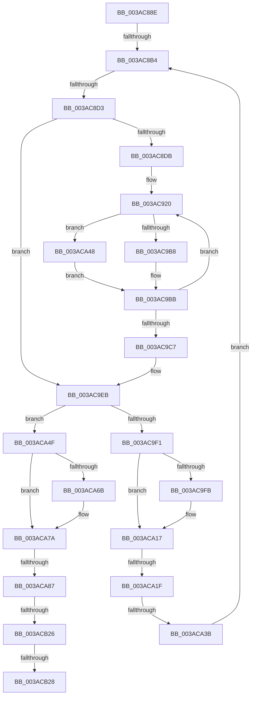

# sub_003AC88E

- RVA: `0x003AC88E`–`0x003ACB3C` (길이 `686` bytes)
- VA: `0x00000001403AC88E`
- 실행 섹션: `.text`
- PDB 이름 있음: `아니요`; PDB Function 태그: `아니요`
- unwind 정보 RVA: `0x0008BB94`
- 디코드: `165`개 명령, `686/686` bytes 표시
- 미해석 바이트: `0` (있으면 어셈블리에 `.byte`로 보존)

> 이 문서는 커널 이미지의 기계어와 PDB 기호를 분석해 생성했습니다. 4번과 5번은 함수 원형과 자료형을 바이너리 사용 방식에서 추정한 C 해석이며 원본 소스 복구 결과는 아닙니다.

## 1. Dependencies

- 직접 호출 지점: **0**; 고유 호출 대상: **0**
- 직접 호출자로 확인된 함수: **0**
- RIP 상대 이미지 참조: **0**

### Outgoing calls
- 직접 디코드된 call 명령이 없습니다.

### Direct callers
- 이 함수 시작 RVA로 연결되는 직접 call은 확인되지 않았습니다. 간접 호출은 완전히 역산할 수 없습니다.

### Static image references
- 디코드된 RIP-relative 메모리 참조가 없습니다.

## 2. Other-region calls and transfers

- 다른 실행 섹션으로 향하는 call: **0**
- call이 아닌 외부 분기/꼬리 이동: **7**
  - `0x003AC8AE` → [sub_003ACB95](Unknown_function_003ACB95.md) (`tail-transfer`)
  - `0x003AC8CD` → [sub_003ACB95 + 0x20](Unknown_function_003ACB95.md) (`tail-transfer`)
  - `0x003ACA19` → [sub_003ACB7A](Unknown_function_003ACB7A.md) (`tail-transfer`)
  - `0x003ACA35` → [sub_003ACCBB + 0x14](Unknown_function_003ACCBB.md) (`tail-transfer`)
  - `0x003ACA81` → [sub_003ACB95 + 0x8](Unknown_function_003ACB95.md) (`tail-transfer`)
  - `0x003ACB24` → [sub_003ACB95 + 0x8](Unknown_function_003ACB95.md) (`tail-transfer`)
  - `0x003ACB26` → [sub_003ACB95 + 0x8](Unknown_function_003ACB95.md) (`tail-transfer`)

## 3. Assembly (complete function range)

```asm
003AC88E  48 89 5C 24 78                  mov qword ptr [rsp + 0x78], rbx
003AC893  49 8B 1C 24                     mov rbx, qword ptr [r12]
003AC897  48 89 7C 24 70                  mov qword ptr [rsp + 0x70], rdi
003AC89C  4C 89 74 24 38                  mov qword ptr [rsp + 0x38], r14
003AC8A1  4C 89 7C 24 68                  mov qword ptr [rsp + 0x68], r15
003AC8A6  48 89 5C 24 40                  mov qword ptr [rsp + 0x40], rbx
003AC8AB  48 85 DB                        test rbx, rbx
003AC8AE  0F 84 E1 02 00 00               je 0x1403acb95
003AC8B4  8B 0B                           mov ecx, dword ptr [rbx]
003AC8B6  4C 8D 7B 10                     lea r15, [rbx + 0x10]
003AC8BA  0F B7 C1                        movzx eax, cx
003AC8BD  41 BB FF FF FF FF               mov r11d, 0xffffffff
003AC8C3  C1 E9 18                        shr ecx, 0x18
003AC8C6  4C 89 7C 24 30                  mov qword ptr [rsp + 0x30], r15
003AC8CB  84 C9                           test cl, cl
003AC8CD  0F 84 E2 02 00 00               je 0x1403acbb5
003AC8D3  85 C0                           test eax, eax
003AC8D5  0F 84 10 01 00 00               je 0x1403ac9eb
003AC8DB  45 8B BC 24 8C 01 00 00         mov r15d, dword ptr [r12 + 0x18c]
003AC8E3  41 8B F5                        mov esi, r13d
003AC8E6  41 8B AC 24 88 01 00 00         mov ebp, dword ptr [r12 + 0x188]
003AC8EE  41 8B D7                        mov edx, r15d
003AC8F1  4C 8B 74 24 30                  mov r14, qword ptr [rsp + 0x30]
003AC8F6  8B CD                           mov ecx, ebp
003AC8F8  41 23 D5                        and edx, r13d
003AC8FB  D3 EE                           shr esi, cl
003AC8FD  45 8B AC 24 98 01 00 00         mov r13d, dword ptr [r12 + 0x198]
003AC905  BB 01 00 00 00                  mov ebx, 1
003AC90A  45 8B A4 24 90 01 00 00         mov r12d, dword ptr [r12 + 0x190]
003AC912  41 8B CC                        mov ecx, r12d
003AC915  0F AF CA                        imul ecx, edx
003AC918  48 89 4C 24 28                  mov qword ptr [rsp + 0x28], rcx
003AC91D  0F 1F 00                        nop dword ptr [rax]
003AC920  42 8D 0C 18                     lea ecx, [rax + r11]
003AC924  C7 44 24 30 00 00 00 00         mov dword ptr [rsp + 0x30], 0
003AC92C  D1 E9                           shr ecx, 1
003AC92E  45 8B D7                        mov r10d, r15d
003AC931  8B F9                           mov edi, ecx
003AC933  44 8B C3                        mov r8d, ebx
003AC936  C7 44 24 30 00 00 00 00         mov dword ptr [rsp + 0x30], 0
003AC93E  41 8B 14 8E                     mov edx, dword ptr [r14 + rcx*4]
003AC942  44 8B CA                        mov r9d, edx
003AC945  44 23 D2                        and r10d, edx
003AC948  8B CD                           mov ecx, ebp
003AC94A  48 8B 94 24 B0 00 00 00         mov rdx, qword ptr [rsp + 0xb0]
003AC952  41 D3 E9                        shr r9d, cl
003AC955  41 0F BD C9                     bsr ecx, r9d
003AC959  41 D3 E0                        shl r8d, cl
003AC95C  45 33 C1                        xor r8d, r9d
003AC95F  45 8B CC                        mov r9d, r12d
003AC962  45 0F AF CA                     imul r9d, r10d
003AC966  48 8B 94 CA 80 00 00 00         mov rdx, qword ptr [rdx + rcx*8 + 0x80]
003AC96E  41 8B C8                        mov ecx, r8d
003AC971  44 8B C3                        mov r8d, ebx
003AC974  48 03 C9                        add rcx, rcx
003AC977  48 8B 14 CA                     mov rdx, qword ptr [rdx + rcx*8]
003AC97B  49 03 D5                        add rdx, r13
003AC97E  4C 03 CA                        add r9, rdx
003AC981  48 8B 94 24 B0 00 00 00         mov rdx, qword ptr [rsp + 0xb0]
003AC989  0F BD CE                        bsr ecx, esi
003AC98C  41 D3 E0                        shl r8d, cl
003AC98F  44 33 C6                        xor r8d, esi
003AC992  48 8B 94 CA 80 00 00 00         mov rdx, qword ptr [rdx + rcx*8 + 0x80]
003AC99A  41 8B C8                        mov ecx, r8d
003AC99D  48 03 C9                        add rcx, rcx
003AC9A0  48 8B 14 CA                     mov rdx, qword ptr [rdx + rcx*8]
003AC9A4  48 8B 4C 24 28                  mov rcx, qword ptr [rsp + 0x28]
003AC9A9  49 03 D5                        add rdx, r13
003AC9AC  8B 0C 11                        mov ecx, dword ptr [rcx + rdx]
003AC9AF  41 39 09                        cmp dword ptr [r9], ecx
003AC9B2  0F 83 90 00 00 00               jae 0x1403aca48
003AC9B8  44 8B DF                        mov r11d, edi
003AC9BB  41 8D 4B 01                     lea ecx, [r11 + 1]
003AC9BF  3B C8                           cmp ecx, eax
003AC9C1  0F 85 59 FF FF FF               jne 0x1403ac920
003AC9C7  4C 8B A4 24 B0 00 00 00         mov r12, qword ptr [rsp + 0xb0]
003AC9CF  BE 01 00 00 00                  mov esi, 1
003AC9D4  44 8B 6C 24 20                  mov r13d, dword ptr [rsp + 0x20]
003AC9D9  48 8B AC 24 C0 00 00 00         mov rbp, qword ptr [rsp + 0xc0]
003AC9E1  4C 8B 74 24 38                  mov r14, qword ptr [rsp + 0x38]
003AC9E6  48 8B 5C 24 40                  mov rbx, qword ptr [rsp + 0x40]
003AC9EB  80 7B 03 00                     cmp byte ptr [rbx + 3], 0
003AC9EF  75 5E                           jne 0x1403aca4f
003AC9F1  83 BC 24 C8 00 00 00 00         cmp dword ptr [rsp + 0xc8], 0
003AC9F9  74 1C                           je 0x1403aca17
003AC9FB  8B C8                           mov ecx, eax
003AC9FD  48 FF C1                        inc rcx
003ACA00  49 89 1E                        mov qword ptr [r14], rbx
003ACA03  48 C1 E1 04                     shl rcx, 4
003ACA07  48 03 CB                        add rcx, rbx
003ACA0A  49 89 4E 08                     mov qword ptr [r14 + 8], rcx
003ACA0E  49 83 C6 10                     add r14, 0x10
003ACA12  4C 89 74 24 38                  mov qword ptr [rsp + 0x38], r14
003ACA17  85 C0                           test eax, eax
003ACA19  0F 84 5B 01 00 00               je 0x1403acb7a
003ACA1F  8D 48 FF                        lea ecx, [rax - 1]
003ACA22  48 C1 E1 04                     shl rcx, 4
003ACA26  48 83 C1 18                     add rcx, 0x18
003ACA2A  48 03 CB                        add rcx, rbx
003ACA2D  49 8B 44 24 10                  mov rax, qword ptr [r12 + 0x10]
003ACA32  83 38 FF                        cmp dword ptr [rax], -1
003ACA35  0F 85 94 02 00 00               jne 0x1403acccf
003ACA3B  48 8B 19                        mov rbx, qword ptr [rcx]
003ACA3E  48 89 5C 24 40                  mov qword ptr [rsp + 0x40], rbx
003ACA43  E9 6C FE FF FF                  jmp 0x1403ac8b4
003ACA48  8B C7                           mov eax, edi
003ACA4A  E9 6C FF FF FF                  jmp 0x1403ac9bb
003ACA4F  44 8B C8                        mov r9d, eax
003ACA52  49 83 C1 04                     add r9, 4
003ACA56  49 89 1E                        mov qword ptr [r14], rbx
003ACA59  83 BC 24 C8 00 00 00 00         cmp dword ptr [rsp + 0xc8], 0
003ACA61  4E 8D 0C 8B                     lea r9, [rbx + r9*4]
003ACA65  4D 89 4E 08                     mov qword ptr [r14 + 8], r9
003ACA69  74 0F                           je 0x1403aca7a
003ACA6B  4C 2B 75 00                     sub r14, qword ptr [rbp]
003ACA6F  49 C1 FE 04                     sar r14, 4
003ACA73  41 FF C6                        inc r14d
003ACA76  44 89 75 18                     mov dword ptr [rbp + 0x18], r14d
003ACA7A  8B 0B                           mov ecx, dword ptr [rbx]
003ACA7C  0F B7 D1                        movzx edx, cx
003ACA7F  3B C2                           cmp eax, edx
003ACA81  0F 83 16 01 00 00               jae 0x1403acb9d
003ACA87  45 8B 09                        mov r9d, dword ptr [r9]
003ACA8A  44 8B C6                        mov r8d, esi
003ACA8D  45 8B 94 24 88 01 00 00         mov r10d, dword ptr [r12 + 0x188]
003ACA95  41 8B D1                        mov edx, r9d
003ACA98  41 8B 9C 24 8C 01 00 00         mov ebx, dword ptr [r12 + 0x18c]
003ACAA0  41 8B CA                        mov ecx, r10d
003ACAA3  45 8B 9C 24 90 01 00 00         mov r11d, dword ptr [r12 + 0x190]
003ACAAB  8B C3                           mov eax, ebx
003ACAAD  41 8B BC 24 98 01 00 00         mov edi, dword ptr [r12 + 0x198]
003ACAB5  41 23 C1                        and eax, r9d
003ACAB8  D3 EA                           shr edx, cl
003ACABA  41 23 DD                        and ebx, r13d
003ACABD  0F BD CA                        bsr ecx, edx
003ACAC0  41 0F AF C3                     imul eax, r11d
003ACAC4  41 D3 E0                        shl r8d, cl
003ACAC7  4C 33 C2                        xor r8, rdx
003ACACA  41 0F AF DB                     imul ebx, r11d
003ACACE  4D 03 C0                        add r8, r8
003ACAD1  C7 84 24 C0 00 00 00 00 00 00 00  mov dword ptr [rsp + 0xc0], 0
003ACADC  49 8B 94 CC 80 00 00 00         mov rdx, qword ptr [r12 + rcx*8 + 0x80]
003ACAE4  41 8B CA                        mov ecx, r10d
003ACAE7  C7 84 24 C0 00 00 00 00 00 00 00  mov dword ptr [rsp + 0xc0], 0
003ACAF2  4E 8B 0C C2                     mov r9, qword ptr [rdx + r8*8]
003ACAF6  41 8B D5                        mov edx, r13d
003ACAF9  D3 EA                           shr edx, cl
003ACAFB  4C 03 C8                        add r9, rax
003ACAFE  0F BD CA                        bsr ecx, edx
003ACB01  8B C3                           mov eax, ebx
003ACB03  D3 E6                           shl esi, cl
003ACB05  44 8B C6                        mov r8d, esi
003ACB08  4C 33 C2                        xor r8, rdx
003ACB0B  49 8B 8C CC 80 00 00 00         mov rcx, qword ptr [r12 + rcx*8 + 0x80]
003ACB13  4D 03 C0                        add r8, r8
003ACB16  4A 8B 14 C1                     mov rdx, qword ptr [rcx + r8*8]
003ACB1A  48 03 D0                        add rdx, rax
003ACB1D  41 8B 04 39                     mov eax, dword ptr [r9 + rdi]
003ACB21  3B 04 3A                        cmp eax, dword ptr [rdx + rdi]
003ACB24  72 77                           jb 0x1403acb9d
003ACB26  77 75                           ja 0x1403acb9d
003ACB28  B8 54 01 00 C0                  mov eax, 0xc0000154
003ACB2D  48 8B 7C 24 70                  mov rdi, qword ptr [rsp + 0x70]
003ACB32  48 8B 5C 24 78                  mov rbx, qword ptr [rsp + 0x78]
003ACB37  4C 8B 7C 24 68                  mov r15, qword ptr [rsp + 0x68]
```

## 4. C-style interpretation (structured pseudocode)

```c
__int64 __fastcall sub_003AC88E(__int64 a1, __int64 a2, __int64 a3, __int64 a4, __int64 a5, __int64 a6, __int64 a7, __int64 a8, __int64 a9, __int64 a10, __int64 a11, __int64 a12, __int64 a13, __int64 a14, __int64 a15, __int64 a16, __int64 a17, __int64 a18, __int64 a19, __int64 a20, __int64 a21, __int64 a22, __int64 a23, __int64 a24, unsigned int a25)
{
    __int64 result;
    __int64 v_r10;
    __int64 v_r14;
    __int64 v_rbx;
    __int64 v_rsi;
    unsigned int v_stack_p20;
    unsigned __int64 v_stack_p28;
    unsigned __int64 v_stack_p30;
    unsigned __int64 v_stack_p38;
    unsigned __int64 v_stack_p40;
    unsigned __int64 v_stack_p68;
    unsigned __int64 v_stack_p70;
    unsigned __int64 v_stack_p78;
    unsigned int v_stack_pC0;

    v_stack_p78 = v_rbx;
    v_stack_p70 = v_rdi;
    v_stack_p38 = v_r14;
    v_stack_p68 = v_r15;
    v_stack_p40 = *(unsigned __int64 *)(v_r12);
loc_003AC8B4:
    a1 = (unsigned int)(((unsigned int)(*(unsigned int *)(*(unsigned __int64 *)(v_r12)))) >> (24));
    v_stack_p30 = *(unsigned __int64 *)(v_r12) + 16;
    if ((unsigned int)((unsigned __int16)((unsigned int)(*(unsigned int *)(*(unsigned __int64 *)(v_r12))))) == 0) goto loc_003AC9EB;
    a2 = (unsigned int)(((unsigned int)((unsigned int)((unsigned int)(*(unsigned int *)(v_r12 + 396))))) & ((unsigned int)(v_r13)));
    v_rsi = (unsigned int)(((unsigned int)((unsigned int)(v_r13))) >> ((unsigned __int8)((unsigned int)((unsigned int)((unsigned int)(*(unsigned int *)(v_r12 + 392)))))));
    a1 = (unsigned int)(((unsigned int)((unsigned int)((unsigned int)(*(unsigned int *)(v_r12 + 400))))) * ((unsigned int)(a2)));
    v_stack_p28 = a1;
loc_003AC920:
    v_stack_p30 = 0;
    a1 = (unsigned int)(((unsigned __int16)((unsigned int)(*(unsigned int *)(*(unsigned __int64 *)(v_r12)))) + (unsigned int)(0xFFFFFFFFULL) * 1) >> (1));
    v_stack_p30 = 0;
    v_r10 = (unsigned int)(((unsigned int)((unsigned int)((unsigned int)(*(unsigned int *)(v_r12 + 396))))) & ((unsigned int)((unsigned int)(*(unsigned int *)(a6 + a1 * 4)))));
    a4 = (unsigned int)(((unsigned int)((unsigned int)((unsigned int)(*(unsigned int *)(a6 + a1 * 4))))) >> ((unsigned __int8)((unsigned int)((unsigned int)((unsigned int)(*(unsigned int *)(v_r12 + 392)))))));
    a3 = (unsigned int)((1) << ((unsigned __int8)((unsigned int)((unsigned int)((unsigned int)(*(unsigned int *)(v_r12 + 392)))))));
    a3 = (unsigned int)((a3) ^ ((unsigned int)(a4)));
    a4 = (unsigned int)(((unsigned int)((unsigned int)((unsigned int)(*(unsigned int *)(v_r12 + 400))))) * ((unsigned int)(v_r10)));
    a1 = ((unsigned int)((unsigned int)(a3))) + ((unsigned int)((unsigned int)(a3)));
    a2 = (*(unsigned __int64 *)(*(unsigned __int64 *)(a22 + (unsigned int)((unsigned int)((unsigned int)(*(unsigned int *)(v_r12 + 392)))) * 8 + 128) + a1 * 8)) + ((unsigned int)(*(unsigned int *)(v_r12 + 408)));
    a4 = (a4) + (a2);
    a3 = (unsigned int)((1) << ((unsigned __int8)(a1)));
    a3 = (unsigned int)((a3) ^ ((unsigned int)(v_rsi)));
    a1 = ((unsigned int)((unsigned int)(a3))) + ((unsigned int)((unsigned int)(a3)));
    a2 = (*(unsigned __int64 *)(*(unsigned __int64 *)(a22 + a1 * 8 + 128) + a1 * 8)) + ((unsigned int)(*(unsigned int *)(v_r12 + 408)));
    if ((*(unsigned int *)(a4)) >= ((unsigned int)((unsigned int)(*(unsigned int *)(a5 + a2 * 1))))) goto loc_003ACA48;
loc_003AC9BB:
    if (((unsigned int)((unsigned int)((unsigned int)((unsigned int)((unsigned int)(a1)))) + 1)) != ((unsigned int)((unsigned __int16)((unsigned int)(*(unsigned int *)(*(unsigned __int64 *)(v_r12))))))) goto loc_003AC920;
loc_003AC9EB:
    if ((*(unsigned __int8 *)(a8 + 3)) != 0) goto loc_003ACA4F;
    v_r14 = a7;
    if (a25 != 0) {
        a1 = (unsigned int)((unsigned __int16)((unsigned int)(*(unsigned int *)(*(unsigned __int64 *)(v_r12)))));
        a1 = (a1) + 1;
        *(unsigned __int64 *)(a7) = a8;
        a1 = (a1) << (4);
        a1 = (a1) + (a8);
        *(unsigned __int64 *)(a7 + 8) = a1;
        v_r14 = (a7) + (16);
        v_stack_p38 = v_r14;
    }
    a1 = ((unsigned __int16)((unsigned int)(*(unsigned int *)(*(unsigned __int64 *)(v_r12)))) - 1) << (4);
    a1 = (a1) + (24);
    a1 = (a1) + (a8);
    v_stack_p40 = *(unsigned __int64 *)(a1);
    goto loc_003AC8B4;
loc_003ACA48:
    goto loc_003AC9BB;
loc_003ACA4F:
    a4 = ((unsigned int)((unsigned int)((unsigned int)((unsigned int)((unsigned int)((unsigned int)(a1))))))) + (4);
    *(unsigned __int64 *)(v_r14) = *(unsigned __int64 *)(a1);
    *(unsigned __int64 *)(v_r14 + 8) = *(unsigned __int64 *)(a1) + a4 * 4;
    if (a25 != 0) {
        v_r14 = (v_r14) - (*(unsigned __int64 *)(a24));
        v_r14 = (v_r14) >> (4);
        v_r14 = (unsigned int)((v_r14) + 1);
        *(unsigned int *)(a24 + 24) = (unsigned int)(v_r14);
    }
    result = (unsigned int)(((unsigned int)((unsigned int)((unsigned int)(*(unsigned int *)(a22 + 396))))) & ((unsigned int)((unsigned int)(*(unsigned int *)(*(unsigned __int64 *)(a1) + a4 * 4)))));
    a2 = (unsigned int)(((unsigned int)((unsigned int)((unsigned int)(*(unsigned int *)(*(unsigned __int64 *)(a1) + a4 * 4))))) >> ((unsigned __int8)((unsigned int)((unsigned int)((unsigned int)(*(unsigned int *)(a22 + 392)))))));
    v_rbx = (unsigned int)(((unsigned int)(*(unsigned int *)(a22 + 396))) & ((unsigned int)((unsigned int)(v_stack_p20))));
    result = (unsigned int)((result) * ((unsigned int)((unsigned int)(*(unsigned int *)(a22 + 400)))));
    a3 = (unsigned int)((1) << ((unsigned __int8)((unsigned int)((unsigned int)((unsigned int)(*(unsigned int *)(a22 + 392)))))));
    a3 = (a3) ^ (a2);
    v_rbx = (unsigned int)((v_rbx) * ((unsigned int)((unsigned int)(*(unsigned int *)(a22 + 400)))));
    a3 = (a3) + (a3);
    v_stack_pC0 = 0;
    v_stack_pC0 = 0;
    a2 = (unsigned int)(((unsigned int)((unsigned int)((unsigned int)(v_stack_p20)))) >> ((unsigned __int8)((unsigned int)((unsigned int)((unsigned int)(*(unsigned int *)(a22 + 392)))))));
    a4 = (*(unsigned __int64 *)(*(unsigned __int64 *)(a22 + (unsigned int)((unsigned int)((unsigned int)(*(unsigned int *)(a22 + 392)))) * 8 + 128) + a3 * 8)) + (result);
    v_rsi = (unsigned int)((1) << ((unsigned __int8)((unsigned int)((unsigned int)((unsigned int)(*(unsigned int *)(a22 + 392)))))));
    a3 = ((unsigned int)((unsigned int)(v_rsi))) ^ (a2);
    a3 = (a3) + (a3);
    a2 = (*(unsigned __int64 *)(*(unsigned __int64 *)(a22 + (unsigned int)((unsigned int)((unsigned int)(*(unsigned int *)(a22 + 392)))) * 8 + 128) + a3 * 8)) + ((unsigned int)((unsigned int)(v_rbx)));
    return (unsigned int)(0xC0000154ULL);
}
```

## 5. (Beta) C Style

```c
int64_t sub_003AC88E(int64_t Arg1, int64_t Arg2, int64_t Arg3, int64_t Arg4, void *Arg5, void *Arg6, int64_t Arg7, int64_t Arg8, uint64_t Arg9, uint64_t Arg10, uint64_t Arg11, uint64_t Arg12, int64_t Arg13, int64_t Arg14, int64_t Arg15, uint64_t Arg16, uint64_t Arg17, uint64_t Arg18, uint64_t Arg19, uint64_t Arg20, uint64_t Arg21, void *Arg22, uint64_t Arg23, int64_t Arg24, uint32_t Arg25)
{
    uint8_t *arg5 = (uint8_t *)Arg5;
    uint8_t *arg6 = (uint8_t *)Arg6;
    uint8_t *arg22 = (uint8_t *)Arg22;

    int64_t result;
    int64_t local_r10;
    int64_t local_r14;
    int64_t local_rbx;
    int64_t local_rsi;
    uint32_t v_stack_p20;
    uint64_t v_stack_p28;
    uint64_t v_stack_p30;
    uint64_t v_stack_p38;
    uint64_t v_stack_p40;
    uint64_t v_stack_p68;
    uint64_t v_stack_p70;
    uint64_t v_stack_p78;
    uint32_t v_stack_pC0;

    v_stack_p78 = local_rbx;
    v_stack_p70 = local_rdi;
    v_stack_p38 = local_r14;
    v_stack_p68 = local_r15;
    v_stack_p40 = *(uint64_t *)(local_r12);
loc_003AC8B4:
    Arg1 = (uint32_t)(((uint32_t)(*(uint32_t *)(*(uint64_t *)(local_r12)))) >> (24));
    v_stack_p30 = *(uint64_t *)(local_r12) + 16;
    if ((uint32_t)((uint16_t)((uint32_t)(*(uint32_t *)(*(uint64_t *)(local_r12))))) == 0) goto loc_003AC9EB;
    Arg2 = (uint32_t)(((uint32_t)((uint32_t)((uint32_t)(*(uint32_t *)(local_r12 + 0x18C))))) & ((uint32_t)(local_r13)));
    local_rsi = (uint32_t)(((uint32_t)((uint32_t)(local_r13))) >> ((uint8_t)((uint32_t)((uint32_t)((uint32_t)(*(uint32_t *)(local_r12 + 0x188)))))));
    Arg1 = (uint32_t)(((uint32_t)((uint32_t)((uint32_t)(*(uint32_t *)(local_r12 + 0x190))))) * ((uint32_t)(Arg2)));
    v_stack_p28 = Arg1;
loc_003AC920:
    v_stack_p30 = 0;
    Arg1 = (uint32_t)(((uint16_t)((uint32_t)(*(uint32_t *)(*(uint64_t *)(local_r12)))) + (uint32_t)(0xFFFFFFFFULL) * 1) >> (1));
    v_stack_p30 = 0;
    local_r10 = (uint32_t)(((uint32_t)((uint32_t)((uint32_t)(*(uint32_t *)(local_r12 + 0x18C))))) & ((uint32_t)((uint32_t)(*(uint32_t *)(arg6 + Arg1 * 4)))));
    Arg4 = (uint32_t)(((uint32_t)((uint32_t)((uint32_t)(*(uint32_t *)(arg6 + Arg1 * 4))))) >> ((uint8_t)((uint32_t)((uint32_t)((uint32_t)(*(uint32_t *)(local_r12 + 0x188)))))));
    Arg3 = (uint32_t)((1) << ((uint8_t)((uint32_t)((uint32_t)((uint32_t)(*(uint32_t *)(local_r12 + 0x188)))))));
    Arg3 = (uint32_t)((Arg3) ^ ((uint32_t)(Arg4)));
    Arg4 = (uint32_t)(((uint32_t)((uint32_t)((uint32_t)(*(uint32_t *)(local_r12 + 0x190))))) * ((uint32_t)(local_r10)));
    Arg1 = ((uint32_t)((uint32_t)(Arg3))) + ((uint32_t)((uint32_t)(Arg3)));
    Arg2 = (*(uint64_t *)(*(uint64_t *)(arg22 + (uint32_t)((uint32_t)((uint32_t)(*(uint32_t *)(local_r12 + 0x188)))) * 8 + 0x80) + Arg1 * 8)) + ((uint32_t)(*(uint32_t *)(local_r12 + 0x198)));
    Arg4 = (Arg4) + (Arg2);
    Arg3 = (uint32_t)((1) << ((uint8_t)(Arg1)));
    Arg3 = (uint32_t)((Arg3) ^ ((uint32_t)(local_rsi)));
    Arg1 = ((uint32_t)((uint32_t)(Arg3))) + ((uint32_t)((uint32_t)(Arg3)));
    Arg2 = (*(uint64_t *)(*(uint64_t *)(arg22 + Arg1 * 8 + 0x80) + Arg1 * 8)) + ((uint32_t)(*(uint32_t *)(local_r12 + 0x198)));
    if ((*(uint32_t *)(Arg4)) >= ((uint32_t)((uint32_t)(*(uint32_t *)(arg5 + Arg2 * 1))))) goto loc_003ACA48;
loc_003AC9BB:
    if (((uint32_t)((uint32_t)((uint32_t)((uint32_t)((uint32_t)(Arg1)))) + 1)) != ((uint32_t)((uint16_t)((uint32_t)(*(uint32_t *)(*(uint64_t *)(local_r12))))))) goto loc_003AC920;
loc_003AC9EB:
    if ((*(uint8_t *)(Arg8 + 0x3)) != 0) goto loc_003ACA4F;
    local_r14 = Arg7;
    if (Arg25 != 0) {
        Arg1 = (uint32_t)((uint16_t)((uint32_t)(*(uint32_t *)(*(uint64_t *)(local_r12)))));
        Arg1 = (Arg1) + 1;
        *(uint64_t *)(Arg7) = Arg8;
        Arg1 = (Arg1) << (4);
        Arg1 = (Arg1) + (Arg8);
        *(uint64_t *)(Arg7 + 0x8) = Arg1;
        local_r14 = (Arg7) + (16);
        v_stack_p38 = local_r14;
    }
    Arg1 = ((uint16_t)((uint32_t)(*(uint32_t *)(*(uint64_t *)(local_r12)))) - 1) << (4);
    Arg1 = (Arg1) + (24);
    Arg1 = (Arg1) + (Arg8);
    v_stack_p40 = *(uint64_t *)(Arg1);
    goto loc_003AC8B4;
loc_003ACA48:
    goto loc_003AC9BB;
loc_003ACA4F:
    Arg4 = ((uint32_t)((uint32_t)((uint32_t)((uint32_t)((uint32_t)((uint32_t)(Arg1))))))) + (4);
    *(uint64_t *)(local_r14) = *(uint64_t *)(Arg1);
    *(uint64_t *)(local_r14 + 0x8) = *(uint64_t *)(Arg1) + Arg4 * 4;
    if (Arg25 != 0) {
        local_r14 = (local_r14) - (*(uint64_t *)(Arg24));
        local_r14 = (local_r14) >> (4);
        local_r14 = (uint32_t)((local_r14) + 1);
        *(uint32_t *)(Arg24 + 0x18) = (uint32_t)(local_r14);
    }
    result = (uint32_t)(((uint32_t)((uint32_t)((uint32_t)(*(uint32_t *)(arg22 + 0x18C))))) & ((uint32_t)((uint32_t)(*(uint32_t *)(*(uint64_t *)(Arg1) + Arg4 * 4)))));
    Arg2 = (uint32_t)(((uint32_t)((uint32_t)((uint32_t)(*(uint32_t *)(*(uint64_t *)(Arg1) + Arg4 * 4))))) >> ((uint8_t)((uint32_t)((uint32_t)((uint32_t)(*(uint32_t *)(arg22 + 0x188)))))));
    local_rbx = (uint32_t)(((uint32_t)(*(uint32_t *)(arg22 + 0x18C))) & ((uint32_t)((uint32_t)(v_stack_p20))));
    result = (uint32_t)((result) * ((uint32_t)((uint32_t)(*(uint32_t *)(arg22 + 0x190)))));
    Arg3 = (uint32_t)((1) << ((uint8_t)((uint32_t)((uint32_t)((uint32_t)(*(uint32_t *)(arg22 + 0x188)))))));
    Arg3 = (Arg3) ^ (Arg2);
    local_rbx = (uint32_t)((local_rbx) * ((uint32_t)((uint32_t)(*(uint32_t *)(arg22 + 0x190)))));
    Arg3 = (Arg3) + (Arg3);
    v_stack_pC0 = 0;
    v_stack_pC0 = 0;
    Arg2 = (uint32_t)(((uint32_t)((uint32_t)((uint32_t)(v_stack_p20)))) >> ((uint8_t)((uint32_t)((uint32_t)((uint32_t)(*(uint32_t *)(arg22 + 0x188)))))));
    Arg4 = (*(uint64_t *)(*(uint64_t *)(arg22 + (uint32_t)((uint32_t)((uint32_t)(*(uint32_t *)(arg22 + 0x188)))) * 8 + 0x80) + Arg3 * 8)) + (result);
    local_rsi = (uint32_t)((1) << ((uint8_t)((uint32_t)((uint32_t)((uint32_t)(*(uint32_t *)(arg22 + 0x188)))))));
    Arg3 = ((uint32_t)((uint32_t)(local_rsi))) ^ (Arg2);
    Arg3 = (Arg3) + (Arg3);
    Arg2 = (*(uint64_t *)(*(uint64_t *)(arg22 + (uint32_t)((uint32_t)((uint32_t)(*(uint32_t *)(arg22 + 0x188)))) * 8 + 0x80) + Arg3 * 8)) + ((uint32_t)((uint32_t)(local_rbx)));
    return (uint32_t)(0xC0000154ULL);
}
```

### 관측된 메모리 오프셋

구조체 형식이 확인되지 않은 접근은 인자 기준의 오프셋으로만 기록했습니다.

| 기준 인자 | 오프셋 표현 | 폭 (bit) | 접근 |
|---|---:|---:|---|
| `Arg5` | `+ 0x0 + rdx*1` | `32` | `R` |
| `Arg6` | `+ 0x0 + rcx*4` | `32` | `R` |
| `Arg22` | `+ 0x80 + rcx*8` | `64` | `R` |

## 6. Execution-region graph

[열기: 2D/3D 그래프와 함수 탐색 컨트롤 패널](../../../control-panel.html?section=text&rva=0x003AC88E&view=graph)

- 2D 그래프는 위에서 아래로 흐르고, 3D 그래프는 빈 공간을 드래그해 회전합니다. Shift+드래그는 이동, 휠은 확대·축소, 함수 노드 선택은 대상 보고서 이동입니다.

### Static fallback


