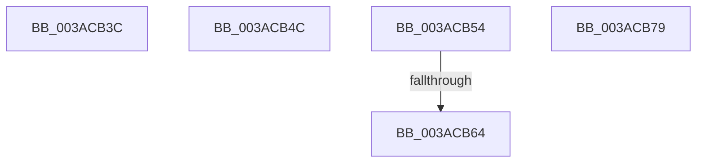

# sub_003ACB3C

- RVA: `0x003ACB3C`–`0x003ACB7A` (길이 `62` bytes)
- VA: `0x00000001403ACB3C`
- 실행 섹션: `.text`
- PDB 이름 있음: `아니요`; PDB Function 태그: `아니요`
- unwind 정보 RVA: `0x0008BBB0`
- 디코드: `23`개 명령, `62/62` bytes 표시
- 미해석 바이트: `0` (있으면 어셈블리에 `.byte`로 보존)

> 이 문서는 커널 이미지의 기계어와 PDB 기호를 분석해 생성했습니다. 4번과 5번은 함수 원형과 자료형을 바이너리 사용 방식에서 추정한 C 해석이며 원본 소스 복구 결과는 아닙니다.

## 1. Dependencies

- 직접 호출 지점: **1**; 고유 호출 대상: **1**
- 직접 호출자로 확인된 함수: **0**
- RIP 상대 이미지 참조: **0**

### Outgoing calls
- `0x003ACB57` → [SmArrayGrow](SmArrayGrow_function_003AC6C8.md) (function, `0x003AC6C8`)

### Direct callers
- 이 함수 시작 RVA로 연결되는 직접 call은 확인되지 않았습니다. 간접 호출은 완전히 역산할 수 없습니다.

### Static image references
- 디코드된 RIP-relative 메모리 참조가 없습니다.

## 2. Other-region calls and transfers

- 다른 실행 섹션으로 향하는 call: **0**
- call이 아닌 외부 분기/꼬리 이동: **2**
  - `0x003ACB4F` → [B_TREE<unsigned long,ST_STORE<SM_TRAITS>::_ST_REGION_ENTRY,4096,NP_CONTEXT,ST_STORE<SM_TRAITS>::ST_REGION_ENTRY_COMPARATOR>::BTreeInsert + 0x5D](B_TREE_unsigned_long_ST_STORE_SM_TRAITS__ST_REGION_ENTRY_4096_NP_CONTEXT_ST_STORE_SM_TRAITS_ST_REGIO_function_003AC820.md) (`tail-transfer`)
  - `0x003ACB5E` → [sub_003ACCB4](Unknown_function_003ACCB4.md) (`tail-transfer`)

## 3. Assembly (complete function range)

```asm
003ACB3C  48 81 C4 80 00 00 00            add rsp, 0x80
003ACB43  41 5E                           pop r14
003ACB45  41 5D                           pop r13
003ACB47  41 5C                           pop r12
003ACB49  5E                              pop rsi
003ACB4A  5D                              pop rbp
003ACB4B  C3                              ret
003ACB4C  CC                              int3
003ACB4D  33 C9                           xor ecx, ecx
003ACB4F  E9 29 FD FF FF                  jmp 0x1403ac87d
003ACB54  4C 8B CD                        mov r9, rbp
003ACB57  E8 6C FB FF FF                  call 0x1403ac6c8
003ACB5C  85 C0                           test eax, eax
003ACB5E  0F 85 50 01 00 00               jne 0x1403accb4
003ACB64  B8 9A 00 00 C0                  mov eax, 0xc000009a
003ACB69  48 81 C4 80 00 00 00            add rsp, 0x80
003ACB70  41 5E                           pop r14
003ACB72  41 5D                           pop r13
003ACB74  41 5C                           pop r12
003ACB76  5E                              pop rsi
003ACB77  5D                              pop rbp
003ACB78  C3                              ret
003ACB79  CC                              int3
```

## 4. C-style interpretation (structured pseudocode)

```c
__int64 __fastcall sub_003ACB3C(int a1)
{
    __int64 v_rsp;

    v_rsp = (v_rsp) + (128);
    return result;
}
```

## 5. (Beta) C Style

```c
int64_t sub_003ACB3C(int32_t Arg1)
{
    int64_t local_rsp;

    local_rsp = (local_rsp) + (128);
    return result;
}
```

## 6. Execution-region graph

[열기: 2D/3D 그래프와 함수 탐색 컨트롤 패널](../../../control-panel.html?section=text&rva=0x003ACB3C&view=graph)

- 2D 그래프는 위에서 아래로 흐르고, 3D 그래프는 빈 공간을 드래그해 회전합니다. Shift+드래그는 이동, 휠은 확대·축소, 함수 노드 선택은 대상 보고서 이동입니다.

### Static fallback


