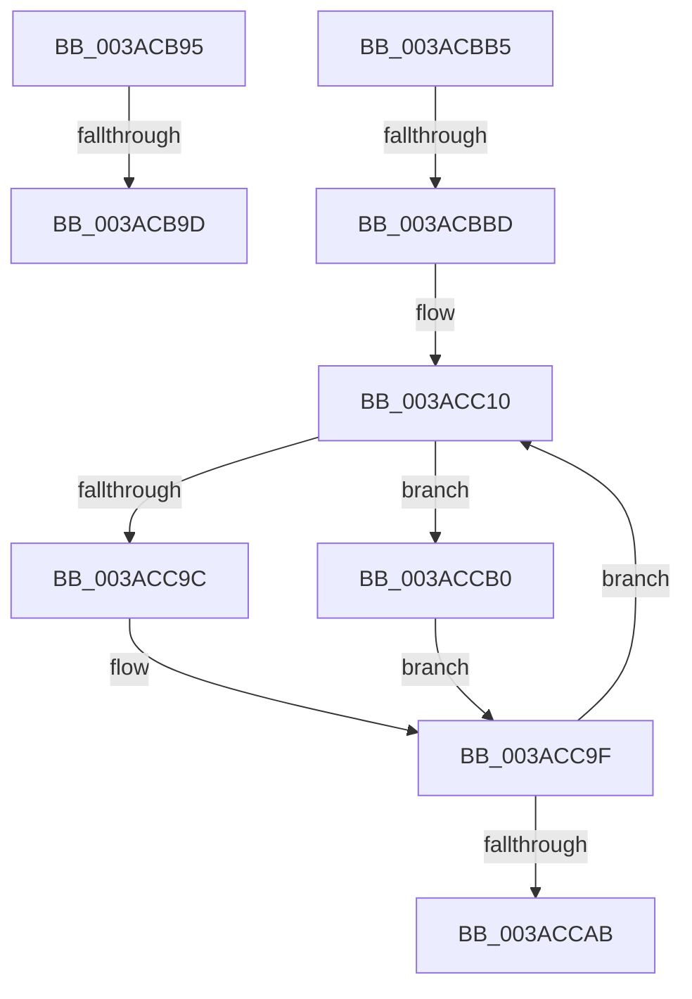

# sub_003ACB95

- RVA: `0x003ACB95`–`0x003ACCB4` (길이 `287` bytes)
- VA: `0x00000001403ACB95`
- 실행 섹션: `.text`
- PDB 이름 있음: `아니요`; PDB Function 태그: `아니요`
- unwind 정보 RVA: `0x0008BBF4`
- 디코드: `70`개 명령, `287/287` bytes 표시
- 미해석 바이트: `0` (있으면 어셈블리에 `.byte`로 보존)

> 이 문서는 커널 이미지의 기계어와 PDB 기호를 분석해 생성했습니다. 4번과 5번은 함수 원형과 자료형을 바이너리 사용 방식에서 추정한 C 해석이며 원본 소스 복구 결과는 아닙니다.

## 1. Dependencies

- 직접 호출 지점: **1**; 고유 호출 대상: **1**
- 직접 호출자로 확인된 함수: **0**
- RIP 상대 이미지 참조: **0**

### Outgoing calls
- `0x003ACBAB` → [B_TREE<unsigned long,ST_STORE<SM_TRAITS>::_ST_REGION_ENTRY,4096,NP_CONTEXT,ST_STORE<SM_TRAITS>::ST_REGION_ENTRY_COMPARATOR>::BTreeInsertEx](B_TREE_unsigned_long_ST_STORE_SM_TRAITS__ST_REGION_ENTRY_4096_NP_CONTEXT_ST_STORE_SM_TRAITS_ST_REGIO_function_003ABB70.md) (function, `0x003ABB70`)

### Direct callers
- 이 함수 시작 RVA로 연결되는 직접 call은 확인되지 않았습니다. 간접 호출은 완전히 역산할 수 없습니다.

### Static image references
- 디코드된 RIP-relative 메모리 참조가 없습니다.

## 2. Other-region calls and transfers

- 다른 실행 섹션으로 향하는 call: **0**
- call이 아닌 외부 분기/꼬리 이동: **4**
  - `0x003ACB97` → [sub_003ACCBB](Unknown_function_003ACCBB.md) (`tail-transfer`)
  - `0x003ACBB0` → [sub_003AC88E + 0x29F](Unknown_function_003AC88E.md) (`tail-transfer`)
  - `0x003ACBB7` → [sub_003AC88E + 0x15D](Unknown_function_003AC88E.md) (`tail-transfer`)
  - `0x003ACCAB` → [sub_003AC88E + 0x146](Unknown_function_003AC88E.md) (`tail-transfer`)

## 3. Assembly (complete function range)

```asm
003ACB95  85 D2                           test edx, edx
003ACB97  0F 84 1E 01 00 00               je 0x1403accbb
003ACB9D  4C 8B 84 24 B8 00 00 00         mov r8, qword ptr [rsp + 0xb8]
003ACBA5  48 8B D5                        mov rdx, rbp
003ACBA8  49 8B CC                        mov rcx, r12
003ACBAB  E8 C0 EF FF FF                  call 0x1403abb70
003ACBB0  E9 78 FF FF FF                  jmp 0x1403acb2d
003ACBB5  85 C0                           test eax, eax
003ACBB7  0F 84 2E FE FF FF               je 0x1403ac9eb
003ACBBD  45 8B B4 24 88 01 00 00         mov r14d, dword ptr [r12 + 0x188]
003ACBC5  41 8B D5                        mov edx, r13d
003ACBC8  41 8B 9C 24 8C 01 00 00         mov ebx, dword ptr [r12 + 0x18c]
003ACBD0  41 8B CE                        mov ecx, r14d
003ACBD3  D3 EA                           shr edx, cl
003ACBD5  41 8B 8C 24 98 01 00 00         mov ecx, dword ptr [r12 + 0x198]
003ACBDD  89 54 24 28                     mov dword ptr [rsp + 0x28], edx
003ACBE1  8B D3                           mov edx, ebx
003ACBE3  48 89 4C 24 48                  mov qword ptr [rsp + 0x48], rcx
003ACBE8  41 23 D5                        and edx, r13d
003ACBEB  41 8B 8C 24 90 01 00 00         mov ecx, dword ptr [r12 + 0x190]
003ACBF3  44 8B 6C 24 28                  mov r13d, dword ptr [rsp + 0x28]
003ACBF8  48 8B 6C 24 48                  mov rbp, qword ptr [rsp + 0x48]
003ACBFD  89 4C 24 30                     mov dword ptr [rsp + 0x30], ecx
003ACC01  0F AF CA                        imul ecx, edx
003ACC04  48 89 4C 24 50                  mov qword ptr [rsp + 0x50], rcx
003ACC09  0F 1F 80 00 00 00 00            nop dword ptr [rax]
003ACC10  42 8D 0C 18                     lea ecx, [rax + r11]
003ACC14  C7 44 24 28 00 00 00 00         mov dword ptr [rsp + 0x28], 0
003ACC1C  D1 E9                           shr ecx, 1
003ACC1E  44 8B C6                        mov r8d, esi
003ACC21  8B F9                           mov edi, ecx
003ACC23  44 8B D3                        mov r10d, ebx
003ACC26  48 03 C9                        add rcx, rcx
003ACC29  C7 44 24 28 00 00 00 00         mov dword ptr [rsp + 0x28], 0
003ACC31  41 8B 14 CF                     mov edx, dword ptr [r15 + rcx*8]
003ACC35  44 8B CA                        mov r9d, edx
003ACC38  44 23 D2                        and r10d, edx
003ACC3B  41 8B CE                        mov ecx, r14d
003ACC3E  41 D3 E9                        shr r9d, cl
003ACC41  41 0F BD C9                     bsr ecx, r9d
003ACC45  41 D3 E0                        shl r8d, cl
003ACC48  45 33 C1                        xor r8d, r9d
003ACC4B  44 8B 4C 24 30                  mov r9d, dword ptr [rsp + 0x30]
003ACC50  45 0F AF CA                     imul r9d, r10d
003ACC54  49 8B 94 CC 80 00 00 00         mov rdx, qword ptr [r12 + rcx*8 + 0x80]
003ACC5C  41 8B C8                        mov ecx, r8d
003ACC5F  44 8B C6                        mov r8d, esi
003ACC62  48 03 C9                        add rcx, rcx
003ACC65  48 8B 14 CA                     mov rdx, qword ptr [rdx + rcx*8]
003ACC69  48 03 D5                        add rdx, rbp
003ACC6C  4C 03 CA                        add r9, rdx
003ACC6F  41 0F BD CD                     bsr ecx, r13d
003ACC73  41 D3 E0                        shl r8d, cl
003ACC76  45 33 C5                        xor r8d, r13d
003ACC79  49 8B 94 CC 80 00 00 00         mov rdx, qword ptr [r12 + rcx*8 + 0x80]
003ACC81  41 8B C8                        mov ecx, r8d
003ACC84  4C 8B 44 24 50                  mov r8, qword ptr [rsp + 0x50]
003ACC89  48 03 C9                        add rcx, rcx
003ACC8C  48 8B 14 CA                     mov rdx, qword ptr [rdx + rcx*8]
003ACC90  41 8B 09                        mov ecx, dword ptr [r9]
003ACC93  48 03 D5                        add rdx, rbp
003ACC96  41 3B 0C 10                     cmp ecx, dword ptr [r8 + rdx]
003ACC9A  77 14                           ja 0x1403accb0
003ACC9C  44 8B DF                        mov r11d, edi
003ACC9F  41 8D 4B 01                     lea ecx, [r11 + 1]
003ACCA3  3B C8                           cmp ecx, eax
003ACCA5  0F 85 65 FF FF FF               jne 0x1403acc10
003ACCAB  E9 24 FD FF FF                  jmp 0x1403ac9d4
003ACCB0  8B C7                           mov eax, edi
003ACCB2  EB EB                           jmp 0x1403acc9f
```

## 4. C-style interpretation (structured pseudocode)

```c
__int64 __fastcall sub_003ACB95(__int64 a1, int a2, __int64 a3, __int64 a4, __int64 a5, __int64 a6, __int64 a7, __int64 a8, __int64 a9, __int64 a10, __int64 a11, __int64 a12, __int64 a13, __int64 a14, __int64 a15, __int64 a16, __int64 a17, __int64 a18, __int64 a19, __int64 a20, __int64 a21, __int64 a22, __int64 a23)
{
    __int64 result;
    unsigned int v_stack_p28;
    unsigned int v_stack_p30;
    unsigned __int64 v_stack_p48;
    unsigned __int64 v_stack_p50;

    result = B_TREE_unsigned_long_ST_STORE_SM_TRAITS____ST_REGION_ENTRY_4096_NP_CONTEXT_ST_STORE_SM_TRAITS___ST_R(v_r12, v_rbp, a23, a4);
}
```

## 5. (Beta) C Style

```c
int64_t sub_003ACB95(int64_t Arg1, int32_t Arg2, int64_t Arg3, int64_t Arg4, uint64_t Arg5, uint64_t Arg6, uint64_t Arg7, uint64_t Arg8, uint64_t Arg9, uint64_t Arg10, uint64_t Arg11, uint64_t Arg12, uint64_t Arg13, uint64_t Arg14, uint64_t Arg15, uint64_t Arg16, uint64_t Arg17, uint64_t Arg18, uint64_t Arg19, uint64_t Arg20, uint64_t Arg21, uint64_t Arg22, int64_t Arg23)
{
    int64_t result;
    uint32_t v_stack_p28;
    uint32_t v_stack_p30;
    uint64_t v_stack_p48;
    uint64_t v_stack_p50;

    result = B_TREE_unsigned_long_ST_STORE_SM_TRAITS____ST_REGION_ENTRY_4096_NP_CONTEXT_ST_STORE_SM_TRAITS___ST_R(local_r12, local_rbp, Arg23, Arg4);
}
```

## 6. Execution-region graph

[열기: 2D/3D 그래프와 함수 탐색 컨트롤 패널](../../../control-panel.html?section=text&rva=0x003ACB95&view=graph)

- 2D 그래프는 위에서 아래로 흐르고, 3D 그래프는 빈 공간을 드래그해 회전합니다. Shift+드래그는 이동, 휠은 확대·축소, 함수 노드 선택은 대상 보고서 이동입니다.

### Static fallback


