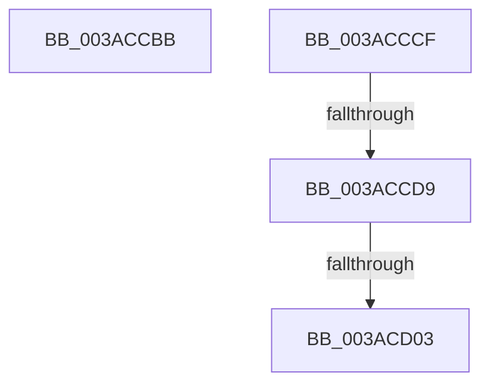

# sub_003ACCBB

- RVA: `0x003ACCBB`–`0x003ACD0D` (길이 `82` bytes)
- VA: `0x00000001403ACCBB`
- 실행 섹션: `.text`
- PDB 이름 있음: `아니요`; PDB Function 태그: `아니요`
- unwind 정보 RVA: `0x0008BC20`
- 디코드: `17`개 명령, `82/82` bytes 표시
- 미해석 바이트: `0` (있으면 어셈블리에 `.byte`로 보존)

> 이 문서는 커널 이미지의 기계어와 PDB 기호를 분석해 생성했습니다. 4번과 5번은 함수 원형과 자료형을 바이너리 사용 방식에서 추정한 C 해석이며 원본 소스 복구 결과는 아닙니다.

## 1. Dependencies

- 직접 호출 지점: **1**; 고유 호출 대상: **1**
- 직접 호출자로 확인된 함수: **0**
- RIP 상대 이미지 참조: **0**

### Outgoing calls
- `0x003ACCED` → [NP_CONTEXT::NpLeafRefInternal](NP_CONTEXT_NpLeafRefInternal_function_003AA340.md) (function, `0x003AA340`)

### Direct callers
- 이 함수 시작 RVA로 연결되는 직접 call은 확인되지 않았습니다. 간접 호출은 완전히 역산할 수 없습니다.

### Static image references
- 디코드된 RIP-relative 메모리 참조가 없습니다.

## 2. Other-region calls and transfers

- 다른 실행 섹션으로 향하는 call: **0**
- call이 아닌 외부 분기/꼬리 이동: **4**
  - `0x003ACCCA` → [sub_003ACB95 + 0x8](Unknown_function_003ACB95.md) (`tail-transfer`)
  - `0x003ACCD3` → [sub_003AC88E + 0x1AD](Unknown_function_003AC88E.md) (`tail-transfer`)
  - `0x003ACCFD` → [sub_003AC88E + 0x26](Unknown_function_003AC88E.md) (`tail-transfer`)
  - `0x003ACD08` → [sub_003AC88E + 0x29F](Unknown_function_003AC88E.md) (`tail-transfer`)

## 3. Assembly (complete function range)

```asm
003ACCBB  49 C7 06 00 00 00 00            mov qword ptr [r14], 0
003ACCC2  49 C7 46 08 00 00 00 00         mov qword ptr [r14 + 8], 0
003ACCCA  E9 CE FE FF FF                  jmp 0x1403acb9d
003ACCCF  80 7B 02 02                     cmp byte ptr [rbx + 2], 2
003ACCD3  0F 85 62 FD FF FF               jne 0x1403aca3b
003ACCD9  44 0F B6 45 20                  movzx r8d, byte ptr [rbp + 0x20]
003ACCDE  48 8B D1                        mov rdx, rcx
003ACCE1  41 83 E0 01                     and r8d, 1
003ACCE5  49 8D 4C 24 10                  lea rcx, [r12 + 0x10]
003ACCEA  45 03 C0                        add r8d, r8d
003ACCED  E8 4E D6 FF FF                  call 0x1403aa340
003ACCF2  48 89 44 24 40                  mov qword ptr [rsp + 0x40], rax
003ACCF7  48 8B D8                        mov rbx, rax
003ACCFA  48 85 C0                        test rax, rax
003ACCFD  0F 85 B1 FB FF FF               jne 0x1403ac8b4
003ACD03  B8 06 00 00 C0                  mov eax, 0xc0000006
003ACD08  E9 20 FE FF FF                  jmp 0x1403acb2d
```

## 4. C-style interpretation (structured pseudocode)

```c
__int64 __fastcall sub_003ACCBB(__int64 a1)
{
    unsigned __int64 v_stack_p40;

    *(unsigned __int64 *)(v_r14) = 0;
    *(unsigned __int64 *)(v_r14 + 8) = 0;
}
```

## 5. (Beta) C Style

```c
int64_t sub_003ACCBB(int64_t Arg1)
{
    uint64_t v_stack_p40;

    *(uint64_t *)(local_r14) = 0;
    *(uint64_t *)(local_r14 + 0x8) = 0;
}
```

## 6. Execution-region graph

[열기: 2D/3D 그래프와 함수 탐색 컨트롤 패널](../../../control-panel.html?section=text&rva=0x003ACCBB&view=graph)

- 2D 그래프는 위에서 아래로 흐르고, 3D 그래프는 빈 공간을 드래그해 회전합니다. Shift+드래그는 이동, 휠은 확대·축소, 함수 노드 선택은 대상 보고서 이동입니다.

### Static fallback


