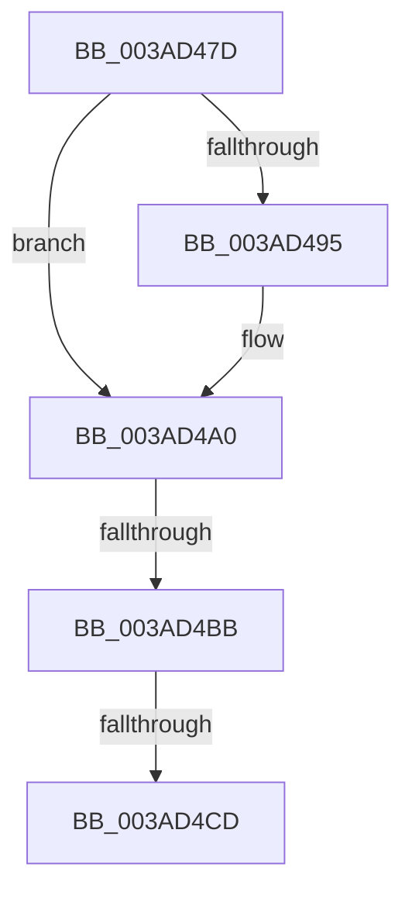

# sub_003AD47D

- RVA: `0x003AD47D`–`0x003AD4D0` (길이 `83` bytes)
- VA: `0x00000001403AD47D`
- 실행 섹션: `.text`
- PDB 이름 있음: `아니요`; PDB Function 태그: `아니요`
- unwind 정보 RVA: `0x0008BCA8`
- 디코드: `20`개 명령, `83/83` bytes 표시
- 미해석 바이트: `0` (있으면 어셈블리에 `.byte`로 보존)

> 이 문서는 커널 이미지의 기계어와 PDB 기호를 분석해 생성했습니다. 4번과 5번은 함수 원형과 자료형을 바이너리 사용 방식에서 추정한 C 해석이며 원본 소스 복구 결과는 아닙니다.

## 1. Dependencies

- 직접 호출 지점: **2**; 고유 호출 대상: **2**
- 직접 호출자로 확인된 함수: **0**
- RIP 상대 이미지 참조: **0**

### Outgoing calls
- `0x003AD49B` → [B_TREE<unsigned long,ST_STORE<SM_TRAITS>::_ST_HASH_ENTRY,4096,NP_CONTEXT,ST_STORE<SM_TRAITS>::ST_HASH_ENTRY_COMPARATOR>::BTreeSearchResultDeref](B_TREE_unsigned_long_ST_STORE_SM_TRAITS__ST_HASH_ENTRY_4096_NP_CONTEXT_ST_STORE_SM_TRAITS_ST_HASH_EN_function_003AE310.md) (function, `0x003AE310`)
- `0x003AD4AB` → [B_TREE<unsigned long,ST_STORE<SM_TRAITS>::_ST_REGION_ENTRY,4096,NP_CONTEXT,ST_STORE<SM_TRAITS>::ST_REGION_ENTRY_COMPARATOR>::BTreeDeleteEx](B_TREE_unsigned_long_ST_STORE_SM_TRAITS__ST_REGION_ENTRY_4096_NP_CONTEXT_ST_STORE_SM_TRAITS_ST_REGIO_function_003ADAF0.md) (function, `0x003ADAF0`)

### Direct callers
- 이 함수 시작 RVA로 연결되는 직접 call은 확인되지 않았습니다. 간접 호출은 완전히 역산할 수 없습니다.

### Static image references
- 디코드된 RIP-relative 메모리 참조가 없습니다.

## 2. Other-region calls and transfers

- 다른 실행 섹션으로 향하는 call: **0**
- call이 아닌 외부 분기/꼬리 이동: **2**
  - `0x003AD4B5` → [sub_003ADACE](Unknown_function_003ADACE.md) (`tail-transfer`)
  - `0x003AD4C7` → [sub_003AD7AD + 0x3F](Unknown_function_003AD7AD.md) (`tail-transfer`)

## 3. Assembly (complete function range)

```asm
003AD47D  4C 89 6C 24 60                  mov qword ptr [rsp + 0x60], r13
003AD482  8B 47 20                        mov eax, dword ptr [rdi + 0x20]
003AD485  4C 8D AB 80 00 00 00            lea r13, [rbx + 0x80]
003AD48C  48 89 7C 24 50                  mov qword ptr [rsp + 0x50], rdi
003AD491  A8 01                           test al, 1
003AD493  74 0B                           je 0x1403ad4a0
003AD495  48 8B D7                        mov rdx, rdi
003AD498  49 8B CD                        mov rcx, r13
003AD49B  E8 70 0E 00 00                  call 0x1403ae310
003AD4A0  83 67 20 FE                     and dword ptr [rdi + 0x20], 0xfffffffe
003AD4A4  48 8D 4B 40                     lea rcx, [rbx + 0x40]
003AD4A8  48 8B D5                        mov rdx, rbp
003AD4AB  E8 40 06 00 00                  call 0x1403adaf0
003AD4B0  44 8B F0                        mov r14d, eax
003AD4B3  85 C0                           test eax, eax
003AD4B5  0F 88 13 06 00 00               js 0x1403adace
003AD4BB  33 ED                           xor ebp, ebp
003AD4BD  F7 83 08 03 00 00 00 00 10 00   test dword ptr [rbx + 0x308], 0x100000
003AD4C7  0F 84 1F 03 00 00               je 0x1403ad7ec
003AD4CD  48 8B D7                        mov rdx, rdi
```

## 4. C-style interpretation (structured pseudocode)

```c
__int64 __fastcall sub_003AD47D(void)
{
    __int64 result;
    __int64 v_rbp;
    unsigned __int64 v_stack_p50;
    unsigned __int64 v_stack_p60;

    v_stack_p60 = v_r13;
    v_stack_p50 = v_rdi;
    result = (unsigned int)(*(unsigned int *)(v_rdi + 32));
    if ((((unsigned __int8)((unsigned int)(*(unsigned int *)(v_rdi + 32)))) & (1)) != 0) {
        a2 = v_rdi;
        a1 = v_rbx + 128;
        result = B_TREE_unsigned_long_ST_STORE_SM_TRAITS____ST_HASH_ENTRY_4096_NP_CONTEXT_ST_STORE_SM_TRAITS___ST_HAS(a1, a2, a3, a4);
    }
    result = B_TREE_unsigned_long_ST_STORE_SM_TRAITS____ST_REGION_ENTRY_4096_NP_CONTEXT_ST_STORE_SM_TRAITS___ST_R(v_rbx + 64, v_rbp, a3, a4);
    v_rbp = 0;
    return result;
}
```

## 5. (Beta) C Style

```c
void sub_003AD47D(void)
{
    int64_t result;
    int64_t local_rbp;
    uint64_t v_stack_p50;
    uint64_t v_stack_p60;

    v_stack_p60 = local_r13;
    v_stack_p50 = local_rdi;
    result = (uint32_t)(*(uint32_t *)(local_rdi + 0x20));
    if ((((uint8_t)((uint32_t)(*(uint32_t *)(local_rdi + 0x20)))) & (1)) != 0) {
        a2 = local_rdi;
        a1 = local_rbx + 128;
        result = B_TREE_unsigned_long_ST_STORE_SM_TRAITS____ST_HASH_ENTRY_4096_NP_CONTEXT_ST_STORE_SM_TRAITS___ST_HAS(a1, a2, a3, a4);
    }
    result = B_TREE_unsigned_long_ST_STORE_SM_TRAITS____ST_REGION_ENTRY_4096_NP_CONTEXT_ST_STORE_SM_TRAITS___ST_R(local_rbx + 64, local_rbp, a3, a4);
    local_rbp = 0;
    return result;
}
```

## 6. Execution-region graph

[열기: 2D/3D 그래프와 함수 탐색 컨트롤 패널](../../../control-panel.html?section=text&rva=0x003AD47D&view=graph)

- 2D 그래프는 위에서 아래로 흐르고, 3D 그래프는 빈 공간을 드래그해 회전합니다. Shift+드래그는 이동, 휠은 확대·축소, 함수 노드 선택은 대상 보고서 이동입니다.

### Static fallback


