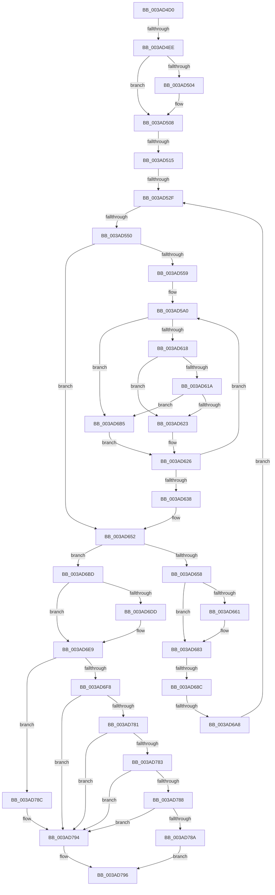

# sub_003AD4D0

- RVA: `0x003AD4D0`–`0x003AD7AD` (길이 `733` bytes)
- VA: `0x00000001403AD4D0`
- 실행 섹션: `.text`
- PDB 이름 있음: `아니요`; PDB Function 태그: `아니요`
- unwind 정보 RVA: `0x0008BCBC`
- 디코드: `183`개 명령, `733/733` bytes 표시
- 미해석 바이트: `0` (있으면 어셈블리에 `.byte`로 보존)

> 이 문서는 커널 이미지의 기계어와 PDB 기호를 분석해 생성했습니다. 4번과 5번은 함수 원형과 자료형을 바이너리 사용 방식에서 추정한 C 해석이며 원본 소스 복구 결과는 아닙니다.

## 1. Dependencies

- 직접 호출 지점: **1**; 고유 호출 대상: **1**
- 직접 호출자로 확인된 함수: **0**
- RIP 상대 이미지 참조: **0**

### Outgoing calls
- `0x003AD4DB` → [B_TREE<unsigned long,ST_STORE<SM_TRAITS>::_ST_HASH_ENTRY,4096,NP_CONTEXT,ST_STORE<SM_TRAITS>::ST_HASH_ENTRY_COMPARATOR>::BTreeSearchResultDeref](B_TREE_unsigned_long_ST_STORE_SM_TRAITS__ST_HASH_ENTRY_4096_NP_CONTEXT_ST_STORE_SM_TRAITS_ST_HASH_EN_function_003AE310.md) (function, `0x003AE310`)

### Direct callers
- 이 함수 시작 RVA로 연결되는 직접 call은 확인되지 않았습니다. 간접 호출은 완전히 역산할 수 없습니다.

### Static image references
- 디코드된 RIP-relative 메모리 참조가 없습니다.

## 2. Other-region calls and transfers

- 다른 실행 섹션으로 향하는 call: **0**
- call이 아닌 외부 분기/꼬리 이동: **7**
  - `0x003AD4E8` → [sub_003AD8D4](Unknown_function_003AD8D4.md) (`tail-transfer`)
  - `0x003AD50F` → [sub_003AD8D4 + 0x1C](Unknown_function_003AD8D4.md) (`tail-transfer`)
  - `0x003AD529` → [sub_003ADA5F](Unknown_function_003ADA5F.md) (`tail-transfer`)
  - `0x003AD54A` → [sub_003AD939](Unknown_function_003AD939.md) (`tail-transfer`)
  - `0x003AD686` → [sub_003AD8D4 + 0x13](Unknown_function_003AD8D4.md) (`tail-transfer`)
  - `0x003AD6A2` → [sub_003ADA80](Unknown_function_003ADA80.md) (`tail-transfer`)
  - `0x003AD7A7` → [sub_003ADA74](Unknown_function_003ADA74.md) (`tail-transfer`)

## 3. Assembly (complete function range)

```asm
003AD4D0  4C 89 A4 24 B0 00 00 00         mov qword ptr [rsp + 0xb0], r12
003AD4D8  49 8B CD                        mov rcx, r13
003AD4DB  E8 30 0E 00 00                  call 0x1403ae310
003AD4E0  83 7F 18 FF                     cmp dword ptr [rdi + 0x18], -1
003AD4E4  44 8D 65 01                     lea r12d, [rbp + 1]
003AD4E8  0F 84 E6 03 00 00               je 0x1403ad8d4
003AD4EE  49 8B 45 00                     mov rax, qword ptr [r13]
003AD4F2  45 8B CC                        mov r9d, r12d
003AD4F5  44 89 A4 24 B8 00 00 00         mov dword ptr [rsp + 0xb8], r12d
003AD4FD  8B CD                           mov ecx, ebp
003AD4FF  48 85 C0                        test rax, rax
003AD502  74 04                           je 0x1403ad508
003AD504  0F B6 48 02                     movzx ecx, byte ptr [rax + 2]
003AD508  39 4F 1C                        cmp dword ptr [rdi + 0x1c], ecx
003AD50B  4C 8D 47 1C                     lea r8, [rdi + 0x1c]
003AD50F  0F 82 DB 03 00 00               jb 0x1403ad8f0
003AD515  48 8B 17                        mov rdx, qword ptr [rdi]
003AD518  4D 8B 75 00                     mov r14, qword ptr [r13]
003AD51C  48 89 54 24 38                  mov qword ptr [rsp + 0x38], rdx
003AD521  4C 89 74 24 28                  mov qword ptr [rsp + 0x28], r14
003AD526  4D 85 F6                        test r14, r14
003AD529  0F 84 30 05 00 00               je 0x1403ada5f
003AD52F  41 8B 06                        mov eax, dword ptr [r14]
003AD532  49 8D 56 10                     lea rdx, [r14 + 0x10]
003AD536  44 0F B7 C8                     movzx r9d, ax
003AD53A  41 BA FF FF FF FF               mov r10d, 0xffffffff
003AD540  C1 E8 18                        shr eax, 0x18
003AD543  48 89 54 24 48                  mov qword ptr [rsp + 0x48], rdx
003AD548  84 C0                           test al, al
003AD54A  0F 84 E9 03 00 00               je 0x1403ad939
003AD550  45 85 C9                        test r9d, r9d
003AD553  0F 84 F9 00 00 00               je 0x1403ad652
003AD559  41 8B 85 58 01 00 00            mov eax, dword ptr [r13 + 0x158]
003AD560  44 8B E6                        mov r12d, esi
003AD563  41 8B BD 48 01 00 00            mov edi, dword ptr [r13 + 0x148]
003AD56A  8B CF                           mov ecx, edi
003AD56C  41 8B 9D 4C 01 00 00            mov ebx, dword ptr [r13 + 0x14c]
003AD573  41 D3 EC                        shr r12d, cl
003AD576  8B CB                           mov ecx, ebx
003AD578  48 89 44 24 30                  mov qword ptr [rsp + 0x30], rax
003AD57D  23 CE                           and ecx, esi
003AD57F  41 8B 85 50 01 00 00            mov eax, dword ptr [r13 + 0x150]
003AD586  89 44 24 20                     mov dword ptr [rsp + 0x20], eax
003AD58A  44 8B 74 24 20                  mov r14d, dword ptr [rsp + 0x20]
003AD58F  0F AF C1                        imul eax, ecx
003AD592  48 89 44 24 40                  mov qword ptr [rsp + 0x40], rax
003AD597  66 0F 1F 84 00 00 00 00 00      nop word ptr [rax + rax]
003AD5A0  8B CF                           mov ecx, edi
003AD5A2  89 6C 24 24                     mov dword ptr [rsp + 0x24], ebp
003AD5A6  43 8D 04 11                     lea eax, [r9 + r10]
003AD5AA  89 6C 24 24                     mov dword ptr [rsp + 0x24], ebp
003AD5AE  D1 E8                           shr eax, 1
003AD5B0  44 8B C3                        mov r8d, ebx
003AD5B3  44 8B F8                        mov r15d, eax
003AD5B6  44 8B 1C 82                     mov r11d, dword ptr [rdx + rax*4]
003AD5BA  45 23 C3                        and r8d, r11d
003AD5BD  41 8B C3                        mov eax, r11d
003AD5C0  45 0F AF C6                     imul r8d, r14d
003AD5C4  D3 E8                           shr eax, cl
003AD5C6  BA 01 00 00 00                  mov edx, 1
003AD5CB  0F BD C8                        bsr ecx, eax
003AD5CE  D3 E2                           shl edx, cl
003AD5D0  33 C2                           xor eax, edx
003AD5D2  48 8B 54 24 40                  mov rdx, qword ptr [rsp + 0x40]
003AD5D7  48 C1 E0 04                     shl rax, 4
003AD5DB  49 03 44 CD 40                  add rax, qword ptr [r13 + rcx*8 + 0x40]
003AD5E0  48 8B 4C 24 30                  mov rcx, qword ptr [rsp + 0x30]
003AD5E5  48 03 08                        add rcx, qword ptr [rax]
003AD5E8  B8 01 00 00 00                  mov eax, 1
003AD5ED  4C 03 C1                        add r8, rcx
003AD5F0  41 0F BD CC                     bsr ecx, r12d
003AD5F4  D3 E0                           shl eax, cl
003AD5F6  41 33 C4                        xor eax, r12d
003AD5F9  48 C1 E0 04                     shl rax, 4
003AD5FD  49 03 44 CD 40                  add rax, qword ptr [r13 + rcx*8 + 0x40]
003AD602  48 8B 4C 24 30                  mov rcx, qword ptr [rsp + 0x30]
003AD607  48 03 08                        add rcx, qword ptr [rax]
003AD60A  41 8B 40 08                     mov eax, dword ptr [r8 + 8]
003AD60E  3B 44 0A 08                     cmp eax, dword ptr [rdx + rcx + 8]
003AD612  0F 82 9D 00 00 00               jb 0x1403ad6b5
003AD618  77 09                           ja 0x1403ad623
003AD61A  44 3B DE                        cmp r11d, esi
003AD61D  0F 82 92 00 00 00               jb 0x1403ad6b5
003AD623  45 8B CF                        mov r9d, r15d
003AD626  48 8B 54 24 48                  mov rdx, qword ptr [rsp + 0x48]
003AD62B  41 8D 42 01                     lea eax, [r10 + 1]
003AD62F  41 3B C1                        cmp eax, r9d
003AD632  0F 85 68 FF FF FF               jne 0x1403ad5a0
003AD638  48 8B 9C 24 A0 00 00 00         mov rbx, qword ptr [rsp + 0xa0]
003AD640  41 BC 01 00 00 00               mov r12d, 1
003AD646  4C 8B 74 24 28                  mov r14, qword ptr [rsp + 0x28]
003AD64B  48 8D BB 98 00 00 00            lea rdi, [rbx + 0x98]
003AD652  41 38 6E 03                     cmp byte ptr [r14 + 3], bpl
003AD656  75 65                           jne 0x1403ad6bd
003AD658  39 AC 24 B8 00 00 00            cmp dword ptr [rsp + 0xb8], ebp
003AD65F  74 22                           je 0x1403ad683
003AD661  48 8B 54 24 38                  mov rdx, qword ptr [rsp + 0x38]
003AD666  41 8B C1                        mov eax, r9d
003AD669  48 FF C0                        inc rax
003AD66C  48 C1 E0 04                     shl rax, 4
003AD670  49 03 C6                        add rax, r14
003AD673  4C 89 32                        mov qword ptr [rdx], r14
003AD676  48 89 42 08                     mov qword ptr [rdx + 8], rax
003AD67A  48 83 C2 10                     add rdx, 0x10
003AD67E  48 89 54 24 38                  mov qword ptr [rsp + 0x38], rdx
003AD683  45 85 C9                        test r9d, r9d
003AD686  0F 84 5B 02 00 00               je 0x1403ad8e7
003AD68C  41 8D 49 FF                     lea ecx, [r9 - 1]
003AD690  48 C1 E1 04                     shl rcx, 4
003AD694  48 83 C1 18                     add rcx, 0x18
003AD698  49 03 CE                        add rcx, r14
003AD69B  49 8B 45 10                     mov rax, qword ptr [r13 + 0x10]
003AD69F  83 38 FF                        cmp dword ptr [rax], -1
003AD6A2  0F 85 D8 03 00 00               jne 0x1403ada80
003AD6A8  4C 8B 31                        mov r14, qword ptr [rcx]
003AD6AB  4C 89 74 24 28                  mov qword ptr [rsp + 0x28], r14
003AD6B0  E9 7A FE FF FF                  jmp 0x1403ad52f
003AD6B5  45 8B D7                        mov r10d, r15d
003AD6B8  E9 69 FF FF FF                  jmp 0x1403ad626
003AD6BD  41 8B C1                        mov eax, r9d
003AD6C0  48 83 C0 04                     add rax, 4
003AD6C4  49 8D 14 86                     lea rdx, [r14 + rax*4]
003AD6C8  48 8B 44 24 38                  mov rax, qword ptr [rsp + 0x38]
003AD6CD  4C 89 30                        mov qword ptr [rax], r14
003AD6D0  48 89 50 08                     mov qword ptr [rax + 8], rdx
003AD6D4  39 AC 24 B8 00 00 00            cmp dword ptr [rsp + 0xb8], ebp
003AD6DB  74 0C                           je 0x1403ad6e9
003AD6DD  48 2B 07                        sub rax, qword ptr [rdi]
003AD6E0  48 C1 F8 04                     sar rax, 4
003AD6E4  FF C0                           inc eax
003AD6E6  89 47 18                        mov dword ptr [rdi + 0x18], eax
003AD6E9  41 8B 06                        mov eax, dword ptr [r14]
003AD6EC  0F B7 C8                        movzx ecx, ax
003AD6EF  44 3B C9                        cmp r9d, ecx
003AD6F2  0F 83 94 00 00 00               jae 0x1403ad78c
003AD6F8  44 8B 32                        mov r14d, dword ptr [rdx]
003AD6FB  45 8B C4                        mov r8d, r12d
003AD6FE  45 8B 9D 48 01 00 00            mov r11d, dword ptr [r13 + 0x148]
003AD705  41 8B C6                        mov eax, r14d
003AD708  41 8B BD 4C 01 00 00            mov edi, dword ptr [r13 + 0x14c]
003AD70F  41 8B CB                        mov ecx, r11d
003AD712  45 8B 95 50 01 00 00            mov r10d, dword ptr [r13 + 0x150]
003AD719  44 8B CF                        mov r9d, edi
003AD71C  4C 8B BC 24 A8 00 00 00         mov r15, qword ptr [rsp + 0xa8]
003AD724  45 23 CE                        and r9d, r14d
003AD727  D3 E8                           shr eax, cl
003AD729  23 FE                           and edi, esi
003AD72B  0F BD C8                        bsr ecx, eax
003AD72E  45 0F AF CA                     imul r9d, r10d
003AD732  41 D3 E0                        shl r8d, cl
003AD735  41 33 C0                        xor eax, r8d
003AD738  44 0F AF D7                     imul r10d, edi
003AD73C  45 8B 85 58 01 00 00            mov r8d, dword ptr [r13 + 0x158]
003AD743  48 03 C0                        add rax, rax
003AD746  49 8B 54 CD 40                  mov rdx, qword ptr [r13 + rcx*8 + 0x40]
003AD74B  41 8B CB                        mov ecx, r11d
003AD74E  48 8B 14 C2                     mov rdx, qword ptr [rdx + rax*8]
003AD752  8B C6                           mov eax, esi
003AD754  D3 E8                           shr eax, cl
003AD756  49 03 D0                        add rdx, r8
003AD759  0F BD C8                        bsr ecx, eax
003AD75C  41 D3 E4                        shl r12d, cl
003AD75F  41 33 C4                        xor eax, r12d
003AD762  48 03 C0                        add rax, rax
003AD765  49 8B 4C CD 40                  mov rcx, qword ptr [r13 + rcx*8 + 0x40]
003AD76A  48 8B 0C C1                     mov rcx, qword ptr [rcx + rax*8]
003AD76E  49 03 C8                        add rcx, r8
003AD771  41 8B C2                        mov eax, r10d
003AD774  48 03 C1                        add rax, rcx
003AD777  41 8B 4C 11 08                  mov ecx, dword ptr [r9 + rdx + 8]
003AD77C  3B 48 08                        cmp ecx, dword ptr [rax + 8]
003AD77F  72 13                           jb 0x1403ad794
003AD781  77 11                           ja 0x1403ad794
003AD783  44 3B F6                        cmp r14d, esi
003AD786  72 0C                           jb 0x1403ad794
003AD788  77 0A                           ja 0x1403ad794
003AD78A  EB 0A                           jmp 0x1403ad796
003AD78C  4C 8B BC 24 A8 00 00 00         mov r15, qword ptr [rsp + 0xa8]
003AD794  CD 2C                           int 0x2c
003AD796  8B 83 B0 00 00 00               mov eax, dword ptr [rbx + 0xb0]
003AD79C  4C 8B A4 24 B0 00 00 00         mov r12, qword ptr [rsp + 0xb0]
003AD7A4  83 F8 FF                        cmp eax, -1
003AD7A7  0F 84 C7 02 00 00               je 0x1403ada74
```

## 4. C-style interpretation (structured pseudocode)

```c
__int64 __fastcall sub_003AD4D0(__int64 a1, __int64 a2, __int64 a3, __int64 a4, __int64 a5, __int64 a6, __int64 a7, __int64 a8, __int64 a9, __int64 a10, __int64 a11, __int64 a12, __int64 a13, __int64 a14, __int64 a15, __int64 a16, __int64 a17, __int64 a18, __int64 a19, __int64 a20, __int64 a21, __int64 a22, unsigned int a23)
{
    __int64 result;
    __int64 v_r10;
    __int64 v_r12;
    __int64 v_rdi;
    unsigned int v_stack_p20;
    unsigned int v_stack_p24;
    unsigned __int64 v_stack_p28;
    unsigned __int64 v_stack_p30;
    unsigned __int64 v_stack_p38;
    unsigned __int64 v_stack_p40;
    unsigned __int64 v_stack_p48;
    unsigned __int64 v_stack_pB0;
    unsigned int v_stack_pB8;

    v_stack_pB0 = v_r12;
    result = B_TREE_unsigned_long_ST_STORE_SM_TRAITS____ST_HASH_ENTRY_4096_NP_CONTEXT_ST_STORE_SM_TRAITS___ST_HAS(v_r13, a2, a3, a4);
    v_stack_pB8 = (unsigned int)(v_rbp + 1);
    if (*(unsigned __int64 *)(v_r13) != 0) {
        a1 = *(unsigned __int8 *)(*(unsigned __int64 *)(v_r13) + 2);
    }
    v_stack_p38 = *(unsigned __int64 *)(v_rdi);
    v_stack_p28 = *(unsigned __int64 *)(v_r13);
loc_003AD52F:
    result = (unsigned int)(((unsigned int)(*(unsigned int *)(*(unsigned __int64 *)(v_r13)))) >> (24));
    v_stack_p48 = *(unsigned __int64 *)(v_r13) + 16;
    if ((unsigned int)((unsigned __int16)((unsigned int)(*(unsigned int *)(*(unsigned __int64 *)(v_r13))))) == 0) goto loc_003AD652;
    v_r12 = (unsigned int)(((unsigned int)((unsigned int)(v_rsi))) >> ((unsigned __int8)((unsigned int)((unsigned int)((unsigned int)(*(unsigned int *)(v_r13 + 328)))))));
    v_stack_p30 = (unsigned int)(*(unsigned int *)(v_r13 + 344));
    a1 = (unsigned int)(((unsigned int)((unsigned int)((unsigned int)(*(unsigned int *)(v_r13 + 332))))) & ((unsigned int)(v_rsi)));
    v_stack_p20 = (unsigned int)((unsigned int)(*(unsigned int *)(v_r13 + 336)));
    result = (unsigned int)(((unsigned int)(*(unsigned int *)(v_r13 + 336))) * ((unsigned int)(a1)));
    v_stack_p40 = result;
loc_003AD5A0:
    v_stack_p24 = (unsigned int)(v_rbp);
    v_stack_p24 = (unsigned int)(v_rbp);
    result = (unsigned int)(((unsigned __int16)((unsigned int)(*(unsigned int *)(*(unsigned __int64 *)(v_r13)))) + (unsigned int)(0xFFFFFFFFULL) * 1) >> (1));
    a3 = (unsigned int)(((unsigned int)((unsigned int)((unsigned int)(*(unsigned int *)(v_r13 + 332))))) & ((unsigned int)((unsigned int)(*(unsigned int *)(*(unsigned __int64 *)(v_r13) + 16 + result * 4)))));
    a3 = (unsigned int)((a3) * ((unsigned int)((unsigned int)(v_stack_p20))));
    result = (unsigned int)(((unsigned int)((unsigned int)((unsigned int)(*(unsigned int *)(*(unsigned __int64 *)(v_r13) + 16 + result * 4))))) >> ((unsigned __int8)((unsigned int)((unsigned int)((unsigned int)(*(unsigned int *)(v_r13 + 328)))))));
    a2 = (unsigned int)((1) << ((unsigned __int8)((unsigned int)((unsigned int)((unsigned int)(*(unsigned int *)(v_r13 + 328)))))));
    result = (unsigned int)((result) ^ ((unsigned int)(a2)));
    result = (result) << (4);
    result = (result) + (*(unsigned __int64 *)(v_r13 + (unsigned int)((unsigned int)((unsigned int)(*(unsigned int *)(v_r13 + 328)))) * 8 + 64));
    a1 = (a6) + (*(unsigned __int64 *)(result));
    a3 = (a3) + (a1);
    result = (unsigned int)((1) << ((unsigned __int8)(a1)));
    result = (unsigned int)((result) ^ ((unsigned int)(v_r12)));
    result = (result) << (4);
    result = (result) + (*(unsigned __int64 *)(v_r13 + a1 * 8 + 64));
    a1 = (a6) + (*(unsigned __int64 *)(result));
    if (((unsigned int)((unsigned int)(*(unsigned int *)(a3 + 8)))) < (*(unsigned int *)(a8 + a1 * 1 + 8))) goto loc_003AD6B5;
    if (((unsigned int)((unsigned int)(*(unsigned int *)(a3 + 8)))) > (*(unsigned int *)(a8 + a1 * 1 + 8))) goto loc_003AD623;
    if (((unsigned int)((unsigned int)(*(unsigned int *)(*(unsigned __int64 *)(v_r13) + 16 + result * 4)))) < ((unsigned int)(v_rsi))) goto loc_003AD6B5;
loc_003AD623:
loc_003AD626:
    if (((unsigned int)((unsigned int)(0xFFFFFFFFULL) + 1)) != ((unsigned int)((unsigned int)((unsigned int)((unsigned int)((unsigned int)(result))))))) goto loc_003AD5A0;
loc_003AD652:
    if ((*(unsigned __int8 *)(a5 + 3)) != ((unsigned __int8)(v_rbp))) goto loc_003AD6BD;
    result = (unsigned int)(0xFFFFFFFFULL) + 1;
    if (a23 != ((unsigned int)(v_rbp))) {
        a2 = a7;
        result = (unsigned int)((unsigned int)((unsigned int)((unsigned int)((unsigned int)(result)))));
        result = (result) + 1;
        result = (result) << (4);
        result = (result) + (a5);
        *(unsigned __int64 *)(a2) = a5;
        *(unsigned __int64 *)(a2 + 8) = result;
        a2 = (a2) + (16);
        v_stack_p38 = a2;
    }
    a1 = ((unsigned int)((unsigned int)((unsigned int)((unsigned int)(result)))) - 1) << (4);
    a1 = (a1) + (24);
    a1 = (a1) + (a5);
    v_stack_p28 = *(unsigned __int64 *)(a1);
    goto loc_003AD52F;
loc_003AD6B5:
    goto loc_003AD626;
loc_003AD6BD:
    result = ((unsigned int)((unsigned int)((unsigned int)((unsigned int)((unsigned int)((unsigned int)(result))))))) + (4);
    *(unsigned __int64 *)(a7) = *(unsigned __int64 *)(a1);
    *(unsigned __int64 *)(a7 + 8) = *(unsigned __int64 *)(a1) + result * 4;
    result = a7;
    if (a23 != ((unsigned int)(v_rbp))) {
        result = (a7) - (*(unsigned __int64 *)(a20 + 152));
        result = (result) >> (4);
        result = (unsigned int)((result) + 1);
        *(unsigned int *)(a20 + 152 + 24) = (unsigned int)(result);
    }
    if (((unsigned int)((unsigned int)((unsigned int)((unsigned int)((unsigned int)(result)))))) >= ((unsigned int)((unsigned __int16)((unsigned int)(*(unsigned int *)(*(unsigned __int64 *)(a1))))))) goto loc_003AD78C;
    a4 = (unsigned int)(((unsigned int)((unsigned int)((unsigned int)(*(unsigned int *)(v_r13 + 332))))) & ((unsigned int)((unsigned int)(*(unsigned int *)(*(unsigned __int64 *)(a1) + result * 4)))));
    result = (unsigned int)(((unsigned int)((unsigned int)((unsigned int)(*(unsigned int *)(*(unsigned __int64 *)(a1) + result * 4))))) >> ((unsigned __int8)((unsigned int)((unsigned int)((unsigned int)(*(unsigned int *)(v_r13 + 328)))))));
    v_rdi = (unsigned int)(((unsigned int)(*(unsigned int *)(v_r13 + 332))) & ((unsigned int)(v_rsi)));
    a4 = (unsigned int)((a4) * ((unsigned int)((unsigned int)(*(unsigned int *)(v_r13 + 336)))));
    a3 = (unsigned int)((1) << ((unsigned __int8)((unsigned int)((unsigned int)((unsigned int)(*(unsigned int *)(v_r13 + 328)))))));
    result = (unsigned int)((result) ^ ((unsigned int)(a3)));
    v_r10 = (unsigned int)(((unsigned int)(*(unsigned int *)(v_r13 + 336))) * ((unsigned int)(v_rdi)));
    result = (result) + (result);
    result = (unsigned int)(((unsigned int)((unsigned int)(v_rsi))) >> ((unsigned __int8)((unsigned int)((unsigned int)((unsigned int)(*(unsigned int *)(v_r13 + 328)))))));
    a2 = (*(unsigned __int64 *)(*(unsigned __int64 *)(v_r13 + (unsigned int)((unsigned int)((unsigned int)(*(unsigned int *)(v_r13 + 328)))) * 8 + 64) + result * 8)) + ((unsigned int)(*(unsigned int *)(v_r13 + 344)));
    v_r12 = (unsigned int)((1) << ((unsigned __int8)((unsigned int)((unsigned int)((unsigned int)(*(unsigned int *)(v_r13 + 328)))))));
    result = (unsigned int)((result) ^ ((unsigned int)(v_r12)));
    result = (result) + (result);
    a1 = (*(unsigned __int64 *)(*(unsigned __int64 *)(v_r13 + (unsigned int)((unsigned int)((unsigned int)(*(unsigned int *)(v_r13 + 328)))) * 8 + 64) + result * 8)) + ((unsigned int)(*(unsigned int *)(v_r13 + 344)));
    result = ((unsigned int)((unsigned int)(v_r10))) + (a1);
    if (((unsigned int)((unsigned int)(*(unsigned int *)(a4 + a2 * 1 + 8)))) < (*(unsigned int *)(result + 8))) goto loc_003AD794;
    if (((unsigned int)((unsigned int)(*(unsigned int *)(a4 + a2 * 1 + 8)))) > (*(unsigned int *)(result + 8))) goto loc_003AD794;
    if (((unsigned int)((unsigned int)(*(unsigned int *)(*(unsigned __int64 *)(a1) + result * 4)))) < ((unsigned int)(v_rsi))) goto loc_003AD794;
    if (((unsigned int)((unsigned int)(*(unsigned int *)(*(unsigned __int64 *)(a1) + result * 4)))) > ((unsigned int)(v_rsi))) goto loc_003AD794;
    goto loc_003AD796;
loc_003AD78C:
loc_003AD794:
loc_003AD796:
}
```

## 5. (Beta) C Style

```c
int64_t sub_003AD4D0(int64_t Arg1, int64_t Arg2, int64_t Arg3, int64_t Arg4, int64_t Arg5, int64_t Arg6, void *Arg7, void *Arg8, int64_t Arg9, uint64_t Arg10, uint64_t Arg11, uint64_t Arg12, uint64_t Arg13, uint64_t Arg14, uint64_t Arg15, uint64_t Arg16, uint64_t Arg17, uint64_t Arg18, uint64_t Arg19, void *Arg20, int64_t Arg21, int64_t Arg22, uint32_t Arg23)
{
    uint8_t *arg7 = (uint8_t *)Arg7;
    uint8_t *arg8 = (uint8_t *)Arg8;
    uint8_t *arg20 = (uint8_t *)Arg20;

    int64_t result;
    int64_t local_r10;
    int64_t local_r12;
    int64_t local_rdi;
    uint32_t v_stack_p20;
    uint32_t v_stack_p24;
    uint64_t v_stack_p28;
    uint64_t v_stack_p30;
    uint64_t v_stack_p38;
    uint64_t v_stack_p40;
    uint64_t v_stack_p48;
    uint64_t v_stack_pB0;
    uint32_t v_stack_pB8;

    v_stack_pB0 = local_r12;
    result = B_TREE_unsigned_long_ST_STORE_SM_TRAITS____ST_HASH_ENTRY_4096_NP_CONTEXT_ST_STORE_SM_TRAITS___ST_HAS(local_r13, Arg2, Arg3, Arg4);
    v_stack_pB8 = (uint32_t)(local_rbp + 1);
    if (*(uint64_t *)(local_r13) != 0) {
        Arg1 = *(uint8_t *)(*(uint64_t *)(local_r13) + 0x2);
    }
    v_stack_p38 = *(uint64_t *)(local_rdi);
    v_stack_p28 = *(uint64_t *)(local_r13);
loc_003AD52F:
    result = (uint32_t)(((uint32_t)(*(uint32_t *)(*(uint64_t *)(local_r13)))) >> (24));
    v_stack_p48 = *(uint64_t *)(local_r13) + 16;
    if ((uint32_t)((uint16_t)((uint32_t)(*(uint32_t *)(*(uint64_t *)(local_r13))))) == 0) goto loc_003AD652;
    local_r12 = (uint32_t)(((uint32_t)((uint32_t)(local_rsi))) >> ((uint8_t)((uint32_t)((uint32_t)((uint32_t)(*(uint32_t *)(local_r13 + 0x148)))))));
    v_stack_p30 = (uint32_t)(*(uint32_t *)(local_r13 + 0x158));
    Arg1 = (uint32_t)(((uint32_t)((uint32_t)((uint32_t)(*(uint32_t *)(local_r13 + 0x14C))))) & ((uint32_t)(local_rsi)));
    v_stack_p20 = (uint32_t)((uint32_t)(*(uint32_t *)(local_r13 + 0x150)));
    result = (uint32_t)(((uint32_t)(*(uint32_t *)(local_r13 + 0x150))) * ((uint32_t)(Arg1)));
    v_stack_p40 = result;
loc_003AD5A0:
    v_stack_p24 = (uint32_t)(local_rbp);
    v_stack_p24 = (uint32_t)(local_rbp);
    result = (uint32_t)(((uint16_t)((uint32_t)(*(uint32_t *)(*(uint64_t *)(local_r13)))) + (uint32_t)(0xFFFFFFFFULL) * 1) >> (1));
    Arg3 = (uint32_t)(((uint32_t)((uint32_t)((uint32_t)(*(uint32_t *)(local_r13 + 0x14C))))) & ((uint32_t)((uint32_t)(*(uint32_t *)(*(uint64_t *)(local_r13) + 0x10 + result * 4)))));
    Arg3 = (uint32_t)((Arg3) * ((uint32_t)((uint32_t)(v_stack_p20))));
    result = (uint32_t)(((uint32_t)((uint32_t)((uint32_t)(*(uint32_t *)(*(uint64_t *)(local_r13) + 0x10 + result * 4))))) >> ((uint8_t)((uint32_t)((uint32_t)((uint32_t)(*(uint32_t *)(local_r13 + 0x148)))))));
    Arg2 = (uint32_t)((1) << ((uint8_t)((uint32_t)((uint32_t)((uint32_t)(*(uint32_t *)(local_r13 + 0x148)))))));
    result = (uint32_t)((result) ^ ((uint32_t)(Arg2)));
    result = (result) << (4);
    result = (result) + (*(uint64_t *)(local_r13 + (uint32_t)((uint32_t)((uint32_t)(*(uint32_t *)(local_r13 + 0x148)))) * 8 + 0x40));
    Arg1 = (Arg6) + (*(uint64_t *)(result));
    Arg3 = (Arg3) + (Arg1);
    result = (uint32_t)((1) << ((uint8_t)(Arg1)));
    result = (uint32_t)((result) ^ ((uint32_t)(local_r12)));
    result = (result) << (4);
    result = (result) + (*(uint64_t *)(local_r13 + Arg1 * 8 + 0x40));
    Arg1 = (Arg6) + (*(uint64_t *)(result));
    if (((uint32_t)((uint32_t)(*(uint32_t *)(Arg3 + 0x8)))) < (*(uint32_t *)(arg8 + Arg1 * 1 + 0x8))) goto loc_003AD6B5;
    if (((uint32_t)((uint32_t)(*(uint32_t *)(Arg3 + 0x8)))) > (*(uint32_t *)(arg8 + Arg1 * 1 + 0x8))) goto loc_003AD623;
    if (((uint32_t)((uint32_t)(*(uint32_t *)(*(uint64_t *)(local_r13) + 0x10 + result * 4)))) < ((uint32_t)(local_rsi))) goto loc_003AD6B5;
loc_003AD623:
loc_003AD626:
    if (((uint32_t)((uint32_t)(0xFFFFFFFFULL) + 1)) != ((uint32_t)((uint32_t)((uint32_t)((uint32_t)((uint32_t)(result))))))) goto loc_003AD5A0;
loc_003AD652:
    if ((*(uint8_t *)(Arg5 + 0x3)) != ((uint8_t)(local_rbp))) goto loc_003AD6BD;
    result = (uint32_t)(0xFFFFFFFFULL) + 1;
    if (Arg23 != ((uint32_t)(local_rbp))) {
        Arg2 = Arg7;
        result = (uint32_t)((uint32_t)((uint32_t)((uint32_t)((uint32_t)(result)))));
        result = (result) + 1;
        result = (result) << (4);
        result = (result) + (Arg5);
        *(uint64_t *)(Arg2) = Arg5;
        *(uint64_t *)(Arg2 + 0x8) = result;
        Arg2 = (Arg2) + (16);
        v_stack_p38 = Arg2;
    }
    Arg1 = ((uint32_t)((uint32_t)((uint32_t)((uint32_t)(result)))) - 1) << (4);
    Arg1 = (Arg1) + (24);
    Arg1 = (Arg1) + (Arg5);
    v_stack_p28 = *(uint64_t *)(Arg1);
    goto loc_003AD52F;
loc_003AD6B5:
    goto loc_003AD626;
loc_003AD6BD:
    result = ((uint32_t)((uint32_t)((uint32_t)((uint32_t)((uint32_t)((uint32_t)(result))))))) + (4);
    *(uint64_t *)(arg7) = *(uint64_t *)(Arg1);
    *(uint64_t *)(arg7 + 0x8) = *(uint64_t *)(Arg1) + result * 4;
    result = Arg7;
    if (Arg23 != ((uint32_t)(local_rbp))) {
        result = (Arg7) - (*(uint64_t *)(arg20 + 0x98));
        result = (result) >> (4);
        result = (uint32_t)((result) + 1);
        *(uint32_t *)(arg20 + 0x98 + 0x18) = (uint32_t)(result);
    }
    if (((uint32_t)((uint32_t)((uint32_t)((uint32_t)((uint32_t)(result)))))) >= ((uint32_t)((uint16_t)((uint32_t)(*(uint32_t *)(*(uint64_t *)(Arg1))))))) goto loc_003AD78C;
    Arg4 = (uint32_t)(((uint32_t)((uint32_t)((uint32_t)(*(uint32_t *)(local_r13 + 0x14C))))) & ((uint32_t)((uint32_t)(*(uint32_t *)(*(uint64_t *)(Arg1) + result * 4)))));
    result = (uint32_t)(((uint32_t)((uint32_t)((uint32_t)(*(uint32_t *)(*(uint64_t *)(Arg1) + result * 4))))) >> ((uint8_t)((uint32_t)((uint32_t)((uint32_t)(*(uint32_t *)(local_r13 + 0x148)))))));
    local_rdi = (uint32_t)(((uint32_t)(*(uint32_t *)(local_r13 + 0x14C))) & ((uint32_t)(local_rsi)));
    Arg4 = (uint32_t)((Arg4) * ((uint32_t)((uint32_t)(*(uint32_t *)(local_r13 + 0x150)))));
    Arg3 = (uint32_t)((1) << ((uint8_t)((uint32_t)((uint32_t)((uint32_t)(*(uint32_t *)(local_r13 + 0x148)))))));
    result = (uint32_t)((result) ^ ((uint32_t)(Arg3)));
    local_r10 = (uint32_t)(((uint32_t)(*(uint32_t *)(local_r13 + 0x150))) * ((uint32_t)(local_rdi)));
    result = (result) + (result);
    result = (uint32_t)(((uint32_t)((uint32_t)(local_rsi))) >> ((uint8_t)((uint32_t)((uint32_t)((uint32_t)(*(uint32_t *)(local_r13 + 0x148)))))));
    Arg2 = (*(uint64_t *)(*(uint64_t *)(local_r13 + (uint32_t)((uint32_t)((uint32_t)(*(uint32_t *)(local_r13 + 0x148)))) * 8 + 0x40) + result * 8)) + ((uint32_t)(*(uint32_t *)(local_r13 + 0x158)));
    local_r12 = (uint32_t)((1) << ((uint8_t)((uint32_t)((uint32_t)((uint32_t)(*(uint32_t *)(local_r13 + 0x148)))))));
    result = (uint32_t)((result) ^ ((uint32_t)(local_r12)));
    result = (result) + (result);
    Arg1 = (*(uint64_t *)(*(uint64_t *)(local_r13 + (uint32_t)((uint32_t)((uint32_t)(*(uint32_t *)(local_r13 + 0x148)))) * 8 + 0x40) + result * 8)) + ((uint32_t)(*(uint32_t *)(local_r13 + 0x158)));
    result = ((uint32_t)((uint32_t)(local_r10))) + (Arg1);
    if (((uint32_t)((uint32_t)(*(uint32_t *)(Arg4 + Arg2 * 1 + 0x8)))) < (*(uint32_t *)(result + 0x8))) goto loc_003AD794;
    if (((uint32_t)((uint32_t)(*(uint32_t *)(Arg4 + Arg2 * 1 + 0x8)))) > (*(uint32_t *)(result + 0x8))) goto loc_003AD794;
    if (((uint32_t)((uint32_t)(*(uint32_t *)(*(uint64_t *)(Arg1) + result * 4)))) < ((uint32_t)(local_rsi))) goto loc_003AD794;
    if (((uint32_t)((uint32_t)(*(uint32_t *)(*(uint64_t *)(Arg1) + result * 4)))) > ((uint32_t)(local_rsi))) goto loc_003AD794;
    goto loc_003AD796;
loc_003AD78C:
loc_003AD794:
loc_003AD796:
}
```

### 관측된 메모리 오프셋

구조체 형식이 확인되지 않은 접근은 인자 기준의 오프셋으로만 기록했습니다.

| 기준 인자 | 오프셋 표현 | 폭 (bit) | 접근 |
|---|---:|---:|---|
| `Arg7` | `+ 0x0` | `64` | `W` |
| `Arg7` | `+ 0x8` | `64` | `W` |
| `Arg8` | `+ 0x8 + rcx*1` | `32` | `R` |
| `Arg20` | `+ 0x98` | `64` | `R` |

## 6. Execution-region graph

[열기: 2D/3D 그래프와 함수 탐색 컨트롤 패널](../../../control-panel.html?section=text&rva=0x003AD4D0&view=graph)

- 2D 그래프는 위에서 아래로 흐르고, 3D 그래프는 빈 공간을 드래그해 회전합니다. Shift+드래그는 이동, 휠은 확대·축소, 함수 노드 선택은 대상 보고서 이동입니다.

### Static fallback


