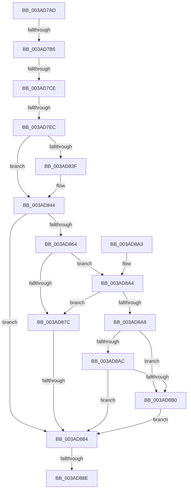

# sub_003AD7AD

- RVA: `0x003AD7AD`–`0x003AD8D4` (길이 `295` bytes)
- VA: `0x00000001403AD7AD`
- 실행 섹션: `.text`
- PDB 이름 있음: `아니요`; PDB Function 태그: `아니요`
- unwind 정보 RVA: `0x0008BCD0`
- 디코드: `83`개 명령, `295/295` bytes 표시
- 미해석 바이트: `0` (있으면 어셈블리에 `.byte`로 보존)

> 이 문서는 커널 이미지의 기계어와 PDB 기호를 분석해 생성했습니다. 4번과 5번은 함수 원형과 자료형을 바이너리 사용 방식에서 추정한 C 해석이며 원본 소스 복구 결과는 아닙니다.

## 1. Dependencies

- 직접 호출 지점: **1**; 고유 호출 대상: **1**
- 직접 호출자로 확인된 함수: **0**
- RIP 상대 이미지 참조: **0**

### Outgoing calls
- `0x003AD7DC` → [B_TREE<unsigned long,ST_STORE<SM_TRAITS>::_ST_HASH_ENTRY,4096,NP_CONTEXT,ST_STORE<SM_TRAITS>::ST_HASH_ENTRY_COMPARATOR>::BTreeDeleteEx](B_TREE_unsigned_long_ST_STORE_SM_TRAITS__ST_HASH_ENTRY_4096_NP_CONTEXT_ST_STORE_SM_TRAITS_ST_HASH_EN_function_003AE410.md) (function, `0x003AE410`)

### Direct callers
- 이 함수 시작 RVA로 연결되는 직접 call은 확인되지 않았습니다. 간접 호출은 완전히 역산할 수 없습니다.

### Static image references
- 디코드된 RIP-relative 메모리 참조가 없습니다.

## 2. Other-region calls and transfers

- 다른 실행 섹션으로 향하는 call: **0**
- call이 아닌 외부 분기/꼬리 이동: **5**
  - `0x003AD7AF` → [sub_003ADA74](Unknown_function_003ADA74.md) (`tail-transfer`)
  - `0x003AD7C8` → [sub_003ADAB9](Unknown_function_003ADAB9.md) (`tail-transfer`)
  - `0x003AD7E6` → [sub_003ADAB9 + 0x7](Unknown_function_003ADAB9.md) (`tail-transfer`)
  - `0x003AD87E` → [sub_003AD908](Unknown_function_003AD908.md) (`tail-transfer`)
  - `0x003AD888` → [sub_003ADA42](Unknown_function_003ADA42.md) (`tail-transfer`)

## 3. Assembly (complete function range)

```asm
003AD7AD  85 C0                           test eax, eax
003AD7AF  0F 84 BF 02 00 00               je 0x1403ada74
003AD7B5  FF C8                           dec eax
003AD7B7  48 C1 E0 04                     shl rax, 4
003AD7BB  48 03 83 98 00 00 00            add rax, qword ptr [rbx + 0x98]
003AD7C2  48 8B 40 08                     mov rax, qword ptr [rax + 8]
003AD7C6  39 30                           cmp dword ptr [rax], esi
003AD7C8  0F 85 EB 02 00 00               jne 0x1403adab9
003AD7CE  48 8D 93 98 00 00 00            lea rdx, [rbx + 0x98]
003AD7D5  48 8D 8B 80 00 00 00            lea rcx, [rbx + 0x80]
003AD7DC  E8 2F 0C 00 00                  call 0x1403ae410
003AD7E1  44 8B F0                        mov r14d, eax
003AD7E4  85 C0                           test eax, eax
003AD7E6  0F 88 D4 02 00 00               js 0x1403adac0
003AD7EC  41 8B 47 04                     mov eax, dword ptr [r15 + 4]
003AD7F0  BA 00 10 00 00                  mov edx, 0x1000
003AD7F5  45 8B 0F                        mov r9d, dword ptr [r15]
003AD7F8  25 FF 0F 00 00                  and eax, 0xfff
003AD7FD  8B 8B 2C 03 00 00               mov ecx, dword ptr [rbx + 0x32c]
003AD803  BF FF 1F 00 00                  mov edi, 0x1fff
003AD808  0F 47 D0                        cmova edx, eax
003AD80B  8B 83 38 03 00 00               mov eax, dword ptr [rbx + 0x338]
003AD811  83 C0 0F                        add eax, 0xf
003AD814  41 D3 E9                        shr r9d, cl
003AD817  03 D0                           add edx, eax
003AD819  48 8B 83 78 05 00 00            mov rax, qword ptr [rbx + 0x578]
003AD820  42 0F B7 0C 48                  movzx ecx, word ptr [rax + r9*2]
003AD825  C1 EA 04                        shr edx, 4
003AD828  44 0F B7 C1                     movzx r8d, cx
003AD82C  4E 8D 14 48                     lea r10, [rax + r9*2]
003AD830  66 44 23 C7                     and r8w, di
003AD834  F7 DA                           neg edx
003AD836  40 38 AB 08 03 00 00            cmp byte ptr [rbx + 0x308], bpl
003AD83D  75 05                           jne 0x1403ad844
003AD83F  8B E9                           mov ebp, ecx
003AD841  C1 ED 0D                        shr ebp, 0xd
003AD844  8B C5                           mov eax, ebp
003AD846  66 03 CA                        add cx, dx
003AD849  66 41 89 0A                     mov word ptr [r10], cx
003AD84D  01 94 C3 9C 08 00 00            add dword ptr [rbx + rax*8 + 0x89c], edx
003AD854  48 03 C0                        add rax, rax
003AD857  4C 8D 1C C3                     lea r11, [rbx + rax*8]
003AD85B  45 39 8B 58 06 00 00            cmp dword ptr [r11 + 0x658], r9d
003AD862  74 20                           je 0x1403ad884
003AD864  8B 83 28 03 00 00               mov eax, dword ptr [rbx + 0x328]
003AD86A  41 0F B7 0A                     movzx ecx, word ptr [r10]
003AD86E  FF C0                           inc eax
003AD870  D1 E8                           shr eax, 1
003AD872  23 CF                           and ecx, edi
003AD874  41 0F B7 D0                     movzx edx, r8w
003AD878  3B D0                           cmp edx, eax
003AD87A  72 28                           jb 0x1403ad8a4
003AD87C  3B C8                           cmp ecx, eax
003AD87E  0F 82 84 00 00 00               jb 0x1403ad908
003AD884  66 41 85 3A                     test word ptr [r10], di
003AD888  0F 84 B4 01 00 00               je 0x1403ada42
003AD88E  41 8B C6                        mov eax, r14d
003AD891  4C 8B 6C 24 60                  mov r13, qword ptr [rsp + 0x60]
003AD896  48 83 C4 68                     add rsp, 0x68
003AD89A  41 5F                           pop r15
003AD89C  41 5E                           pop r14
003AD89E  5F                              pop rdi
003AD89F  5E                              pop rsi
003AD8A0  5D                              pop rbp
003AD8A1  5B                              pop rbx
003AD8A2  C3                              ret
003AD8A3  CC                              int3
003AD8A4  85 D2                           test edx, edx
003AD8A6  74 D4                           je 0x1403ad87c
003AD8A8  3B C8                           cmp ecx, eax
003AD8AA  73 04                           jae 0x1403ad8b0
003AD8AC  85 C9                           test ecx, ecx
003AD8AE  75 D4                           jne 0x1403ad884
003AD8B0  FF 8B B0 05 00 00               dec dword ptr [rbx + 0x5b0]
003AD8B6  41 8B C1                        mov eax, r9d
003AD8B9  41 8B D1                        mov edx, r9d
003AD8BC  83 E0 07                        and eax, 7
003AD8BF  48 C1 EA 03                     shr rdx, 3
003AD8C3  48 03 93 A8 05 00 00            add rdx, qword ptr [rbx + 0x5a8]
003AD8CA  0F BE 0A                        movsx ecx, byte ptr [rdx]
003AD8CD  0F AB C1                        bts ecx, eax
003AD8D0  88 0A                           mov byte ptr [rdx], cl
003AD8D2  EB B0                           jmp 0x1403ad884
```

## 4. C-style interpretation (structured pseudocode)

```c
__int64 __fastcall sub_003AD7AD(__int64 a1, __int64 a2, __int64 a3, __int64 a4, __int64 a5, __int64 a6, __int64 a7, __int64 a8, __int64 a9, __int64 a10, __int64 a11, __int64 a12)
{
    __int64 result;
    __int64 v_rbp;
    __int64 v_rsp;

    result = (unsigned int)((result) - 1);
    result = (result) << (4);
    result = (result) + (*(unsigned __int64 *)(v_rbx + 152));
    result = B_TREE_unsigned_long_ST_STORE_SM_TRAITS____ST_HASH_ENTRY_4096_NP_CONTEXT_ST_STORE_SM_TRAITS___ST_HAS(v_rbx + 128, v_rbx + 152, a3, a4);
    result = (unsigned int)(((unsigned int)(*(unsigned int *)(v_r15 + 4))) & (0xFFFULL));
    a2 = (unsigned int)(0x1000ULL);
    if (condition_is_above) { a2 = (unsigned int)(result); }
    result = (unsigned int)(((unsigned int)(*(unsigned int *)(v_rbx + 824))) + (15));
    a4 = (unsigned int)(((unsigned int)(*(unsigned int *)(v_r15))) >> ((unsigned __int8)((unsigned int)(*(unsigned int *)(v_rbx + 812)))));
    a2 = (unsigned int)((a2) + ((unsigned int)(result)));
    a2 = (unsigned int)((a2) >> (4));
    a3 = (unsigned __int16)(((unsigned __int16)(*(unsigned __int16 *)(*(unsigned __int64 *)(v_rbx + 1400) + a4 * 2))) & ((unsigned __int16)((unsigned int)(0x1FFFULL))));
    a2 = (unsigned int)(-(a2));
    if ((*(unsigned __int8 *)(v_rbx + 776)) == ((unsigned __int8)(v_rbp))) {
        v_rbp = (unsigned int)(*(unsigned __int16 *)(*(unsigned __int64 *)(v_rbx + 1400) + a4 * 2));
        v_rbp = (unsigned int)((v_rbp) >> (13));
    }
    a1 = (unsigned __int16)((*(unsigned __int16 *)(*(unsigned __int64 *)(v_rbx + 1400) + a4 * 2)) + ((unsigned __int16)(a2)));
    *(unsigned __int16 *)(*(unsigned __int64 *)(v_rbx + 1400) + a4 * 2) = (unsigned __int16)(a1);
    result = ((unsigned int)((unsigned int)(v_rbp))) + ((unsigned int)((unsigned int)(v_rbp)));
    if ((*(unsigned int *)(v_rbx + result * 8 + 1624)) == ((unsigned int)(a4))) goto loc_003AD884;
    result = (unsigned int)(((unsigned int)(*(unsigned int *)(v_rbx + 808))) + 1);
    result = (unsigned int)((result) >> (1));
    a1 = (unsigned int)((*(unsigned __int16 *)(*(unsigned __int64 *)(v_rbx + 1400) + a4 * 2)) & ((unsigned int)((unsigned int)(0x1FFFULL))));
    if (((unsigned int)((unsigned __int16)(a3))) < ((unsigned int)(result))) goto loc_003AD8A4;
loc_003AD87C:
loc_003AD884:
    v_rsp = (v_rsp) + (104);
    return (unsigned int)((unsigned int)((unsigned int)((unsigned int)(result))));
loc_003AD8A4:
    if ((unsigned int)((unsigned __int16)(a3)) == 0) goto loc_003AD87C;
    if (((unsigned int)(a1)) >= ((unsigned int)((unsigned int)((unsigned int)((unsigned int)((unsigned int)(result))))))) goto loc_003AD8B0;
    if ((unsigned int)(a1) != 0) goto loc_003AD884;
loc_003AD8B0:
    result = (unsigned int)(((unsigned int)((unsigned int)(a4))) & (7));
    a2 = ((unsigned int)((unsigned int)(a4))) >> (3);
    a2 = (a2) + (*(unsigned __int64 *)(v_rbx + 1448));
    *(unsigned __int8 *)(a2) = (unsigned __int8)((__int8)(*(unsigned __int8 *)(a2)));
    goto loc_003AD884;
}
```

## 5. (Beta) C Style

```c
int64_t sub_003AD7AD(int64_t Arg1, int64_t Arg2, int64_t Arg3, int64_t Arg4, uint64_t Arg5, uint64_t Arg6, uint64_t Arg7, uint64_t Arg8, uint64_t Arg9, uint64_t Arg10, uint64_t Arg11, int64_t Arg12)
{
    int64_t result;
    int64_t local_rbp;
    int64_t local_rsp;

    result = (uint32_t)((result) - 1);
    result = (result) << (4);
    result = (result) + (*(uint64_t *)(local_rbx + 0x98));
    result = B_TREE_unsigned_long_ST_STORE_SM_TRAITS____ST_HASH_ENTRY_4096_NP_CONTEXT_ST_STORE_SM_TRAITS___ST_HAS(local_rbx + 128, local_rbx + 152, Arg3, Arg4);
    result = (uint32_t)(((uint32_t)(*(uint32_t *)(local_r15 + 0x4))) & (0xFFFULL));
    Arg2 = (uint32_t)(0x1000ULL);
    if (condition_is_above) { Arg2 = (uint32_t)(result); }
    result = (uint32_t)(((uint32_t)(*(uint32_t *)(local_rbx + 0x338))) + (15));
    Arg4 = (uint32_t)(((uint32_t)(*(uint32_t *)(local_r15))) >> ((uint8_t)((uint32_t)(*(uint32_t *)(local_rbx + 0x32C)))));
    Arg2 = (uint32_t)((Arg2) + ((uint32_t)(result)));
    Arg2 = (uint32_t)((Arg2) >> (4));
    Arg3 = (uint16_t)(((uint16_t)(*(uint16_t *)(*(uint64_t *)(local_rbx + 0x578) + Arg4 * 2))) & ((uint16_t)((uint32_t)(0x1FFFULL))));
    Arg2 = (uint32_t)(-(Arg2));
    if ((*(uint8_t *)(local_rbx + 0x308)) == ((uint8_t)(local_rbp))) {
        local_rbp = (uint32_t)(*(uint16_t *)(*(uint64_t *)(local_rbx + 0x578) + Arg4 * 2));
        local_rbp = (uint32_t)((local_rbp) >> (13));
    }
    Arg1 = (uint16_t)((*(uint16_t *)(*(uint64_t *)(local_rbx + 0x578) + Arg4 * 2)) + ((uint16_t)(Arg2)));
    *(uint16_t *)(*(uint64_t *)(local_rbx + 0x578) + Arg4 * 2) = (uint16_t)(Arg1);
    result = ((uint32_t)((uint32_t)(local_rbp))) + ((uint32_t)((uint32_t)(local_rbp)));
    if ((*(uint32_t *)(local_rbx + result * 8 + 0x658)) == ((uint32_t)(Arg4))) goto loc_003AD884;
    result = (uint32_t)(((uint32_t)(*(uint32_t *)(local_rbx + 0x328))) + 1);
    result = (uint32_t)((result) >> (1));
    Arg1 = (uint32_t)((*(uint16_t *)(*(uint64_t *)(local_rbx + 0x578) + Arg4 * 2)) & ((uint32_t)((uint32_t)(0x1FFFULL))));
    if (((uint32_t)((uint16_t)(Arg3))) < ((uint32_t)(result))) goto loc_003AD8A4;
loc_003AD87C:
loc_003AD884:
    local_rsp = (local_rsp) + (104);
    return (uint32_t)((uint32_t)((uint32_t)((uint32_t)(result))));
loc_003AD8A4:
    if ((uint32_t)((uint16_t)(Arg3)) == 0) goto loc_003AD87C;
    if (((uint32_t)(Arg1)) >= ((uint32_t)((uint32_t)((uint32_t)((uint32_t)((uint32_t)(result))))))) goto loc_003AD8B0;
    if ((uint32_t)(Arg1) != 0) goto loc_003AD884;
loc_003AD8B0:
    result = (uint32_t)(((uint32_t)((uint32_t)(Arg4))) & (7));
    Arg2 = ((uint32_t)((uint32_t)(Arg4))) >> (3);
    Arg2 = (Arg2) + (*(uint64_t *)(local_rbx + 0x5A8));
    *(uint8_t *)(Arg2) = (uint8_t)((int8_t)(*(uint8_t *)(Arg2)));
    goto loc_003AD884;
}
```

## 6. Execution-region graph

[열기: 2D/3D 그래프와 함수 탐색 컨트롤 패널](../../../control-panel.html?section=text&rva=0x003AD7AD&view=graph)

- 2D 그래프는 위에서 아래로 흐르고, 3D 그래프는 빈 공간을 드래그해 회전합니다. Shift+드래그는 이동, 휠은 확대·축소, 함수 노드 선택은 대상 보고서 이동입니다.

### Static fallback


