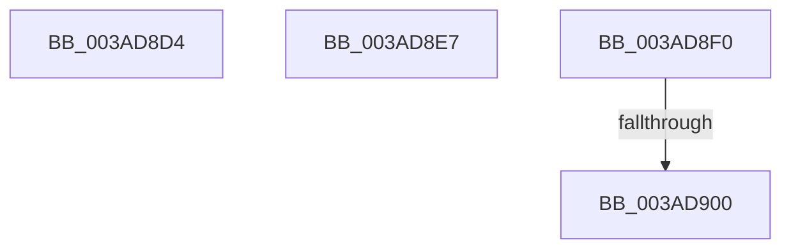

# sub_003AD8D4

- RVA: `0x003AD8D4`–`0x003AD908` (길이 `52` bytes)
- VA: `0x00000001403AD8D4`
- 실행 섹션: `.text`
- PDB 이름 있음: `아니요`; PDB Function 태그: `아니요`
- unwind 정보 RVA: `0x0008BCE4`
- 디코드: `12`개 명령, `52/52` bytes 표시
- 미해석 바이트: `0` (있으면 어셈블리에 `.byte`로 보존)

> 이 문서는 커널 이미지의 기계어와 PDB 기호를 분석해 생성했습니다. 4번과 5번은 함수 원형과 자료형을 바이너리 사용 방식에서 추정한 C 해석이며 원본 소스 복구 결과는 아닙니다.

## 1. Dependencies

- 직접 호출 지점: **1**; 고유 호출 대상: **1**
- 직접 호출자로 확인된 함수: **0**
- RIP 상대 이미지 참조: **0**

### Outgoing calls
- `0x003AD8F3` → [SmArrayGrow](SmArrayGrow_function_003AC6C8.md) (function, `0x003AC6C8`)

### Direct callers
- 이 함수 시작 RVA로 연결되는 직접 call은 확인되지 않았습니다. 간접 호출은 완전히 역산할 수 없습니다.

### Static image references
- 디코드된 RIP-relative 메모리 참조가 없습니다.

## 2. Other-region calls and transfers

- 다른 실행 섹션으로 향하는 call: **0**
- call이 아닌 외부 분기/꼬리 이동: **4**
  - `0x003AD8E2` → [sub_003AD4D0 + 0x48](Unknown_function_003AD4D0.md) (`tail-transfer`)
  - `0x003AD8EB` → [sub_003AD4D0 + 0x1CB](Unknown_function_003AD4D0.md) (`tail-transfer`)
  - `0x003AD8FA` → [sub_003AD4D0 + 0x2C4](Unknown_function_003AD4D0.md) (`tail-transfer`)
  - `0x003AD903` → [sub_003AD4D0 + 0x45](Unknown_function_003AD4D0.md) (`tail-transfer`)

## 3. Assembly (complete function range)

```asm
003AD8D4  44 8B CD                        mov r9d, ebp
003AD8D7  89 AC 24 B8 00 00 00            mov dword ptr [rsp + 0xb8], ebp
003AD8DE  48 8D 57 08                     lea rdx, [rdi + 8]
003AD8E2  E9 31 FC FF FF                  jmp 0x1403ad518
003AD8E7  49 8D 4E 08                     lea rcx, [r14 + 8]
003AD8EB  E9 AB FD FF FF                  jmp 0x1403ad69b
003AD8F0  4C 8B CF                        mov r9, rdi
003AD8F3  E8 D0 ED FF FF                  call 0x1403ac6c8
003AD8F8  85 C0                           test eax, eax
003AD8FA  0F 84 94 FE FF FF               je 0x1403ad794
003AD900  45 8B CC                        mov r9d, r12d
003AD903  E9 0D FC FF FF                  jmp 0x1403ad515
```

## 4. C-style interpretation (structured pseudocode)

```c
__int64 __fastcall sub_003AD8D4(void)
{
    unsigned int v_stack_pB8;

    v_stack_pB8 = (unsigned int)(v_rbp);
}
```

## 5. (Beta) C Style

```c
void sub_003AD8D4(void)
{
    uint32_t v_stack_pB8;

    v_stack_pB8 = (uint32_t)(local_rbp);
}
```

## 6. Execution-region graph

[열기: 2D/3D 그래프와 함수 탐색 컨트롤 패널](../../../control-panel.html?section=text&rva=0x003AD8D4&view=graph)

- 2D 그래프는 위에서 아래로 흐르고, 3D 그래프는 빈 공간을 드래그해 회전합니다. Shift+드래그는 이동, 휠은 확대·축소, 함수 노드 선택은 대상 보고서 이동입니다.

### Static fallback


