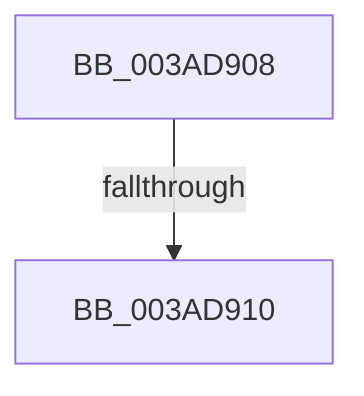

# sub_003AD908

- RVA: `0x003AD908`–`0x003AD939` (길이 `49` bytes)
- VA: `0x00000001403AD908`
- 실행 섹션: `.text`
- PDB 이름 있음: `아니요`; PDB Function 태그: `아니요`
- unwind 정보 RVA: `0x0008BCF8`
- 디코드: `12`개 명령, `49/49` bytes 표시
- 미해석 바이트: `0` (있으면 어셈블리에 `.byte`로 보존)

> 이 문서는 커널 이미지의 기계어와 PDB 기호를 분석해 생성했습니다. 4번과 5번은 함수 원형과 자료형을 바이너리 사용 방식에서 추정한 C 해석이며 원본 소스 복구 결과는 아닙니다.

## 1. Dependencies

- 직접 호출 지점: **0**; 고유 호출 대상: **0**
- 직접 호출자로 확인된 함수: **0**
- RIP 상대 이미지 참조: **0**

### Outgoing calls
- 직접 디코드된 call 명령이 없습니다.

### Direct callers
- 이 함수 시작 RVA로 연결되는 직접 call은 확인되지 않았습니다. 간접 호출은 완전히 역산할 수 없습니다.

### Static image references
- 디코드된 RIP-relative 메모리 참조가 없습니다.

## 2. Other-region calls and transfers

- 다른 실행 섹션으로 향하는 call: **0**
- call이 아닌 외부 분기/꼬리 이동: **2**
  - `0x003AD90A` → [sub_003AD7AD + 0xD7](Unknown_function_003AD7AD.md) (`tail-transfer`)
  - `0x003AD934` → [sub_003AD7AD + 0xD7](Unknown_function_003AD7AD.md) (`tail-transfer`)

## 3. Assembly (complete function range)

```asm
003AD908  85 C9                           test ecx, ecx
003AD90A  0F 84 74 FF FF FF               je 0x1403ad884
003AD910  45 8B C1                        mov r8d, r9d
003AD913  41 8B C1                        mov eax, r9d
003AD916  49 C1 E8 03                     shr r8, 3
003AD91A  83 E0 07                        and eax, 7
003AD91D  4C 03 83 A8 05 00 00            add r8, qword ptr [rbx + 0x5a8]
003AD924  41 0F BE 08                     movsx ecx, byte ptr [r8]
003AD928  0F B3 C1                        btr ecx, eax
003AD92B  41 88 08                        mov byte ptr [r8], cl
003AD92E  FF 83 B0 05 00 00               inc dword ptr [rbx + 0x5b0]
003AD934  E9 4B FF FF FF                  jmp 0x1403ad884
```

## 4. C-style interpretation (structured pseudocode)

```c
__int64 __fastcall sub_003AD908(int a1, __int64 a2, __int64 a3, int a4)
{
    __int64 result;

    a3 = ((unsigned int)(a4)) >> (3);
    result = (unsigned int)(((unsigned int)(a4)) & (7));
    a3 = (a3) + (*(unsigned __int64 *)(v_rbx + 1448));
    *(unsigned __int8 *)(a3) = (unsigned __int8)((__int8)(*(unsigned __int8 *)(a3)));
}
```

## 5. (Beta) C Style

```c
int64_t sub_003AD908(int32_t Arg1, int64_t Arg2, int64_t Arg3, int32_t Arg4)
{
    int64_t result;

    Arg3 = ((uint32_t)(Arg4)) >> (3);
    result = (uint32_t)(((uint32_t)(Arg4)) & (7));
    Arg3 = (Arg3) + (*(uint64_t *)(local_rbx + 0x5A8));
    *(uint8_t *)(Arg3) = (uint8_t)((int8_t)(*(uint8_t *)(Arg3)));
}
```

## 6. Execution-region graph

[열기: 2D/3D 그래프와 함수 탐색 컨트롤 패널](../../../control-panel.html?section=text&rva=0x003AD908&view=graph)

- 2D 그래프는 위에서 아래로 흐르고, 3D 그래프는 빈 공간을 드래그해 회전합니다. Shift+드래그는 이동, 휠은 확대·축소, 함수 노드 선택은 대상 보고서 이동입니다.

### Static fallback


