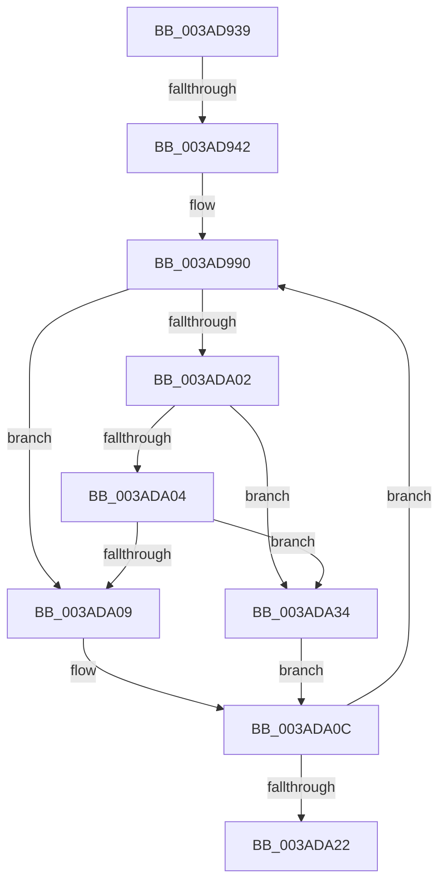

# sub_003AD939

- RVA: `0x003AD939`–`0x003ADA39` (길이 `256` bytes)
- VA: `0x00000001403AD939`
- 실행 섹션: `.text`
- PDB 이름 있음: `아니요`; PDB Function 태그: `아니요`
- unwind 정보 RVA: `0x0008BD08`
- 디코드: `67`개 명령, `256/256` bytes 표시
- 미해석 바이트: `0` (있으면 어셈블리에 `.byte`로 보존)

> 이 문서는 커널 이미지의 기계어와 PDB 기호를 분석해 생성했습니다. 4번과 5번은 함수 원형과 자료형을 바이너리 사용 방식에서 추정한 C 해석이며 원본 소스 복구 결과는 아닙니다.

## 1. Dependencies

- 직접 호출 지점: **0**; 고유 호출 대상: **0**
- 직접 호출자로 확인된 함수: **0**
- RIP 상대 이미지 참조: **0**

### Outgoing calls
- 직접 디코드된 call 명령이 없습니다.

### Direct callers
- 이 함수 시작 RVA로 연결되는 직접 call은 확인되지 않았습니다. 간접 호출은 완전히 역산할 수 없습니다.

### Static image references
- 디코드된 RIP-relative 메모리 참조가 없습니다.

## 2. Other-region calls and transfers

- 다른 실행 섹션으로 향하는 call: **0**
- call이 아닌 외부 분기/꼬리 이동: **2**
  - `0x003AD93C` → [sub_003AD4D0 + 0x182](Unknown_function_003AD4D0.md) (`tail-transfer`)
  - `0x003ADA2F` → [sub_003AD4D0 + 0x182](Unknown_function_003AD4D0.md) (`tail-transfer`)

## 3. Assembly (complete function range)

```asm
003AD939  45 85 C9                        test r9d, r9d
003AD93C  0F 84 10 FD FF FF               je 0x1403ad652
003AD942  41 8B 85 4C 01 00 00            mov eax, dword ptr [r13 + 0x14c]
003AD949  8B DE                           mov ebx, esi
003AD94B  45 8B 85 48 01 00 00            mov r8d, dword ptr [r13 + 0x148]
003AD952  41 8B C8                        mov ecx, r8d
003AD955  D3 EB                           shr ebx, cl
003AD957  8B C8                           mov ecx, eax
003AD959  89 44 24 20                     mov dword ptr [rsp + 0x20], eax
003AD95D  23 CE                           and ecx, esi
003AD95F  41 8B 85 58 01 00 00            mov eax, dword ptr [r13 + 0x158]
003AD966  48 89 44 24 48                  mov qword ptr [rsp + 0x48], rax
003AD96B  41 8B 85 50 01 00 00            mov eax, dword ptr [r13 + 0x150]
003AD972  48 8B 7C 24 48                  mov rdi, qword ptr [rsp + 0x48]
003AD977  89 44 24 30                     mov dword ptr [rsp + 0x30], eax
003AD97B  0F AF C1                        imul eax, ecx
003AD97E  44 89 44 24 24                  mov dword ptr [rsp + 0x24], r8d
003AD983  48 89 44 24 40                  mov qword ptr [rsp + 0x40], rax
003AD988  0F 1F 84 00 00 00 00 00         nop dword ptr [rax + rax]
003AD990  41 8B C8                        mov ecx, r8d
003AD993  89 6C 24 28                     mov dword ptr [rsp + 0x28], ebp
003AD997  44 8B 44 24 20                  mov r8d, dword ptr [rsp + 0x20]
003AD99C  43 8D 04 11                     lea eax, [r9 + r10]
003AD9A0  D1 E8                           shr eax, 1
003AD9A2  44 8B F8                        mov r15d, eax
003AD9A5  48 03 C0                        add rax, rax
003AD9A8  89 6C 24 28                     mov dword ptr [rsp + 0x28], ebp
003AD9AC  44 8B 1C C2                     mov r11d, dword ptr [rdx + rax*8]
003AD9B0  45 23 C3                        and r8d, r11d
003AD9B3  44 0F AF 44 24 30               imul r8d, dword ptr [rsp + 0x30]
003AD9B9  41 8B C3                        mov eax, r11d
003AD9BC  D3 E8                           shr eax, cl
003AD9BE  41 8B D4                        mov edx, r12d
003AD9C1  0F BD C8                        bsr ecx, eax
003AD9C4  D3 E2                           shl edx, cl
003AD9C6  33 C2                           xor eax, edx
003AD9C8  48 8B 54 24 40                  mov rdx, qword ptr [rsp + 0x40]
003AD9CD  48 03 C0                        add rax, rax
003AD9D0  49 8B 4C CD 40                  mov rcx, qword ptr [r13 + rcx*8 + 0x40]
003AD9D5  48 8B 0C C1                     mov rcx, qword ptr [rcx + rax*8]
003AD9D9  41 8B C4                        mov eax, r12d
003AD9DC  48 03 CF                        add rcx, rdi
003AD9DF  4C 03 C1                        add r8, rcx
003AD9E2  0F BD CB                        bsr ecx, ebx
003AD9E5  D3 E0                           shl eax, cl
003AD9E7  33 C3                           xor eax, ebx
003AD9E9  48 03 C0                        add rax, rax
003AD9EC  49 8B 4C CD 40                  mov rcx, qword ptr [r13 + rcx*8 + 0x40]
003AD9F1  48 8B 0C C1                     mov rcx, qword ptr [rcx + rax*8]
003AD9F5  41 8B 40 08                     mov eax, dword ptr [r8 + 8]
003AD9F9  48 03 CF                        add rcx, rdi
003AD9FC  3B 44 0A 08                     cmp eax, dword ptr [rdx + rcx + 8]
003ADA00  72 07                           jb 0x1403ada09
003ADA02  77 30                           ja 0x1403ada34
003ADA04  44 3B DE                        cmp r11d, esi
003ADA07  77 2B                           ja 0x1403ada34
003ADA09  45 8B D7                        mov r10d, r15d
003ADA0C  44 8B 44 24 24                  mov r8d, dword ptr [rsp + 0x24]
003ADA11  41 8D 42 01                     lea eax, [r10 + 1]
003ADA15  49 8D 56 10                     lea rdx, [r14 + 0x10]
003ADA19  41 3B C1                        cmp eax, r9d
003ADA1C  0F 85 6E FF FF FF               jne 0x1403ad990
003ADA22  48 8B 9C 24 A0 00 00 00         mov rbx, qword ptr [rsp + 0xa0]
003ADA2A  48 8B 7C 24 50                  mov rdi, qword ptr [rsp + 0x50]
003ADA2F  E9 1E FC FF FF                  jmp 0x1403ad652
003ADA34  45 8B CF                        mov r9d, r15d
003ADA37  EB D3                           jmp 0x1403ada0c
```

## 4. C-style interpretation (structured pseudocode)

```c
__int64 __fastcall sub_003AD939(__int64 a1, __int64 a2, __int64 a3, __int64 a4, __int64 a5, unsigned int a6, __int64 a7, __int64 a8, __int64 a9, __int64 a10, __int64 a11, __int64 a12, __int64 a13, __int64 a14, __int64 a15, __int64 a16, __int64 a17, __int64 a18, __int64 a19, __int64 a20)
{
    __int64 result;
    __int64 v_rbx;
    unsigned int v_stack_p20;
    unsigned int v_stack_p24;
    unsigned int v_stack_p28;
    unsigned int v_stack_p30;
    unsigned __int64 v_stack_p40;
    unsigned __int64 v_stack_p48;

    v_rbx = (unsigned int)(((unsigned int)((unsigned int)(v_rsi))) >> ((unsigned __int8)((unsigned int)((unsigned int)((unsigned int)(*(unsigned int *)(v_r13 + 328)))))));
    v_stack_p20 = (unsigned int)((unsigned int)(*(unsigned int *)(v_r13 + 332)));
    a1 = (unsigned int)(((unsigned int)((unsigned int)((unsigned int)(*(unsigned int *)(v_r13 + 332))))) & ((unsigned int)(v_rsi)));
    v_stack_p48 = (unsigned int)(*(unsigned int *)(v_r13 + 344));
    v_stack_p30 = (unsigned int)((unsigned int)(*(unsigned int *)(v_r13 + 336)));
    result = (unsigned int)(((unsigned int)(*(unsigned int *)(v_r13 + 336))) * ((unsigned int)(a1)));
    v_stack_p24 = (unsigned int)((unsigned int)(*(unsigned int *)(v_r13 + 328)));
    v_stack_p40 = result;
loc_003AD990:
    v_stack_p28 = (unsigned int)(v_rbp);
    result = (unsigned int)((a4 + v_r10 * 1) >> (1));
    result = (result) + (result);
    v_stack_p28 = (unsigned int)(v_rbp);
    a3 = (unsigned int)(((unsigned int)(v_stack_p20)) & ((unsigned int)((unsigned int)(*(unsigned int *)(a2 + result * 8)))));
    a3 = (unsigned int)((a3) * (a6));
    result = (unsigned int)(((unsigned int)((unsigned int)((unsigned int)(*(unsigned int *)(a2 + result * 8))))) >> ((unsigned __int8)((unsigned int)((unsigned int)((unsigned int)(*(unsigned int *)(v_r13 + 328)))))));
    a2 = (unsigned int)(((unsigned int)((unsigned int)(v_r12))) << ((unsigned __int8)((unsigned int)((unsigned int)((unsigned int)(*(unsigned int *)(v_r13 + 328)))))));
    result = (unsigned int)((result) ^ ((unsigned int)(a2)));
    result = (result) + (result);
    a1 = (*(unsigned __int64 *)(*(unsigned __int64 *)(v_r13 + (unsigned int)((unsigned int)((unsigned int)(*(unsigned int *)(v_r13 + 328)))) * 8 + 64) + result * 8)) + (a9);
    a3 = (a3) + (a1);
    result = (unsigned int)(((unsigned int)((unsigned int)(v_r12))) << ((unsigned __int8)(a1)));
    result = (unsigned int)((result) ^ ((unsigned int)(v_rbx)));
    result = (result) + (result);
    a1 = (*(unsigned __int64 *)(*(unsigned __int64 *)(v_r13 + a1 * 8 + 64) + result * 8)) + (a9);
    if (((unsigned int)((unsigned int)(*(unsigned int *)(a3 + 8)))) < (*(unsigned int *)(a8 + a1 * 1 + 8))) goto loc_003ADA09;
    if (((unsigned int)((unsigned int)(*(unsigned int *)(a3 + 8)))) > (*(unsigned int *)(a8 + a1 * 1 + 8))) goto loc_003ADA34;
    if (((unsigned int)((unsigned int)(*(unsigned int *)(a2 + result * 8)))) > ((unsigned int)(v_rsi))) goto loc_003ADA34;
loc_003ADA09:
loc_003ADA0C:
    if (((unsigned int)((unsigned int)((unsigned int)((unsigned int)((unsigned int)(result)))) + 1)) != ((unsigned int)(a4))) goto loc_003AD990;
loc_003ADA34:
    goto loc_003ADA0C;
}
```

## 5. (Beta) C Style

```c
int64_t sub_003AD939(int64_t Arg1, int64_t Arg2, int64_t Arg3, int64_t Arg4, uint64_t Arg5, uint32_t Arg6, uint64_t Arg7, void *Arg8, int64_t Arg9, int64_t Arg10, uint64_t Arg11, uint64_t Arg12, uint64_t Arg13, uint64_t Arg14, uint64_t Arg15, uint64_t Arg16, uint64_t Arg17, uint64_t Arg18, uint64_t Arg19, int64_t Arg20)
{
    uint8_t *arg8 = (uint8_t *)Arg8;

    int64_t result;
    int64_t local_rbx;
    uint32_t v_stack_p20;
    uint32_t v_stack_p24;
    uint32_t v_stack_p28;
    uint32_t v_stack_p30;
    uint64_t v_stack_p40;
    uint64_t v_stack_p48;

    local_rbx = (uint32_t)(((uint32_t)((uint32_t)(local_rsi))) >> ((uint8_t)((uint32_t)((uint32_t)((uint32_t)(*(uint32_t *)(local_r13 + 0x148)))))));
    v_stack_p20 = (uint32_t)((uint32_t)(*(uint32_t *)(local_r13 + 0x14C)));
    Arg1 = (uint32_t)(((uint32_t)((uint32_t)((uint32_t)(*(uint32_t *)(local_r13 + 0x14C))))) & ((uint32_t)(local_rsi)));
    v_stack_p48 = (uint32_t)(*(uint32_t *)(local_r13 + 0x158));
    v_stack_p30 = (uint32_t)((uint32_t)(*(uint32_t *)(local_r13 + 0x150)));
    result = (uint32_t)(((uint32_t)(*(uint32_t *)(local_r13 + 0x150))) * ((uint32_t)(Arg1)));
    v_stack_p24 = (uint32_t)((uint32_t)(*(uint32_t *)(local_r13 + 0x148)));
    v_stack_p40 = result;
loc_003AD990:
    v_stack_p28 = (uint32_t)(local_rbp);
    result = (uint32_t)((Arg4 + local_r10 * 1) >> (1));
    result = (result) + (result);
    v_stack_p28 = (uint32_t)(local_rbp);
    Arg3 = (uint32_t)(((uint32_t)(v_stack_p20)) & ((uint32_t)((uint32_t)(*(uint32_t *)(Arg2 + result * 8)))));
    Arg3 = (uint32_t)((Arg3) * (Arg6));
    result = (uint32_t)(((uint32_t)((uint32_t)((uint32_t)(*(uint32_t *)(Arg2 + result * 8))))) >> ((uint8_t)((uint32_t)((uint32_t)((uint32_t)(*(uint32_t *)(local_r13 + 0x148)))))));
    Arg2 = (uint32_t)(((uint32_t)((uint32_t)(local_r12))) << ((uint8_t)((uint32_t)((uint32_t)((uint32_t)(*(uint32_t *)(local_r13 + 0x148)))))));
    result = (uint32_t)((result) ^ ((uint32_t)(Arg2)));
    result = (result) + (result);
    Arg1 = (*(uint64_t *)(*(uint64_t *)(local_r13 + (uint32_t)((uint32_t)((uint32_t)(*(uint32_t *)(local_r13 + 0x148)))) * 8 + 0x40) + result * 8)) + (Arg9);
    Arg3 = (Arg3) + (Arg1);
    result = (uint32_t)(((uint32_t)((uint32_t)(local_r12))) << ((uint8_t)(Arg1)));
    result = (uint32_t)((result) ^ ((uint32_t)(local_rbx)));
    result = (result) + (result);
    Arg1 = (*(uint64_t *)(*(uint64_t *)(local_r13 + Arg1 * 8 + 0x40) + result * 8)) + (Arg9);
    if (((uint32_t)((uint32_t)(*(uint32_t *)(Arg3 + 0x8)))) < (*(uint32_t *)(arg8 + Arg1 * 1 + 0x8))) goto loc_003ADA09;
    if (((uint32_t)((uint32_t)(*(uint32_t *)(Arg3 + 0x8)))) > (*(uint32_t *)(arg8 + Arg1 * 1 + 0x8))) goto loc_003ADA34;
    if (((uint32_t)((uint32_t)(*(uint32_t *)(Arg2 + result * 8)))) > ((uint32_t)(local_rsi))) goto loc_003ADA34;
loc_003ADA09:
loc_003ADA0C:
    if (((uint32_t)((uint32_t)((uint32_t)((uint32_t)((uint32_t)(result)))) + 1)) != ((uint32_t)(Arg4))) goto loc_003AD990;
loc_003ADA34:
    goto loc_003ADA0C;
}
```

### 관측된 메모리 오프셋

구조체 형식이 확인되지 않은 접근은 인자 기준의 오프셋으로만 기록했습니다.

| 기준 인자 | 오프셋 표현 | 폭 (bit) | 접근 |
|---|---:|---:|---|
| `Arg8` | `+ 0x8 + rcx*1` | `32` | `R` |

## 6. Execution-region graph

[열기: 2D/3D 그래프와 함수 탐색 컨트롤 패널](../../../control-panel.html?section=text&rva=0x003AD939&view=graph)

- 2D 그래프는 위에서 아래로 흐르고, 3D 그래프는 빈 공간을 드래그해 회전합니다. Shift+드래그는 이동, 휠은 확대·축소, 함수 노드 선택은 대상 보고서 이동입니다.

### Static fallback


