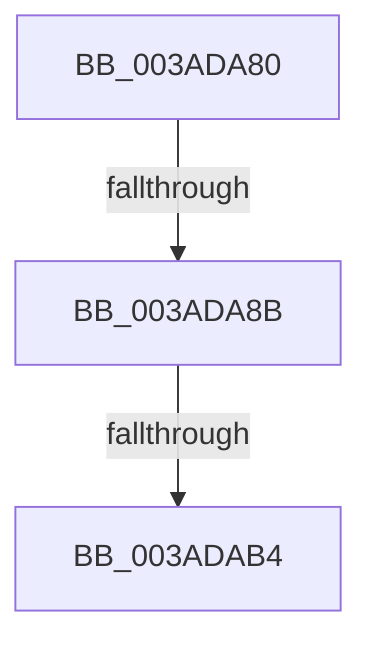

# sub_003ADA80

- RVA: `0x003ADA80`–`0x003ADAB9` (길이 `57` bytes)
- VA: `0x00000001403ADA80`
- 실행 섹션: `.text`
- PDB 이름 있음: `아니요`; PDB Function 태그: `아니요`
- unwind 정보 RVA: `0x0008BD6C`
- 디코드: `13`개 명령, `57/57` bytes 표시
- 미해석 바이트: `0` (있으면 어셈블리에 `.byte`로 보존)

> 이 문서는 커널 이미지의 기계어와 PDB 기호를 분석해 생성했습니다. 4번과 5번은 함수 원형과 자료형을 바이너리 사용 방식에서 추정한 C 해석이며 원본 소스 복구 결과는 아닙니다.

## 1. Dependencies

- 직접 호출 지점: **1**; 고유 호출 대상: **1**
- 직접 호출자로 확인된 함수: **0**
- RIP 상대 이미지 참조: **0**

### Outgoing calls
- `0x003ADA9E` → [NP_CONTEXT::NpLeafRefInternal](NP_CONTEXT_NpLeafRefInternal_function_003AA340.md) (function, `0x003AA340`)

### Direct callers
- 이 함수 시작 RVA로 연결되는 직접 call은 확인되지 않았습니다. 간접 호출은 완전히 역산할 수 없습니다.

### Static image references
- 디코드된 RIP-relative 메모리 참조가 없습니다.

## 2. Other-region calls and transfers

- 다른 실행 섹션으로 향하는 call: **0**
- call이 아닌 외부 분기/꼬리 이동: **3**
  - `0x003ADA85` → [sub_003AD4D0 + 0x1D8](Unknown_function_003AD4D0.md) (`tail-transfer`)
  - `0x003ADAAE` → [sub_003AD4D0 + 0x5F](Unknown_function_003AD4D0.md) (`tail-transfer`)
  - `0x003ADAB4` → [sub_003AD4D0 + 0x2BC](Unknown_function_003AD4D0.md) (`tail-transfer`)

## 3. Assembly (complete function range)

```asm
003ADA80  41 80 7E 02 02                  cmp byte ptr [r14 + 2], 2
003ADA85  0F 85 1D FC FF FF               jne 0x1403ad6a8
003ADA8B  44 0F B6 47 20                  movzx r8d, byte ptr [rdi + 0x20]
003ADA90  48 8B D1                        mov rdx, rcx
003ADA93  41 83 E0 01                     and r8d, 1
003ADA97  49 8D 4D 10                     lea rcx, [r13 + 0x10]
003ADA9B  45 03 C0                        add r8d, r8d
003ADA9E  E8 9D C8 FF FF                  call 0x1403aa340
003ADAA3  48 89 44 24 28                  mov qword ptr [rsp + 0x28], rax
003ADAA8  4C 8B F0                        mov r14, rax
003ADAAB  48 85 C0                        test rax, rax
003ADAAE  0F 85 7B FA FF FF               jne 0x1403ad52f
003ADAB4  E9 D3 FC FF FF                  jmp 0x1403ad78c
```

## 4. C-style interpretation (structured pseudocode)

```c
__int64 __fastcall sub_003ADA80(__int64 a1)
{
    __int64 result;
    unsigned __int64 v_stack_p28;

    a3 = (unsigned int)((*(unsigned __int8 *)(v_rdi + 32)) & (1));
    a3 = (unsigned int)((a3) + ((unsigned int)(a3)));
    result = NP_CONTEXT__NpLeafRefInternal(v_r13 + 16, a1, a3, a4);
    v_stack_p28 = result;
}
```

## 5. (Beta) C Style

```c
int64_t sub_003ADA80(int64_t Arg1)
{
    int64_t result;
    uint64_t v_stack_p28;

    a3 = (uint32_t)((*(uint8_t *)(local_rdi + 0x20)) & (1));
    a3 = (uint32_t)((a3) + ((uint32_t)(a3)));
    result = NP_CONTEXT__NpLeafRefInternal(local_r13 + 16, Arg1, a3, a4);
    v_stack_p28 = result;
}
```

## 6. Execution-region graph

[열기: 2D/3D 그래프와 함수 탐색 컨트롤 패널](../../../control-panel.html?section=text&rva=0x003ADA80&view=graph)

- 2D 그래프는 위에서 아래로 흐르고, 3D 그래프는 빈 공간을 드래그해 회전합니다. Shift+드래그는 이동, 휠은 확대·축소, 함수 노드 선택은 대상 보고서 이동입니다.

### Static fallback


