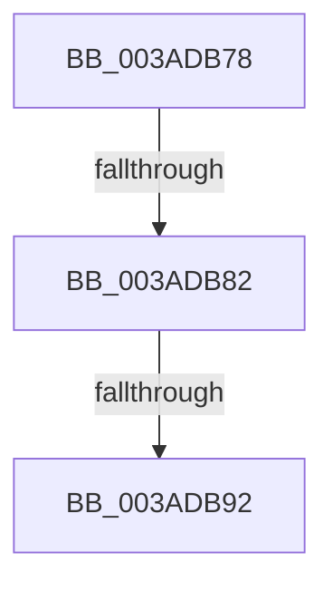

# sub_003ADB78

- RVA: `0x003ADB78`–`0x003ADB99` (길이 `33` bytes)
- VA: `0x00000001403ADB78`
- 실행 섹션: `.text`
- PDB 이름 있음: `아니요`; PDB Function 태그: `아니요`
- unwind 정보 RVA: `0x0008BDD4`
- 디코드: `10`개 명령, `33/33` bytes 표시
- 미해석 바이트: `0` (있으면 어셈블리에 `.byte`로 보존)

> 이 문서는 커널 이미지의 기계어와 PDB 기호를 분석해 생성했습니다. 4번과 5번은 함수 원형과 자료형을 바이너리 사용 방식에서 추정한 C 해석이며 원본 소스 복구 결과는 아닙니다.

## 1. Dependencies

- 직접 호출 지점: **0**; 고유 호출 대상: **0**
- 직접 호출자로 확인된 함수: **0**
- RIP 상대 이미지 참조: **0**

### Outgoing calls
- 직접 디코드된 call 명령이 없습니다.

### Direct callers
- 이 함수 시작 RVA로 연결되는 직접 call은 확인되지 않았습니다. 간접 호출은 완전히 역산할 수 없습니다.

### Static image references
- 디코드된 RIP-relative 메모리 참조가 없습니다.

## 2. Other-region calls and transfers

- 다른 실행 섹션으로 향하는 call: **0**
- call이 아닌 외부 분기/꼬리 이동: **2**
  - `0x003ADB80` → [sub_003ADBF3](Unknown_function_003ADBF3.md) (`tail-transfer`)
  - `0x003ADB90` → [sub_003ADBB1](Unknown_function_003ADBB1.md) (`tail-transfer`)

## 3. Assembly (complete function range)

```asm
003ADB78  4C 89 64 24 50                  mov qword ptr [rsp + 0x50], r12
003ADB7D  41 3B CE                        cmp ecx, r14d
003ADB80  72 71                           jb 0x1403adbf3
003ADB82  48 8B 0F                        mov rcx, qword ptr [rdi]
003ADB85  48 8B 57 08                     mov rdx, qword ptr [rdi + 8]
003ADB89  48 8D 41 10                     lea rax, [rcx + 0x10]
003ADB8D  48 3B D0                        cmp rdx, rax
003ADB90  74 1F                           je 0x1403adbb1
003ADB92  33 C0                           xor eax, eax
003ADB94  4C 8B 64 24 50                  mov r12, qword ptr [rsp + 0x50]
```

## 4. C-style interpretation (structured pseudocode)

```c
__int64 __fastcall sub_003ADB78(int a1, __int64 a2, __int64 a3, __int64 a4, __int64 a5, __int64 a6, __int64 a7, __int64 a8, __int64 a9, __int64 a10)
{
    __int64 result;
    unsigned __int64 v_stack_p50;

    v_stack_p50 = v_r12;
    result = 0;
    return result;
}
```

## 5. (Beta) C Style

```c
int64_t sub_003ADB78(int32_t Arg1, int64_t Arg2, int64_t Arg3, int64_t Arg4, uint64_t Arg5, uint64_t Arg6, uint64_t Arg7, uint64_t Arg8, uint64_t Arg9, int64_t Arg10)
{
    int64_t result;
    uint64_t v_stack_p50;

    v_stack_p50 = local_r12;
    result = 0;
    return result;
}
```

## 6. Execution-region graph

[열기: 2D/3D 그래프와 함수 탐색 컨트롤 패널](../../../control-panel.html?section=text&rva=0x003ADB78&view=graph)

- 2D 그래프는 위에서 아래로 흐르고, 3D 그래프는 빈 공간을 드래그해 회전합니다. Shift+드래그는 이동, 휠은 확대·축소, 함수 노드 선택은 대상 보고서 이동입니다.

### Static fallback


