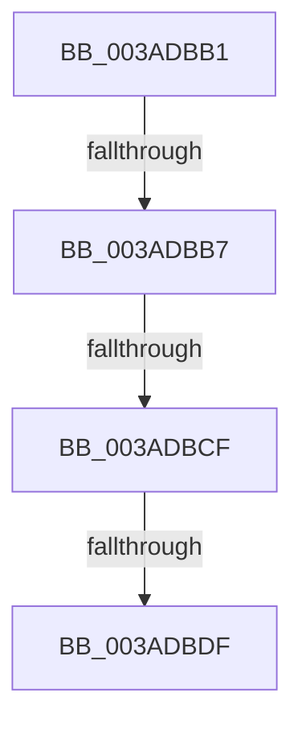

# sub_003ADBB1

- RVA: `0x003ADBB1`–`0x003ADBE7` (길이 `54` bytes)
- VA: `0x00000001403ADBB1`
- 실행 섹션: `.text`
- PDB 이름 있음: `아니요`; PDB Function 태그: `아니요`
- unwind 정보 RVA: `0x0008BDFC`
- 디코드: `17`개 명령, `54/54` bytes 표시
- 미해석 바이트: `0` (있으면 어셈블리에 `.byte`로 보존)

> 이 문서는 커널 이미지의 기계어와 PDB 기호를 분석해 생성했습니다. 4번과 5번은 함수 원형과 자료형을 바이너리 사용 방식에서 추정한 C 해석이며 원본 소스 복구 결과는 아닙니다.

## 1. Dependencies

- 직접 호출 지점: **0**; 고유 호출 대상: **0**
- 직접 호출자로 확인된 함수: **0**
- RIP 상대 이미지 참조: **0**

### Outgoing calls
- 직접 디코드된 call 명령이 없습니다.

### Direct callers
- 이 함수 시작 RVA로 연결되는 직접 call은 확인되지 않았습니다. 간접 호출은 완전히 역산할 수 없습니다.

### Static image references
- 디코드된 RIP-relative 메모리 참조가 없습니다.

## 2. Other-region calls and transfers

- 다른 실행 섹션으로 향하는 call: **0**
- call이 아닌 외부 분기/꼬리 이동: **4**
  - `0x003ADBB5` → [sub_003ADB78 + 0x1A](Unknown_function_003ADB78.md) (`tail-transfer`)
  - `0x003ADBCD` → [sub_003ADB78 + 0x1A](Unknown_function_003ADB78.md) (`tail-transfer`)
  - `0x003ADBDD` → [sub_003ADBF3 + 0x5D](Unknown_function_003ADBF3.md) (`tail-transfer`)
  - `0x003ADBE5` → [sub_003ADB78 + 0x1A](Unknown_function_003ADB78.md) (`tail-transfer`)

## 3. Assembly (complete function range)

```asm
003ADBB1  80 79 03 00                     cmp byte ptr [rcx + 3], 0
003ADBB5  74 DB                           je 0x1403adb92
003ADBB7  41 8B 4D 18                     mov ecx, dword ptr [r13 + 0x18]
003ADBBB  4D 8B 45 00                     mov r8, qword ptr [r13]
003ADBBF  48 83 E9 02                     sub rcx, 2
003ADBC3  48 C1 E1 04                     shl rcx, 4
003ADBC7  49 03 C8                        add rcx, r8
003ADBCA  49 3B C8                        cmp rcx, r8
003ADBCD  72 C3                           jb 0x1403adb92
003ADBCF  48 8B 01                        mov rax, qword ptr [rcx]
003ADBD2  4C 8B 49 08                     mov r9, qword ptr [rcx + 8]
003ADBD6  48 83 C0 10                     add rax, 0x10
003ADBDA  4C 3B C8                        cmp r9, rax
003ADBDD  76 71                           jbe 0x1403adc50
003ADBDF  8B 02                           mov eax, dword ptr [rdx]
003ADBE1  41 89 41 F0                     mov dword ptr [r9 - 0x10], eax
003ADBE5  EB AB                           jmp 0x1403adb92
```

## 4. C-style interpretation (structured pseudocode)

```c
__int64 __fastcall sub_003ADBB1(__int64 a1, __int64 a2)
{
    __int64 result;

    a1 = ((unsigned int)(*(unsigned int *)(v_r13 + 24))) - (2);
    a1 = (a1) << (4);
    a1 = (a1) + (*(unsigned __int64 *)(v_r13));
    result = (*(unsigned __int64 *)(a1)) + (16);
    *(unsigned int *)(*(unsigned __int64 *)(a1 + 8) - 16) = (unsigned int)((unsigned int)(*(unsigned int *)(a2)));
}
```

## 5. (Beta) C Style

```c
int64_t sub_003ADBB1(void *Arg1, void *Arg2)
{
    uint8_t *arg1 = (uint8_t *)Arg1;
    uint8_t *arg2 = (uint8_t *)Arg2;

    int64_t result;

    Arg1 = ((uint32_t)(*(uint32_t *)(local_r13 + 0x18))) - (2);
    Arg1 = (Arg1) << (4);
    Arg1 = (Arg1) + (*(uint64_t *)(local_r13));
    result = (*(uint64_t *)(arg1)) + (16);
    *(uint32_t *)(*(uint64_t *)(arg1 + 0x8) - 0x10) = (uint32_t)((uint32_t)(*(uint32_t *)(arg2)));
}
```

### 관측된 메모리 오프셋

구조체 형식이 확인되지 않은 접근은 인자 기준의 오프셋으로만 기록했습니다.

| 기준 인자 | 오프셋 표현 | 폭 (bit) | 접근 |
|---|---:|---:|---|
| `Arg1` | `+ 0x3` | `8` | `R` |
| `Arg2` | `+ 0x0` | `32` | `R` |

## 6. Execution-region graph

[열기: 2D/3D 그래프와 함수 탐색 컨트롤 패널](../../../control-panel.html?section=text&rva=0x003ADBB1&view=graph)

- 2D 그래프는 위에서 아래로 흐르고, 3D 그래프는 빈 공간을 드래그해 회전합니다. Shift+드래그는 이동, 휠은 확대·축소, 함수 노드 선택은 대상 보고서 이동입니다.

### Static fallback


