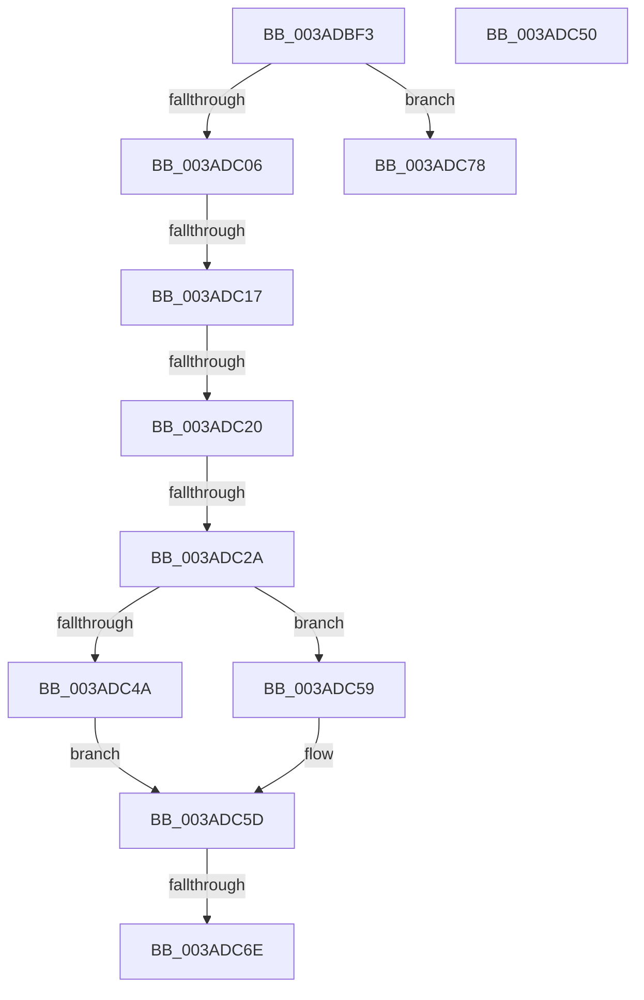

# sub_003ADBF3

- RVA: `0x003ADBF3`–`0x003ADC82` (길이 `143` bytes)
- VA: `0x00000001403ADBF3`
- 실행 섹션: `.text`
- PDB 이름 있음: `아니요`; PDB Function 태그: `아니요`
- unwind 정보 RVA: `0x0008BE20`
- 디코드: `38`개 명령, `143/143` bytes 표시
- 미해석 바이트: `0` (있으면 어셈블리에 `.byte`로 보존)

> 이 문서는 커널 이미지의 기계어와 PDB 기호를 분석해 생성했습니다. 4번과 5번은 함수 원형과 자료형을 바이너리 사용 방식에서 추정한 C 해석이며 원본 소스 복구 결과는 아닙니다.

## 1. Dependencies

- 직접 호출 지점: **2**; 고유 호출 대상: **2**
- 직접 호출자로 확인된 함수: **0**
- RIP 상대 이미지 참조: **0**

### Outgoing calls
- `0x003ADBF9` → [B_TREE<unsigned long,ST_STORE<SM_TRAITS>::_ST_REGION_ENTRY,4096,NP_CONTEXT,ST_STORE<SM_TRAITS>::ST_REGION_ENTRY_COMPARATOR>::BTreeRedistribute](B_TREE_unsigned_long_ST_STORE_SM_TRAITS__ST_REGION_ENTRY_4096_NP_CONTEXT_ST_STORE_SM_TRAITS_ST_REGIO_function_003AEA1C.md) (function, `0x003AEA1C`)
- `0x003ADC6E` → [NP_CONTEXT::NpLeafDerefInternal](NP_CONTEXT_NpLeafDerefInternal_function_003A9A70.md) (function, `0x003A9A70`)

### Direct callers
- 이 함수 시작 RVA로 연결되는 직접 call은 확인되지 않았습니다. 간접 호출은 완전히 역산할 수 없습니다.

### Static image references
- 디코드된 RIP-relative 메모리 참조가 없습니다.

## 2. Other-region calls and transfers

- 다른 실행 섹션으로 향하는 call: **0**
- call이 아닌 외부 분기/꼬리 이동: **7**
  - `0x003ADC15` → [sub_003ADC95](Unknown_function_003ADC95.md) (`tail-transfer`)
  - `0x003ADC1A` → [sub_003ADC95 + 0x56](Unknown_function_003ADC95.md) (`tail-transfer`)
  - `0x003ADC24` → [sub_003ADB78 + 0xA](Unknown_function_003ADB78.md) (`tail-transfer`)
  - `0x003ADC54` → [sub_003ADBB1 + 0x19](Unknown_function_003ADBB1.md) (`tail-transfer`)
  - `0x003ADC68` → [sub_003ADB78 + 0xA](Unknown_function_003ADB78.md) (`tail-transfer`)
  - `0x003ADC73` → [sub_003ADB78 + 0xA](Unknown_function_003ADB78.md) (`tail-transfer`)
  - `0x003ADC7D` → [sub_003ADB78 + 0x1C](Unknown_function_003ADB78.md) (`tail-transfer`)

## 3. Assembly (complete function range)

```asm
003ADBF3  49 8B D5                        mov rdx, r13
003ADBF6  48 8B CE                        mov rcx, rsi
003ADBF9  E8 1E 0E 00 00                  call 0x1403aea1c
003ADBFE  4C 8B E0                        mov r12, rax
003ADC01  48 85 C0                        test rax, rax
003ADC04  74 72                           je 0x1403adc78
003ADC06  8B 03                           mov eax, dword ptr [rbx]
003ADC08  41 23 C7                        and eax, r15d
003ADC0B  4D 8B FC                        mov r15, r12
003ADC0E  41 83 E7 01                     and r15d, 1
003ADC12  41 3B C6                        cmp eax, r14d
003ADC15  72 7E                           jb 0x1403adc95
003ADC17  4D 85 FF                        test r15, r15
003ADC1A  0F 85 CB 00 00 00               jne 0x1403adceb
003ADC20  80 7B 03 00                     cmp byte ptr [rbx + 3], 0
003ADC24  0F 84 58 FF FF FF               je 0x1403adb82
003ADC2A  48 8B 57 F0                     mov rdx, qword ptr [rdi - 0x10]
003ADC2E  49 83 F7 01                     xor r15, 1
003ADC32  48 8B 4F F8                     mov rcx, qword ptr [rdi - 8]
003ADC36  49 C1 E7 05                     shl r15, 5
003ADC3A  48 83 C1 F0                     add rcx, -0x10
003ADC3E  49 03 CF                        add rcx, r15
003ADC41  48 8D 42 10                     lea rax, [rdx + 0x10]
003ADC45  48 3B C8                        cmp rcx, rax
003ADC48  77 0F                           ja 0x1403adc59
003ADC4A  48 83 C2 08                     add rdx, 8
003ADC4E  EB 0D                           jmp 0x1403adc5d
003ADC50  48 83 E9 10                     sub rcx, 0x10
003ADC54  E9 71 FF FF FF                  jmp 0x1403adbca
003ADC59  48 8D 51 F8                     lea rdx, [rcx - 8]
003ADC5D  48 8B 46 10                     mov rax, qword ptr [rsi + 0x10]
003ADC61  48 8D 4E 10                     lea rcx, [rsi + 0x10]
003ADC65  83 38 FF                        cmp dword ptr [rax], -1
003ADC68  0F 84 14 FF FF FF               je 0x1403adb82
003ADC6E  E8 FD BD FF FF                  call 0x1403a9a70
003ADC73  E9 0A FF FF FF                  jmp 0x1403adb82
003ADC78  B8 06 00 00 C0                  mov eax, 0xc0000006
003ADC7D  E9 12 FF FF FF                  jmp 0x1403adb94
```

## 4. C-style interpretation (structured pseudocode)

```c
__int64 __fastcall sub_003ADBF3(void)
{
    __int64 result;
    __int64 v_r15;

    result = B_TREE_unsigned_long_ST_STORE_SM_TRAITS____ST_REGION_ENTRY_4096_NP_CONTEXT_ST_STORE_SM_TRAITS___ST_R(v_rsi, v_r13, a3, a4);
    if (result == 0) goto loc_003ADC78;
    result = (unsigned int)(((unsigned int)(*(unsigned int *)(v_rbx))) & ((unsigned int)(v_r15)));
    v_r15 = (unsigned int)((result) & (1));
    v_r15 = (v_r15) ^ (1);
    v_r15 = (v_r15) << (5);
    a1 = (*(unsigned __int64 *)(v_rdi - 8)) + (-16);
    a1 = (a1) + (v_r15);
    if (a1 > (*(unsigned __int64 *)(v_rdi - 16) + 16)) goto loc_003ADC59;
    a2 = (*(unsigned __int64 *)(v_rdi - 16)) + (8);
    goto loc_003ADC5D;
loc_003ADC59:
loc_003ADC5D:
    result = NP_CONTEXT__NpLeafDerefInternal(v_rsi + 16, a1 - 8, a3, a4);
loc_003ADC78:
}
```

## 5. (Beta) C Style

```c
void sub_003ADBF3(void)
{
    int64_t result;
    int64_t local_r15;

    result = B_TREE_unsigned_long_ST_STORE_SM_TRAITS____ST_REGION_ENTRY_4096_NP_CONTEXT_ST_STORE_SM_TRAITS___ST_R(local_rsi, local_r13, a3, a4);
    if (result == 0) goto loc_003ADC78;
    result = (uint32_t)(((uint32_t)(*(uint32_t *)(local_rbx))) & ((uint32_t)(local_r15)));
    local_r15 = (uint32_t)((result) & (1));
    local_r15 = (local_r15) ^ (1);
    local_r15 = (local_r15) << (5);
    a1 = (*(uint64_t *)(local_rdi - 0x8)) + (-16);
    a1 = (a1) + (local_r15);
    if (a1 > (*(uint64_t *)(local_rdi - 0x10) + 16)) goto loc_003ADC59;
    a2 = (*(uint64_t *)(local_rdi - 0x10)) + (8);
    goto loc_003ADC5D;
loc_003ADC59:
loc_003ADC5D:
    result = NP_CONTEXT__NpLeafDerefInternal(local_rsi + 16, a1 - 8, a3, a4);
loc_003ADC78:
}
```

## 6. Execution-region graph

[열기: 2D/3D 그래프와 함수 탐색 컨트롤 패널](../../../control-panel.html?section=text&rva=0x003ADBF3&view=graph)

- 2D 그래프는 위에서 아래로 흐르고, 3D 그래프는 빈 공간을 드래그해 회전합니다. Shift+드래그는 이동, 휠은 확대·축소, 함수 노드 선택은 대상 보고서 이동입니다.

### Static fallback


