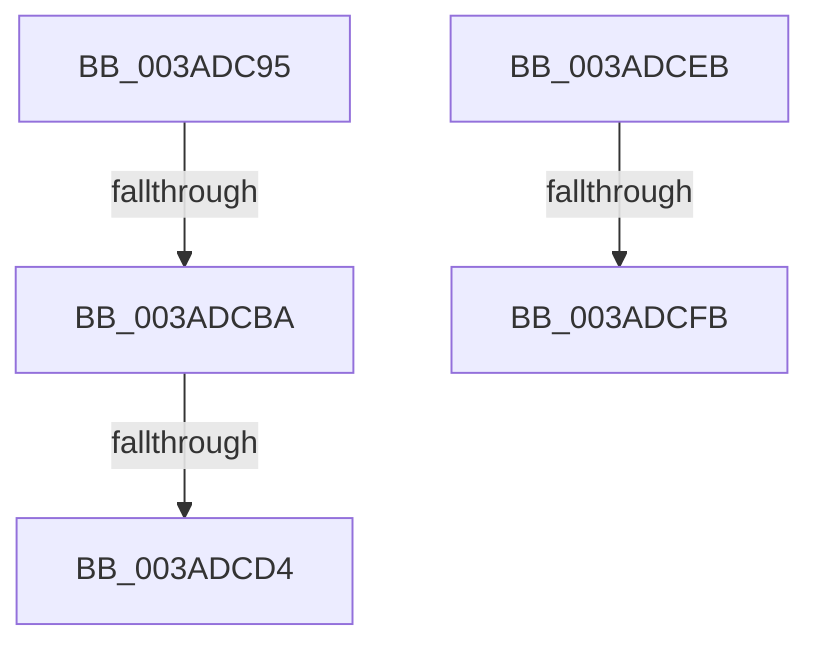

# sub_003ADC95

- RVA: `0x003ADC95`–`0x003ADD08` (길이 `115` bytes)
- VA: `0x00000001403ADC95`
- 실행 섹션: `.text`
- PDB 이름 있음: `아니요`; PDB Function 태그: `아니요`
- unwind 정보 RVA: `0x0008BE44`
- 디코드: `29`개 명령, `115/115` bytes 표시
- 미해석 바이트: `0` (있으면 어셈블리에 `.byte`로 보존)

> 이 문서는 커널 이미지의 기계어와 PDB 기호를 분석해 생성했습니다. 4번과 5번은 함수 원형과 자료형을 바이너리 사용 방식에서 추정한 C 해석이며 원본 소스 복구 결과는 아닙니다.

## 1. Dependencies

- 직접 호출 지점: **1**; 고유 호출 대상: **1**
- 직접 호출자로 확인된 함수: **0**
- RIP 상대 이미지 참조: **0**

### Outgoing calls
- `0x003ADC9E` → [B_TREE<unsigned long,ST_STORE<SM_TRAITS>::_ST_REGION_ENTRY,4096,NP_CONTEXT,ST_STORE<SM_TRAITS>::ST_REGION_ENTRY_COMPARATOR>::BTreeMergeNodes](B_TREE_unsigned_long_ST_STORE_SM_TRAITS__ST_REGION_ENTRY_4096_NP_CONTEXT_ST_STORE_SM_TRAITS_ST_REGIO_function_003AF47C.md) (function, `0x003AF47C`)

### Direct callers
- 이 함수 시작 RVA로 연결되는 직접 call은 확인되지 않았습니다. 간접 호출은 완전히 역산할 수 없습니다.

### Static image references
- 디코드된 RIP-relative 메모리 참조가 없습니다.

## 2. Other-region calls and transfers

- 다른 실행 섹션으로 향하는 call: **0**
- call이 아닌 외부 분기/꼬리 이동: **5**
  - `0x003ADCB4` → [sub_003ADB78 + 0xA](Unknown_function_003ADB78.md) (`tail-transfer`)
  - `0x003ADCCE` → [sub_003ADD99](Unknown_function_003ADD99.md) (`tail-transfer`)
  - `0x003ADCE6` → [sub_003ADB78 + 0xA](Unknown_function_003ADB78.md) (`tail-transfer`)
  - `0x003ADCF9` → [sub_003ADD4D](Unknown_function_003ADD4D.md) (`tail-transfer`)
  - `0x003ADD03` → [sub_003ADBF3 + 0x2D](Unknown_function_003ADBF3.md) (`tail-transfer`)

## 3. Assembly (complete function range)

```asm
003ADC95  4D 8B C4                        mov r8, r12
003ADC98  49 8B D5                        mov rdx, r13
003ADC9B  48 8B CE                        mov rcx, rsi
003ADC9E  E8 D9 17 00 00                  call 0x1403af47c
003ADCA3  41 8B 7D 18                     mov edi, dword ptr [r13 + 0x18]
003ADCA7  FF CF                           dec edi
003ADCA9  48 C1 E7 04                     shl rdi, 4
003ADCAD  49 03 7D 00                     add rdi, qword ptr [r13]
003ADCB1  4D 85 FF                        test r15, r15
003ADCB4  0F 84 C8 FE FF FF               je 0x1403adb82
003ADCBA  49 83 E4 FE                     and r12, 0xfffffffffffffffe
003ADCBE  4C 89 27                        mov qword ptr [rdi], r12
003ADCC1  41 80 7C 24 03 00               cmp byte ptr [r12 + 3], 0
003ADCC7  41 8B 04 24                     mov eax, dword ptr [r12]
003ADCCB  0F B7 C0                        movzx eax, ax
003ADCCE  0F 84 C5 00 00 00               je 0x1403add99
003ADCD4  48 8D 04 85 10 00 00 00         lea rax, [rax*4 + 0x10]
003ADCDC  48 2B C5                        sub rax, rbp
003ADCDF  49 03 C4                        add rax, r12
003ADCE2  48 89 47 08                     mov qword ptr [rdi + 8], rax
003ADCE6  E9 97 FE FF FF                  jmp 0x1403adb82
003ADCEB  41 2B C6                        sub eax, r14d
003ADCEE  80 7B 03 00                     cmp byte ptr [rbx + 3], 0
003ADCF2  8D 48 01                        lea ecx, [rax + 1]
003ADCF5  48 8B 47 08                     mov rax, qword ptr [rdi + 8]
003ADCF9  74 52                           je 0x1403add4d
003ADCFB  48 8D 04 88                     lea rax, [rax + rcx*4]
003ADCFF  48 89 47 08                     mov qword ptr [rdi + 8], rax
003ADD03  E9 18 FF FF FF                  jmp 0x1403adc20
```

## 4. C-style interpretation (structured pseudocode)

```c
__int64 __fastcall sub_003ADC95(void)
{
    __int64 result;
    __int64 v_r12;
    __int64 v_rdi;

    result = B_TREE_unsigned_long_ST_STORE_SM_TRAITS____ST_REGION_ENTRY_4096_NP_CONTEXT_ST_STORE_SM_TRAITS___ST_R(v_rsi, v_r13, v_r12, a4);
    v_rdi = (unsigned int)(((unsigned int)(*(unsigned int *)(v_r13 + 24))) - 1);
    v_rdi = (v_rdi) << (4);
    v_rdi = (v_rdi) + (*(unsigned __int64 *)(v_r13));
    v_r12 = (v_r12) & (-2);
    *(unsigned __int64 *)(v_rdi) = v_r12;
    result = ((unsigned __int16)((unsigned int)(*(unsigned int *)(v_r12))) * 4 + 16) - (v_rbp);
    result = (result) + (v_r12);
    *(unsigned __int64 *)(v_rdi + 8) = result;
}
```

## 5. (Beta) C Style

```c
void sub_003ADC95(void)
{
    int64_t result;
    int64_t local_r12;
    int64_t local_rdi;

    result = B_TREE_unsigned_long_ST_STORE_SM_TRAITS____ST_REGION_ENTRY_4096_NP_CONTEXT_ST_STORE_SM_TRAITS___ST_R(local_rsi, local_r13, local_r12, a4);
    local_rdi = (uint32_t)(((uint32_t)(*(uint32_t *)(local_r13 + 0x18))) - 1);
    local_rdi = (local_rdi) << (4);
    local_rdi = (local_rdi) + (*(uint64_t *)(local_r13));
    local_r12 = (local_r12) & (-2);
    *(uint64_t *)(local_rdi) = local_r12;
    result = ((uint16_t)((uint32_t)(*(uint32_t *)(local_r12))) * 4 + 16) - (local_rbp);
    result = (result) + (local_r12);
    *(uint64_t *)(local_rdi + 0x8) = result;
}
```

## 6. Execution-region graph

[열기: 2D/3D 그래프와 함수 탐색 컨트롤 패널](../../../control-panel.html?section=text&rva=0x003ADC95&view=graph)

- 2D 그래프는 위에서 아래로 흐르고, 3D 그래프는 빈 공간을 드래그해 회전합니다. Shift+드래그는 이동, 휠은 확대·축소, 함수 노드 선택은 대상 보고서 이동입니다.

### Static fallback


