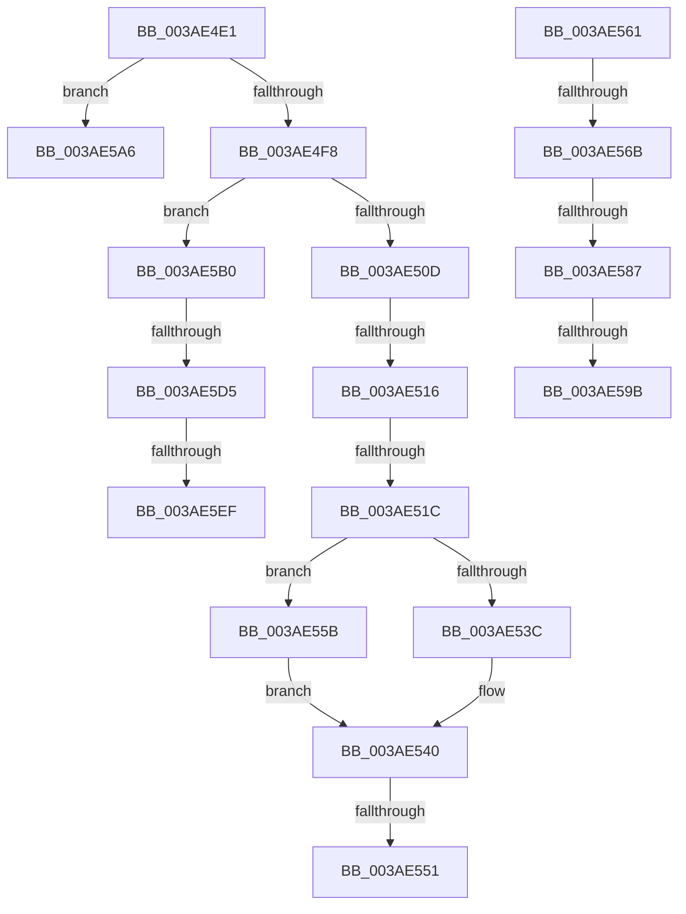

# sub_003AE4E1

- RVA: `0x003AE4E1`–`0x003AE5FC` (길이 `283` bytes)
- VA: `0x00000001403AE4E1`
- 실행 섹션: `.text`
- PDB 이름 있음: `아니요`; PDB Function 태그: `아니요`
- unwind 정보 RVA: `0x0008BF48`
- 디코드: `71`개 명령, `283/283` bytes 표시
- 미해석 바이트: `0` (있으면 어셈블리에 `.byte`로 보존)

> 이 문서는 커널 이미지의 기계어와 PDB 기호를 분석해 생성했습니다. 4번과 5번은 함수 원형과 자료형을 바이너리 사용 방식에서 추정한 C 해석이며 원본 소스 복구 결과는 아닙니다.

## 1. Dependencies

- 직접 호출 지점: **3**; 고유 호출 대상: **3**
- 직접 호출자로 확인된 함수: **0**
- RIP 상대 이미지 참조: **0**

### Outgoing calls
- `0x003AE4E7` → [B_TREE<unsigned long,ST_STORE<SM_TRAITS>::_ST_HASH_ENTRY,4096,NP_CONTEXT,ST_STORE<SM_TRAITS>::ST_HASH_ENTRY_COMPARATOR>::BTreeRedistribute](B_TREE_unsigned_long_ST_STORE_SM_TRAITS__ST_HASH_ENTRY_4096_NP_CONTEXT_ST_STORE_SM_TRAITS_ST_HASH_EN_function_003AECFC.md) (function, `0x003AECFC`)
- `0x003AE551` → [NP_CONTEXT::NpLeafDerefInternal](NP_CONTEXT_NpLeafDerefInternal_function_003A9A70.md) (function, `0x003A9A70`)
- `0x003AE5B9` → [B_TREE<unsigned long,ST_STORE<SM_TRAITS>::_ST_HASH_ENTRY,4096,NP_CONTEXT,ST_STORE<SM_TRAITS>::ST_HASH_ENTRY_COMPARATOR>::BTreeMergeNodes](B_TREE_unsigned_long_ST_STORE_SM_TRAITS__ST_HASH_ENTRY_4096_NP_CONTEXT_ST_STORE_SM_TRAITS_ST_HASH_EN_function_003AA404.md) (function, `0x003AA404`)

### Direct callers
- 이 함수 시작 RVA로 연결되는 직접 call은 확인되지 않았습니다. 간접 호출은 완전히 역산할 수 없습니다.

### Static image references
- 디코드된 RIP-relative 메모리 참조가 없습니다.

## 2. Other-region calls and transfers

- 다른 실행 섹션으로 향하는 call: **0**
- call이 아닌 외부 분기/꼬리 이동: **12**
  - `0x003AE510` → [sub_003AE60F](Unknown_function_003AE60F.md) (`tail-transfer`)
  - `0x003AE51A` → [sub_003AE498 + 0xA](Unknown_function_003AE498.md) (`tail-transfer`)
  - `0x003AE54B` → [sub_003AE498 + 0xA](Unknown_function_003AE498.md) (`tail-transfer`)
  - `0x003AE556` → [sub_003AE498 + 0xA](Unknown_function_003AE498.md) (`tail-transfer`)
  - `0x003AE565` → [sub_003AE498 + 0x1E](Unknown_function_003AE498.md) (`tail-transfer`)
  - `0x003AE581` → [sub_003AE498 + 0x1E](Unknown_function_003AE498.md) (`tail-transfer`)
  - `0x003AE595` → [sub_003AE671 + 0x10](Unknown_function_003AE671.md) (`tail-transfer`)
  - `0x003AE5A1` → [sub_003AE498 + 0x1E](Unknown_function_003AE498.md) (`tail-transfer`)
  - `0x003AE5AB` → [sub_003AE498 + 0x20](Unknown_function_003AE498.md) (`tail-transfer`)
  - `0x003AE5CF` → [sub_003AE498 + 0xA](Unknown_function_003AE498.md) (`tail-transfer`)
  - `0x003AE5E9` → [sub_006E6F84](../6E/Unknown_function_006E6F84.md) (`tail-transfer`)
  - `0x003AE5F7` → [sub_006E6F84 + 0x7](../6E/Unknown_function_006E6F84.md) (`tail-transfer`)

## 3. Assembly (complete function range)

```asm
003AE4E1  49 8B D5                        mov rdx, r13
003AE4E4  48 8B CE                        mov rcx, rsi
003AE4E7  E8 10 08 00 00                  call 0x1403aecfc
003AE4EC  4C 8B E0                        mov r12, rax
003AE4EF  48 85 C0                        test rax, rax
003AE4F2  0F 84 AE 00 00 00               je 0x1403ae5a6
003AE4F8  8B 03                           mov eax, dword ptr [rbx]
003AE4FA  41 23 C7                        and eax, r15d
003AE4FD  4D 8B FC                        mov r15, r12
003AE500  41 83 E7 01                     and r15d, 1
003AE504  41 3B C6                        cmp eax, r14d
003AE507  0F 82 A3 00 00 00               jb 0x1403ae5b0
003AE50D  4D 85 FF                        test r15, r15
003AE510  0F 85 F9 00 00 00               jne 0x1403ae60f
003AE516  80 7B 03 00                     cmp byte ptr [rbx + 3], 0
003AE51A  74 86                           je 0x1403ae4a2
003AE51C  48 8B 57 F0                     mov rdx, qword ptr [rdi - 0x10]
003AE520  49 83 F7 01                     xor r15, 1
003AE524  48 8B 4F F8                     mov rcx, qword ptr [rdi - 8]
003AE528  49 C1 E7 05                     shl r15, 5
003AE52C  48 83 C1 F0                     add rcx, -0x10
003AE530  49 03 CF                        add rcx, r15
003AE533  48 8D 42 10                     lea rax, [rdx + 0x10]
003AE537  48 3B C8                        cmp rcx, rax
003AE53A  76 1F                           jbe 0x1403ae55b
003AE53C  48 8D 51 F8                     lea rdx, [rcx - 8]
003AE540  48 8B 46 10                     mov rax, qword ptr [rsi + 0x10]
003AE544  48 8D 4E 10                     lea rcx, [rsi + 0x10]
003AE548  83 38 FF                        cmp dword ptr [rax], -1
003AE54B  0F 84 51 FF FF FF               je 0x1403ae4a2
003AE551  E8 1A B5 FF FF                  call 0x1403a9a70
003AE556  E9 47 FF FF FF                  jmp 0x1403ae4a2
003AE55B  48 83 C2 08                     add rdx, 8
003AE55F  EB DF                           jmp 0x1403ae540
003AE561  80 79 03 00                     cmp byte ptr [rcx + 3], 0
003AE565  0F 84 4B FF FF FF               je 0x1403ae4b6
003AE56B  41 8B 4D 18                     mov ecx, dword ptr [r13 + 0x18]
003AE56F  4D 8B 45 00                     mov r8, qword ptr [r13]
003AE573  48 83 E9 02                     sub rcx, 2
003AE577  48 C1 E1 04                     shl rcx, 4
003AE57B  49 03 C8                        add rcx, r8
003AE57E  49 3B C8                        cmp rcx, r8
003AE581  0F 82 2F FF FF FF               jb 0x1403ae4b6
003AE587  48 8B 01                        mov rax, qword ptr [rcx]
003AE58A  4C 8B 49 08                     mov r9, qword ptr [rcx + 8]
003AE58E  48 83 C0 10                     add rax, 0x10
003AE592  4C 3B C8                        cmp r9, rax
003AE595  0F 86 E6 00 00 00               jbe 0x1403ae681
003AE59B  8B 02                           mov eax, dword ptr [rdx]
003AE59D  41 89 41 F0                     mov dword ptr [r9 - 0x10], eax
003AE5A1  E9 10 FF FF FF                  jmp 0x1403ae4b6
003AE5A6  B8 06 00 00 C0                  mov eax, 0xc0000006
003AE5AB  E9 08 FF FF FF                  jmp 0x1403ae4b8
003AE5B0  4D 8B C4                        mov r8, r12
003AE5B3  49 8B D5                        mov rdx, r13
003AE5B6  48 8B CE                        mov rcx, rsi
003AE5B9  E8 46 BE FF FF                  call 0x1403aa404
003AE5BE  41 8B 7D 18                     mov edi, dword ptr [r13 + 0x18]
003AE5C2  FF CF                           dec edi
003AE5C4  48 C1 E7 04                     shl rdi, 4
003AE5C8  49 03 7D 00                     add rdi, qword ptr [r13]
003AE5CC  4D 85 FF                        test r15, r15
003AE5CF  0F 84 CD FE FF FF               je 0x1403ae4a2
003AE5D5  49 83 E4 FE                     and r12, 0xfffffffffffffffe
003AE5D9  4C 89 27                        mov qword ptr [rdi], r12
003AE5DC  41 80 7C 24 03 00               cmp byte ptr [r12 + 3], 0
003AE5E2  41 8B 04 24                     mov eax, dword ptr [r12]
003AE5E6  0F B7 C0                        movzx eax, ax
003AE5E9  0F 84 95 89 33 00               je 0x1406e6f84
003AE5EF  48 8D 04 85 10 00 00 00         lea rax, [rax*4 + 0x10]
003AE5F7  E9 8F 89 33 00                  jmp 0x1406e6f8b
```

## 4. C-style interpretation (structured pseudocode)

```c
__int64 __fastcall sub_003AE4E1(void)
{
    __int64 result;
    __int64 v_r12;
    __int64 v_r15;
    __int64 v_rdi;

    result = B_TREE_unsigned_long_ST_STORE_SM_TRAITS____ST_HASH_ENTRY_4096_NP_CONTEXT_ST_STORE_SM_TRAITS___ST_HAS(v_rsi, v_r13, a3, a4);
    if (result == 0) goto loc_003AE5A6;
    result = (unsigned int)(((unsigned int)(*(unsigned int *)(v_rbx))) & ((unsigned int)(v_r15)));
    v_r15 = (unsigned int)((result) & (1));
    if (((unsigned int)(result)) < ((unsigned int)(v_r14))) goto loc_003AE5B0;
    v_r15 = (v_r15) ^ (1);
    v_r15 = (v_r15) << (5);
    a1 = (*(unsigned __int64 *)(v_rdi - 8)) + (-16);
    a1 = (a1) + (v_r15);
    if (a1 <= (*(unsigned __int64 *)(v_rdi - 16) + 16)) goto loc_003AE55B;
loc_003AE540:
    result = NP_CONTEXT__NpLeafDerefInternal(v_rsi + 16, a1 - 8, a3, a4);
loc_003AE55B:
    a2 = (a1 - 8) + (8);
    goto loc_003AE540;
loc_003AE5A6:
loc_003AE5B0:
    result = B_TREE_unsigned_long_ST_STORE_SM_TRAITS____ST_HASH_ENTRY_4096_NP_CONTEXT_ST_STORE_SM_TRAITS___ST_HAS(v_rsi, v_r13, result, a4);
    v_rdi = (unsigned int)(((unsigned int)(*(unsigned int *)(v_r13 + 24))) - 1);
    v_rdi = (v_rdi) << (4);
    v_rdi = (v_rdi) + (*(unsigned __int64 *)(v_r13));
    v_r12 = (result) & (-2);
    *(unsigned __int64 *)(v_rdi) = v_r12;
}
```

## 5. (Beta) C Style

```c
void sub_003AE4E1(void)
{
    int64_t result;
    int64_t local_r12;
    int64_t local_r15;
    int64_t local_rdi;

    result = B_TREE_unsigned_long_ST_STORE_SM_TRAITS____ST_HASH_ENTRY_4096_NP_CONTEXT_ST_STORE_SM_TRAITS___ST_HAS(local_rsi, local_r13, a3, a4);
    if (result == 0) goto loc_003AE5A6;
    result = (uint32_t)(((uint32_t)(*(uint32_t *)(local_rbx))) & ((uint32_t)(local_r15)));
    local_r15 = (uint32_t)((result) & (1));
    if (((uint32_t)(result)) < ((uint32_t)(local_r14))) goto loc_003AE5B0;
    local_r15 = (local_r15) ^ (1);
    local_r15 = (local_r15) << (5);
    a1 = (*(uint64_t *)(local_rdi - 0x8)) + (-16);
    a1 = (a1) + (local_r15);
    if (a1 <= (*(uint64_t *)(local_rdi - 0x10) + 16)) goto loc_003AE55B;
loc_003AE540:
    result = NP_CONTEXT__NpLeafDerefInternal(local_rsi + 16, a1 - 8, a3, a4);
loc_003AE55B:
    a2 = (a1 - 8) + (8);
    goto loc_003AE540;
loc_003AE5A6:
loc_003AE5B0:
    result = B_TREE_unsigned_long_ST_STORE_SM_TRAITS____ST_HASH_ENTRY_4096_NP_CONTEXT_ST_STORE_SM_TRAITS___ST_HAS(local_rsi, local_r13, result, a4);
    local_rdi = (uint32_t)(((uint32_t)(*(uint32_t *)(local_r13 + 0x18))) - 1);
    local_rdi = (local_rdi) << (4);
    local_rdi = (local_rdi) + (*(uint64_t *)(local_r13));
    local_r12 = (result) & (-2);
    *(uint64_t *)(local_rdi) = local_r12;
}
```

## 6. Execution-region graph

[열기: 2D/3D 그래프와 함수 탐색 컨트롤 패널](../../../control-panel.html?section=text&rva=0x003AE4E1&view=graph)

- 2D 그래프는 위에서 아래로 흐르고, 3D 그래프는 빈 공간을 드래그해 회전합니다. Shift+드래그는 이동, 휠은 확대·축소, 함수 노드 선택은 대상 보고서 이동입니다.

### Static fallback


