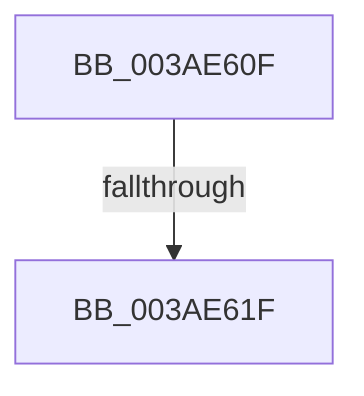

# sub_003AE60F

- RVA: `0x003AE60F`–`0x003AE62C` (길이 `29` bytes)
- VA: `0x00000001403AE60F`
- 실행 섹션: `.text`
- PDB 이름 있음: `아니요`; PDB Function 태그: `아니요`
- unwind 정보 RVA: `0x0008BF6C`
- 디코드: `8`개 명령, `29/29` bytes 표시
- 미해석 바이트: `0` (있으면 어셈블리에 `.byte`로 보존)

> 이 문서는 커널 이미지의 기계어와 PDB 기호를 분석해 생성했습니다. 4번과 5번은 함수 원형과 자료형을 바이너리 사용 방식에서 추정한 C 해석이며 원본 소스 복구 결과는 아닙니다.

## 1. Dependencies

- 직접 호출 지점: **0**; 고유 호출 대상: **0**
- 직접 호출자로 확인된 함수: **0**
- RIP 상대 이미지 참조: **0**

### Outgoing calls
- 직접 디코드된 call 명령이 없습니다.

### Direct callers
- 이 함수 시작 RVA로 연결되는 직접 call은 확인되지 않았습니다. 간접 호출은 완전히 역산할 수 없습니다.

### Static image references
- 디코드된 RIP-relative 메모리 참조가 없습니다.

## 2. Other-region calls and transfers

- 다른 실행 섹션으로 향하는 call: **0**
- call이 아닌 외부 분기/꼬리 이동: **2**
  - `0x003AE61D` → [sub_003AE671](Unknown_function_003AE671.md) (`tail-transfer`)
  - `0x003AE627` → [sub_003AE4E1 + 0x35](Unknown_function_003AE4E1.md) (`tail-transfer`)

## 3. Assembly (complete function range)

```asm
003AE60F  41 2B C6                        sub eax, r14d
003AE612  80 7B 03 00                     cmp byte ptr [rbx + 3], 0
003AE616  8D 48 01                        lea ecx, [rax + 1]
003AE619  48 8B 47 08                     mov rax, qword ptr [rdi + 8]
003AE61D  74 52                           je 0x1403ae671
003AE61F  48 8D 04 88                     lea rax, [rax + rcx*4]
003AE623  48 89 47 08                     mov qword ptr [rdi + 8], rax
003AE627  E9 EA FE FF FF                  jmp 0x1403ae516
```

## 4. C-style interpretation (structured pseudocode)

```c
__int64 __fastcall sub_003AE60F(void)
{
    __int64 result;

    result = (unsigned int)((result) - ((unsigned int)(v_r14)));
    *(unsigned __int64 *)(v_rdi + 8) = *(unsigned __int64 *)(v_rdi + 8) + result + 1 * 4;
}
```

## 5. (Beta) C Style

```c
void sub_003AE60F(void)
{
    int64_t result;

    result = (uint32_t)((result) - ((uint32_t)(local_r14)));
    *(uint64_t *)(local_rdi + 0x8) = *(uint64_t *)(local_rdi + 0x8) + result + 1 * 4;
}
```

## 6. Execution-region graph

[열기: 2D/3D 그래프와 함수 탐색 컨트롤 패널](../../../control-panel.html?section=text&rva=0x003AE60F&view=graph)

- 2D 그래프는 위에서 아래로 흐르고, 3D 그래프는 빈 공간을 드래그해 회전합니다. Shift+드래그는 이동, 휠은 확대·축소, 함수 노드 선택은 대상 보고서 이동입니다.

### Static fallback


