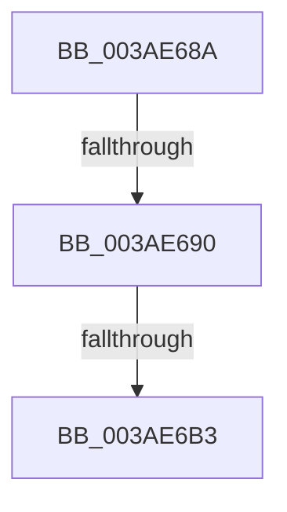

# sub_003AE68A

- RVA: `0x003AE68A`–`0x003AE6C6` (길이 `60` bytes)
- VA: `0x00000001403AE68A`
- 실행 섹션: `.text`
- PDB 이름 있음: `아니요`; PDB Function 태그: `아니요`
- unwind 정보 RVA: `0x0008BFA4`
- 디코드: `15`개 명령, `60/60` bytes 표시
- 미해석 바이트: `0` (있으면 어셈블리에 `.byte`로 보존)

> 이 문서는 커널 이미지의 기계어와 PDB 기호를 분석해 생성했습니다. 4번과 5번은 함수 원형과 자료형을 바이너리 사용 방식에서 추정한 C 해석이며 원본 소스 복구 결과는 아닙니다.

## 1. Dependencies

- 직접 호출 지점: **2**; 고유 호출 대상: **2**
- 직접 호출자로 확인된 함수: **0**
- RIP 상대 이미지 참조: **0**

### Outgoing calls
- `0x003AE69E` → [NP_CONTEXT::NpLeafRefInternal](NP_CONTEXT_NpLeafRefInternal_function_003AA340.md) (function, `0x003AA340`)
- `0x003AE6BB` → [NP_CONTEXT::NpLeafDerefInternal](NP_CONTEXT_NpLeafDerefInternal_function_003A9A70.md) (function, `0x003A9A70`)

### Direct callers
- 이 함수 시작 RVA로 연결되는 직접 call은 확인되지 않았습니다. 간접 호출은 완전히 역산할 수 없습니다.

### Static image references
- 디코드된 RIP-relative 메모리 참조가 없습니다.

## 2. Other-region calls and transfers

- 다른 실행 섹션으로 향하는 call: **0**
- call이 아닌 외부 분기/꼬리 이동: **3**
  - `0x003AE68E` → [sub_003AE62C + 0x2E](Unknown_function_003AE62C.md) (`tail-transfer`)
  - `0x003AE6AD` → [sub_006E6F04](../6E/Unknown_function_006E6F04.md) (`tail-transfer`)
  - `0x003AE6C1` → [sub_006E6F04](../6E/Unknown_function_006E6F04.md) (`tail-transfer`)

## 3. Assembly (complete function range)

```asm
003AE68A  80 7B 02 02                     cmp byte ptr [rbx + 2], 2
003AE68E  75 CA                           jne 0x1403ae65a
003AE690  41 B8 01 00 00 00               mov r8d, 1
003AE696  48 8D 53 08                     lea rdx, [rbx + 8]
003AE69A  48 8D 4E 10                     lea rcx, [rsi + 0x10]
003AE69E  E8 9D BC FF FF                  call 0x1403aa340
003AE6A3  48 89 06                        mov qword ptr [rsi], rax
003AE6A6  48 8B 46 10                     mov rax, qword ptr [rsi + 0x10]
003AE6AA  83 38 FF                        cmp dword ptr [rax], -1
003AE6AD  0F 84 51 88 33 00               je 0x1406e6f04
003AE6B3  48 8D 53 08                     lea rdx, [rbx + 8]
003AE6B7  48 8D 4E 10                     lea rcx, [rsi + 0x10]
003AE6BB  E8 B0 B3 FF FF                  call 0x1403a9a70
003AE6C0  90                              nop
003AE6C1  E9 3E 88 33 00                  jmp 0x1406e6f04
```

## 4. C-style interpretation (structured pseudocode)

```c
__int64 __fastcall sub_003AE68A(void)
{
    __int64 result;

    result = NP_CONTEXT__NpLeafRefInternal(v_rsi + 16, v_rbx + 8, 1, a4);
    *(unsigned __int64 *)(v_rsi) = result;
    result = NP_CONTEXT__NpLeafDerefInternal(v_rsi + 16, v_rbx + 8, 1, a4);
}
```

## 5. (Beta) C Style

```c
void sub_003AE68A(void)
{
    int64_t result;

    result = NP_CONTEXT__NpLeafRefInternal(local_rsi + 16, local_rbx + 8, 1, a4);
    *(uint64_t *)(local_rsi) = result;
    result = NP_CONTEXT__NpLeafDerefInternal(local_rsi + 16, local_rbx + 8, 1, a4);
}
```

## 6. Execution-region graph

[열기: 2D/3D 그래프와 함수 탐색 컨트롤 패널](../../../control-panel.html?section=text&rva=0x003AE68A&view=graph)

- 2D 그래프는 위에서 아래로 흐르고, 3D 그래프는 빈 공간을 드래그해 회전합니다. Shift+드래그는 이동, 휠은 확대·축소, 함수 노드 선택은 대상 보고서 이동입니다.

### Static fallback


