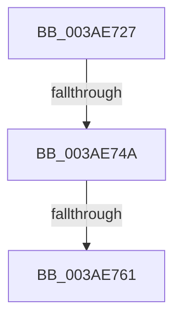

# sub_003AE727

- RVA: `0x003AE727`–`0x003AE791` (길이 `106` bytes)
- VA: `0x00000001403AE727`
- 실행 섹션: `.text`
- PDB 이름 있음: `아니요`; PDB Function 태그: `아니요`
- unwind 정보 RVA: `0x0008BFFC`
- 디코드: `27`개 명령, `106/106` bytes 표시
- 미해석 바이트: `0` (있으면 어셈블리에 `.byte`로 보존)

> 이 문서는 커널 이미지의 기계어와 PDB 기호를 분석해 생성했습니다. 4번과 5번은 함수 원형과 자료형을 바이너리 사용 방식에서 추정한 C 해석이며 원본 소스 복구 결과는 아닙니다.

## 1. Dependencies

- 직접 호출 지점: **1**; 고유 호출 대상: **1**
- 직접 호출자로 확인된 함수: **0**
- RIP 상대 이미지 참조: **0**

### Outgoing calls
- `0x003AE773` → [memcpy](../6C/memcpy_function_006C6840.md) (function, `0x006C6840`)

### Direct callers
- 이 함수 시작 RVA로 연결되는 직접 call은 확인되지 않았습니다. 간접 호출은 완전히 역산할 수 없습니다.

### Static image references
- 디코드된 RIP-relative 메모리 참조가 없습니다.

## 2. Other-region calls and transfers

- 다른 실행 섹션으로 향하는 call: **0**
- call이 아닌 외부 분기/꼬리 이동: **2**
  - `0x003AE744` → [sub_003AE7FC](Unknown_function_003AE7FC.md) (`tail-transfer`)
  - `0x003AE75B` → [sub_003AE7FC + 0x174](Unknown_function_003AE7FC.md) (`tail-transfer`)

## 3. Assembly (complete function range)

```asm
003AE727  48 89 6C 24 50                  mov qword ptr [rsp + 0x50], rbp
003AE72C  BD FC 03 00 00                  mov ebp, 0x3fc
003AE731  4C 89 64 24 60                  mov qword ptr [rsp + 0x60], r12
003AE736  44 38 6B 03                     cmp byte ptr [rbx + 3], r13b
003AE73A  8B 0B                           mov ecx, dword ptr [rbx]
003AE73C  0F 44 E8                        cmove ebp, eax
003AE73F  0F B7 C1                        movzx eax, cx
003AE742  3B C5                           cmp eax, ebp
003AE744  0F 83 B2 00 00 00               jae 0x1403ae7fc
003AE74A  48 8B 7F 08                     mov rdi, qword ptr [rdi + 8]
003AE74E  48 8B D7                        mov rdx, rdi
003AE751  8B 03                           mov eax, dword ptr [rbx]
003AE753  44 0F B7 C0                     movzx r8d, ax
003AE757  44 38 6B 03                     cmp byte ptr [rbx + 3], r13b
003AE75B  0F 84 0F 02 00 00               je 0x1403ae970
003AE761  4E 8D 04 85 10 00 00 00         lea r8, [r8*4 + 0x10]
003AE769  4C 2B C7                        sub r8, rdi
003AE76C  48 8D 4F 04                     lea rcx, [rdi + 4]
003AE770  4C 03 C3                        add r8, rbx
003AE773  E8 C8 80 31 00                  call 0x1406c6840
003AE778  41 8B 07                        mov eax, dword ptr [r15]
003AE77B  89 07                           mov dword ptr [rdi], eax
003AE77D  49 FF 46 08                     inc qword ptr [r14 + 8]
003AE781  66 FF 03                        inc word ptr [rbx]
003AE784  41 8B C5                        mov eax, r13d
003AE787  48 8B 6C 24 50                  mov rbp, qword ptr [rsp + 0x50]
003AE78C  4C 8B 64 24 60                  mov r12, qword ptr [rsp + 0x60]
```

## 4. C-style interpretation (structured pseudocode)

```c
__int64 __fastcall sub_003AE727(__int64 a1, __int64 a2, __int64 a3, __int64 a4, __int64 a5, __int64 a6, __int64 a7, __int64 a8, __int64 a9, __int64 a10, __int64 a11, __int64 a12)
{
    __int64 result;
    __int64 v_rbp;
    unsigned __int64 v_stack_p50;
    unsigned __int64 v_stack_p60;

    v_stack_p50 = v_rbp;
    v_stack_p60 = v_r12;
    v_rbp = (unsigned int)(0x3FCULL);
    if ((*(unsigned __int8 *)(v_rbx + 3)) == ((unsigned __int8)(v_r13))) { v_rbp = (unsigned int)(result); }
    a3 = ((unsigned __int16)((unsigned int)(*(unsigned int *)(v_rbx))) * 4 + 16) - (*(unsigned __int64 *)(v_rdi + 8));
    a3 = (a3) + (v_rbx);
    result = memcpy(*(unsigned __int64 *)(v_rdi + 8) + 4, *(unsigned __int64 *)(v_rdi + 8), a3, a4);
    *(unsigned int *)(*(unsigned __int64 *)(v_rdi + 8)) = (unsigned int)((unsigned int)(*(unsigned int *)(v_r15)));
    return (unsigned int)((unsigned int)(v_r13));
}
```

## 5. (Beta) C Style

```c
int64_t sub_003AE727(int64_t Arg1, int64_t Arg2, int64_t Arg3, int64_t Arg4, uint64_t Arg5, uint64_t Arg6, uint64_t Arg7, uint64_t Arg8, uint64_t Arg9, int64_t Arg10, uint64_t Arg11, int64_t Arg12)
{
    int64_t result;
    int64_t local_rbp;
    uint64_t v_stack_p50;
    uint64_t v_stack_p60;

    v_stack_p50 = local_rbp;
    v_stack_p60 = local_r12;
    local_rbp = (uint32_t)(0x3FCULL);
    if ((*(uint8_t *)(local_rbx + 0x3)) == ((uint8_t)(local_r13))) { local_rbp = (uint32_t)(result); }
    Arg3 = ((uint16_t)((uint32_t)(*(uint32_t *)(local_rbx))) * 4 + 16) - (*(uint64_t *)(local_rdi + 0x8));
    Arg3 = (Arg3) + (local_rbx);
    result = memcpy(*(uint64_t *)(local_rdi + 0x8) + 4, *(uint64_t *)(local_rdi + 0x8), Arg3, Arg4);
    *(uint32_t *)(*(uint64_t *)(local_rdi + 0x8)) = (uint32_t)((uint32_t)(*(uint32_t *)(local_r15)));
    return (uint32_t)((uint32_t)(local_r13));
}
```

## 6. Execution-region graph

[열기: 2D/3D 그래프와 함수 탐색 컨트롤 패널](../../../control-panel.html?section=text&rva=0x003AE727&view=graph)

- 2D 그래프는 위에서 아래로 흐르고, 3D 그래프는 빈 공간을 드래그해 회전합니다. Shift+드래그는 이동, 휠은 확대·축소, 함수 노드 선택은 대상 보고서 이동입니다.

### Static fallback


