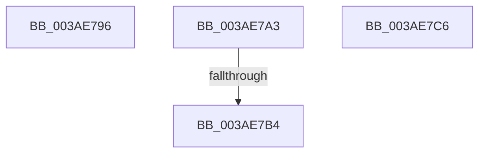

# sub_003AE796

- RVA: `0x003AE796`–`0x003AE7C7` (길이 `49` bytes)
- VA: `0x00000001403AE796`
- 실행 섹션: `.text`
- PDB 이름 있음: `아니요`; PDB Function 태그: `아니요`
- unwind 정보 RVA: `0x0008C024`
- 디코드: `21`개 명령, `49/49` bytes 표시
- 미해석 바이트: `0` (있으면 어셈블리에 `.byte`로 보존)

> 이 문서는 커널 이미지의 기계어와 PDB 기호를 분석해 생성했습니다. 4번과 5번은 함수 원형과 자료형을 바이너리 사용 방식에서 추정한 C 해석이며 원본 소스 복구 결과는 아닙니다.

## 1. Dependencies

- 직접 호출 지점: **1**; 고유 호출 대상: **1**
- 직접 호출자로 확인된 함수: **0**
- RIP 상대 이미지 참조: **0**

### Outgoing calls
- `0x003AE7A7` → [SmArrayGrow](SmArrayGrow_function_003AC6C8.md) (function, `0x003AC6C8`)

### Direct callers
- 이 함수 시작 RVA로 연결되는 직접 call은 확인되지 않았습니다. 간접 호출은 완전히 역산할 수 없습니다.

### Static image references
- 디코드된 RIP-relative 메모리 참조가 없습니다.

## 2. Other-region calls and transfers

- 다른 실행 섹션으로 향하는 call: **0**
- call이 아닌 외부 분기/꼬리 이동: **1**
  - `0x003AE7AE` → [sub_003AE708](Unknown_function_003AE708.md) (`tail-transfer`)

## 3. Assembly (complete function range)

```asm
003AE796  48 83 C4 20                     add rsp, 0x20
003AE79A  41 5F                           pop r15
003AE79C  41 5E                           pop r14
003AE79E  41 5D                           pop r13
003AE7A0  5E                              pop rsi
003AE7A1  5B                              pop rbx
003AE7A2  C3                              ret
003AE7A3  CC                              int3
003AE7A4  4C 8B CE                        mov r9, rsi
003AE7A7  E8 1C DF FF FF                  call 0x1403ac6c8
003AE7AC  85 C0                           test eax, eax
003AE7AE  0F 85 54 FF FF FF               jne 0x1403ae708
003AE7B4  B8 9A 00 00 C0                  mov eax, 0xc000009a
003AE7B9  48 83 C4 20                     add rsp, 0x20
003AE7BD  41 5F                           pop r15
003AE7BF  41 5E                           pop r14
003AE7C1  41 5D                           pop r13
003AE7C3  5E                              pop rsi
003AE7C4  5B                              pop rbx
003AE7C5  C3                              ret
003AE7C6  CC                              int3
```

## 4. C-style interpretation (structured pseudocode)

```c
__int64 __fastcall sub_003AE796(void)
{
    __int64 v_rsp;

    v_rsp = (v_rsp) + (32);
    return result;
}
```

## 5. (Beta) C Style

```c
void sub_003AE796(void)
{
    int64_t local_rsp;

    local_rsp = (local_rsp) + (32);
    return result;
}
```

## 6. Execution-region graph

[열기: 2D/3D 그래프와 함수 탐색 컨트롤 패널](../../../control-panel.html?section=text&rva=0x003AE796&view=graph)

- 2D 그래프는 위에서 아래로 흐르고, 3D 그래프는 빈 공간을 드래그해 회전합니다. Shift+드래그는 이동, 휠은 확대·축소, 함수 노드 선택은 대상 보고서 이동입니다.

### Static fallback


