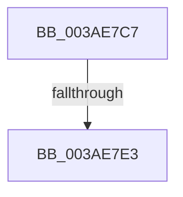

# sub_003AE7C7

- RVA: `0x003AE7C7`–`0x003AE7FC` (길이 `53` bytes)
- VA: `0x00000001403AE7C7`
- 실행 섹션: `.text`
- PDB 이름 있음: `아니요`; PDB Function 태그: `아니요`
- unwind 정보 RVA: `0x0008C03C`
- 디코드: `14`개 명령, `53/53` bytes 표시
- 미해석 바이트: `0` (있으면 어셈블리에 `.byte`로 보존)

> 이 문서는 커널 이미지의 기계어와 PDB 기호를 분석해 생성했습니다. 4번과 5번은 함수 원형과 자료형을 바이너리 사용 방식에서 추정한 C 해석이며 원본 소스 복구 결과는 아닙니다.

## 1. Dependencies

- 직접 호출 지점: **1**; 고유 호출 대상: **1**
- 직접 호출자로 확인된 함수: **0**
- RIP 상대 이미지 참조: **0**

### Outgoing calls
- `0x003AE7D2` → [B_TREE<_SM_PAGE_KEY,ST_STORE<SM_TRAITS>::_ST_PAGE_ENTRY,4096,NP_CONTEXT,B_TREE_KEY_COMPARATOR<_SM_PAGE_KEY> >::BTreeNewNode](B_TREE__SM_PAGE_KEY_ST_STORE_SM_TRAITS__ST_PAGE_ENTRY_4096_NP_CONTEXT_B_TREE_KEY_COMPARATOR__SM_PAGE_function_003AAD60.md) (function, `0x003AAD60`)

### Direct callers
- 이 함수 시작 RVA로 연결되는 직접 call은 확인되지 않았습니다. 간접 호출은 완전히 역산할 수 없습니다.

### Static image references
- 디코드된 RIP-relative 메모리 참조가 없습니다.

## 2. Other-region calls and transfers

- 다른 실행 섹션으로 향하는 call: **0**
- call이 아닌 외부 분기/꼬리 이동: **2**
  - `0x003AE7DD` → [sub_003AE9E5](Unknown_function_003AE9E5.md) (`tail-transfer`)
  - `0x003AE7F7` → [sub_003AE708 + 0x17](Unknown_function_003AE708.md) (`tail-transfer`)

## 3. Assembly (complete function range)

```asm
003AE7C7  BA 01 00 00 00                  mov edx, 1
003AE7CC  49 8B CE                        mov rcx, r14
003AE7CF  44 8B C2                        mov r8d, edx
003AE7D2  E8 89 C5 FF FF                  call 0x1403aad60
003AE7D7  49 89 06                        mov qword ptr [r14], rax
003AE7DA  48 85 C0                        test rax, rax
003AE7DD  0F 84 02 02 00 00               je 0x1403ae9e5
003AE7E3  48 8B 3E                        mov rdi, qword ptr [rsi]
003AE7E6  48 89 07                        mov qword ptr [rdi], rax
003AE7E9  49 8B 06                        mov rax, qword ptr [r14]
003AE7EC  48 83 C0 10                     add rax, 0x10
003AE7F0  48 89 47 08                     mov qword ptr [rdi + 8], rax
003AE7F4  FF 46 18                        inc dword ptr [rsi + 0x18]
003AE7F7  E9 23 FF FF FF                  jmp 0x1403ae71f
```

## 4. C-style interpretation (structured pseudocode)

```c
__int64 __fastcall sub_003AE7C7(void)
{
    __int64 result;

    result = B_TREE__SM_PAGE_KEY_ST_STORE_SM_TRAITS____ST_PAGE_ENTRY_4096_NP_CONTEXT_B_TREE_KEY_COMPARATOR__SM_PA(v_r14, 1, 1, a4);
    *(unsigned __int64 *)(v_r14) = result;
    *(unsigned __int64 *)(*(unsigned __int64 *)(v_rsi)) = result;
    result = (*(unsigned __int64 *)(v_r14)) + (16);
    *(unsigned __int64 *)(*(unsigned __int64 *)(v_rsi) + 8) = result;
}
```

## 5. (Beta) C Style

```c
void sub_003AE7C7(void)
{
    int64_t result;

    result = B_TREE__SM_PAGE_KEY_ST_STORE_SM_TRAITS____ST_PAGE_ENTRY_4096_NP_CONTEXT_B_TREE_KEY_COMPARATOR__SM_PA(local_r14, 1, 1, a4);
    *(uint64_t *)(local_r14) = result;
    *(uint64_t *)(*(uint64_t *)(local_rsi)) = result;
    result = (*(uint64_t *)(local_r14)) + (16);
    *(uint64_t *)(*(uint64_t *)(local_rsi) + 0x8) = result;
}
```

## 6. Execution-region graph

[열기: 2D/3D 그래프와 함수 탐색 컨트롤 패널](../../../control-panel.html?section=text&rva=0x003AE7C7&view=graph)

- 2D 그래프는 위에서 아래로 흐르고, 3D 그래프는 빈 공간을 드래그해 회전합니다. Shift+드래그는 이동, 휠은 확대·축소, 함수 노드 선택은 대상 보고서 이동입니다.

### Static fallback


